# Alive, not lagging — the verb answers first, the world runs after

Story rpg-project#879. Findings ledger: [findings.md](findings.md). Index and
how to add a finding: [README.md](README.md). Rulings R1–R5 are ruled on the
lane issue (#880); R1, R2 and R4 settled 2026-11-07, R3, R6 and R7 2026-11-08. Measured against rpg-toolkit main `3972f948` and the behavior <!-- case-file -->
cutover head `c1cbf623` (toolkit#2293), on the garrison keep. <!-- case-file -->

## Shape

```mermaid
flowchart TD
    subgraph today [a Move today]
        V[the player's verb] --> R[resolve the walk]
        R --> W[raise the clock: wake who is due]
        W --> S[rebuild sight for each woken creature]
        S --> M[step its machines, run its intents]
        M --> P[save the whole record]
        P --> A[answer]
    end
    subgraph target [a Move under this design]
        V2[the player's verb] --> R2[resolve the walk until the world is due]
        R2 --> A2[answer: the player's own steps and view]
        A2 --> W2[continuation, still under the session lock: raise]
        W2 --> F[facts on demand; sight from the cache]
        F --> M2[step machines, run intents, finish the walk]
        M2 --> B[deeds arrive as beats on the stream]
        M2 --> C[writes queued per session: beats, then the checkpoint]
    end
```

## Law

**The verb answers before the world runs.** A verb's answer carries the
player's own resolution and the view it earns; the raise that the verb causes
runs after the answer, under the same session lock, and its deeds arrive as the
beats they already are. The next verb waits for the raise to finish, so the
record stays one deterministic pass in seat order (the-world-runs R2, one
deterministic pass, stands). Mechanically a verb returns an answer and a
continuation: the answer is the steps walked until a pace comes due and the
view they earn; the continuation is the rest of the verb as it runs today,
the raise, the remaining steps, the settlement, the writes and the delivery,
run by the host after the answer. A test host runs the continuation inline;
the server runs it on the session's queue. Because the pace accrues per cell,
the raise may fall mid-path; the continuation keeps that order, so nothing a
creature does moves relative to the player's steps.

**The instance lives where the lock lives, and the lock lives in the
store.** A verb runs under a session lease the store grants; the live
encounter that verb mutates is a resident copy on the process that holds
the lease, kept for as long as the host keeps it. The store is the
authority: a verb compares the store's checkpoint version with the copy's,
reuses the copy on a match and rebuilds it from the checkpoint on a miss,
and saves with a fence on that version so a copy that fell behind fails
closed instead of overwriting. The version is the store's, incremented on
every save; the record's sequence cannot serve, because a verb that
appends no beat leaves it where it was and two such writers would both
pass. A lease may expire while a verb still runs; the fence, not the
lease, is what keeps a late writer out. Residency is a cache, never
ownership; a verb that lands on another process costs one rebuild and
loses nothing.
Routing a guild's verbs and streams to one process raises the hit rate and
is never needed for correctness. The repository contract permits this
already: an encounter held in memory on a live server and checkpointed
periodically is invisible from the session's side.

**The save is one fenced transaction of the pieces that changed.** The
checkpoint is stored by shape (#770's shapes: site, roster, clocks,
knowledge, log), a verb writes only the pieces it touched, and it writes
them together with the version fence in one transaction, so a process that
dies mid-save leaves the store whole. A load fetches every piece in one
pipelined read and assembles the instance in memory; the site piece is
skipped when its hash is already resident.

**A listener hears a beat when its commit is saved, and the continuation
commits at each pace boundary.** Delivery waits for the save, so nothing a
listener hears can be lost and nothing in the record is ever ahead of its
checkpoint; no load replays. The continuation does not wait for the verb's
end to save: when a pace comes due, the raise's beats and the checkpoint
delta land together in one small fenced transaction and are delivered at
once, and the remaining steps follow in the next commit. A process that
dies mid-continuation leaves the player at the last committed boundary,
which is what every client was told. The first beat is therefore the
answer plus one raise plus one small save, never the end of the verb.

**A machine step costs no perception.** A machine reads the facts the
encounter supplies; a step never rebuilds sight. The composer is a cost only
when the profile says so.

**Sight is a function, not a recomputation.** What a cell sees is a function
of the site, the doors and the props; members never block sight. The wake
reads a cached value and invalidates it when a door or a prop changes, never
when a member moves.

**A cached value lives where its inputs live.** What depends only on the
compiled site is site data, shared by every game on that site version. What
changes with the game, an observer's concealment knowledge, is the
instance's. A value that changes with an instance cannot live above it.

**A fact is computed when a guard asks.** A guard that asks whether an enemy
is in sight gets a lane query; it does not pay for the cells the observer
learns.

**An effect subscribes by holder.** A tracker attached for one holder is
reached by that holder's events, never by every event in the world.

**The site is content the record references.** The field, its props and
geometry are loaded by content hash and shared by every encounter of the
site; a save never carries them (the first shape of #770).

**A claim carries its measurement.** Every number in this story names the
head it was taken on, the command that produced it and the keep it ran on,
in the findings ledger; a number without those three is an opinion.

## Where the instance lives

Three tiers, each where its inputs live.

| tier | holds | keyed by | shared by | invalidated by |
|---|---|---|---|---|
| site | the compiled site: field, partitions, the authored site's answer to what a cell sees | the content hash of the authored site | every game on that version | a new version of the content, nothing else |
| instance | one live encounter per game: members, clocks, journal, knowledge, the sight entries for door states that differ from the authored site; a cache of the store, validated by the checkpoint version | encounter id, at a checkpoint version | the verbs of one game that land on this process, in lease order | a version mismatch, eviction by the host, or the game ending; rebuilt from the checkpoint |
| writes | the verb's writes, leaving the answer's path: the beats first, then the pieces of the checkpoint that changed, in one fenced transaction | session | nothing; one queue per session, in order | drained at shutdown |

The site tier is `encounter`'s to split out of the build; what of a built
keep is site and what is instance is a measurement this story owes before
the tier is built (F8 weighs the whole build; F1 weighs the site's share of
the record). The instance tier is the session SDK's, as a host-injected
residency beside the locker with an in-process default, so a test host and
a one-process server need nothing and a shared lock brings a shared
residency with it. The write tier is the host's queue; what a checkpoint
writes is #770's. Between the answer and the first write a verb exists
only in the process; the beats-first write bounds that window to one
append.

The site tier is built before the instance tier: a cheap miss is what lets
routing stay an optimisation, and the site is the expensive part of a miss.

### What moves a copy

Nothing migrates and nothing syncs; a copy is validated or rebuilt.

| event | what happens |
|---|---|
| a verb lands on a process without the copy | the lease is taken, the pieces are fetched, the instance is assembled; the site is reused when its hash is resident |
| a verb lands where a copy is stale | the version check misses, the copy is dropped and rebuilt |
| a stale copy tries to save | the fence refuses, the copy is dropped, the verb fails closed and the client retries |
| the process drains for a deploy | continuations finish within the drain window, dirty pieces are written, the process exits; the next process rebuilds on first verb |
| the process dies | the verb in flight fails closed, the lease expires, the next verb rebuilds from the checkpoint; a continuation that did not finish wrote nothing, and the world is still due on the next verb |
| memory pressure | the host evicts copies least recently used; the site tier stays, one per distinct site per process |
| the store is unreachable | every verb fails closed, as today |

### The owner shape, deferred

A process that owns a session outright, with a handoff when routing moves
it and a recovery when the process dies, is a game server and a design of
its own; it is deferred, not refused. What reopens it: one guild's games
outgrowing one process, or verb rates at which the lease round trip itself
shows in the answer. Until either is measured, the copy is a cache.

## Rulings

| ID | status | scope | ruled by | date |
|---|---|---|---|---|
| R1 the budget: the verb answers within 100 ms at the garrison keep, the first beat within 250 ms after | settled | §Law, the verb | KirkDiggler | 2026-11-07 |
| R2 the verb answers first, the raise runs after under the session lock; the first slice | settled | §Shape | KirkDiggler | 2026-11-07 |
| R3 where the instance lives: three tiers, the compiled site by content hash shared across games, the live instance resident where the session's lock lives, the writes queued per session after the answer | settled | §Where the instance lives | KirkDiggler | 2026-11-08 |
| R4 a cached value lives where its inputs live: what a cell sees given doors and props is compiled site data, the concealment layer is the instance's | settled | §Law, sight and facts | KirkDiggler | 2026-11-07 |
| R5 the harness is the record: phases, blob, allocations, answer and first beat | open | §Law, the claim | | |
| R6 the resident copy is a cache behind the store's lease, the store is the authority, the save is one transaction of the pieces that changed, fenced on a checkpoint version the store increments; the owner shape is deferred with its reopen conditions; the site tier is built before the instance tier | settled | §Law, the lock; §Where the instance lives | KirkDiggler | 2026-11-08 |
| R7 a listener hears a beat when its commit is saved; the continuation commits at each pace boundary, so the first beat is the answer plus one raise plus one small save; the record as the source of truth with a replayed tail is a story of its own, not refused | settled | §Law, the listener | KirkDiggler | 2026-11-08 |

## Open

- **The second verb while the world runs.** It waits on the lock, as today;
  how the client shows the wait, and whether a read verb may answer from the
  pre-raise view, is a session question.
- **The record as the game.** Beats written and delivered as they are
  produced, the checkpoint an optimisation, a tail ahead of it replayed on
  load: replay, spectate from the start, rewind for the GM. Every beat
  would need an apply and the fold a determinism contract. The appended
  record is its prerequisite and nothing here forecloses it; it is a story
  of its own.
- **The grain of the knowledge piece.** A walk changes the mover's cell and
  every observer's sight, so the knowledge piece is the largest a Move
  writes; whether it splits per observer, and what that saves, is measured
  before the fenced save is built.
- **The cost of a miss.** A cold rebuild by stage (fetch, decode, site build,
  sheets attach, seams) is measured before the instance tier is built; it is
  the number the cache bet rests on.
- **The site's share of the build.** How much of a resident keep is site and
  how much is instance decides what the site tier saves per game; measured
  before that tier is built.
- **What a checkpoint writes.** Which shapes a pass touched, and whether the
  checkpoint is one record or #770's shapes, is settled with #770.
- **Invalidation at the edge.** A door opening or a prop moving changes the
  blockers in many lanes at once; the sweep that invalidates for a mover may
  not be the right key for a blocker.
- **The behavior head's double refresh.** Whether the extra sight rebuild per
  creature opportunity on toolkit#2293 is a consequence of the design or a
  defect in the cutover is #2293's to answer; the law above says a step
  costs no perception either way.
