# Alive, not lagging — the verb answers first, the world runs after

Story rpg-project#879. Findings ledger: [findings.md](findings.md). Index and
how to add a finding: [README.md](README.md). Rulings R1–R5 are ruled on the
lane issue (#880); R1, R2 and R4 settled 2026-11-07. Measured against rpg-toolkit main `3972f948` and the behavior <!-- case-file -->
cutover head `c1cbf623` (toolkit#2293), on the garrison keep. <!-- case-file -->

## Shape

```mermaid
flowchart TD
    subgraph today [a Move today]
        V[the player's verb] --> R[resolve the walk]
        R --> W[raise the clock: wake who is due]
        W --> S[rebuild sight for each woken creature]
        S --> M[step its machines, run its intents]
        M --> P[save the whole record]
        P --> A[answer]
    end
    subgraph target [a Move under this design]
        V2[the player's verb] --> R2[resolve the walk until the world is due]
        R2 --> A2[answer: the player's own steps and view]
        A2 --> W2[continuation, still under the session lock: raise]
        W2 --> F[facts on demand; sight from the cache]
        F --> M2[step machines, run intents, finish the walk]
        M2 --> B[deeds arrive as beats on the stream]
        M2 --> C[writes queued per session: beats, then the checkpoint]
    end
```

## Law

**The verb answers before the world runs.** A verb's answer carries the
player's own resolution and the view it earns; the raise that the verb causes
runs after the answer, under the same session lock, and its deeds arrive as the
beats they already are. The next verb waits for the raise to finish, so the
record stays one deterministic pass in seat order (the-world-runs R2, one
deterministic pass, stands). Mechanically a verb returns an answer and a
continuation: the answer is the steps walked until a pace comes due and the
view they earn; the continuation is the rest of the verb as it runs today,
the raise, the remaining steps, the settlement, the writes and the delivery,
run by the host after the answer. A test host runs the continuation inline;
the server runs it on the session's queue. Because the pace accrues per cell,
the raise may fall mid-path; the continuation keeps that order, so nothing a
creature does moves relative to the player's steps.

**The instance lives where the lock lives.** A verb runs under a session lock
the host owns; the live encounter that verb mutates is resident in the same
place, for the same span of ownership. The lock and the instance scale
together: while the lock is process-local, so is the instance; when the lock
is shared across processes, its owner hosts the instance and a verb arriving
elsewhere is forwarded or rebuilds from the checkpoint. The repository
contract permits this already: an encounter held in memory on a live server
and checkpointed periodically is invisible from the session's side.

**A machine step costs no perception.** A machine reads the facts the
encounter supplies; a step never rebuilds sight. The composer is a cost only
when the profile says so.

**Sight is a function, not a recomputation.** What a cell sees is a function
of the site, the doors and the props; members never block sight. The wake
reads a cached value and invalidates it when a door or a prop changes, never
when a member moves.

**A cached value lives where its inputs live.** What depends only on the
compiled site is site data, shared by every game on that site version. What
changes with the game, an observer's concealment knowledge, is the
instance's. A value that changes with an instance cannot live above it.

**A fact is computed when a guard asks.** A guard that asks whether an enemy
is in sight gets a lane query; it does not pay for the cells the observer
learns.

**An effect subscribes by holder.** A tracker attached for one holder is
reached by that holder's events, never by every event in the world.

**The site is content the record references.** The field, its props and
geometry are loaded by content hash and shared by every encounter of the
site; a save never carries them (the first shape of #770).

**A claim carries its measurement.** Every number in this story names the
head it was taken on, the command that produced it and the keep it ran on,
in the findings ledger; a number without those three is an opinion.

## Where the instance lives

Three tiers, each where its inputs live.

| tier | holds | keyed by | shared by | invalidated by |
|---|---|---|---|---|
| site | the compiled site: field, partitions, the authored site's answer to what a cell sees | the content hash of the authored site | every game on that version | a new version of the content, nothing else |
| instance | one live encounter per game: members, clocks, journal, knowledge, the sight entries for door states that differ from the authored site | encounter id | the verbs of one game, in lock order | the game ending, or eviction by the host; rebuilt from the checkpoint |
| writes | the verb's writes, leaving the answer's path: the beats first, then the checkpoint of the shapes that changed | session | nothing; one queue per session, in order | drained at shutdown |

The site tier is `encounter`'s to split out of the build; what of a built
keep is site and what is instance is a measurement this story owes before
the tier is built (F8 weighs the whole build; F1 weighs the site's share of
the record). The instance tier is the session SDK's, as a host-injected
residency beside the locker with an in-process default, so a test host and
a one-process server need nothing and a shared lock brings a shared
residency with it. The write tier is the host's queue; what a checkpoint
writes is #770's. Between the answer and the first write a verb exists
only in the process; the beats-first write bounds that window to one
append.

## Rulings

| ID | status | scope | ruled by | date |
|---|---|---|---|---|
| R1 the budget: the verb answers within 100 ms at the garrison keep, the first beat within 250 ms after | settled | §Law, the verb | KirkDiggler | 2026-11-07 |
| R2 the verb answers first, the raise runs after under the session lock; the first slice | settled | §Shape | KirkDiggler | 2026-11-07 |
| R3 where the instance lives: three tiers, the compiled site by content hash shared across games, the live instance resident where the session's lock lives, the writes queued per session after the answer | proposed | §Where the instance lives | | |
| R4 a cached value lives where its inputs live: what a cell sees given doors and props is compiled site data, the concealment layer is the instance's | settled | §Law, sight and facts | KirkDiggler | 2026-11-07 |
| R5 the harness is the record: phases, blob, allocations, answer and first beat | open | §Law, the claim | | |

## Open

- **The second verb while the world runs.** It waits on the lock, as today;
  how the client shows the wait, and whether a read verb may answer from the
  pre-raise view, is a session question.
- **The durability window.** A verb answered and not yet written is lost if
  the process dies; whether the beats-first write closes it before the answer
  or just after is settled with the write tier.
- **The site's share of the build.** How much of a resident keep is site and
  how much is instance decides what the site tier saves per game; measured
  before that tier is built.
- **What a checkpoint writes.** Which shapes a pass touched, and whether the
  checkpoint is one record or #770's shapes, is settled with #770.
- **Invalidation at the edge.** A door opening or a prop moving changes the
  blockers in many lanes at once; the sweep that invalidates for a mover may
  not be the right key for a blocker.
- **The behavior head's double refresh.** Whether the extra sight rebuild per
  creature opportunity on toolkit#2293 is a consequence of the design or a
  defect in the cutover is #2293's to answer; the law above says a step
  costs no perception either way.
