# Alive, not lagging — the verb answers first, the world runs after

Story rpg-project#879. Findings ledger: [findings.md](findings.md). Index and
how to add a finding: [README.md](README.md). Rulings R1–R5 are ruled on the
lane issue (#880). Measured against rpg-toolkit main `3972f948` and the behavior <!-- case-file -->
cutover head `c1cbf623` (toolkit#2293), on the garrison keep. <!-- case-file -->

## Shape

```mermaid
flowchart TD
    subgraph today [a Move today]
        V[the player's verb] --> R[resolve the walk]
        R --> W[raise the clock: wake who is due]
        W --> S[rebuild sight for each woken creature]
        S --> M[step its machines, run its intents]
        M --> P[save the whole record]
        P --> A[answer]
    end
    subgraph target [a Move under this design]
        V2[the player's verb] --> R2[resolve the walk]
        R2 --> A2[answer: the player's result and view]
        A2 --> W2[raise under the session lock]
        W2 --> F[facts on demand; sight from the cache]
        F --> M2[step machines, run intents]
        M2 --> B[deeds arrive as beats on the stream]
        M2 --> C[checkpoint the shapes that changed]
    end
```

## Law

**The verb answers before the world runs.** A verb's answer carries the
player's own resolution and the view it earns; the raise that the verb causes
runs after the answer, under the same session lock, and its deeds arrive as the
beats they already are. The next verb waits for the raise to finish, so the
record stays one deterministic pass in seat order (the-world-runs R2 stands).

**A machine step costs no perception.** A machine reads the facts the
encounter supplies; a step never rebuilds sight. The composer is a cost only
when the profile says so.

**Sight is a function, not a recomputation.** What an observer sees is a
function of its cell, its facing and the blockers in its lanes. The wake reads
a cached value and invalidates it only when a mover enters the observer's
sweep.

**A fact is computed when a guard asks.** A guard that asks whether an enemy
is in sight gets a lane query; it does not pay for the cells the observer
learns.

**An effect subscribes by holder.** A tracker attached for one holder is
reached by that holder's events, never by every event in the world.

**The site is content the record references.** The field, its props and
geometry are loaded by content hash and shared by every encounter of the
site; a save never carries them (the first shape of #770).

**A claim carries its measurement.** Every number in this story names the
head it was taken on, the command that produced it and the keep it ran on,
in the findings ledger; a number without those three is an opinion.

## Rulings

| ID | status | scope | ruled by | date |
|---|---|---|---|---|
| R1 the budget: the verb answers within 100 ms at the garrison keep, the first beat within 250 ms after | open | §Law, the verb | | |
| R2 the verb answers first, the raise runs after under the session lock | open | §Shape | | |
| R3 one in-memory encounter per session, checkpointed after each pass | open | §Shape, the checkpoint | | |
| R4 sight cached per observer, facts on demand first | open | §Law, sight and facts | | |
| R5 the harness is the record: phases, blob, allocations, answer and first beat | open | §Law, the claim | | |

## Open

- **The lock and the second verb.** When a verb arrives while the raise is
  running, it waits; how the client shows the wait, and whether a read verb
  may answer from the pre-raise view, is a session question.
- **What a checkpoint writes.** Which shapes a pass touched, and whether the
  checkpoint is one record or #770's shapes, is settled with #770.
- **Invalidation at the edge.** A door opening or a prop moving changes the
  blockers in many lanes at once; the sweep that invalidates for a mover may
  not be the right key for a blocker.
- **The behavior head's double refresh.** Whether the extra sight rebuild per
  creature opportunity on toolkit#2293 is a consequence of the design or a
  defect in the cutover is #2293's to answer; the law above says a step
  costs no perception either way.
