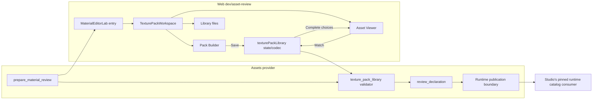

# Shared texture packs: the seam walkthrough

[Assets #226](https://github.com/KirkDiggler/rpg-game-assets/issues/226) owns authoring and ingestion. [Library law](library-design.md) governs reusable choices alongside the [source/recipe law](design.md) and [direct-editor agreement](editor-amendment.md). [Web #1268](https://github.com/KirkDiggler/rpg-dnd5e-web/issues/1268) owns the Studio consumer. A saved pack declares complete looks and available membership; it does not introduce another model conversion engine or approval authority.

## Component shape

## Ownership and contracts

| Component | Owns | Input → output |
|---|---|---|
| `prepare_material_review` | Source/image custody and slot-addressable preview preparation | Source audit/profile → `MaterialEditorManifest` schema3 |
| `MaterialEditorLab` / `TexturePackWorkspace` | View routing and shared library/draft persistence | Manifest3 + saved library1 → separate Builder, Viewer and Library files views |
| `TexturePackBuilder` | Named pack draft, explicit color selection and optional shared maps | Inventory + draft → complete set definitions on Save pack |
| `TexturePackAssetViewer` | Selected asset/surface/pack/choice and temporary preview profile | Library1 + manifest3 → profile2 scene preview and explicit match/unmatch actions |
| `MaterialEditorWorkbench` | Advanced independent channel/batch experiments | `EditingProfile` schema2 + selected actual slot → per-slot scene materials |
| Web `texturePackLibrary` | Immutable library state and strict codec | Library schema1 + manifest3 → validated pack sets and allowed memberships |
| Assets `texture_pack_library` | Independent source-bound validation and review custody expansion | Exact library file bytes + manifest3 → review-only declaration |
| Runtime publication boundary | Released model/resource identities and compatibility | Reviewed authoring choices + verified promoted models → released supported-choice catalog |
| Studio consumer | Per-placement choice and instance-owned rendering | Pinned released metadata + chosen references → saved and rendered appearance |

The workbench does not turn a visually acceptable trial into declared or released support. The library codec does not infer slot compatibility from source names. The provider validator does not publish preview targets as promoted-model selectors. Studio does not repair missing metadata by maintaining its own texture catalog. These refusals enforce R3–R5.

## Walk one choice through

The operator checks the actual `PolygonFantasyKingdom_Texture_01_A.png` inventory row. `TexturePackBuilder` creates a set labeled `01_A` inside a named Kingdom pack on **Save pack**, then opens Asset Viewer. The set keeps the source-relative image identity, complete optional-channel settings and wrap; its display label does not become a filename detector.

The operator checks the actual Fancy Chair01 and Chair02 slots. Their `TexturePackLibrary.assignments` rows contain the same pack ID, not two copies of its twelve sets. Adding membership does not touch the current `EditingProfile` or the promoted models (R1, R6).

Selecting a pack/choice in `TexturePackAssetViewer` applies one complete `EditingProfileDefinition` to a temporary slot profile; the selected surface previews it, but the saved set and memberships do not change. The match checkbox updates only that surface's allowed pack references. Camera fitting changes projection rather than source geometry. Exported library JSON travels to the Python validator. `review_declaration` adds the exact library-byte SHA, registered image hashes and prepared source/editor identities. It does not add an `assetRef` or claim a runtime material binding. The released-selector/resource contract is R7, not a rule a renderer may guess.

## Separations that look like one thing

| Query | Source of truth |
|---|---|
| What is currently on the experimental surface? | Slot profile/workbench state |
| What complete choices does this pack contain? | Library `packs[id].sets` |
| Which packs are explicitly allowed on this source slot? | Library `assignments` |
| Which source/editor bytes were inspected? | Generated review declaration |
| What is available on a released game model? | Verified released provider metadata |
| What does a placement without a choice display? | Original promoted GLB |

Conflating membership with preview changes defaults when an operator merely organizes assets. Conflating the preview target with a runtime selector recolors a different material or no material at all. Conflating an image filename with support makes unreviewed artistic combinations appear compatible.

## Trade-offs

| Decision | Benefit | Cost / boundary | Not taken |
|---|---|---|---|
| Complete sets reuse the editing-definition channel semantics | Independent maps and one renderer recipe meaning | Codec mirrors those values across Python/TypeScript | Filename-paired color/normal inference |
| Pack membership references actual slots | Different wall/floor choices and safe bulk scope | Operator inspects multi-material target lists | Apply to every material by model name |
| Separate library authority from transient slot trials | Saved packs survive further experiments | UI names save/preview/assign as different verbs | Per-asset copies of every look |
| Review-only declaration binds exact library bytes | Reproducible source custody without a second JSON number canonicalizer | Provider keeps the exported file; declaration remains private | User-maintained hashes/trust flags |
| Separate pack/image selection and asset preview views | One task and broad usable space per view | Builder owns thumbnails; Viewer loads only the selected complete look | Three narrow columns carrying every workflow |

## Edges

This is static PBR set authoring, not Blender shader-node import, automatic compatibility detection, visual approval or runtime release. Normal/emissive absence is explicit off, while a present emissive channel may be solid emission. Source-bound metadata is private. Runtime resource policy, exact promoted-slot verification and consumer pins remain open under R7.

## Where a change lands

A new library editing action lands in Web `texturePackLibrary` and the owning Builder/Viewer/File view, with mirrored codec validation only if the wire changes. A new source/image custody check lands in Assets `texture_pack_library` or preparation, not Studio. A new released placement Look control lands in Studio once the publication owner supplies the released contract.

## Source map

| Concern | Owning path |
|---|---|
| Entry / advanced workbench / shared preview | Web `src/dev/asset-review/MaterialEditorLab.tsx`, `MaterialEditorWorkbench.tsx`, `MaterialEditorScene.tsx`, `materialEditorVisuals.ts` |
| Pack/library views and pure state | Web `src/dev/asset-review/TexturePackWorkspace.tsx`, `TexturePackBuilder.tsx`, `TexturePackAssetViewer.tsx`, `texturePackLibrary.ts` |
| Camera-only model framing | Web `src/dev/asset-review/materialEditorFraming.ts` |
| Definition semantics | Web `materialRecipe.ts`; Assets `scripts/synty_material_recipe.py` |
| Source-bound library validation/declaration | Assets `scripts/texture_pack_library.py` |
| Operator workflow | Assets `docs/human/asset-ingestion/texture-pack-library.md` |
