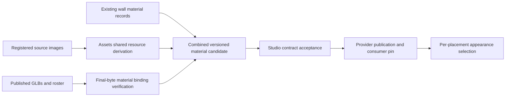

# Shared prop atlas resources and bindings

## Shape

A collection suggests reusable map choices. A binding describes the actual
editable material scope on an exact model. The two do not grant each other's
claims.

## Law

- The provider derives shared images once and verifies bindings against exact
  promoted GLB bytes. Display names and source/editor selectors do not grant
  runtime compatibility.
- An atlas choice uses authored UVs and sampling. It does not imply planar wall
  fitting, physical repeat mapping, geometry normalization or a normal texture.
- Color-only choices explicitly have no normal or emissive map. Applying a choice
  preserves non-texture material properties; no selection restores the complete
  original appearance.
- Collection membership is a recommendation, not an exhaustive allow-list for
  Studio experimentation. Technical target/resource validity remains mandatory.
- Bulk preparation selects an explicit provider roster and records actual target
  identities. Ambiguous, changed or unsupported targets refuse rather than being
  silently skipped or broadened to the whole model.
- Existing model bytes, UVs, default appearances, wall resources and approved
  wall mapping remain unchanged by atlas preparation.
- The shared material catalog has one publication authority. Candidate evolution
  retains existing wall records instead of creating a second live prop catalog.
- A new catalog version remains staged until consumer and publication contracts
  accept it. An older reader refuses the new version; it never silently drops
  atlas records or misrepresents them as masonry.
- The provider owns source/resource custody and verified target facts. Studio owns
  user controls, placement state and history; admin curation and publication
  permissions require a separate agreement.
- Licensed resources and private verification evidence remain in the private
  provider or ignored staging paths.

## Rulings

| ID | status | scope | ruled by | date |
|---|---|---|---|---|
| A1 | settled | Shared atlas collection and bulk-generated binding/recommendation map for existing props | KirkDiggler | 2026-10-15 |
| A2 | settled | Preserve GLBs/defaults; authored UVs instead of masonry mapping; optional channels remain absent unless explicitly selected | KirkDiggler | 2026-10-15 |
| A3 | settled | Recommendations replace mandatory per-prop artistic admission; technical checks remain | KirkDiggler | 2026-10-15 |
| A4 | settled | Provider preparation here; Studio implementation belongs to its team | KirkDiggler | 2026-10-15 |
| A5 | open | Exact combined catalog wire version, generalized reader/publication and released consumer pin | — | — |
| A6 | open | Admin-authored recommendations, permissions and publication lifecycle | — | — |

## Open

- **Wire acceptance (A5):** The proposed versioned candidate uses authored-UV
  material rows, collections and model-hash-bound material surfaces. Final field
  names and the reader/publication migration require consumer agreement.
- **Optional atlas channels (A2/A5):** Separate normal/emissive presets need explicit
  image-layout and renderer-basis evidence; color-only preparation does not
  establish those combinations.
- **Saved appearance identity (A5):** Studio coordinates stable choices and
  unresolved selections through save/reload and gameplay without treating the
  candidate's presence as a delivered integration.
- **Admin authority (A6):** Shared recommendations need an owner and publication
  lifecycle before a Studio admin can change the common library.
