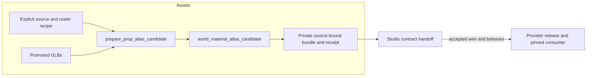

# From shared atlas to actual prop surface

[Design](atlas-provider-design.md) · [provider work](https://github.com/KirkDiggler/rpg-game-assets/issues/319) · [Studio handoff](https://github.com/KirkDiggler/rpg-dnd5e-web/issues/1268).

This prepares one shared material candidate from registered source images and
exact published models. It reuses image identity/derivation and preserves the
wall catalog rather than introducing a live prop-only texture catalog (A1/A7).

## Component shape

## Ownership and contracts

| Component | Owns | Input → output |
|---|---|---|
| Provider recipe | Source member choices and selected roster | registered IDs, category/count → explicit preparation inputs |
| Shared image helpers | Immutable derived resource identity | verified source bytes and runtime policy → PNG facts/bytes |
| `inspect_target` | Final-byte scope and UV/sampler facts | exact published GLB and derived baseline image hash → one bound surface plus proof |
| Candidate validator | Schema2 data integrity | wall records, authored-UV choices, collections and bindings → validated review catalog |
| Source-bound bundle | Reproducible preparation evidence | candidate/resource/model facts → catalog plus private receipt |
| Studio owner | Consumer acceptance and placement lifecycle | agreed released records → selectable/saved appearance |

The recipe does not encode manual per-prop permission ticks. The target inspector
does not infer compatibility from a name or replace an unverified target. The
candidate validator does not approve artistic combinations. The bundle does not
publish itself or change the installed provider. Studio does not reconstruct
source provenance or copy a private editor identity into a saved runtime target.

## Walk one thing through

A registered `01_A` color source becomes one role-correct runtime image. Its hash
can match a prop's exact embedded default image; this is a measured relationship,
not a guess based on `SyntyAtlas`. The inspector verifies the model hash, actual
mesh/material scope and its UV/sampling data. The resulting binding references a
shared atlas collection whose alternatives are defined once (A1/A2).

Studio can present a suggested `04_C` choice for that surface. Its future adapter
replaces the selected instance's map, keeping geometry/UVs and unrelated material
properties. No selected choice means the original material, not a synthesized
reset recipe. The precise saved selection wire remains A5.

## Separations that look like one thing

| Query | Source of truth |
|---|---|
| Which actual geometry/material can be targeted? | Final GLB and hash-bound binding |
| Which color maps are suggested? | Collection recommendation |
| Which pixels are loaded? | Content-addressed image records |
| Which appearance does this placement use? | Studio's placement state |
| Is this candidate a released contract? | Accepted provider publication and consumer pin |

Collapsing recommendations into technical validity blocks useful experimentation.
Collapsing technical validity into recommendations permits stale targets to
silently recolor the wrong material. Neither is acceptable (A3).

## Trade-offs and edges

| Decision | Benefit | Cost / boundary | Not taken |
|---|---|---|---|
| Shared maps with bindings | No model variants or per-model alternate images | Consumer needs an authored-UV adapter | One GLB per look |
| Conservative initial target profile | Bulk evidence is reproducible | Complex targets need their own scope verifier | Guessing merged/multi-material scope |
| Staged versioned catalog | Existing wall consumers remain intact | Reader/adapter and publication checks implement and accept schema2 before release | Replacing v1 with unreadable data |
| Color-only atlas choices (A8) | No invented normal pairing or optional-channel delivery blocker | Future optional channels need separate proof | Adding a fake normal to satisfy wall schema |

The candidate does not prove that every color produces a visible change on every
prop. Some UV regions sample identical pixels across alternatives. It does not
enroll buildings, door surrounds, moving parts or wall mapping merely because an
asset uses a familiar image.

## Where a change lands

Adding a registered color changes the provider recipe and resources. A different
actual material/UV scope changes the provider verifier and binding contract. A
new Studio picker or history behavior belongs to Studio, not a new source-image
catalog. Admin publication belongs to A6.

## Source map

| Concern | Path |
|---|---|
| Shared immutable image verification | Assets `scripts/world_material_catalog.py` |
| Candidate wire checks | Assets `scripts/world_material_atlas_candidate.py` |
| Source/roster preparation and final-byte proof | Assets `scripts/prepare_prop_atlas_candidate.py` |
| Kingdom input recipe | Assets `scripts/configs/world-materials/kingdom-prop-atlases.json` |
| Existing production wall publication | Assets `scripts/publish_world_materials.py` |
| Existing strict consumer boundary | Web `scripts/world-material-catalog.mjs` |
