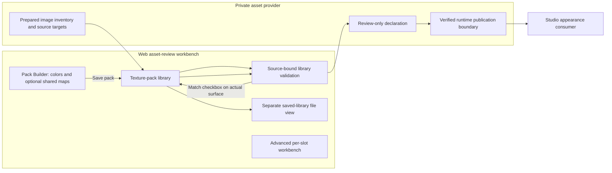

# Shared texture-pack authoring

## Shape

A set is one complete color-map look with optional normal/emissive channels. A pack names a collection of sets. An assignment records an editor match on an actual source material slot, not a runtime permission gate. Experiment, recommendations, technical targeting and released availability answer different questions. The [atlas provider design](atlas-provider-design.md) and [walkthrough](atlas-provider-walkthrough.md) govern bulk preparation for authored-UV props.

## Law

- Pack building and asset viewing occupy separate views. Pack Builder starts the workflow: select color images, optionally select shared normal/emissive images, then save the named pack.
- Asset Viewer selects a saved pack and choice for immediate preview; its match checkbox records support on the visibly selected actual surface. Library-file operations and advanced material/batch experiments stay outside both primary views.
- The texture-pack library owns named complete sets and explicit editor match membership. The experimental slot profile owns the currently applied workbench recipe; neither document infers the other's choices. Studio recommendations do not require every asset to pass through this editor.
- A set owns a color image and explicit normal/emissive absence or settings, including channel strengths, emission color and repeat/clamp sampling. Images remain independent artistic choices.
- The library defines each set once. Assignments reference pack identities rather than copying sets into every asset or GLB.
- Actual source objects and rendered material slots define assignment targets. Asset-level bulk actions expose their complete material-slot scope before application.
- Assignment, import and rename do not apply a choice or change original/default appearance. Explicit preview changes only the selected workbench surface.
- Multiple allowed packs may be declared on a slot. Removing one membership leaves other packs and sibling slots intact; removing a pack explicitly removes its memberships.
- Stable pack/set identities are separate from display labels. Editing the workbench cannot silently mutate a saved set; updating a set is explicit.
- Library import validates the source pack/version, complete channel values, inventory membership and current target membership before replacing state. Invalid or incompatible drafts remain preserved and show a technical error.
- Browser autosave is a convenience. Library JSON export is the durable authoring document; it contains no approval flags or hand-maintained hashes.
- A generated review declaration binds exact UTF-8 library bytes, source/editor hashes, image identities and prepared editor targets. It is explicitly review-only and remains private.
- Runtime publication verifies selectors against exact promoted model bytes and publishes provider-owned shared resources. Editor selectors are not runtime selectors.
- A placement without an explicit look keeps the original promoted appearance. Studio consumes verified resources and actual bindings, not source-folder or filename compatibility heuristics. Suggested collections are not an exhaustive allow-list; missing recommendations do not bar technically valid experimentation.
- Licensed images, models and source-bound evidence remain private. Source quality, geometry, UVs, slot face assignments, prior approvals and active caches are preserved.

## Rulings

| ID | status | scope | ruled by | date |
|---|---|---|---|---|
| R1 | settled | Reusable sets, named packs and explicit bulk assignment replace per-asset single-look authoring as the shared-choice model | KirkDiggler | 2026-10-14 |
| R2 | settled | Independent color/normal/emissive artistic trials remain unrestricted | KirkDiggler | 2026-10-14 |
| R3 | settled | Actual slot targeting, complete scope visibility and preservation of unrelated materials | KirkDiggler | 2026-10-14 |
| R4 | superseded | Separate experimental preview, supported-pack declarations and verified release availability; runtime recommendations are governed by R9 | KirkDiggler | 2026-10-14 |
| R5 | settled | Provider-owned shared resources and supported-choice metadata; Studio implementation belongs to its owning team | KirkDiggler | 2026-10-14 |
| R6 | settled | Original/default appearance and existing source/cache/review custody remain preserved | KirkDiggler | 2026-10-14 |
| R7 | open | Exact released catalog/resource/selector contract and pinned consumer integration | — | — |
| R8 | settled | Pack-first separate views, optional shared maps, saved-pack preview and explicit match checkbox | KirkDiggler | 2026-10-14 |
| R9 | settled | Bulk resource/binding preparation and Studio experimentation; recommendations rather than mandatory per-prop admission, with technical validity preserved | KirkDiggler | 2026-10-15 |

## Open

- **Runtime binding contract (R7):** Which verified promoted-GLB selectors expose source-slot scope, and how does publication refuse a source-slot assignment when normalization merged that scope?
- **Shared runtime resource derivation (R7):** Which provider-owned texture policy and receipt binds released shared image bytes without replacing source-quality authoring inputs?
- **Released consumer identity (R7):** Which released catalog identifiers and pin does Studio consume and persist per placement?
