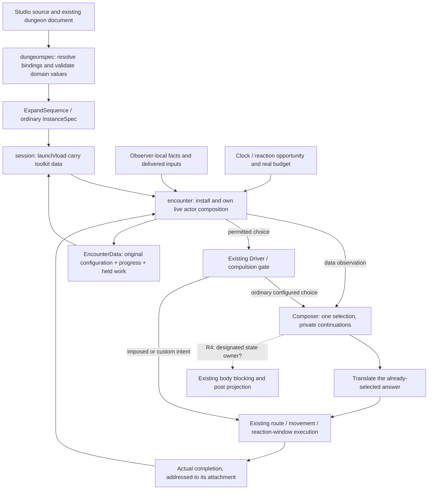

# Live behavior consumer — proposed contract

## Shape

This is the live-consumer proposal for [story #859](https://github.com/KirkDiggler/rpg-project/issues/859)
and [S1 adoption #866](https://github.com/KirkDiggler/rpg-project/issues/866).
[Walkthrough](consumer.md); [conditional implementation plan](plan-consumer.md);
[R4 case file](https://github.com/KirkDiggler/rpg-project/pull/877).
It inherits [R1–R3](design.md). R4 is open: the proposal is not authorization to
change creature-state ownership before that decision.

## Law

The accepted R1–R3 boundaries continue to hold. The following consumer invariants
are the proposed implementation contract, conditional on R4:

- Source references and authored values survive studio load/edit/save. The
  compiler resolves them once into immutable runtime configuration.
- The encounter owns lawful observation projection, opportunity/budget checks,
  action execution and completion detection. API/session code stores and carries
  toolkit values; it does not choose behavior or interpret geometry.
- One opportunity produces at most one selected answer per selection call. The
  answer is translated and executed without a second weighted pick.
- A turn ending does not imply an authored waypoint was reached. Exact-cell work
  completes only when its selected target is actually satisfied and the actor is
  not still suspended in a reaction window.
- No-budget holds, partial movement and blocked movement do not consume a pending
  Patrol leg. The example retries its pending authored waypoint; it does not
  silently migrate legacy position-derived patrol or dwell semantics.
- A held action carries its behavior attachment, selected key, completion mapping
  and target through the existing pause/save/resume path. Resume does not select
  again. Corrupt or mismatched non-null completion claims are refused.
- Runtime configuration, completion maps and private progress load from the saved
  encounter. Loading does not consult edited source, expand again or resample.
- Existing observer-local testimony remains authoritative for what an NPC knows.
  A heard occurrence exposes its delivered kind/location, not an unseen maker's
  identity or another observer's holdings.
- Body/post permissions stay encounter-owned and derived from one explicitly
  designated state source. Other behavior instances do not become extra physical
  permission authorities. R4 selects that state source's runtime placement.
- Existing actors without the new authored composition keep their current path.
  Presence of a new composition is not a silent rewrite of existing content.
- This consumer adds no general job scheduler, async recovery protocol, shared
  effects machine, runtime script interpreter or client-side game-rule engine.

## Rulings

| ID | status | scope | ruled by | date |
|---|---|---|---|---|
| R1–R3 | settled | Data definitions, separate bindings/progress, finite expansion; inherited from the parent design | KirkDiggler | 2026-11-05 |
| R4 | open | For opted-in actors, represent the existing creature-state machine as an explicit composer instance and designate the body-state source, or retain a separate runner | — | — |

## Open

- **R4 — one live progress owner or two runners.** The recommended cut uses one
  composer for an opted-in actor, with an explicit imported creature-state entry
  and explicit body-state binding. The alternative keeps the existing creature
  machine alongside the composer and requires a separately specified arbitration
  and scheduling rule. Neither choice is implied by merely pinning v0.20.0.
- **Contract finalization after R4:** the conditional plan names proposed types,
  source fields, scope and test assertions for the recommended cut. Reconcile
  them with the chosen cut before declaring the plan executable.
- **Later authoring breadth:** rich graph editing, cross-site definition catalogs,
  sampled defaults, generalized item schemas and async cross-cycle completion
  deduplication are not prerequisites of this two-guard consumer.
