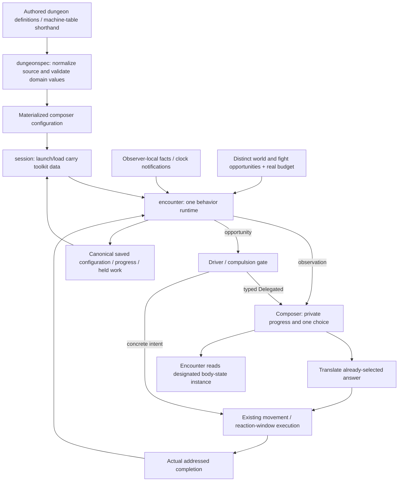

# Live behavior consumer contract

## Shape

[Story #859](https://github.com/KirkDiggler/rpg-project/issues/859),
[live S1 adoption #866](https://github.com/KirkDiggler/rpg-project/issues/866),
[case file #877](https://github.com/KirkDiggler/rpg-project/pull/877).
[Walkthrough](consumer.md); [implementation plan](plan-consumer.md).
This extends the accepted [R1–R3 producer boundaries](design.md).

## Law

**R4 — one runtime.** Machine-driven actors use one composer runtime. Existing
machine/table source is shorthand normalized at construction or load, not a
second execution path. Distinct concerns retain independent machine instances
and private progress; canonical runtime does not mean one giant actor state
machine or a requirement that every concern competes for movement. A body/post
binding reads one designated instance; a
single-instance composition supplies that source unambiguously. No second live
creature-machine blob mirrors the same progress. Actors with no ordinary
machine-driven policy gain no invented behavior.

**R5 — typed delegation.** `Delegated` is a member of the sealed `TurnIntent`
vocabulary, not a boolean beside a competing intent. The existing Driver and
compulsion wrapper run before ordinary choice. The encounter resolves delegation
before execution and refuses an already-selected Pick attached to it. It does
not invoke a second weighted selection after the composer answers.

**R6 — opportunity kinds.** World-action opportunities and fight-turn
opportunities use distinct input beats. Clock/round notifications remain a
separate input class and grant no action by themselves. Duties subscribe to the
opportunities they handle; a behavior intended for both explicitly names both.
A world Patrol is not offered a fight turn merely because its author omitted a
clock guard. Normalization preserves existing authored input meaning at the
boundary rather than retaining a legacy runtime branch.

**R7 — first authoring cut.** The first live delivery authors content as YAML and
proves Studio import/edit/save/export preservation plus server compilation.
Dedicated behavior-definition/binding editors are a later slice, not a
prerequisite. Client-side game-rule execution is not introduced.

The inherited and consumer invariants remain:

- The encounter owns lawful observation projection, opportunity/budget checks,
  execution, actual completion and physical permission. API/session carry and
  store toolkit values; they do not choose behavior or interpret geometry.
- A turn ending does not imply an authored waypoint was reached. Exact-cell work
  completes only when the selected target is satisfied and the actor is not
  suspended in a reaction window.
- No-budget holds, partial movement and blocked movement do not consume a pending
  Patrol leg. The example retries its pending authored waypoint, without a new
  universal nearest-waypoint, dwell or recovery policy.
- Held execution retains attachment, selected key, completion mapping and target
  through the existing pause/save/resume path. Resume does not select again.
  Corrupt or mismatched non-null completion claims are refused.
- Runtime configuration, completion maps and private progress load from the saved
  encounter. Loading does not consult edited source, expand again or resample.
- A heard occurrence exposes its delivered kind/location, not an unseen maker's
  identity or another observer's holdings. Private role state is not additional
  client-visible world truth.
- This consumer adds no general scheduler, asynchronous recovery protocol,
  shared effects machine or runtime script interpreter.

## Rulings

| ID | status | scope | ruled by | date |
|---|---|---|---|---|
| R1–R3 | settled | Data definitions, separate bindings/progress, finite expansion; inherited from the parent design | KirkDiggler | 2026-11-05 |
| R4 | settled | One canonical runtime for machine-driven actors; source normalization and designated body-state instance, not opt-in parallel execution | KirkDiggler | 2026-11-06 |
| R5 | settled | Typed Delegated intent, compulsion before ordinary choice, no second roll | KirkDiggler | 2026-11-06 |
| R6 | settled | Distinct world/fight opportunity beats, separate from clock notifications | KirkDiggler | 2026-11-06 |
| R7 | settled | YAML-first delivery with Studio preservation/round-trip proof; dedicated editors later | KirkDiggler | 2026-11-06 |

## Open

- **Migration parity is an implementation proof, not assumed equivalence.** The
  current reaction dispatcher and `Composer.Observe` have different contracts.
  Named tests cover reactions, multiple-pick source refusals, terminal state,
  wake/deferred progress, body/post changes and ordinary combat policy. A
  concrete contradiction must be reported rather than silently changing rules.
- **Source/selection-lane contract:** the [source → instance boundary](source-instance-contract.md)
  specifies identity, supplied values, producer output and refusals. It does not
  settle the separate resource/selection-lane policy. Preserve independent
  concerns such as movement and needs; finish the first consumer's action-lane
  boundaries and migration semantics before implementation.
- **Later authoring breadth:** dedicated editors, cross-site catalogs, sampled
  defaults, generalized item schemas and async cross-cycle completion
  deduplication are not prerequisites of this delivery.
