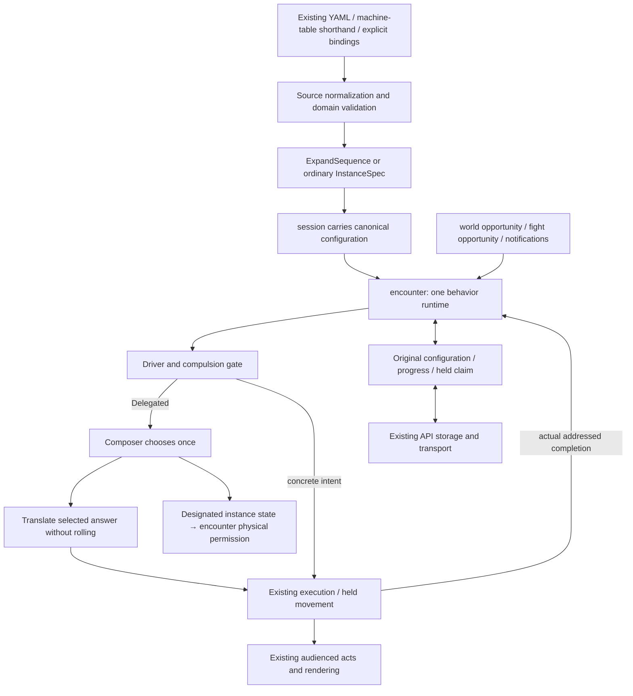

# From authored Patrol to a moving creature

Live-consumer walkthrough for [#859](https://github.com/KirkDiggler/rpg-project/issues/859)
and [S1 adoption #866](https://github.com/KirkDiggler/rpg-project/issues/866).
[Contract and R4–R7](consumer-design.md); [implementation plan](plan-consumer.md);
[focused source → instance contract](source-instance-contract.md).
This explains the agreed target; candidate interface names in the plan are not
claims that the live adapter has already shipped.

## Component shape

## Ownership and contracts

| Component | Owns | Input → output |
|---|---|---|
| Source / Studio carry | Authored definitions, references, values and ordering | YAML → existing draft/source codecs → preserved YAML; no new editor prerequisite |
| `dungeonspec` | Name resolution, source normalization, domain validation and coordinate lowering | Existing machine/table shorthand or explicit behavior bindings → canonical behavior setup |
| `ExpandSequence` | Finite expansion | Definition + chosen items/scalars → ordinary instances, completion/source maps |
| Session/API | Launch/load/store plumbing | Compiled and saved toolkit data; no behavior or geometry decisions |
| Encounter installation | One normalized runtime configuration | Existing shorthand becomes a canonical composition; no permanent legacy execution branch |
| Composer | Instance progress and ordered weighted choice | Observe/Decide plus derived state/scheduling queries |
| Driver/compulsion gate | Imposed/custom decision precedence | Concrete intent, or typed `Delegated{}` for ordinary composed choice |
| Execution | Real price, route, movement and actual completion | Selected answer → TurnIntent → execution/held work → addressed completion |
| Physical projection | Blocking/posts from one designated state source | Read-only instance state, never a second mirrored live blob |

The client does not expand or execute definitions. The compiler does not sample
missing values. The translator does not roll. Turn-end does not fabricate
arrival. A load does not replace saved configuration with the latest source.

## One runtime, normalization at the boundary

R4 makes the existing machine/table input shorthand for canonical composition.
A creature with a simple policy needs only the simple source form; it does not
need a second live interpreter. Multiple concerns still use independent machines
and continuations—for example, movement and needs are not collapsed into one
actor-wide state graph. The first action lane does not become a universal
resource scheduler. Explicit compositions can name several roles in
authored order. Actors with no ordinary machine-driven policy gain no invented
behavior merely for structural uniformity.

`BlockingStates` and `Posts` remain encounter rules. Their state source is one
instance; when exactly one exists it is unambiguous, otherwise the author names
it. Other roles' private progress is not another physical permission authority.
The canonical saved form contains the materialized instances, original completion
maps and private progress, not both a live Machine blob and its composer copy.

Normalization must preserve existing observable behavior. It is not enough to
rename a type: current world reactions can pick, fight turns use the existing
ordinary table path, and the core composer refuses a Pick through Observe.
The plan requires parity tests at those seams before removing the old runner.
Compatibility, where retained, lives only at construction/load boundaries.

## Typed delegation and opportunity beats

R5 retains the existing compulsion wrapper before the ordinary brain. A concrete
imposed/custom intent bypasses composed selection. The default decision source
returns `Delegated{}` without rolling; the encounter resolves it by choosing once
and translating the chosen answer. Delegation is resolved before the movement
executor and cannot carry an already-selected Pick.

R6 separates world opportunities from fight opportunities. The proposed spellings
are `time` for a world action opportunity and `turn` for a fight action opportunity.
Existing `clock:world`/`clock:fight` inputs remain notifications: in particular,
`clock:fight` is a faction-addressed round announcement, not an individual's turn.
A body intended for both opportunities names both; Patrol need not carry a
repeated defensive `clock.kind == world` guard.

The world due index must not arm a fight-only role merely because its beat is
timed. The provider proposal reports each current state's timed beat names as well
as wake/due information; its exact source/lane contract still needs specification
before implementation. A future wake suppresses timed stepping of that instance
while another instance runs; ordinary delivered observations remain independent.
No virtual paused clocks or new global scheduler is introduced.

## Source adapter and the first authoring cut

The [source → instance boundary](source-instance-contract.md) pins the distinct
source key, definition ref, actor identity and attachment ID, the producer
handoff, refusal paths and source-preserving round-trip assertions. It does not
silently settle the separate selection-lane or legacy-normalization semantics.

Use the existing site document, not a new authoring database. The candidate
`behaviorDefinitions` map and ordered creature/faction binding lists are source
forms for the canonical runtime. Existing simple machine/table content normalizes
at the same boundary. Explicit lists replace inherited lists wholesale; absent
and explicitly empty are not collapsed into an accidental fallback.

Definitions can use the shipped sequence body or a concrete reusable ordinary
recipe/table body. A binding supplies its own ID, chosen finite items and scalar
values; it does not carry an edited copy of the shared definition's logic.
Existing catalog/default/coordinate owners remain responsible for those concerns.

For Patrol, `cells` items use the existing `RoomCell{Q,R}`, `roomCells.cellAt` and
`hexCell` boundary. Single-room axial values already name the canonical cell;
never convert through an offset frame twice. Validate emitted selectors through
their existing owner, without importing stateless-route overlap restrictions
into a state-retained finite list.

R7 authors the first content as YAML. Studio must preserve definitions, binding
order, values, explicit absence and unrelated/unknown fields through import,
ordinary editing, draft persistence and export; the exported source must compile
on the actual server. Existing `SiteScope.unread`, binding-field carry and source
splicing are reused. Add codec changes only where the joined round-trip test
shows a concrete gap. Dedicated definition/binding panels are a later slice.

## Walk one value through

West's second waypoint is `{q:12,r:0}`. The compiler validates that it is floor and
supplies `{"x":12,"y":0}` to the finite producer. The emitted configuration has
that goal's table and completion mapping; editable source still names one shared
definition and supplies its own route.

Launch carries the compiled setup. Encounter normalizes simple and composed
source to the same runtime, retaining original materialized data. A world
opportunity reaches the Driver/compulsion gate; ordinary delegated choice asks the
composer once. The existing router/Mover consumes the selected answer within the
real movement budget.

Stopping short of `(12,0)` sends no completion. Actual arrival sends the mapped
input to the selected instance, with no free extra turn. A reaction window carries
the selected attachment/key/goal in held-turn data; reload uses stored
configuration and resumes that held action without selecting again. Another
actor's same local attachment ID owns independent progress.

The client renders existing lawful answer/movement acts. Private role blobs are
not additional omniscient client state. Only the designated body-state source
feeds existing body/post state projection.

## Separations that look like one thing

| Query | Source of truth |
|---|---|
| Which role requests this opportunity? | Composer and authored order |
| Which opportunity is being offered? | Encounter's world/fight/reaction dispatcher |
| Can the action execute? | Real budget and rulebook/encounter capabilities |
| Did the turn end? | Intent-loop result |
| Was the selected goal satisfied? | Actual execution/final cell after any pause |
| Does the body/post block? | Encounter projection of one designated state source |
| What did this NPC hear? | Its delivered occurrence and observer-local testimony |
| What resumes after load? | Original materialized configuration and saved progress |

## Trade-offs and boundaries

| Decision | Benefit | Cost / boundary | Not taken |
|---|---|---|---|
| R4 canonical runtime | One future place to maintain scheduling, progress and persistence | Boundary normalization and parity proof are paid during migration | Permanent opt-in legacy/composer branches |
| R5 typed delegation | One explicit sealed outcome instead of a flag beside a value | Resolve before execution and preserve compulsion | `UseBehaviors` plus competing intent |
| R6 separate opportunities | Forgotten clock guard cannot hijack a fight turn | Normalize existing source meaning; keep notifications distinct | A defensive guard on every duty |
| R7 YAML and preservation first | A smaller real consumer delivery | Dedicated editing UI remains later work | New definition/binding panels in this wave |
| Exact completion claim | Arrival survives partial/blocked/held execution | Pause/load/finalization must change together | Turn-end treated as arrival |

The fixture's pending waypoint is its authored resumption target, not a new
global rejoin/dwell policy. This is not an asynchronous job protocol or arbitrary
rollback. A concrete parity conflict is reported with a failing path rather than
silently redefining source meaning.

## Where changes land and source map

Routes/role order are content; new item domains belong to the source/domain
adapter; new physical outcomes belong to execution; preservation defects belong
to Studio codecs. None belongs in an API-side NPC script.

| Concern | Owning paths |
|---|---|
| Source and domain lowering | `encounter/dungeonspec/{single_room.go,single_room_compile.go,single_room_site.go,bundles.go,states.go}` |
| Facts, timing, listeners | `encounter/{machine.go,wakebeats.go,noise.go,worldtime.go}`; `mind/behavior` inspection; `mind/machine/listeners.go` |
| Decision and execution | `encounter/{tabledriver.go,turndriver.go,clocks.go}`; `session/{driver.go,compelled.go,capabilities.go}` |
| Body/post and held state | `encounter/{field.go,post.go,cellfacts.go,barred.go,data.go,pause.go}` |
| Source preservation | `src/concepts/world-building/{siteScope.ts,roomDraft.ts,singleRoomDungeon.ts}` |
| Transport and acceptance | `internal/{dungeons/registry.go,sessionworld/sessionworld.go,orchestrators/authoring/orchestrator.go,integration/session/}` |
