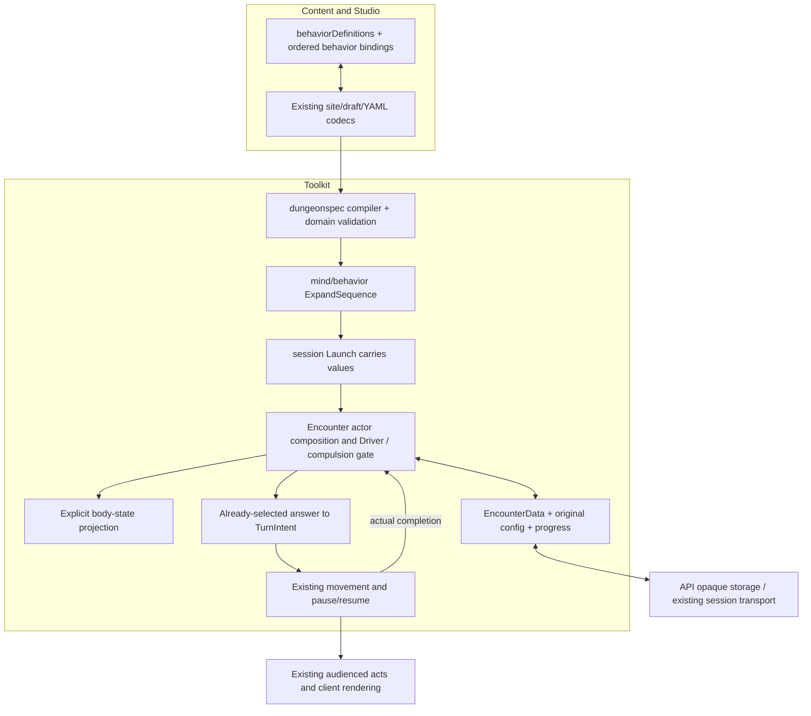

# From authored Patrol to a moving creature

Proposed live-consumer walkthrough for [#859](https://github.com/KirkDiggler/rpg-project/issues/859)
and [S1's remaining adoption journey, #866](https://github.com/KirkDiggler/rpg-project/issues/866).
[Consumer contract](consumer-design.md); [implementation plan](plan-consumer.md).
**R4 is open.** This explains the recommended cut so it can be judged; new type
and field names below are proposed, not existing APIs.

## Component shape



## Ownership and contracts

| Component | Owns | Input → output |
|---|---|---|
| Site authoring/Studio | Editable definitions, references, ordered bindings and values | Proposed `behaviorDefinitions`, `monsterBindings.<id>.behaviors`, `behaviorState`; existing `decodeSingleRoomDungeon` / `encodeSingleRoomDungeon` and draft persistence |
| `dungeonspec` | Source names, inheritance, typed values, cell validation/lowering and diagnostics | Proposed `BehaviorDefinitionSpec` / `BehaviorBindingSpec` → `encounter.BehaviorInput` carried by `MonsterPlacement` |
| `ExpandSequence` | Finite data expansion and local references | Existing `ExpandSequenceInput` → materialized `InstanceSpec`, completion/source maps; no geometry or catalog lookup |
| `session.Launch` | Carrying the compiled placement through load-act-save | `MonsterPlacement.Behaviors` → `JoinInput.Behaviors`; no behavior decisions |
| Encounter installation | Resolve an explicit creature-state/table import after existing defaults/layers, validate and seat the composition | Proposed ordered `BehaviorSlot` values → original materialized configuration + one live `Composer` |
| Composer | Private progress and ordered weighted selection | Existing `Observe` / `Decide`; proposed read-only `Inspect` and explicit wake-shift operation for existing world elapse semantics |
| Encounter observation/opportunity adapter | Lawful facts, event delivery timing and budget | Existing `wakeBeat` / `MonsterView` → data observation or explicitly permitted selection; no automatic extra opportunity |
| Driver/compulsion gate | Preserve imposed/custom decisions before ordinary choice | Existing wrapper runs first; proposed `Decision.UseBehaviors` delegates normal configured choice without rolling |
| Intent translation and movement | Execute one selected answer; detect its actual outcome | Proposed `IntentForAnswer` over existing `MonsterView` + `Answer` → existing `TurnIntent`; completion claim survives `turnPause` |
| Encounter persistence | Original materialized values, body-state binding, private blobs and a held action's claim | Proposed `BehaviorData` on `MemberData`, optional typed claim on `TurnPauseData` → identity-checked reload |
| API/client | Storage, existing authoring transport and audienced rendering | Existing YAML transport and session data; no new behavior evaluator or source rebind |

Refusals: a client does not expand or execute behavior. The source compiler does
not sample a missing value. The runtime does not consult a mutable source key on
load. The translator does not roll. Ending an intent does not fabricate arrival.
A private role state does not independently decide whether a body blocks.

## R4: how the existing creature state joins the new composition

The existing creature machine is not just a patrol cursor. Its state controls
`BlockingStates` and `Posts`, and it can pick a table in response to an immediate
`barred` input. Adding a second controller without a rule would leave two sources
of action requests and an ambiguous physical-state owner.

**Recommended A: one progress owner for an opted-in actor.** An authored binding
may explicitly import the existing creature recipe and resolved table as one
named composer instance. An explicit `behaviorState` identifies the instance
whose state the encounter uses for existing blocking/post projection. Other
instances remain private duties. Imported state names stay the original names;
no mirrored `memberRecord.Machine` blob is maintained for that composed actor.
Existing actors without a behavior profile keep their legacy path.

The order is authored, including where an imported creature/table instance sits.
There is no implicit fallback role or universal priority ladder. A default
`watch → pick time` instance placed before an always-active patrol would win by
that authored order, so the example places the ordinary baseline last and gives
Patrol/Investigate explicit world-clock eligibility. This preserves combat's
normal table path through an explicit baseline rather than silently making
patrol movement the whole combat policy.

**Alternative B: keep the creature machine and composer as separate runners.**
The physical state owner remains where it is, but action arbitration, listener/due
scheduling and queued-input ordering must be specified across both runners.
Running both, ignoring one runner's picks, or polling the roster each round is
not an implementation of either cut.

## Proposed source adapter

Use the existing site document, not a new authoring database. Add a local
`behaviorDefinitions` map and an optional ordered `behaviors` list on a creature
binding (and faction inheritance, nearest explicit list winning wholesale).
An absent list retains legacy behavior; an explicitly empty list means a composed
actor with no selection roles, not an instruction to fall back silently.

Two definition forms serve this consumer without a universal template system:

- `sequence`: a canonical `behavior.SequenceDefinition` plus an item adapter
  declaration (`cells` for this Patrol; `json` for already-domain-valid literal
  items). Bindings supply `items` and scalar `with` values.
- `instance`: a concrete reusable recipe/table body for the investigation or
  another non-sequence role. Its instance ID comes from the binding, not the
  shared definition. Unknown `with`/`items` on this form are refused rather than
  ignored; adding parameterized flat bodies is not hidden in this first adapter.

An explicit binding arm `creature: true` imports the existing resolved creature
recipe/table under its supplied ID. It is mutually exclusive with `use`, `with`
and `items`. `behaviorState` must identify that explicit imported state instance
when existing blocking/post state bindings are present. A source that supplies
legacy state/orders but gives them no explicit consumer is refused, not discarded.

Illustrative source outline, **conditional on R4 and not supported syntax yet**:

```yaml
behaviorDefinitions:
  patrol:
    kind: sequence
    items: cells
    definition: # the canonical SequenceDefinition data, not a Go factory
      ref: example:behaviors:patrol
      end: repeat
      parameters: [{name: weight, kind: int, required: true, min: 1, max: 3}]
      body: # recipe/table data and the four references defined by S2
        # full body supplied by the acceptance fixture
  investigate:
    kind: instance
    instance: # concrete, reusable recipe/table data
      # full body supplied by the acceptance fixture
room:
  room:
    monsterBindings:
      west:
        behaviors:
          - {id: investigate, use: investigate}
          - {id: duty, use: patrol, items: [{q: 0, r: 0}, {q: 12, r: 0}], with: {weight: 1}}
          - {id: baseline, creature: true}
        behaviorState: baseline
```

The outline is not a build fixture with omitted bodies. The implementation plan
requires complete committed fixtures and loader assertions before code is claimed
working. Reuse the existing parameter/value and route-editing surfaces where they
fit; a definition-body text editor is sufficient initially. Do not make the client
execute server validation or invent a second behavior interpreter.

`cells` items use the existing `RoomCell{Q,R}` and `roomCells.cellAt`/`hexCell`
owner. Single-room axial coordinates already name the canonical cell; do not
apply an offset conversion twice. Validate every emitted spatial selector through
the existing owning grammar. Do not apply legacy position-derived route overlap
restrictions to a state-retained list merely because both are called routes.

## Walk one value through

West's source contains `{q: 12, r: 0}` as its second item. The compiler validates
it as floor and lowers it to the component value `{"x":12,"y":0}`. `ExpandSequence`
produces the duty instance's second movement table, completion beat and source
mapping. The definition and binding remain intact in the editable source.

At launch, session carries the compiled setup. Encounter resolves the explicit
baseline import using the already-layered creature table, then creates one
composer and retains that final configuration. The body's physical state is read
from the designated instance, not copied into a second live machine blob.

A paid world opportunity builds the real observer-local view and prices movement.
The existing driver/compulsion wrapper is consulted first: a commanded turn does
not ask the composer or roll its table. The default table driver explicitly
delegates a configured actor's ordinary choice without rolling; the encounter
then uses its existing shared Roller. The composer selects once.
`IntentForAnswer` translates its chosen `Toward.At`
without invoking `TableDriver.Act` and rolling again. The existing router and
movement seam take as many legal cells as the budget permits. If West stops
short of `(12,0)`, the caller sends no completion. If it reaches the cell, the
caller sends the exact mapped beat to `duty`. The next opportunity can request
the next leg; arrival itself grants no extra turn.

If a reaction window opens midway, the selected attachment/key/goal travels in
the existing held-turn data. Save/reload rebuilds the composer from stored
configuration and progress, then finishes the held movement without reselecting.
Only actual arrival completes the step. The existing audienced movement and
answer acts are what the client renders; this design does not publish private
role state as extra omniscient client information.

## Separations that look like one thing

| Query | Source of truth |
|---|---|
| Which behavior requests the opportunity? | Composer and authored ordering |
| Can the action be afforded/executed? | Encounter/rulebook budget and execution capabilities |
| Did the turn end? | Existing intent-loop result |
| Did the selected cell goal complete? | Actual execution result and final cell, after any pause |
| Does the body/post block? | Encounter projection of the explicitly designated state source |
| What did this NPC hear? | Its delivered occurrence and observer-local testimony |
| What does a resumed run execute? | Saved materialized configuration, not the latest source |

## Trade-offs and boundaries

| Decision | Benefit | Cost / boundary | Not taken |
|---|---|---|---|
| R4 recommendation: explicit imported state instance | One live progress owner, authored precedence, no mirrored body blob | Encounter must update state projection, scheduling, save/load and legacy bridging | Two independently acting runners |
| Reuse canonical component bodies inside the site adapter | No per-behavior factory and no second runtime language | Initial body editing is text-oriented; domain values still need their owner | Full graph editor in this consumer |
| Carry a completion claim through the existing pause | Real arrival survives reaction/save/resume | Pause validation and finalization must be updated together | Treating `done == true` as arrival |
| Retry the pending waypoint after a blocked/partial leg | The authored goal and private continuation remain truthful | No automatic skip, teleport or global recovery policy | Inferring a new nearest waypoint |

Only the example's pending-waypoint destination is selected by its authored
body. Legacy `Selector.Path` and dwell behavior are unchanged. This is not an
async job protocol: the encounter owns one held action and validates that action's
claim. A future concurrent-operation use case needs its own contract.

## Where a change lands

A different route or role order is content. A new item domain belongs to the
source/domain adapter. A new physical action outcome belongs at the encounter /
rulebook execution seam. A source-preservation defect belongs in the existing
Studio codecs. None belongs in an API-side NPC script.

## Source map

| Concern | Existing owning files |
|---|---|
| Source and domain values | `encounter/dungeonspec/{single_room.go,single_room_compile.go,single_room_site.go,bundles.go,states.go}` |
| Facts, time and listeners | `encounter/{machine.go,wakebeats.go,noise.go,worldtime.go}`; `mind/machine/listeners.go` |
| Selection to real action | `encounter/{tabledriver.go,turndriver.go,clocks.go}` |
| Body/post permission | `encounter/{field.go,post.go,cellfacts.go,barred.go}` |
| Saved/held execution | `encounter/{data.go,pause.go}`; `session/{launch.go,write.go,driver.go}` |
| Studio carry/edit/export | `src/concepts/world-building/{siteScope.ts,roomDraft.ts,singleRoomDungeon.ts,BundlesPanel.tsx,creatureStates.ts}` |
| API transport and acceptance | `internal/{dungeons/registry.go,sessionworld/sessionworld.go,orchestrators/authoring/orchestrator.go,integration/session/}` |
