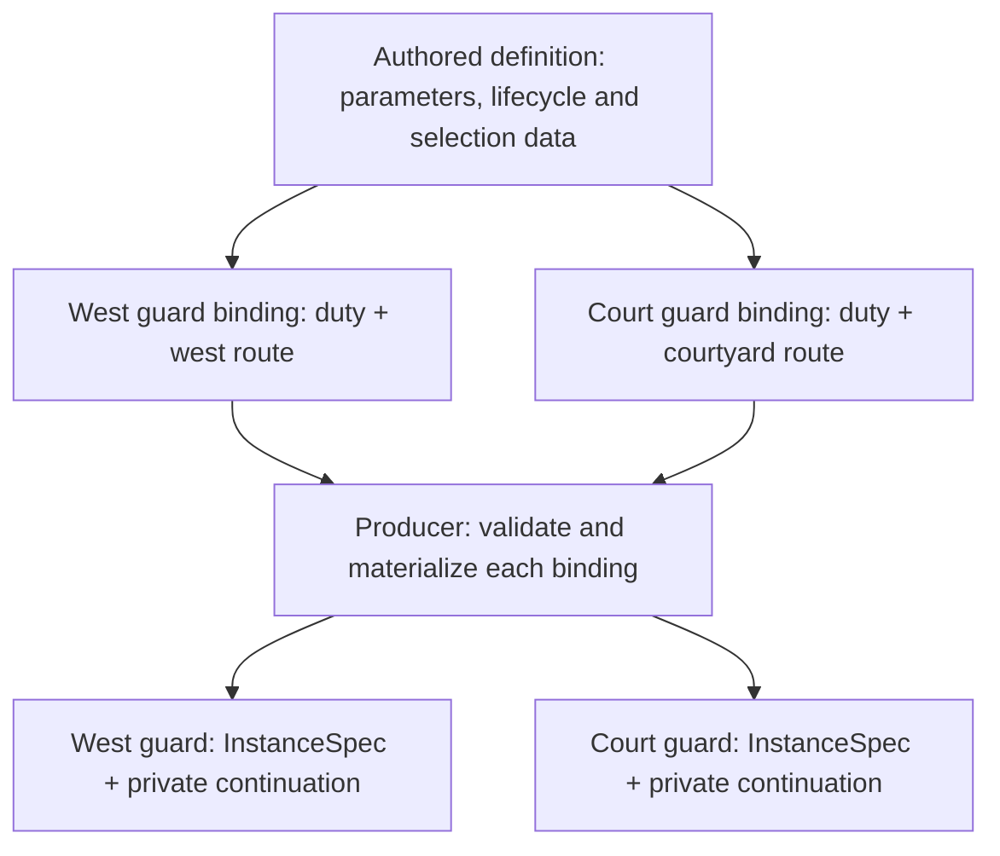

# Behavior definitions and bindings

## Shape

[Story and decision record](https://github.com/KirkDiggler/rpg-project/issues/859).
[Working two-guard example](README.md).

R1 settles the authoring direction; R2 settles the ownership and observable
behavior; R3 selects finite expansion during binding. The component expansion
contract belongs to `mind/behavior`; site-facing source and live-consumer adapters
remain to be specified.

## Law

**R1 — authored definitions.** A reusable behavior definition is editable data
expressing lifecycle and selection through supported primitives. Composing those
primitives into a different behavior does not require a new per-behavior Go
builder. Go implements primitives, compilation and validation; editable data does
not imply arbitrary executable scripts.

**R2 — reusable bindings and independent continuation.** One definition supports
bindings with differently sized finite routes. Bindings supply values and an
attachment identity, not copied-and-edited lifecycle logic. Each actor's
attachment retains its own unfinished work; addressed actual completion advances
only its recipient. Selecting a movement is not completing it. Saving and
reloading preserves those continuations and the original materialized
configuration without resampling.

**R3 — finite expansion during binding.** A reusable producer-side tool expands
a data-authored repeated body over a supplied finite list into ordinary machine
states and table entries. The body remains editable data, not a Patrol-specific
Go factory. The machine and composer require no new runtime sequence interpreter.
Materialized configuration grows with the list; generated identities and
source-to-generated diagnostics belong to the producer.

The runtime boundary remains subject to
[ADR-0049](https://github.com/KirkDiggler/rpg-toolkit/blob/main/docs/adr/0049-behavior-is-a-composer.md):
`mind/behavior` consumes materialized recipes/tables, and each attachment owns
private continuation. R1 does not move source interpretation into the composer,
change weighted selection into role priority, or authorize shared mutable progress.

## Rulings

| ID | status | scope | ruled by | date |
|---|---|---|---|---|
| R1 | settled | Reusable definitions themselves are authored data, rather than only parameter settings for per-behavior Go builders | KirkDiggler | 2026-11-05 |
| R2 | settled | Definition/binding/progress ownership and the two-/three-waypoint independent-completion and reload contract | KirkDiggler | 2026-11-05 |
| R3 | settled | Producer-side finite expansion of authored repeated steps; unchanged machine/composer runtime | KirkDiggler | 2026-11-05 |

## Open

- **Site-facing source and bindings:** their serializable shapes, structured-value
  metadata and owner-supplied domain validation. The component's canonical JSON
  contract is not automatically a studio/dungeonspec source dialect.
- **Source adapter:** connect existing bundle/state authoring to the finite
  producer without duplicating catalog, default or coordinate ownership.
  [The S2 plan](plan-s2.md) names the component seam; [planning preflight](planning-preflight.md)
  preserves the inspected starting point.
- **Consumer bridge:** the concrete input/completion vocabulary and the adapter
  carrying original materialized configuration and per-attachment continuation.
  Selection remains distinct from physical execution; the existing snapshot
  identity check and no-resampling-on-load contract are not open for replacement.
