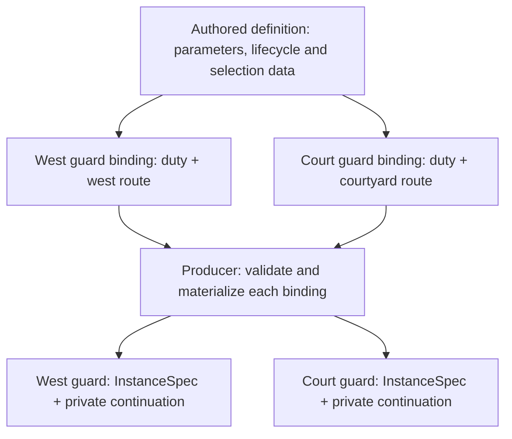

# Behavior definitions and bindings

## Shape

[Story and decision record](https://github.com/KirkDiggler/rpg-project/issues/859).
[Working two-guard example](README.md).

R1 settles the authoring direction. The source grammar and producer contract
remain open; this document is not an implementation-ready binding specification.

## Law

**R1 — authored definitions.** A reusable behavior definition is editable data
expressing lifecycle and selection through supported primitives. Composing those
primitives into a different behavior does not require a new per-behavior Go
builder. Go implements primitives, compilation and validation; editable data does
not imply arbitrary executable scripts.

The runtime boundary remains subject to
[ADR-0049](https://github.com/KirkDiggler/rpg-toolkit/blob/main/docs/adr/0049-behavior-is-a-composer.md):
`mind/behavior` consumes materialized recipes/tables, and each attachment owns
private continuation. R1 does not move source interpretation into the composer,
change weighted selection into role priority, or authorize shared mutable progress.

## Rulings

| ID | status | scope | ruled by | date |
|---|---|---|---|---|
| R1 | settled | Reusable definitions themselves are authored data, rather than only parameter settings for per-behavior Go builders | KirkDiggler | 2026-11-05 |

## Open

- **Source and binding contract:** the serializable definition/binding shapes,
  parameter references, structured-value metadata and owner-supplied validation.
  Scalar `ParameterSpec` support does not establish a route-value contract.
- **Variable route structure:** how one data definition expresses continuation
  over differently sized routes using reusable primitives, and how it lowers to
  ordinary recipes/tables without a Patrol-specific Go factory.
- **Consumer bridge:** the concrete input/completion vocabulary and the adapter
  carrying original materialized configuration and per-attachment continuation.
  Selection remains distinct from physical execution; the existing snapshot
  identity check and no-resampling-on-load contract are not open for replacement.
