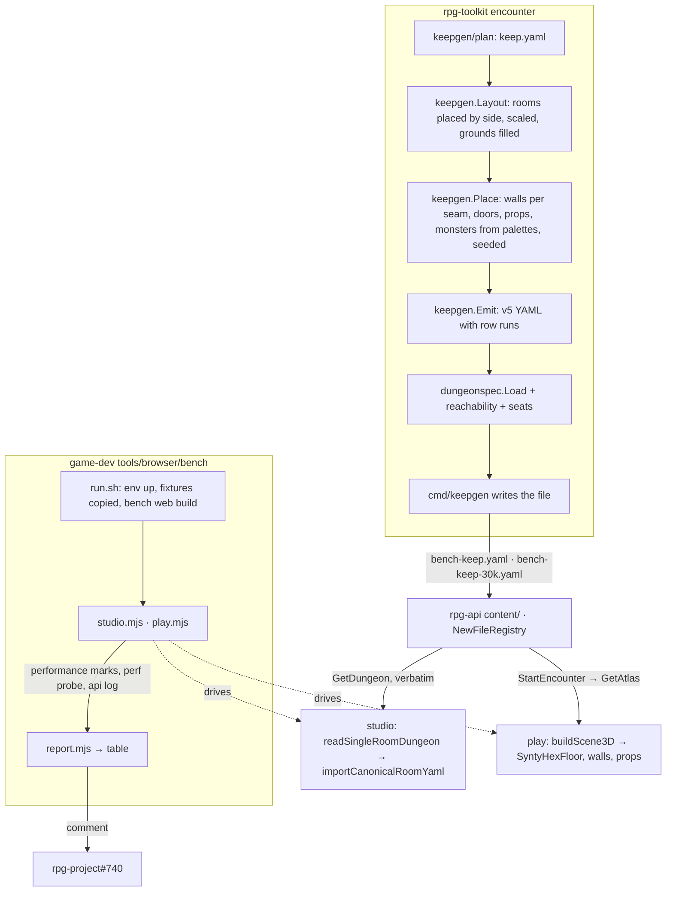

# Benchmark keep — walkthrough

Story: rpg-project#740. Law: [design.md](design.md). This explains how the
pieces meet; the design doc says what holds.

## What this is

A generator turns a plan of FadedPez's keep into two version-5 sites, a keep
at keep scale and the same keep at the 30,000-hex ceiling, propped and
garrisoned from palettes, and a harness measures the studio, the server and
play on both and writes one table per run. It reuses the single-room dialect
and its loader, the api's content shelf, the studio's Open path, the lobby's
start path, the play perf probe that already exists and the api's per-call
timing log. It introduces **no new dialect field**, **no second content
registry**, **no hand-authored content** and **no optimisation**: the
follow-on stories own the fixes, this one owns the yardstick.

## Component shape

## Ownership and contracts

| Component | Owns | Input → output |
|---|---|---|
| `keepgen/plan/keep.yaml` (toolkit, embedded) | the layout as data: `name`, rooms `{id, name, kind, width, depth, side, lighting}`, `doors [[a,b],…]`, `courtyard`, `grounds {west, south}`, `partyStart` room, `exits`, `walls {assetRef, door assetRef}`, `palettes {kind: {props: [{assetRef, width, depth, blocksMovement, blocksLineOfSight}], monsters: [ref,…]}}`, `templates` (the stat blocks the monster palette names, emitted into the site) | an edit → a different site, no Go change |
| `keepgen.Layout` | where each room sits | plan + `Options{Hexes}` → room rectangles in axial cells; linear scale `min(1.5, sqrt(Hexes / planHexes))`; grounds sized so the total equals `Hexes` |
| `keepgen.Place` | every placed thing | layout + `Options{Seed, PropDensity, GroundsDensity, MonsterDensity}` → walls (one line per seam, quarter-line geometry so no wall covers a cell centre), one opening and door per plan door, `scene.items` with `transform`, `propDeclarations` for blockers, `monsterDeclarations` with `startingCell`, `doorBindings` all `{}` (open) |
| `keepgen.Emit` | the bytes | placed site → v5 YAML; regions as canonical row runs via the exported encoder; header comment carrying the command line; deterministic ordering |
| `keepgen.Prove` | the refusal | bytes → `dungeonspec.Load`; every region reachable from `partyStart` through doors; at least four free seats; else an error naming the first failing rule and no file |
| `cmd/keepgen` | the command line | flags `-plan -hexes -seed -props -grounds-props -monsters -out` → a file, or the proof error on stderr and exit 1 |
| `dungeonspec.CellRows` (exported) | one spelling of a cell set | `[]RoomCell` → `[]RoomCellRow`, rows ascending, spans merged |
| api `content/bench/` | the fixtures at rest | files whose `key` equals the file name, off the shelf: `NewFileRegistry` and `SeedShipped` read only the top level, so boot and tests never compile them |
| api `NewFileRegistry` | the shelf | top-level files → compiled, atlas-projected at boot, listed by lobby `ListDungeons` because root version is 5; one log line `content registry: compiled <n> files in <ms>ms` |
| api `bench_fixtures_test.go` | currency of the shelf copies | `keepgen.Generate` with each file's recorded options → bytes equal to the shelf file |
| web `serialization.ts` caps | what the studio refuses by size | `MAX_ITEMS` ≥ 4,000, `MAX_JSON_LENGTH` ≥ 2,500,000 (Law Supported envelope); `MAX_WALL_PIECES_PER_WALL` in `structuralWallEditing.ts` admits the ceiling's longest wall |
| web `devMode.ts` predicate | whether a build is development-like, for the harness's gates only | `import.meta.env.MODE` → `isDevLike()`; `development` and `bench` are true, `production` false; read by the dev player fallback, the player override, the dev player's composition world, the marks and the probe mounts |
| web `performance.mark` points | what the harness can time | marks at open start, decoded, imported, first paint; stroke commit, painted; preview sent, returned; atlas requested, received; scene built; first frame |
| web `DevPerfProbe` mount | frame-time and draw-call sampling in current play and the studio 3D view | `?perfProbe` → `PERF_PROBE_RESULT:` console line and `window.__rpgPerfProbeLatest`; mounted when `isDevLike()` |
| web regions list (`LayoutRoomList.tsx`) | the mark the regions-list row reads | `studio:regions:rendered` after its commit |
| `scripts/dev-env.sh` bench web mode | a measurable web | `RPG_WEB_MODE=bench` → `vite build --mode bench` then `vite preview` on the env's web port |
| api `NewFileRegistry` timing line | the server boot row | one log line `content registry: compiled <n> files in <ms>ms` |
| `tools/browser/bench/run.sh` | the one command | env name + fixture keys → env up, each key copied from `rpg-api/content/bench/` (or `content/` for a shelf site) flat into `.runtime/<env>/sources/rpg-deployment/content/` (seeding never overwrites, so the copy is explicit), api restarted, drivers run, table printed; a mark that never fires reads `absent` and the run goes on |
| `keepgen.OptionsFromHeader` | the recorded options | fixture bytes → `Options` parsed from the header comment, so a shelf copy can be regenerated and compared |
| `tools/browser/bench/studio.mjs`, `play.mjs` | the drive | Playwright on a hardware renderer (headed, or the GPU flags) → marks, probe result, polygon count, JS heap; the `WEBGL_debug_renderer_info` string is recorded and a SwiftShader or llvmpipe run is refused; play started through the lobby picker by key |
| `tools/browser/bench/report.mjs` | the table | marks + probe + api log lines `✓ <method> completed in <ms>ms` + toolkit bench output → one markdown table per fixture beside R1's budgets |

Refusals, one per boundary:

- The plan does not carry cells, coordinates or counts; the generator derives
  them, so the plan reads like a floor plan.
- The generator does not read the web's asset catalog; the palette carries
  the refs and the web's import check is where an unknown ref is refused.
- The generator does not write a file its own loader refuses.
- The shelf does not rewrite the file; the studio and play read the same
  bytes the generator wrote.
- The studio caps do not encode a taste for small documents; they encode
  the supported envelope at R1's ceiling.
- The bench build does not change what a production build does; it opens
  only the gates the harness needs, through one predicate, and no other
  development affordance.
- The harness does not patch the web or the api to make a number better; it
  records what the build does.
- The report does not interpret; the hot-spot list is written by a reader of
  the table on the story issue.

## Walk one thing through

The banquet hall's long table. The plan's `hall` palette lists
`{assetRef: dnd5e:props:fantasy-kingdom:table_fancy_01, width: 3.0, depth: 1.2, blocksMovement: true, blocksLineOfSight: false}`.
`Place` draws a cell in the banquet hall away from both door thresholds with
the seeded source, converts it to scene units (circumradius 1, pointy-top),
and emits `scene.items[]` entry `banquet-hall-prop-07` with
`transform {x, y: 0, z, rotationY}` and a `propDeclarations` entry with that
footprint. `Prove` loads the file: the compiler subtracts the footprint's
cells from the floor, the sight index files nothing for it because it does
not block sight, the hall stays reachable from the gatehouse, and the
compiled party start still seats four. On the
shelf the file is listed as `bench-keep`. The studio decodes it into a v6
envelope and the placed overlay draws one marker; the harness counts it
among the items that the caps admit. In play the atlas carries it as a prop
presentation and `PropModel` clones one GLB for it; the probe counts its
draw call, and when a member moves past it the server's Move time includes
its footprint in the crossing check. The identity that survives every hop is
the item id; the footprint cells are derived at each load and never written.

## Separations that look like one thing

| Query | Source of truth |
|---|---|
| How big is the site in hexes | the plan scaled by the knob: regions' row runs |
| How big is the document | the YAML bytes: props dominate, geometry is small |
| How big is the atlas on the wire | expanded cells, twice (site-format O5) |
| Does a prop block | `propDeclarations.<id>`, not the scene item |
| What the studio refuses | `serialization.ts` caps and the catalog check, before any render |
| What the server refuses | `dungeonspec.Load` at boot, for the whole shelf |
| Studio load cost | YAML decode, envelope validation, polygon count |
| Play load cost | atlas fetch, scene build, GLB clones |

The hazard: a harness that reports one "size" and one "load time" cannot
say which layer moved. The table keeps the rows apart so a follow-on story
can claim one.

## Trade-offs

| Decision | Benefit | Cost / boundary | Not taken |
|---|---|---|---|
| Plan as embedded data | FadedPez edits a floor plan; no Go per layout change | the generator carries a plan schema and its refusals; a layout edit still travels as a toolkit PR, a tag, an api repin and a regeneration, because the shelf copies are pinned to the embedded plan; `-plan <path>` reaches a local file, never the shelf | rooms hard-coded in Go |
| Same plan at both scales (R2) | size is the only variable between fixtures | the ceiling is mostly grounds; a 60-room castle is not measured | an outer ring of new rooms |
| Palette refs pinned in the plan | toolkit stays catalog-ignorant | a ref the web drops breaks Open; the api test does not catch it | generator reads the catalog |
| Proof before write | the shelf never carries a file that refuses boot | generation runs a full compile; seconds at 30k | trust the emitter |
| Fixtures in the api repository, off the shelf (R6) | one Open path, one play path on the bench env; no boot or test pays the ceiling's projection | the operator's look needs the bench env, not :3030; every encounter repin in the api regenerates both files when the emitter's output shifts, which a toolkit golden surfaces in the PR that shifts it; the web keeps one test copy of the ceiling by hand | both keeps on the main shelf, seconds per boot everywhere; a web-only fixture |
| Supported envelope as law | the ceiling opens and the caps stop being a benchmark knob | the autosave and history costs become visible (O3); the bounds are the operator's to move (O6) | caps as a multiple of the fixture; leave caps, record "refused" |
| Bench build mode | R1's play budget is measured on minified code with the dev player and the probe | one predicate for the harness's gates; every other dev gate stays development-only; one more vite mode (O5) | ungate the probe in production; Discord sign-in in the harness |
| Harness in game-dev | owns the env, the ports and the browser already | the web still needs marks and a probe mount | a web-only script |
| Numbers on the issue | the roadmap and the yardstick in one place | tables in comments, not a dataset | a doc under ideas/ |

## Edges

- The garrison stands; nothing patrols or hears (O1).
- No sound, no region presentation, no construction under regions; the file
  carries what version 5 reads.
- Not for authoring: an edit to a fixture in the studio is not saved back to
  the shelf.
- Not the asset team's showcase; a dressed smaller site is separate content.
- One wall line per seam; a wall per neighbour pair is not generated.
- The ceiling's grounds are open; a dense 30k interior is not measured.

## Where a change lands

- **A new prop kind for the kitchen.** Plan palette only, with a ref the web's
  pinned catalog knows.
- **A new metric, say wall pieces per region.** `report.mjs` and, if a mark is
  missing, one `performance.mark` in the web.
- **A new development-only affordance.** On its own development check, as
  today; it moves behind `isDevLike()` only if the harness needs it.
- **FadedPez renames or resizes a room.** Plan; regenerate; the api test
  flags the stale shelf copies.
- **A driven garrison (O1).** `Place` adds `monsterBindings` from a plan
  field; nothing else changes.

## Source map

| concern | path |
|---|---|
| plan, layout, placement, emit, proof | `rpg-toolkit/rulebooks/dnd5e/encounter/dungeonspec/keepgen/` |
| command | `rpg-toolkit/rulebooks/dnd5e/encounter/cmd/keepgen/` |
| row-run encoder | `rpg-toolkit/rulebooks/dnd5e/encounter/dungeonspec/single_room_cells.go` (`CellRows`) |
| 30k budget pin, load benches | `rpg-toolkit/rulebooks/dnd5e/encounter/dungeonspec/site_scale_test.go` |
| shelf, registry, fixtures at rest | `rpg-api/content/`, `rpg-api/content/bench/`, `rpg-api/internal/dungeons/registry.go` |
| shelf currency test | `rpg-api/internal/dungeons/bench_fixtures_test.go` |
| studio caps, catalog check | `rpg-dnd5e-web/src/concepts/world-building/serialization.ts`, `structuralWallEditing.ts` |
| dev-like predicate, auth fallback, overrides | `rpg-dnd5e-web/src/devMode.ts`, `src/api/auth.ts`, `src/App.tsx` |
| studio open, import | `rpg-dnd5e-web/src/concepts/world-building/singleRoomDungeon.ts`, `WorldBuildingConcept.tsx` |
| studio canvas | `rpg-dnd5e-web/src/concepts/encounter-studio/LayoutViewport.tsx` |
| play scene, floor | `rpg-dnd5e-web/src/components/session/atlasToScene3D.ts`, `components/hex-grid/SyntyHexFloor.tsx` |
| perf probe | `rpg-dnd5e-web/src/dev/DevPerfProbe.tsx` |
| per-call timing | `rpg-api/cmd/server/server.go` (`logFunc`) |
| harness | `game-dev/tools/browser/bench/`, `game-dev/envs/bench.env`, `game-dev/scripts/dev-env.sh` |
