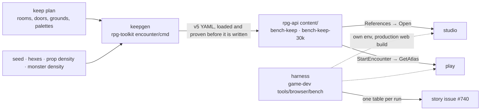

# Benchmark keep — the max size, built out and measured

Story rpg-project#740. Lane rpg-project#739. Walkthrough: [README.md](README.md).
Plan: [plan.md](plan.md). Site format law applies: [../site-format/design.md](../site-format/design.md).

## Shape

## Law

**Plan.** The keep is a plan file the generator reads: rooms with a name, a
footprint at keep scale, a lighting level and the side of the courtyard they
sit on; doors as room pairs; the courtyard; the west and south grounds; the
party start in the gatehouse; the gate and the postern as exits; a prop
palette and a monster palette per room kind. The plan is data so a layout
change is an edit, not a build.

**One keep, two scales.** Both fixtures come from the same plan and the same
door graph. The hex-count knob scales room dimensions, at most one and a half
times linear, and the grounds absorb the remainder exactly. A number that
moves between the two fixtures is the cost of size alone.

**Props exercise the engine.** Placed props carry declared footprints that
block movement and, for tall pieces, sight, so they feed the partition sight
index, pathing and sweep presence; dressing-only items are the minority. The
generator keeps door thresholds, the party start, exits and monster cells
clear, and refuses to write a site in which any room is unreachable from the
party start through open doors.

**Monsters stand.** Monsters are declared from the palette at a density with a
starting cell and no mind or patrol. They cost sight, seats and intel at
scale; what they do when driven is a follow-on knob.

**Defaults.** Rooms take one prop per 8 floor hexes and the grounds one per
40; two thirds of props block. Monsters take one per 100 floor hexes. Keep
scale is 10,000 hexes and the ceiling is 30,000. Every knob is on the command
line and the fixture's header comment records the command that made it.

**Proof before write.** The generator loads its own output through the
dialect's loader and refuses to write a file that does not compile, has no
free seat for four at the start, or fails the reachability rule. The same
inputs produce byte-identical output.

**Shelf.** The two fixtures live in the api's content directory under keys
that equal their file names and regenerate whenever the dialect, the plan or
the palette moves; a test in the api proves each shelf file equals the pinned
generator's output. The fixtures are measurement content, never edited by
hand and never the asset team's showcase.

**Caps from the yardstick.** The studio's static caps on items and document
size derive from R1 of site format: the ceiling fixture at default density
opens. A cap that refuses it is a defect in the cap, not in the fixture.

**Harness.** One command brings up its own environment on its own ports,
copies the fixtures onto that environment's shelf, builds the web for
production, drives the studio and play with a real GPU, and records the same
table every run: file, toolkit, server, studio and play rows per fixture,
each beside its R1 budget where one applies. Development-mode numbers are not
recorded.

**Where numbers live.** Each run is one table in a comment on the story issue
and the story body links the latest. The hot-spot list that seeds the two
follow-on efforts is drawn from the baseline table, not from reading code.

## Rulings

| ID | ruling | status | scope | ruled by | date |
|---|---|---|---|---|---|
| R1 | The generator mirrors FadedPez's keep: its named rooms around a courtyard with west and south grounds, doors between rooms, rather than a neutral layout. | settled | plan | KirkDiggler | 2026-10-30 |
| R2 | The 30k ceiling is the same keep at a larger scale: one plan and door graph at both sizes, rooms scaled by the knob, grounds absorbing the remainder, one wall line per seam. Closes site-format O4. | settled | generator, fixtures | KirkDiggler | 2026-10-30 |
| R3 | Props and monsters are placed to exercise the engine, not only the renderer: declared footprints in the majority, monsters at a density. | settled | generator | KirkDiggler | 2026-10-30 |

## Open

- **O1 Driven garrison.** Whether placed monsters get minds and patrol
  routes so the per-tick cost is measured too. Waits on the baseline.
- **O2 Cap values.** The item and document caps are set from the ceiling
  fixture's measured size with margin; the exact numbers land in the plan
  when the fixture exists.
- **O3 Autosave at scale.** The studio writes the whole document to browser
  storage on every commit; whether that survives a 30k document is a baseline
  finding, not a change here.
- **O4 Runs on the wire.** Site format O5 stands; the atlas size the baseline
  records is the measurement it waits for.
