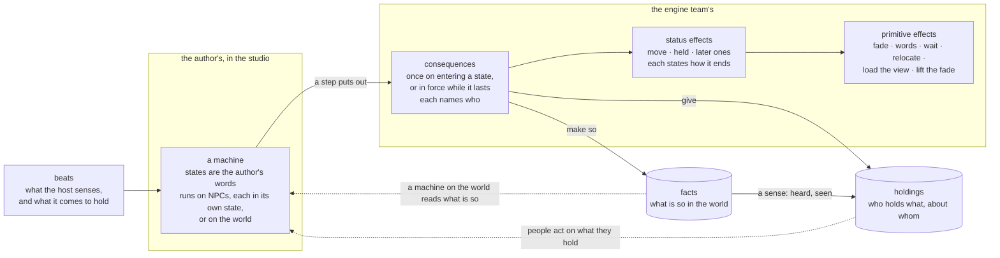

# Composable pieces — authors build stories from a few reusable pieces

Story rpg-project#987. Field note with the figures: [overview.html](overview.html).
The rulings below were taken one at a time on the story issue.

No piece is named after a story. An arrest, a jailing and a feast are things an
author writes from the pieces; the engine does not know those words.

## Shape

## Law

**Facts and holdings**

- A fact is something that is so in the world. It has no point of view.
- A holding is something someone holds, optionally about someone. It is always
  from the holder's point of view, and it may be wrong.
- Facts and holdings are two kinds. A fact can be so while nobody holds it.
- What is so of a person and shows is a holding on that person. Whoever sees
  them comes to hold it.
- Where a person is located is not stored as a fact or a holding. It is read
  from their position.

**Senses**

- A sense is the channel something comes in on: heard, seen.
- A fact reaches a person only through a sense the author wrote. Nothing becomes
  known because it became so.
- What someone holds reaches another only when it is transmitted, and the
  transmission is authored. Someone who was not present does not hold it.
- Telling is saying. It arrives by hearing.

**Machines**

- An author creates a machine. It runs on NPCs, each in its own state, or on
  the world. There is no other kind of machine: a conversation is not one.
- A machine's beats come from its host: the host's senses, and what the host
  comes to hold. A machine on the world is moved by the clock and by what is
  so.
- A state on an NPC is what that NPC is doing. What the NPC thinks of each
  person is a holding, never a state.
- States are the author's words. The engine gives no state a meaning.
- A machine is the same thing wherever it runs: one set of beats, one set of
  consequences.

**Consequences**

- A consequence is what a machine's step puts out. It is done once on entering
  a state, or it is in force while the state lasts.
- Every consequence names who it applies to.
- No group of people is stored. "The ones who" is whoever a holding is held
  about.
- Consequences are status effects composed by the engine team from primitive
  effects. The studio offers status effects, not primitive effects.
- A condition that limits a person states what ends it where the author applies
  it. A move knows nothing about holds.
- Being held in place never prevents fighting. A fight is always a way out.

**What this retires as engine words**

- `arrest`, `jail`, `sceneMove`, the custody phases, the reserved topics
  `arrested`, `wanted` and `jailed`, and the facts that exist only to bridge
  one reader to another.

## Rulings

Ruled by the operator on rpg-project#987.

| ID | ruling | status | scope | ruled by | date |
|---|---|---|---|---|---|
| R1 | Facts and what people hold are two kinds; facts are a plain list | settled | this story | KirkDiggler | 2026-11-18 |
| R2 | A fact is so in the world, not of a person | settled | this story | KirkDiggler | 2026-11-18 |
| R3 | Only "held" is a condition; arrested is not one; jailed is location | settled | this story | KirkDiggler | 2026-11-18 |
| R4 | Arrested is a holding | settled | this story | KirkDiggler | 2026-11-18 |
| R5 | A status that shows is held on the person; whoever sees them gains it | settled | this story | KirkDiggler | 2026-11-18 |
| R6 | The goal and the six pieces: fact, holding, sense, consequence, who, machine | settled | this story | KirkDiggler | 2026-11-18 |
| R7 | The author determines how a fact gets out | settled | this story | KirkDiggler | 2026-11-18 |
| R8 | A sense is the channel: heard, seen | settled | this story | KirkDiggler | 2026-11-18 |
| R9 | Three layers: machines the author's; status effects and primitive effects the engine team's; the studio's inputs are status effects | settled | this story | KirkDiggler | 2026-11-18 |
| R10 | A condition states its own endings where it is applied; a move knows nothing about holds | settled | this story | KirkDiggler | 2026-11-18 |
| R11 | What someone holds must be transmitted, and that is authored; reaching the captain is not the faction knowing | settled | this story | KirkDiggler | 2026-11-18 |
| R12 | How word spreads (announce, messenger, on sight, gossip) | deferred-until-the-machine-work-lands (rpg-project#992) | this story | KirkDiggler | 2026-11-18 |
| R13 | Start with the machine; it is the mind machine, also when applied to nobody | settled | this story | KirkDiggler | 2026-11-18 |
| R14 | Each NPC is in its own state on a machine; beats come from that NPC | settled | this story | KirkDiggler | 2026-11-18 |
| R15 | An NPC's state is what it is doing; what it thinks of each person is a holding | settled | this story | KirkDiggler | 2026-11-18 |
| R16 | The studio tool for consequences comes later | deferred-until-the-status-effects-exist | this story | KirkDiggler | 2026-11-18 |
| R17 | Machines run on NPCs or on the world; the separate conversation machine goes away | settled | this story | KirkDiggler | 2026-11-18 |
| R18 | A machine on the world | deferred-until-a-story-needs-it (rpg-project#991) | this story | KirkDiggler | 2026-11-18 |
| R19 | The engine work is recorded as stories (rpg-project#989, #990) and does not block improving the studio | settled | this story | KirkDiggler | 2026-11-18 |
| R20 | A conversation is its content, the things that can be said, not the storage of running it. It is written once and applied to a number of NPCs (rpg-project#987, issuecomment-7031378865, -7031795013) | settled | this story | KirkDiggler | 2026-11-20 |
| R21 | A conversation is lines and checks that have a consequence. A consequence lands on those who were in sight or hearing and is stored on each of them; an NPC who was away has nothing stored, though it carries the same conversation (issuecomment-7033215555) | settled | this story | KirkDiggler | 2026-11-20 |
| R22 | One shape for a guard, an altar and a grate: something offered to the player, an optional check, and consequences. A conversation is the case where the offer is something said (issuecomment-7033267815) | settled | this story | KirkDiggler | 2026-11-20 |
| R23 | What a conversation offers is decided for each carrier from what that carrier has recorded; a consequence that landed on one NPC and not another makes them offer different things (issuecomment-7033267815) | settled | this story | KirkDiggler | 2026-11-20 |
| R24 | A shared set of lines is not a bundle stretched to hold lines; no shortcut. A bundle is what follows a pass or a miss can use, not what a conversation is (issuecomment-7031745938) | settled | this story | KirkDiggler | 2026-11-20 |

Superseded cuts, one sentence each:

- One merged kind for facts and topics was the session's first recommendation;
  R1 replaced it because intel always has a point of view and a list of plain
  facts is wanted.
- "Condition" as the home for arrested, held and jailed was the session's
  reading; R3 replaced it because arrest does not stop a fight and jail is a
  place.
- One machine telling the gate's story with one shared state was agreed first;
  R14 replaced it because a guard who was away for the arrest should never
  enter that state.

## Open

- **The machine work, measured.** An NPC's machine gains a beat for a line
  said to it, consequences on a state, and reading what it holds about a
  particular person; a machine can run on the world. The size of each against
  the engine as it stands is being probed.
- **The who-words.** The list an author picks from, and whether authors can
  name their own.
- **Reuse.** Writing a machine once and applying it at a second gate with a
  different cell and words.
- **The effects system as the home for "held".** How content applies a
  condition, and how movement comes to ask about one.
- **The first status effects.** Move and held are named; their primitive
  effects are listed for move only.
- **The studio.** How machines, holdings and facts are authored and traced.
