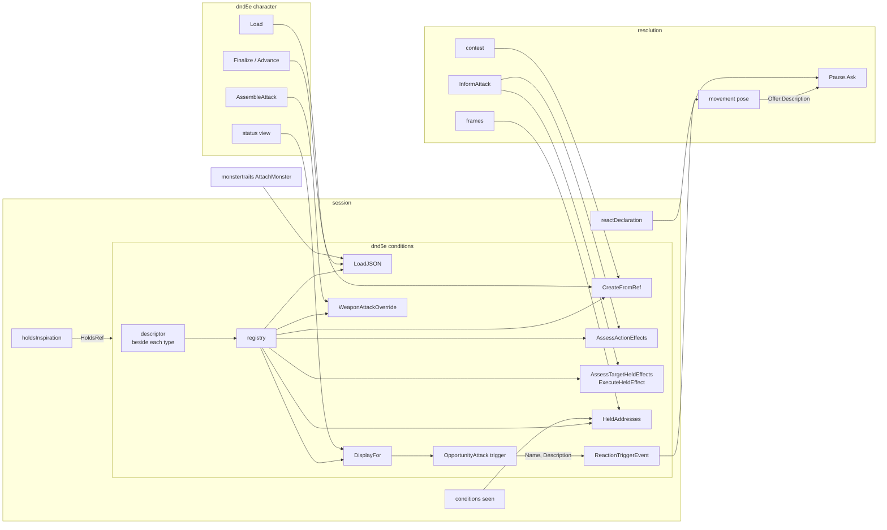

# The condition descriptor — walkthrough

For [rpg-toolkit#1965](https://github.com/KirkDiggler/rpg-toolkit/issues/1965)
tier 2 A. The law is [design.md](design.md); the slices are
[slices.md](slices.md).

## What this is

Every condition type carries **one descriptor** beside it: the ref it names
itself by, its display, how a stored blob loads, how a ref builds it, how it
bears on its holder's own action, how it bears on an attack against its
holder and the rule that answers that, and the offer it makes at attack
assembly (A4). The **registry** is the list of descriptors, keyed by full ref.
Loading, creating, display, effect rows, held addresses and attack overrides
are all reads of that one registry. The four monster traits are conditions and
join it (A2). The design adds no new kind of effect and no second identity:
the ref stays the identity, and the descriptor is the only place a fact about
a condition type is written.

## Component shape

## Ownership and contracts

| Component | Owns | Input → output |
|---|---|---|
| a condition type's file | Its type, its rules, its one `descriptor` | → `descriptor{ref, display, load, create, ownAction, againstHolder, heldRule, attackOverride}` |
| `conditions` registry | The set of condition types and the check that each entry is whole | `[]descriptor` → `map[ref.String()]descriptor`, or a refusal at package load |
| `LoadJSON` | Restoring a stored blob | `json.RawMessage` → `ConditionBehavior`, `ErrRetiredCondition` or `ErrUnknownCondition` |
| `CreateFromRef` | Building a type from a ref | `CreateFromRefInput{Ref, Config, MemberID, SourceRef}` → `ConditionBehavior`, `ErrUnknownCondition` or `ErrNotCreatable` |
| `DisplayFor` | A type's name and detail | `core.Ref` → `(Display, bool)` |
| `AssessActionEffects` | Rows for the holder's own action | loaded conditions, `Frame` → `[]contributions.Effect`, participation from `ownAction` |
| `AssessTargetHeldEffects`, `ExecuteHeldEffect` | Rows and execution for an attack against the holder | `Frame` → `[]contributions.Effect`; holder, held, frame → `Answer` |
| `HeldAddresses` | What a stored sheet holds, traits included | member, stored blobs → `[]ConditionAddress` |
| `WeaponAttackOverride` | A held condition's offer at assembly | `WeaponAttackOverrideInput{Condition, Swing}` → `weaponattack.OverrideOutput` |
| `character.AssembleAttack` | Choosing one offer for a swing (R22) | conditions, slot → `combatActions.Definition` |
| `monstertraits.AttachMonster` | Putting a monster's blobs on a bus with the attach roller | monster, bus, roller → attached monster |
| resolution movement pose | Posing an opportunity attack | `ReactionTriggerEvent` → `Pause{Ask{Offer{Ref, Name, Description}}}` |
| session `reactDeclaration` | The react row | `Pause` → `Declaration`, prose from the offer |

The refusals:

- A condition type's file does not register itself by side effect. It
  declares a value, and `descriptors` lists it, so the set is visible in one
  place and cannot depend on which packages a binary links.
- The registry does not hold a rule. It carries constructors and bearings;
  each answer still comes from the type's own `AssessAction`, held rule or
  override method.
- No read routes by id alone. A ref with a known id under another type is
  unknown.
- A rule's answer does not say how its effect takes part. The bearing does.
- `character` does not discover an offer by asserting an interface on a
  condition. It asks `WeaponAttackOverride`.
- `monstertraits` holds no trait type and no dispatch. It composes a monster's
  attach.
- Resolution does not special-case a condition `CreateFromRef` cannot build.
  A type that is imposed by content has a `create`.
- Session names no reaction's prose. The offer carries it.

## Walk one thing through

A skeleton stands next to a level-3 rogue who attacks it with a shortsword,
with advantage.

1. The skeleton's stat block authors two blobs with `conditions.MustVulnerabilityJSON`
   and `conditions.MustImmunityJSON`. Their refs are
   `dnd5e:monster_traits:vulnerability` and `dnd5e:monster_traits:immunity`.
2. Resolution attaches the skeleton. `AttachMonster` hands each blob to
   `conditions.LoadJSON`, which finds both refs in the registry and loads them
   with `loaderOf`. Neither implements `RollerBinder`, so no roller is bound.
3. Resolution builds the attack's frame. `HeldAddresses` lists the skeleton's
   two traits and its opportunity attack at their addresses. The traits are no
   longer skipped.
4. The rogue's information asks `AssessTargetHeldEffects`. Each trait's
   `againstHolder` is `notBearing`, so neither yields a row: what the skeleton
   resists is not the attacker's to know.
5. The rogue's own row for Sneak Attack comes from `AssessActionEffects`. The
   descriptor keyed `dnd5e:conditions:sneak_attack` says `answersNow`, so the
   row's participation is "contributes now" and its name and detail are the
   descriptor's display. Sneak Attack's answer carries its decision and its
   dice, and no participation.
6. The swing lands. The damage line from Sneak Attack names
   `dnd5e:conditions:sneak_attack`, the same ref the rogue grant names and the
   rogue's blob stores.

## Separations that look like one thing

| Query | Source of truth |
|---|---|
| What a condition type is called | `descriptor.display` |
| Which hand an enchanted weapon is bound to | the condition instance (`EquipmentBinding`) |
| Whether a type bears on an attack against its holder | `descriptor.againstHolder` |
| Whether it applies to this attack | the held rule's answer for this frame |
| How an effect takes part in an action | `descriptor.ownAction.participation` |
| Whether a member is held ready for a free reaction | `conditions.FreeReactions`, read through `FreeReactionRefs` |

A design that moved instance state onto the descriptor would make every
Shillelagh share one hand. A design that let a rule's answer restate its
participation would bring back two declarations and a runtime check between
them. Bearing and applicability are separate because a type can bear on every
attack against its holder and still not apply to this one: Prone from beyond
5 feet bears, and answers disadvantage, while Faerie Fire bears and does not
apply when the attacker cannot see.

## Trade-offs

| Decision | Benefit | Cost / boundary | Not taken |
|---|---|---|---|
| One explicit `descriptors` list | The set is in one place and every test can enumerate it | One line per new type in `registry.go`, paid by the author of the type | Self-registration in each file's `init` |
| A malformed list stops the package loading | A missing detail or held rule is found by any test, not at a player's click | A bad entry breaks every test in the module until fixed | Refusing at the first read |
| Traits move into `conditions` | `HeldAddresses` and `LoadJSON` enumerate traits with no import cycle | `monstertraits` keeps its name while holding only attach composition | A registry hook `monstertraits` fills at init |
| `descriptor` is unexported | The public surface stays the reads hosts already call | A new kind of read is added in `conditions` | Exporting the descriptor for other packages to walk |
| Undead Fortitude gets its roller through `RollerBinder` | Every load path is the same one-argument loader | A missing roller is refused at the save, not at load | A roller parameter on every loader |
| Sneak Attack keeps the condition ref | The grant, the factory and the API enum already name it | Stored data with the feature ref is reset, not translated (A6) | Keeping the feature ref and moving the grant |
| Retired Unarmored Movement and Shield blobs are dropped | A stored sheet keeps loading | Nothing tells a player the entry left | Refusing those sheets |

## Edges

- The descriptor carries the six facts A4 names. Concentration as a declared
  fact, a ward on attempt, and equipment binding are not descriptor fields.
  Each arrives with the use case that needs it.
- Extra Attack, the resource and feature catalogs in the status view, and
  the Bardic Inspiration ability switch are not conditions (A1) and stay
  outside the registry.
- A condition's own driver, such as session's Commanded driver, may name the
  condition it drives by full ref (A5).
- The character loader's lenient policy still drops a blob `LoadJSON`
  refused. The error is reported at the source; dropping it is that caller's
  ruled policy.
- rpg-api's v1alpha1 condition name and enum tables stay. They map toolkit
  ids onto proto enums and are not in this design.

## Where a change lands

- **A new condition type.** Its file declares the type and its descriptor,
  and `descriptors` lists it. `newRegistry` refuses it until the display,
  bearings and held rule agree. Nothing else changes.
- **A rule that starts answering for information.** Pack Tactics moving from
  `notYetAnswering` to `answersNow` implements `ActionAssessor` on its type
  and changes its bearing. The rows follow.
- **A new attack-assembly offer.** The type adds `attackOverride` to its
  descriptor. `AssembleAttack` picks it up, and two offers on one swing still
  refuse.

## Source map

| Concern | Where (rpg-toolkit `rulebooks/dnd5e/`) |
|---|---|
| The descriptor and bearings | `conditions/descriptor.go` |
| The registry and its derived reads | `conditions/registry.go` |
| Loading and the retired set | `conditions/loader.go` `LoadJSON`, `retiredConditions` |
| Building from a ref | `conditions/factory.go` `CreateFromRef` |
| Display | `conditions/display.go` `DisplayFor` |
| Effect rows | `conditions/action_effects.go`, `conditions/target_held.go` |
| What a stored sheet holds | `conditions/holds.go` `HeldAddresses` |
| The traits | `conditions/trait_*.go` |
| Monster attach | `monstertraits/loader.go` `AttachMonster` |
| Attack assembly | `character/attack_definition.go` `weaponAttackOverride` |
| A fighting style's condition | `fightingstyles` `ConditionRef`, `character/draft.go` |
| Imposing a condition | `resolution/contest.go` `prepareCondition` |
| Opportunity offer prose | `conditions/opportunity_attack.go`, `resolution/movement_pose.go` `askOpportunity`, `session/window.go` `reactDeclaration` |
