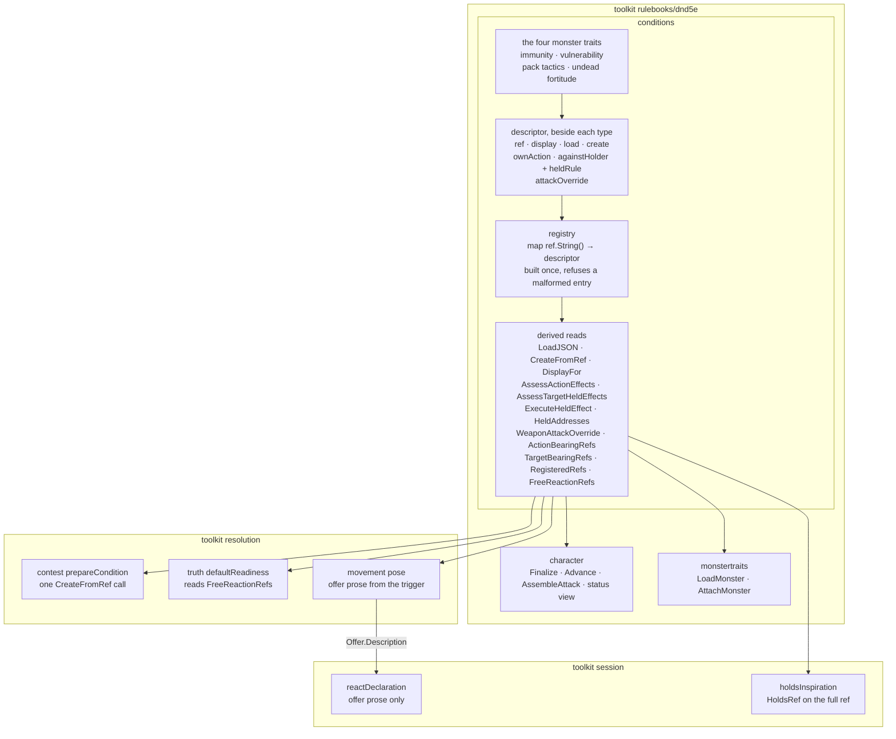

# The condition descriptor — one entry per condition, everything else read from it

Tracking: [rpg-toolkit#1965](https://github.com/KirkDiggler/rpg-toolkit/issues/1965)
tier 2 A. Walkthrough: [README.md](README.md). Slices: [slices.md](slices.md).

## Shape



A condition is a type that listens to chain events and makes modifications
(A1). Each type carries one descriptor beside it. The registry is the list of
those descriptors, keyed by each one's full ref. Every answer that names a
condition — how to load it, how to build it, what it is called, how it bears
on an action, what it offers at attack assembly — is a read of the registry.
No other table keyed by a condition ref exists in the toolkit. The retired
set is the one list beside it, and it names refs that have no type.

### dnd5e conditions

```go
// descriptor.go

// bearing is how a condition type bears on one kind of action: its holder's
// own action, or an attack against its holder. The zero value does not bear.
type bearing struct {
	kind          bearingKind
	participation contributions.Participation
}

type bearingKind uint8

const (
	bearingNone            bearingKind = iota // yields no row
	bearingAnswers                            // answers through a rule
	bearingNotYetAnswering                    // bears but cannot yet answer: an unavailable row
)

var (
	notBearing      = bearing{}
	answersNow      = bearing{kind: bearingAnswers, participation: contributions.ContributesNow}
	answersLater    = bearing{kind: bearingAnswers, participation: contributions.LaterChoice}
	notYetAnswering = bearing{kind: bearingNotYetAnswering, participation: contributions.ContributesNow}
)

// descriptor is the one entry for one condition type.
type descriptor struct {
	// ref is the one ref the type names itself by: what Ref returns, what
	// ToJSON writes, and the registry key (ref.String()).
	ref *core.Ref

	// display is the type's status-visible name and detail. Name is never
	// empty. Detail is required when either bearing is not notBearing.
	display Display

	// load restores a stored blob. Required.
	load func(json.RawMessage) (dnd5eEvents.ConditionBehavior, error)

	// create builds the type from a ref, its config and its holder. Nil for a
	// type nothing builds from a ref: a free reaction, a stat-block trait,
	// a condition its own feature constructs.
	create func(*CreateFromRefInput) (dnd5eEvents.ConditionBehavior, error)

	// ownAction is the bearing on the holder's own action.
	ownAction bearing

	// againstHolder is the bearing on an attack against the holder.
	againstHolder bearing

	// heldRule builds the rule that answers for an attack against the
	// holder. Present exactly when againstHolder answers.
	heldRule heldRuleFor

	// attackOverride is the type's die-or-ability offer at attack assembly.
	// Nil for a type that makes none.
	attackOverride func(dnd5eEvents.ConditionBehavior, *weaponattack.OverrideInput) (*weaponattack.OverrideOutput, error)
}

// registry.go

// descriptors is every registered condition type, one value per type,
// each declared in its type's own file.
var descriptors = []descriptor{ /* shillelaghDescriptor, ragingDescriptor, … */ }

// registry is descriptors keyed by ref.String(). newRegistry refuses a
// malformed list; the package does not load with one.
var registry = mustRegistry(descriptors)

// ErrUnknownCondition is wrapped by every read handed a ref the registry does
// not hold.
var ErrUnknownCondition = errors.New("condition ref is not registered")

// ErrNotCreatable is wrapped by CreateFromRef for a registered type whose
// descriptor has no create.
var ErrNotCreatable = errors.New("condition type is not created from a ref")

// loaderOf is the one load body: a zero value of T reads the blob.
func loaderOf[T any, P interface {
	*T
	dnd5eEvents.ConditionBehavior
	loadJSON(json.RawMessage) error
}]() func(json.RawMessage) (dnd5eEvents.ConditionBehavior, error)

// RegisteredRefs lists every registered ref, sorted.
func RegisteredRefs() []string

// FreeReactionRefs lists the refs of FreeReactions, the one list of
// reactions a combatant carries by existing.
func FreeReactionRefs() []string

// WeaponAttackOverrideInput is one held condition and the swing it may offer for.
type WeaponAttackOverrideInput struct {
	Condition dnd5eEvents.ConditionBehavior
	Swing     *weaponattack.OverrideInput
}

// WeaponAttackOverride asks a held condition's descriptor for its offer. A
// descriptor with no attackOverride answers an output with a nil Override.
// Errors: nil input or condition, an unregistered ref (ErrUnknownCondition),
// and whatever the offer itself refuses.
func WeaponAttackOverride(in *WeaponAttackOverrideInput) (*weaponattack.OverrideOutput, error)
```

The exported reads that exist today keep their signatures and become reads of
the registry:

| Read | Answers from |
|---|---|
| `LoadJSON` | retired set, then `descriptor.load` |
| `CreateFromRef` | `descriptor.create`, routed by the whole parsed ref |
| `DisplayFor` | `descriptor.display` |
| `AssessActionEffects` | `descriptor.ownAction`, `descriptor.display` |
| `AssessTargetHeldEffects` | `descriptor.againstHolder`, `descriptor.heldRule`, `descriptor.display` |
| `ExecuteHeldEffect` | `descriptor.heldRule` |
| `HeldAddresses` | registry membership, then `LoadJSON` |
| `ActionBearingRefs`, `TargetBearingRefs` | the two bearings |

### dnd5e contributions

```go
// Answer loses Participation. A rule's answer carries its decision and its
// contribution; how the effect takes part is the descriptor's.
type Answer struct {
	Decision   Decision
	Benefit    string
	Damage     []DamageChange
	Roll       []DiceContribution
	AttackMode AttackMode
}
```

### dnd5e events

```go
// ReactionTriggerEvent gains the offerer's prose beside its name.
type ReactionTriggerEvent struct {
	// ...unchanged...

	// Description is what taking the reaction does, read from the offering
	// condition's display detail. Empty when the offerer authored none.
	Description string
}
```

The narrower alternative is for `askOpportunity` to read `DisplayFor` itself
and leave the event unchanged. The field is kept because the offerer's prose
belongs beside the offerer's name, which the event already carries from the
same display read.

### dnd5e fightingstyles

```go
// ConditionRef is the condition a fighting style grants. ok is false for
// Unspecified and for a style this package does not name.
func ConditionRef(f FightingStyle) (ref *core.Ref, ok bool)
```

## Law

### The entry

- **A condition is described once, beside its type; everything else reads the
  description.** A table keyed by a condition ref outside the registry is a
  second source of truth that drifts from the first.
- One descriptor per condition type, declared in the type's own file.
  `descriptors` lists them. The registry key is `ref.String()`, the full ref;
  nothing routes by id alone.
- The ref a descriptor names is the ref the type's `Ref` returns and its
  `ToJSON` writes. One type has one ref.
- `newRegistry` refuses, and the package does not load with: a nil ref, two
  entries with one ref, a nil `load`, an empty display name, a bearing other
  than `notBearing` with an empty detail, an answering `againstHolder` without
  a `heldRule`, and a `heldRule` on a bearing that does not answer.
- An entry whose `ownAction` answers names a type that implements
  `contributions.ActionAssessor`, asserted at compile time beside the entry.
- `create` is present for every type `CreateFromRef` builds today, and for
  Blessed and Baned. A type its own feature constructs, a free reaction and a
  stat-block trait have none.
- `attackOverride` is present for Martial Arts and Shillelagh, the two types
  that offer at attack assembly (A3).

### What is derived

- `LoadJSON` drops a retired ref with `ErrRetiredCondition`, then loads
  through the descriptor. `CreateFromRef` parses the ref and looks up its
  whole string; module and type checks are the lookup.
- `DisplayFor` is a lookup of `descriptor.display`. The status view, the
  information facts, the activation identity and the offer prose all read it.
- `AssessActionEffects` and `AssessTargetHeldEffects` take each row's
  participation from the descriptor's bearing. A rule's answer carries no
  participation, so nothing reconciles two declarations at runtime.
- `ActionBearingRefs`, `TargetBearingRefs` and `RegisteredRefs` are filters
  over the registry. Tests that cover every condition read these.
- Character attack assembly asks `WeaponAttackOverride` for each held
  condition. Two offers for one swing still refuse with
  `CodeConflictingState` (R22 of rpg-project#535); the walk that finds offers
  asserts no interface.
- Character creation builds a fighting style's condition through
  `CreateFromRef` with `fightingstyles.ConditionRef`. The style's display is
  its condition's display.
- Resolution's free-reaction readiness reads `FreeReactionRefs`.
  `FreeReactions` stays the one list.
- Resolution's contest builds every imposed condition with one
  `CreateFromRef` call.
- An opportunity attack's trigger carries its descriptor's name and detail,
  read through `DisplayFor`. Resolution's movement pose copies both onto the
  offer. Session's react row reads the offer and names no reaction.

### Traits join the registry

- The four monster traits are conditions (A2). Their types and descriptors
  live in `conditions` beside every other condition. `monstertraits` keeps
  the monster attach composition and holds no trait type.
- A trait has no `create`; a stat block authors its blob. Each trait's
  bearings are `notBearing`, except Pack Tactics on its holder's own action,
  which is `notYetAnswering`: it modifies the attack chain and has no
  information rule.
- Undead Fortitude receives its roller through `RollerBinder` at attach.
  `AttachMonster` binds its roller to every loaded condition that implements
  `RollerBinder`. Undead Fortitude with no bound roller refuses its save with
  an error.
- A trait is held. `HeldAddresses`, resolution's frames and session's
  observed condition sets list a monster's traits at their addresses.

### Error posture

- Every registry read handed an unregistered ref returns an error wrapping
  `ErrUnknownCondition`. An unregistered ref on a stored blob is never read as
  "not held".
- A retired ref is not unregistered. `HeldAddresses` skips a blob for which
  `IsRetired` is true before it calls `LoadJSON`, as the sheet loaders do.
  `AssessTargetHeldEffects` skips a held ref in the retired set. Both read one
  list through `isRetiredRef(ref string) bool`, beside `IsRetired`. A sheet or
  a stored sighting that names a retired ref keeps answering.
- `CreateFromRef` on a registered type with no `create` returns
  `ErrNotCreatable`.
- A caller's lenient load policy may drop a blob `LoadJSON` refused, with its
  warning. That policy belongs to the caller and this design does not change
  it.
- An unknown Unarmored Defense variant, or a missing one, is refused. Both
  grants name their variant.

### Removed kinds and refs

- Unarmored Movement is not a condition (A3). Its type, entry and factory
  case are deleted, and `dnd5e:conditions:unarmored_movement` joins the
  retired set, so a stored blob is dropped.
- The Shield spell condition is retired (Q6). Its type is deleted and
  `dnd5e:spells:shield` joins the retired set.
- Sneak Attack has one ref, `refs.Conditions.SneakAttack`, the ref the rogue
  grant names. `refs.Features.SneakAttack` is deleted. A stored blob carrying
  the feature ref is unregistered (Open 1).

### Seams that name a condition

| Seam | Verdict |
|---|---|
| `session/inspiration.go` `holdsInspiration` | Replaced. `conditions.HoldsRef` on the full Inspired ref. A missing character sheet is `false`; any other sheet error is returned. |
| `session/inspiration.go` `allyCandidatesFor` | Stays. It switches on the Bardic Inspiration feature, which is not a condition. |
| `session/participation.go` `holdsCompulsion`, `session/compelled.go` `commandedIn`, the compelled `Source` and `Cause` | No verdict. A4 lists them among the seams it deletes; keeping them needs a ruling (Open 2). |
| `resolution/contest.go` Bless and Bane branches | Replaced by their `create`. |
| `resolution/truth.go` `freeReactions` | Replaced by `FreeReactionRefs`. |
| `session/information.go` `reactionDescription` and its fallback in `session/window.go` | Replaced by the offer's description. The opportunity attack fills `ReactionTriggerEvent.Description` from its descriptor and resolution's movement pose copies it. |
| `character/status_view.go` `projectConditions` | Stays a `DisplayFor` read. The resource and feature catalogs in the same file name resources and features, not conditions. |
| `character/character.go` `GetExtraAttacksCount` | Stays. Extra Attack listens to nothing; it is a class fact, not a condition (A1). |
| `character/equipment_conditions.go` `removeReleasedEquipmentConditions`, its two inline interfaces | Stay. Which hand an enchanted weapon is bound to is per-instance state, not a fact about the type, so no descriptor field can carry it. |
| `character/spend_profile.go` Martial Arts check, `resolution/short_rest.go` Concentrating check | Stay. Each is one condition's own rule naming that condition. |

### Tier 3 that rides along

- `conditions/types.go` is deleted. Nothing reads it.
- `monstertraits.AllTraitRefs` is deleted with the trait dispatch.
- `character.StructurallyPermanentConditionRefs` is deleted with
  `fightingStyleConditionRef`. Nothing calls it.
- The Unarmored Defense default-to-barbarian goes with the factory switch.
- The case-file narration in the display catalog and the Guiding Bolt
  loader's wrong error text go with their tables.

Tier 3 that waits for its own deletion PR:

- The free-reaction merge in `HeldAddresses`. Removing it depends on every
  stored sheet naming its free reactions, which the code cannot show.
- `ConditionAppliedEvent.Type`. Its fourteen publishers sit in files this
  design does not touch.
- `loadedEffect` and `peekEffectRef`. `character/load.go` is not touched.

### What is deleted

**dnd5e root**

1. `conditionLoaders` and its thirty-nine entries.
2. The `CreateFromRef` switch on id, with its module and type checks.
3. `actionCensus` and `action_census.go`.
4. `targetCensus` and `target_census.go`.
5. `targetHeldRules`.
6. `displayCatalog`.
7. `censusEntry`, `censusClass` and `bearingRefs`; `bearing` replaces them.
8. `contributions.Answer.Participation`, its five setters, and
   `validateAnswer`'s participation comparison.
9. `UnarmoredMovementCondition`, its input, data, constructor, factory helper
   and file.
10. `ShieldSpellCondition`, its constructor and file.
11. `refs.Features.SneakAttack`.
12. `monstertraits.LoadJSON`: its type-routing branch and its trait switch.
13. `monstertraits.AllTraitRefs`.
14. The "not a condition" branch in `HeldAddresses`.
15. `weaponattack.OverrideProvider` and the type-assertion walk in
    `weaponAttackOverride`.
16. `createFightingStyleCondition`.
17. `fightingStyleConditionRef`, `StructurallyPermanentConditionRefs` and
    `permanent_conditions.go`.
18. `fightingstyles.Name` and `fightingstyles.Description`.
19. `conditions/types.go`.
20. The Unarmored Defense default variant.
21. The census and catalog drift tests: every-loader-is-classified twice,
    answering-refs-have-held-rules, bearing-loaders-have-descriptions twice,
    and the Shield catalog exclusion. `newRegistry` makes each drift
    impossible.

**dnd5e resolution**

22. The Blessed and Baned branches of `prepareCondition`.
23. `freeReactions`.

**dnd5e session**

24. `reactionDescription` and the react row's fallback to it.
25. `holdsInspiration`'s hand-copied peek struct and its id comparison.

**rpg-api**

26. The two `refs.Features.SneakAttack` cases in the v1alpha1 feature
    converters.

Twenty-six deletions. Six parallel tables keyed by condition ref become one
registry.

### Proof

- A stored monster sheet with an immunity blob reports the immunity at its
  address from `HeldAddresses`.
- A stored blob whose ref nothing registers fails `HeldAddresses`,
  `LoadJSON` and `CreateFromRef` with `ErrUnknownCondition`.
- A stored sheet carrying an `in_fog`, `unarmored_movement` or `spells:shield`
  blob beside Prone reports Prone alone from `HeldAddresses`, with no error.
- Bless and Bane are imposed by a cast through `CreateFromRef`.
- A monk's unarmed swing deals the Martial Arts die through
  `WeaponAttackOverride`; Shillelagh on a club beside Martial Arts refuses the
  swing with `CodeConflictingState`.
- Inspired's row is a later choice, read from its descriptor.
- An opportunity attack's react row reads the descriptor's detail.
- A rogue's Sneak Attack names `dnd5e:conditions:sneak_attack` on its grant,
  its blob and its damage line.

### The wire

- No proto change. Condition refs on the wire keep their strings, except
  Sneak Attack's damage source, which reads `dnd5e:conditions:sneak_attack`.
  The web renders the source string it receives.

## Rulings

| ID | status | scope | ruled by | date |
|---|---|---|---|---|
| A1 | settled | A condition is something that listens to chain events and makes modifications. Conditions may deviate from RAW; old comments describing a different game are not law. | KirkDiggler | 2026-10-11 |
| A2 | settled | Monster traits are conditions and live in the one registry. The "not a condition" branch in `HeldAddresses` goes; an unregistered ref on a stored blob is an error, not "not held". | KirkDiggler | 2026-10-11 |
| A3 | settled | A listener of nothing is not a condition: Unarmored Movement is deleted. Martial Arts and Shillelagh stay conditions; their attack-assembly override becomes a declared bearing on the descriptor and the `weaponattack.OverrideProvider` type-assertion walk goes. | KirkDiggler | 2026-10-11 |
| A4 | settled | One entry per condition type: loader, factory constructor, display, bearing on the holder's own action, bearing on attacks against the holder with its held-rule constructor, and the attack-assembly override. Everything else derived. The parallel tables and id-naming seams listed under A in rpg-toolkit#1965 are deleted. | KirkDiggler | 2026-10-11 |
| Q6 | settled | Shield is retired now and ported onto the post-roll window when a playable sheet can hold it, so the descriptor carries no dead entry. | KirkDiggler | 2026-10-07 |

What each ruling makes true here:

- **A1.** The descriptor describes listeners. Extra Attack and the resource
  catalogs are not conditions and stay out of the registry.
- **A2.** The four traits move into `conditions` with descriptors, so the
  registry can enumerate them without importing `monstertraits`.
  `ErrUnknownCondition` is the error every read returns.
- **A3.** `attackOverride` is the descriptor field; `WeaponAttackOverride` is
  the read; `OverrideProvider` is deleted. Unarmored Movement's blob is
  retired rather than refused, because the type is gone, not unknown.
- **A4.** The descriptor fields are exactly the six A4 lists, plus the ref
  that keys it. Participation rides the bearing, so it is declared once.
- **Q6.** `ShieldSpellCondition` is deleted in the root slice and its blob is
  retired.

## Open

1. **Stored data naming `dnd5e:features:sneak_attack` (needs A6).** After the
   root slice that ref is unregistered, and three readers meet it:
   - **Lenient load.** The character loader drops the blob with a warning.
     The next save writes the sheet back without it, so the rogue loses
     Sneak Attack for good and nothing tells the player.
   - **Strict reads.** `HeldAddresses` returns `ErrUnknownCondition` for that
     sheet, as A2 intends. Resolution's frame read fails, so every attack by
     or against an existing rogue fails. Session's observed condition sets
     report the rogue's holdings as unknown.
   - **Stored testimony.** A sighting recorded before the slice names the
     feature ref. `AssessTargetHeldEffects` fails the information of any
     attacker who saw that rogue.

   This is durable sheet and encounter data, so the frozen-pause precedent
   (E5) does not cover it. Recommendation: reset the character sheets and
   session records in every store before slice 1 merges (slices, "Reset").
   The alternative is a loader translation from the old ref, which is a
   compatibility path this design does not otherwise carry.

2. **The Commanded seams (needs A5).** A4 deletes the id-naming seams listed
   under A in rpg-toolkit#1965, and that list includes
   `session/participation.go` `holdsCompulsion` and `session/compelled.go`
   `commandedIn` with the compelled `Source` and `Cause`. On the code they
   already read through `HoldsRef` and `DecodeCommanded` on the full
   Commanded ref, so nothing compares by id alone. They are Commanded's own
   driver, and naming the condition it drives is the driver's job. Their
   per-blob leniency is deliberate: each doc ties it to the character
   loader's lenient policy and its tested rulings, and the two readers must
   agree so a member called Driven always has a driver. Recommendation: rule
   that they stay unchanged, recorded as A5. Until then the design gives them
   no verdict.
