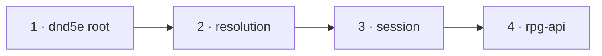

# The condition descriptor — slices

A working document beside [design.md](design.md): slice order, the task list a
worker executes per module, what done means, and what is deleted. Every
`file:line` is at rpg-toolkit `origin/main` `47404a8c` (dnd5e v0.209.0 ·
encounter v0.123.0 · resolution v0.69.0 · session v0.129.0) and rpg-api `dev`
`db831a51`. Toolkit paths are relative to `rulebooks/dnd5e/`. Line numbers
drift as a slice edits a file; the symbol beside each line is the anchor.

Develop outside-in, merge inside-out. One nearest-`go.mod` module per toolkit
PR. Each dependent builds on its provider's gate-approved branch head, never a
draft, and re-pins to the provider's tag at merge-out. Toolkit CI cannot
resolve a branch pseudo-version, so every dependent PR stays a draft until that
re-pin. The squash title's prefix picks the tag bump. Encounter does not import
dnd5e, so no encounter slice exists. No protos or web slice exists (design,
"The wire").

Every command runs with `GOTOOLCHAIN=go1.24.5` from the module directory.
Commit with every pre-commit check running; a "(cached)" pre-commit result ran
nothing.

## Order



| # | Module | PR title |
|---|---|---|
| 1 | `rulebooks/dnd5e` | `refactor!: one descriptor per condition; traits join the registry (toolkit#1965 A)` |
| 2 | `rulebooks/dnd5e/resolution` | `refactor(resolution): build every condition through the registry; reaction prose from the offer (toolkit#1965 A)` |
| 3 | `rulebooks/dnd5e/session` | `refactor(session): react prose from the offer; inspiration asks HoldsRef (toolkit#1965 A)` |
| 4 | rpg-api `dev` | `chore(deps): pin dnd5e, resolution and session for the condition descriptor (toolkit#1965 A)` |

The reset step below runs at merge-out (A6). No slice touches the Commanded
seams (A5).

Root carries `!`: it removes `weaponattack.OverrideProvider`,
`refs.Features.SneakAttack`, `contributions.Answer.Participation`,
`fightingstyles.Name`/`Description`, `character.StructurallyPermanentConditionRefs`,
`monstertraits.LoadJSON`/`AllTraitRefs`, the trait helpers' `monstertraits`
home, and the Unarmored Movement and Shield condition types. Resolution and
session remove nothing exported.

## The entries

Every registered type and its descriptor fields. `create` "yes" means a
`create` closure; "—" means nil. Bearings use the design's names. Display
names and details are copied from today's `displayCatalog` (`display.go:49`)
unless a row says otherwise.

| Ref | Type | create | ownAction | againstHolder | heldRule | attackOverride |
|---|---|---|---|---|---|---|
| `conditions:shillelagh` | `ShillelaghCondition` | yes | answersNow | notBearing | — | yes |
| `conditions:raging` | `RagingCondition` | yes | answersNow | notBearing | — | — |
| `conditions:brutal_critical` | `BrutalCriticalCondition` | yes | answersNow | notBearing | — | — |
| `conditions:unarmored_defense` | `UnarmoredDefenseCondition` | yes | notBearing | notBearing | — | — |
| `conditions:fighting_style_archery` | `FightingStyleArcheryCondition` | yes | answersNow | notBearing | — | — |
| `conditions:fighting_style_defense` | `FightingStyleDefenseCondition` | yes | notBearing | notBearing | — | — |
| `conditions:fighting_style_dueling` | `FightingStyleDuelingCondition` | yes | answersNow | notBearing | — | — |
| `conditions:fighting_style_great_weapon_fighting` | `FightingStyleGreatWeaponFightingCondition` | yes | answersNow | notBearing | — | — |
| `conditions:fighting_style_protection` | `FightingStyleProtectionCondition` | yes | notBearing | notBearing | — | — |
| `conditions:fighting_style_two_weapon_fighting` | `FightingStyleTwoWeaponFightingCondition` | yes | answersNow | notBearing | — | — |
| `conditions:improved_critical` | `ImprovedCriticalCondition` | yes | answersNow | notBearing | — | — |
| `conditions:reckless_attack` | `RecklessAttackCondition` | — | answersNow | answersNow | `newRecklessHeldRule` | — |
| `conditions:martial_arts` | `MartialArtsCondition` | yes | answersNow | notBearing | — | yes |
| `conditions:sneak_attack` | `SneakAttackCondition` | yes | answersNow | notBearing | — | — |
| `conditions:disengaging` | `DisengagingCondition` | yes | notBearing | notBearing | — | — |
| `conditions:dodging` | `DodgingCondition` | yes | notBearing | answersNow | `newDodgingHeldRule` | — |
| `conditions:prone` | `ProneCondition` | yes | answersNow | answersNow | `newProneHeldRule` | — |
| `conditions:hidden` | `HiddenCondition` | yes | answersNow | answersNow | `newHiddenHeldRule` | — |
| `conditions:inspired` | `InspiredCondition` | yes | answersLater | notBearing | — | — |
| `conditions:helped` | `HelpedCondition` | yes | answersNow | notBearing | — | — |
| `conditions:unconscious` | `UnconsciousCondition` | — | notBearing | notBearing | — | — |
| `conditions:opportunity_attack` | `OpportunityAttackCondition` | — | notBearing | notBearing | — | — |
| `conditions:true_strike` | `TrueStrikeCondition` | yes | answersNow | notBearing | — | — |
| `conditions:blade_ward` | `BladeWardCondition` | yes | notBearing | notBearing | — | — |
| `conditions:vicious_mockery` | `ViciousMockeryCondition` | yes | answersNow | notBearing | — | — |
| `conditions:commanded` | `CommandedCondition` | yes | notBearing | notBearing | — | — |
| `conditions:concentrating` | `ConcentratingCondition` | yes | notBearing | notBearing | — | — |
| `conditions:blessed` | `BlessedCondition` | yes (new) | answersNow | notBearing | — | — |
| `conditions:baned` | `BanedCondition` | yes (new) | answersNow | notBearing | — | — |
| `conditions:divine_favor` | `DivineFavorCondition` | yes | answersNow | notBearing | — | — |
| `conditions:faerie_fire` | `FaerieFireCondition` | yes | notBearing | answersNow | `newFaerieFireHeldRule` | — |
| `conditions:shield_of_faith` | `ShieldOfFaithCondition` | yes | notBearing | notBearing | — | — |
| `conditions:guided` | `GuidedCondition` | yes | notBearing | notBearing | — | — |
| `conditions:resistance` | `ResistanceCondition` | yes | notBearing | notBearing | — | — |
| `conditions:sanctuary` | `SanctuaryCondition` | yes | notYetAnswering | answersNow | `newSanctuaryHeldRule` | — |
| `conditions:sanctuary_immune` | `SanctuaryImmuneCondition` | yes | notBearing | notBearing | — | — |
| `conditions:guiding_bolt` | `GuidingBoltCondition` | yes | notBearing | answersNow | `newGuidingBoltHeldRule` | — |
| `monster_traits:immunity` | `immunityCondition` | — | notBearing | notBearing | — | — |
| `monster_traits:vulnerability` | `vulnerabilityCondition` | — | notBearing | notBearing | — | — |
| `monster_traits:pack_tactics` | `packTacticsCondition` | — | notYetAnswering | notBearing | — | — |
| `monster_traits:undead_fortitude` | `undeadFortitudeCondition` | — | notBearing | notBearing | — | — |

All refs are in module `dnd5e`. Display rows that change:

| Ref | Name | Detail |
|---|---|---|
| `conditions:opportunity_attack` | Opportunity Attack | Use your reaction to make one melee attack against a creature that leaves your reach. |
| `monster_traits:immunity` | Damage Immunity | (empty) |
| `monster_traits:vulnerability` | Damage Vulnerability | (empty) |
| `monster_traits:pack_tactics` | Pack Tactics | Has advantage on an attack roll against a creature when at least one of its allies is within 5 feet of that creature. |
| `monster_traits:undead_fortitude` | Undead Fortitude | (empty) |
| `conditions:sneak_attack` | Sneak Attack | today's detail, keyed by the condition ref |

## 1. toolkit dnd5e root

### Types

As in [design.md](design.md): `bearing`, `bearingKind`, `notBearing`,
`answersNow`, `answersLater`, `notYetAnswering`, `descriptor`, `descriptors`,
`registry`, `ErrUnknownCondition`, `ErrNotCreatable`, `loaderOf`,
`RegisteredRefs`, `FreeReactionRefs`, `WeaponAttackOverrideInput`,
`WeaponAttackOverride`, `contributions.Answer` without `Participation`,
`ReactionTriggerEvent.Description`, `fightingstyles.ConditionRef`.

Unexported helpers in `conditions/registry.go`:

```go
// newRegistry keys list by ref.String() and refuses a malformed entry
// (design, "The entry"), naming the entry's ref or index in the error.
func newRegistry(list []descriptor) (map[string]descriptor, error)

// mustRegistry is newRegistry for the package variable; it panics with
// newRegistry's error.
func mustRegistry(list []descriptor) map[string]descriptor

// lookup is the one registry read. An unregistered ref returns an error
// wrapping ErrUnknownCondition with CodeInvalidArgument.
func lookup(ref string) (descriptor, error)
```

### Tasks, in this order

1. **`conditions/descriptor.go`** (new): `bearing`, `bearingKind`, the four
   bearing values, `descriptor`, `loaderOf`. `loaderOf` builds `new(T)`, calls
   `loadJSON`, and on error returns `nil` with the error wrapped
   `failed to load <ref>` where `<ref>` is the zero value's `Ref().String()`.
2. **`conditions/registry.go`** (new): `descriptors`, `registry`,
   `ErrUnknownCondition`, `ErrNotCreatable`, `newRegistry`, `mustRegistry`,
   `lookup`, `RegisteredRefs` (sorted keys), `FreeReactionRefs` (the
   `Ref().String()` of each `FreeReactions("")` value, in list order),
   `WeaponAttackOverrideInput`, `WeaponAttackOverride`. `WeaponAttackOverride`
   refuses a nil input, a nil condition or a nil `Ref()` with
   `CodeInvalidArgument`; looks the ref up; returns
   `&weaponattack.OverrideOutput{}` when `attackOverride` is nil; otherwise
   returns the closure's answer.
3. **One descriptor per type.** In each type's own file, add
   `var <name>Descriptor = descriptor{...}` with the fields from "The
   entries". `load` is `loaderOf[<Type>]()` for every row. Add
   `var _ contributions.ActionAssessor = (*<Type>)(nil)` beside every entry
   whose `ownAction` is `answersNow` or `answersLater`, where the file does
   not already carry it. `create` adapts today's factory case
   (`factory.go:71-144`) to `func(in *CreateFromRefInput)
   (dnd5eEvents.ConditionBehavior, error)`: keep each `createX` helper and
   pass `in.Config`, `in.MemberID`, `in.SourceRef` as its case does today.
   Shillelagh's and Divine Favor's inline cases become closures with the same
   body. `attackOverride` for Martial Arts and Shillelagh asserts its own
   concrete type, returns a `CodeInternal` error naming the ref on a
   mismatch, and calls the type's `WeaponAttackOverride` method. List every
   descriptor in `descriptors`, in the table's order.
4. **Blessed and Baned `create`.** Add `createBlessed` and `createBaned` in
   `factory.go`, each with the body of its branch in
   `resolution/contest.go` `prepareCondition` (`:366-403`): unmarshal
   `{"source_id"}` from `in.Config`, `core.ParseString(in.SourceRef)`, call
   `NewBlessedCondition` / `NewBanedCondition` with `MemberID: in.MemberID`.
   Wrap failures as `build condition blessed for %q` / `baned`, as today.
5. **Traits move into `conditions`.** Move `monstertraits/immunity.go`,
   `vulnerability.go`, `pack_tactics.go`, `undead_fortitude.go` to
   `conditions/trait_immunity.go`, `trait_vulnerability.go`,
   `trait_pack_tactics.go`, `trait_undead_fortitude.go`, package
   `conditions`. Type names stay unexported. `ImmunityJSON`,
   `MustImmunityJSON`, `VulnerabilityJSON`, `MustVulnerabilityJSON`,
   `PackTactics`, `UndeadFortitude` move with them. Move each file's own unit
   test with it when the test uses no `monstertraits` attach function;
   otherwise leave it in `monstertraits` and point it at `conditions.`.
6. **Undead Fortitude takes its roller at attach.** Add
   `var _ RollerBinder = (*undeadFortitudeCondition)(nil)` and `BindRoller`,
   which ignores nil. Where it rolls (`undead_fortitude.go:140`), a nil
   roller returns `rpgerr.New(rpgerr.CodeInvalidArgument, "undead fortitude
   has no roller bound")` instead of rolling. `UndeadFortitude(ownerID,
   conModifier, roller)` keeps its roller parameter: a condition built in
   process is built with its roller, and a loaded one is bound at attach, as
   Sneak Attack is.
7. **`conditions/loader.go`**: delete `conditionLoaders`. `LoadJSON` keeps its
   peek and retired check, then `lookup(peek.Ref.String())` and `load`. Add
   `refs.Conditions.UnarmoredMovement().String()` and
   `refs.Spells.Shield().String()` to `retiredConditions`, each with one
   sentence saying what it was and why it carries no rule. Add
   `isRetiredRef(ref string) bool`, the membership read of
   `retiredConditions`; `IsRetired` and `LoadJSON` call it, so every reader
   uses one list.
8. **`conditions/factory.go`**: `CreateFromRef` keeps its nil, empty-ref and
   empty-member checks and its `core.ParseString`. Delete the module and type
   checks and the switch. Then `lookup(ref.String())`; a nil `create` returns
   an error wrapping `ErrNotCreatable`; otherwise call `create(input)` and
   wrap a failure as `failed to create condition: %s` with the full ref.
   Delete `createUnarmoredMovement`. In `createUnarmoredDefense`, a missing or
   unknown variant returns `CodeInvalidArgument` naming the variant; only
   `"barbarian"` and `"monk"` are accepted.
9. **`conditions/display.go`**: delete `displayCatalog` and its comment.
   `DisplayFor` returns `lookup`'s display and `true`, or `Display{}` and
   `false` on any lookup error. Move the reader-neutral-detail paragraph onto
   the `descriptor.display` field doc.
10. **Bearings replace the censuses.** Delete `action_census.go`,
    `target_census.go`, `census.go`. `ActionBearingRefs` and
    `TargetBearingRefs` move to `registry.go`: sorted refs whose bearing kind
    is not `bearingNone`. In `action_effects.go`, read
    `lookup(ref.String())` where it reads `actionCensus` (`:59`); an error is
    returned wrapped `condition %s`. Switch on `ownAction.kind`.
    `validateAnswer` drops its participation parameter and its comparison
    (`:176-178`). The row's `Participation` is `ownAction.participation`. In
    `target_held.go`, delete `targetHeldRules`; `AssessTargetHeldEffects`
    reads `lookup` where it reads `targetCensus` (`:231`) and asks
    `againstHolder.kind`; `assessHeld` and `ExecuteHeldEffect` build the rule
    from `descriptor.heldRule`. In `AssessTargetHeldEffects`, a held ref for
    which `isRetiredRef` is true is skipped before `lookup`: it yields no row
    and no error, because a sighting recorded before a type retired may still
    name it. `ExecuteHeldEffect` on an unregistered ref
    returns `ErrUnknownCondition`; on a registered ref with no `heldRule` it
    keeps today's `has no held rule` refusal.
11. **`contributions/effect.go`**: delete `Answer.Participation` and fix its
    doc. Delete the five setters: `attack_roll_rule.go:71` (`assessed`),
    `blessed.go:222`, `inspired.go:270`, `raging_assessment.go:53`,
    `sneak_attack.go:327`. Delete the participation assertion in each of the
    four tests that read the field: `sneak_attack_rule_test.go:78`,
    `raging_assessment_test.go:55`, `attack_effect_rules_test.go:39`,
    `action_effects_test.go:162`. `TestParticipationIsTheDescriptors`
    replaces them.
12. **`conditions/holds.go` `HeldAddresses`**: delete the skip branch
    (`:147-149`). In its place, a blob for which `IsRetired` is true is
    skipped, as the sheet loaders skip it (`character/load.go:583`). Every
    other blob goes through `LoadJSON`; an unregistered ref returns an error
    wrapping `ErrUnknownCondition`, wrapped as today (`stored condition %d
    (%s) does not load`). Rewrite the paragraph about traits: a trait is a
    condition and is listed; a retired blob is left out. Keep the
    free-reaction merge. Delete `held_addresses_test.go:42`
    `TestLeavesOutATraitWhichIsNotACondition`; `TestStoredTraitsAreHeld`
    inverts it.
13. **Sneak Attack's one ref.** In `sneak_attack.go`, `Ref` (`:73`), the damage
    component source (`:254`) and `ToJSON` (`:396`) return
    `refs.Conditions.SneakAttack()`. Fix the `Ref` doc. Delete
    `featureSneakAttack` and `SneakAttack()` from `refs/features.go`
    (`:28`, `:66`).
14. **Delete** `conditions/unarmored_movement.go`,
    `unarmored_movement_test.go`, `shield_spell.go`, `shield_spell_test.go`,
    `conditions/types.go`. Delete
    `character/participation_view_test.go`
    `TestParticipationViewLoadsShieldWithoutConsultingDisplayCatalog`: it
    uses Shield as a loadable condition with no display entry, and the
    registry makes that case unrepresentable. The status view's "not in the
    status-view display catalog" refusal can no longer be reached by a loaded
    condition; keep it as the fail-closed answer. Fix every other reference
    `go build ./... && go vet ./...` reports.
15. **`conditions/opportunity_attack.go`** (`:289-305`): publish
    `Description: display.Detail` beside `Name`. Add `Description` to
    `ReactionTriggerEvent` in `events/events.go` with the design's doc. Fix
    the event's `Name` doc, which says Shield has none, and its
    `ConditionRef` example, which names `dnd5e:conditions:shield`: the
    opportunity attack is the example.
16. **`combat/weaponattack/weaponattack.go`**: delete `OverrideProvider`
    (`:293-299`). Point `OverrideInput`'s doc at
    `conditions.WeaponAttackOverride`.
17. **`character/attack_definition.go` `weaponAttackOverride`** (`:82`): the
    loop calls `conditions.WeaponAttackOverride(&conditions.WeaponAttackOverrideInput{Condition: condition, Swing: in})`
    for every condition. Its error wrap, nil-offer skip and R22 conflict
    refusal do not change.
18. **`fightingstyles/fightingstyles.go`**: add `ConditionRef` mapping the six
    styles to `refs.Conditions.FightingStyle*()`. Delete `Name` and
    `Description`.
19. **`character/draft.go`**: the fighting-style block (`:1466-1473`) calls
    `fightingstyles.ConditionRef`; `!ok` returns `CodeInvalidArgument`
    `unknown fighting style: %s`; then `conditions.CreateFromRef` with
    `Ref: ref.String(), MemberID: characterID`. Delete
    `createFightingStyleCondition` (`:1478-1497`).
20. **Delete `character/permanent_conditions.go`** and its test.
21. **`monstertraits/loader.go`**: delete `LoadJSON` and `AllTraitRefs`.
    `LoadMonsterConditions` and `AttachMonster` call `conditions.LoadJSON`,
    then `bindRoller(condition, roller)`: a `conditions.RollerBinder` gets
    `BindRoller(roller)`. Fix the package doc and the comments that name the
    deleted functions.
22. **`monster/monsters/*.go`**: `monstertraits.Must*JSON` becomes
    `conditions.Must*JSON`; drop the `monstertraits` import.
23. Fix every comment in the module that names a deleted symbol:
    `grep -rn 'conditionLoaders\|actionCensus\|targetCensus\|targetHeldRules\|displayCatalog\|OverrideProvider\|AllTraitRefs\|StructurallyPermanentConditionRefs\|createFightingStyleCondition\|monstertraits.LoadJSON' --include='*.go' .`
    from the module root, excluding `encounter/`, `resolution/`, `session/`.
24. Tests (below). Rekey every test table keyed by `conditionLoaders`
    (`long_rest_registry_test.go`, `ref_contract_test.go`,
    `action_effects_test.go`, `target_held_test.go`) to `RegisteredRefs()`,
    adding the four traits' cases: long rest `retain`; ref contract with
    one minimal blob each.

### Done when

- `TestNewRegistryRefusesAMalformedList` (`registry_test.go`, package
  `conditions`): one case per refusal in design "The entry" — nil ref,
  duplicate ref, nil load, empty name, `answersNow` with an empty detail,
  answering `againstHolder` with no `heldRule`, a `heldRule` on
  `notBearing` — each an error from `newRegistry`; the real `descriptors`
  list builds.
- `TestAnUnregisteredRefIsAnErrorEverywhere`: a blob and a fake condition
  naming `dnd5e:conditions:nope` fail `LoadJSON`, `CreateFromRef`,
  `HeldAddresses`, `WeaponAttackOverride`, `AssessActionEffects` and
  `AssessTargetHeldEffects` (a frame whose target holds it), each with
  `errors.Is(err, ErrUnknownCondition)`.
- `TestAKnownIDUnderAnotherTypeIsUnknown`: `CreateFromRef` with
  `dnd5e:features:raging` and `LoadJSON` of a blob naming
  `dnd5e:features:sneak_attack` both wrap `ErrUnknownCondition`.
- `TestATypeWithNoCreateIsNotCreatable`: `CreateFromRef` for the opportunity
  attack and for `monster_traits:immunity` wraps `ErrNotCreatable`.
- `TestARetiredBlobIsNotHeldAndDoesNotFail` (`holds_test.go`):
  `HeldAddresses("gob", [in_fog blob, prone blob])` returns one address, for
  Prone, and no error. The same holds with an `unarmored_movement` blob and
  with a `spells:shield` blob in place of `in_fog`.
- `TestARetiredHeldRefYieldsNoTargetRow` (`target_held_test.go`): a frame
  whose target holds `dnd5e:conditions:unarmored_movement` and Prone yields
  Prone's row alone and no error from `AssessTargetHeldEffects`.
- `TestBlessAndBaneAreCreatedFromARef`: each builds with
  `{"source_id":"cleric"}` and a Bless or Bane source ref; its address has
  `SourceID` `cleric`.
- `TestStoredTraitsAreHeld` (`holds_test.go`): `HeldAddresses` over an
  immunity blob, a vulnerability blob and an opportunity attack blob returns
  three addresses, the traits at their `monster_traits` refs.
- `TestRetiredKindsAreDropped`: `IsRetired` is true for an
  `unarmored_movement` blob and a `spells:shield` blob; `LoadJSON` wraps
  `ErrRetiredCondition` for both.
- `TestParticipationIsTheDescriptors` (`action_effects_test.go`): Inspired's
  row is `LaterChoice` and Blessed's is `ContributesNow`.
- `TestWeaponAttackOverrideAsksTheEntry`: Martial Arts on a level-1 monk's
  empty main hand offers the Martial Arts die; Raging answers a nil
  `Override` and no error.
- The existing competing-offer test for Martial Arts beside Shillelagh in
  `character` still refuses with `CodeConflictingState`.
- `TestEveryFightingStyleIsCreatedThroughTheFactory` (`character`): Finalize
  for each of the six styles yields a condition whose `Ref` equals
  `fightingstyles.ConditionRef(style)`.
- `TestEveryFightingStyleNamesARegisteredCondition` (`conditions`): for
  each style in `fightingstyles.All()`, `fightingstyles.ConditionRef(style)`
  is ok and its `String()` is in `RegisteredRefs()`. The test in package
  `conditions` imports `fightingstyles`, which imports only `shared`, `refs`
  and `core`, so no cycle forms.
- `TestUnarmoredDefenseRefusesAMissingOrUnknownVariant`: config `{}` and
  `{"variant":"druid"}` are each `CodeInvalidArgument`.
- `TestSneakAttackHasOneRef`: the rogue grant's ref, `Ref()`, the `ToJSON`
  ref and the damage component's source all equal
  `refs.Conditions.SneakAttack().String()`.
- `TestTheOpportunityTriggerCarriesItsDetail`: the published
  `ReactionTriggerEvent.Description` equals `DisplayFor`'s detail for the
  opportunity attack.
- `TestUndeadFortitudeRollsTheAttachRoller` (`monstertraits`): no stat
  block authors Undead Fortitude, so the fixture is a `monster.Data` whose
  `Conditions` holds one blob marshalled from
  `conditions.UndeadFortitudeData{Ref: refs.MonsterTraits.UndeadFortitude(),
  OwnerID: <the monster's id>, ConModifier: 3}`. Attached with a scripted
  roller, a drop to 0 rolls that roller's face.
  `TestUndeadFortitudeWithNoRollerRefusesItsSave`: the same fixture attached
  with a nil roller returns an error on the same damage.
- `TestAnsweringLoadersImplementActionAssessor` and the reader-neutral detail
  test read the registry and pass.
- `grep` from task 23 finds nothing; `grep -rn 'Features\.SneakAttack\|UnarmoredMovementCondition\|ShieldSpellCondition\|fightingstyles\.\(Name\|Description\)' --include='*.go' .`
  finds nothing outside the excluded modules.
- `go build ./...`, `go test ./... -count=1`, `golangci-lint run` green.

### Deletion mutants

- Restoring the `HeldAddresses` skip branch fails `TestStoredTraitsAreHeld`
  and the `HeldAddresses` arm of `TestAnUnregisteredRefIsAnErrorEverywhere`.
- Routing `CreateFromRef` by id fails `TestAKnownIDUnderAnotherTypeIsUnknown`.
- Dropping any one `newRegistry` refusal fails its case in
  `TestNewRegistryRefusesAMalformedList`.
- Reading participation from the answer instead of the bearing does not
  compile; the field is gone.
- Dropping `bindRoller` fails `TestUndeadFortitudeRollsTheAttachRoller`.
- Removing the retired skip in `HeldAddresses` fails
  `TestARetiredBlobIsNotHeldAndDoesNotFail`; removing it in
  `AssessTargetHeldEffects` fails `TestARetiredHeldRefYieldsNoTargetRow`.
- Restoring the barbarian default fails
  `TestUnarmoredDefenseRefusesAMissingOrUnknownVariant`.
- Dropping `Description` from the opportunity trigger fails
  `TestTheOpportunityTriggerCarriesItsDetail`.

## 2. toolkit resolution

Builds on root's gate-approved head; re-pins to root's tag at merge-out. Draft
until then.

### Tasks, in this order

1. `go get github.com/KirkDiggler/rpg-toolkit/rulebooks/dnd5e@<gate-approved head>`
   then `go mod tidy`.
2. `contest.go` `prepareCondition` (`:360`): delete the Blessed and Baned
   branches (`:366-403`). The body is the `Validate` check and one
   `conditions.CreateFromRef` call, as its tail is today.
3. `truth.go`: delete `freeReactions` (`:125-134`). `defaultReadiness` ranges
   over `conditions.FreeReactionRefs()`. Move the list's doc paragraph onto
   `defaultReadiness`, pointing at `conditions.FreeReactions` as the one
   list.
4. `movement_pose.go` `askOpportunity` (`:160`): the offer is
   `Offer{Ref: *ref, Name: trigger.Name, Description: trigger.Description}`.
5. Fix every test and comment that names a symbol slice 1 deleted:
   `grep -rn 'Features\.SneakAttack\|monstertraits\.LoadJSON\|AllTraitRefs\|OverrideProvider\|Participation: contributions\|UnarmoredMovement\|ShieldSpell' --include='*.go' .`.
   A test that pins a Sneak Attack source ref pins
   `refs.Conditions.SneakAttack()`.
6. Delete `participation_test.go`
   `TestShieldRecordDoesNotMakeParticipationOrStandingADisplayProjection`. It
   uses Shield as a loadable condition with no display entry, and the
   registry makes that case unrepresentable.
7. Fix the docs that describe `monstertraits`' own dispatch and leniency:
   `standing.go:41` and `resolve.go:483`. The monster branch loads every
   blob through `conditions.LoadJSON`, which refuses an unregistered ref.
8. `contest.go` `conditionDescription` (`:430`): return
   `conditions.DisplayFor(ref).Name`, with an error naming the ref when
   `DisplayFor` answers false. The function becomes
   `conditionDescription(ref core.Ref) (string, error)`; its three callers,
   `atStake` (`contest.go:421`), `publishPreparedCondition` (`:439`) and
   `action.go:785`, return the error before anything is published. Delete the `"the %s condition"` format string.

### Done when

- `TestAnImposedConditionReadsItsRegistryName` (`contest` test): a cast that
  imposes Commanded reports the imposed effect's `Description` as
  `conditions.DisplayFor(refs.Conditions.Commanded()).Name`, and an imposed
  ref the registry does not hold is an error with nothing published.
- Every existing Bless and Bane test (`strike_test.go`, `sanctuary_test.go`,
  `death_save_test.go`, `strike_pose_test.go`) passes unchanged.
- `TestAnOpportunityOfferCarriesItsProse` (`movement_test.go`): the posed
  `PauseOpportunity`'s `Ask.Offer.Description` equals
  `conditions.DisplayFor(refs.Conditions.OpportunityAttack())`'s detail.
- `TestEveryFreeReactionIsReadied` (`truth` internal test): each
  `conditions.FreeReactionRefs()` ref is ready for every participant.
- `TestAMonsterTargetsTraitsYieldNoRow` (`inform_test.go`): `InformAttack`
  against a skeleton lists no target-held row for its vulnerability or
  immunity.
- `grep -n 'refs.Conditions.Blessed()\|refs.Conditions.Baned()' contest.go`
  and `grep -rn 'freeReactions' --include='*.go' .` find nothing.
- `go build ./...`, `go test ./... -count=1`, `golangci-lint run` green.

### Deletion mutants

- Dropping `Description` from the offer fails
  `TestAnOpportunityOfferCarriesItsProse`.
- Ranging over a literal list in `defaultReadiness` passes; the grep for
  `freeReactions` is the guard.

## 3. toolkit session

Builds on resolution's and root's gate-approved heads; re-pins to their tags
at merge-out. Draft until then.

### Tasks, in this order

1. `go get` root and resolution at their gate-approved heads, then
   `go mod tidy`.
2. `information.go`: delete `reactionDescription` (`:57-63`) and the
   paragraph in the file doc that names it (`:36-40`).
3. `window.go` `reactDeclaration` (`:290-295`): `description :=
   offer.Description`. Delete the fallback and its comment.
4. `inspiration.go` `holdsInspiration` (`:128`): load the sheet as today. An
   error wrapping `ErrNoCharacter` returns `false, nil`; any other error is
   returned. Then return `conditions.HoldsRef(data.Conditions,
   refs.Conditions.Inspired())`. Rewrite the doc: a full-ref lookup through
   the conditions reader; a sheet that is not a character's holds no die this
   seam can see; an unreadable blob is an error. Delete the peek struct. Fix
   the `inspirationCandidates` doc, which says a sheet it cannot read leaves
   the candidate available: that case is now an error.
5. `conditions_seen.go`: rewrite the `Conditions` doc paragraph "A trait is
   not a condition … left out". A trait is a condition and is listed; a
   stored condition that cannot be read still makes the member's holdings
   unknown. Rewrite `conditions_seen_test.go:60-81`: the goblin's expected
   set is the vulnerability trait at
   `dnd5e:monster_traits:vulnerability` with no source, then Dodging, then
   the opportunity attack, and the assertion message drops "a trait is not a
   condition". The bare `{"ref":{...vulnerability}}` blob loads under
   `loaderOf`, because the trait's `loadJSON` validates no field.
6. Fix every test and comment that names a symbol slice 1 deleted, with
   slice 2's grep.

### Done when

- `TestTheOpportunityRowReadsTheOffersProse` (`window` test): a react row for
  a `PauseOpportunity` carries `Information.Description` equal to the
  opportunity attack's display detail, with `reactionDescription` gone.
- `TestAnInspiredAllyIsAlreadyInspired` (`inspire_test.go`, existing
  `already inspired` case at `:227`) passes.
- `TestAnUnreadableAllySheetRefusesInspirationCandidates`: an ally whose
  stored conditions hold `json.RawMessage("not json")` makes the candidate
  build return an error. The blob must not parse: `{}` or `{"ref":null}`
  parses, compares unequal and answers `false, nil`.
- `TestABlobNamedInspiredUnderAnotherTypeIsNotADie` (internal): with the
  package's fake character repository holding one sheet whose only condition
  blob names `dnd5e:features:inspired`, `holdsInspiration` returns
  `false, nil`. `HoldsRef` reads refs and loads nothing, so the unregistered
  ref is not an error here.
- `no_check_lives_here_test.go` passes with its allow-list unchanged.
- `grep -rn 'reactionDescription' --include='*.go' .` finds nothing.
- `go build ./...`, `go test ./... -count=1`, `golangci-lint run` green.

### Deletion mutants

- Restoring the `ErrNoCharacter`-blind `false` fails
  `TestAnUnreadableAllySheetRefusesInspirationCandidates`.
- Restoring an id-only comparison fails
  `TestABlobNamedInspiredUnderAnotherTypeIsNotADie`.

## 4. rpg-api

Builds on session's gate-approved head. Draft until the toolkit tags exist.

### Tasks

1. `go get` dnd5e, resolution and session at their gate-approved heads, then
   `go mod tidy`.
2. `internal/handlers/dnd5e/v1alpha1/character/converters.go`: delete the
   `refs.Features.SneakAttack().ID` case in `featureIDToEnum` and in
   `featureIDToDisplayName`. No toolkit feature carries that ref.
3. Fix any test that names `refs.Features.SneakAttack`.

### Done when

- `go build ./...`, `go test ./... -count=1`, `golangci-lint run` green.
- At merge-out, the pins name the toolkit tags.

## Reset (A6)

Runs at merge-out, scoped to the four key patterns below and not to whole
stores, so no character sheet or session record naming
`dnd5e:features:sneak_attack` survives. The keys come
from rpg-api `dev`: character sheets and their indexes are `character:*`
(`internal/repositories/character/redis.go`); session records, encounter
records holding testimony, and seats are `session:v1alpha1:*`,
`session-enc:v1alpha1:*` and `session-seat:v1alpha1:*`
(`internal/orchestrators/session/redis_repos.go`, `seats.go`).

1. **Local dev-env stacks.** A `local/*` environment and a `dev` environment
   without `RPG_REDIS_PERSIST=1` get a fresh Redis volume on every `up`, so
   `scripts/dev-env.sh down <env>` then `up` starts them empty
   (`clean` removes only `local/*` environments). A `dev` environment with
   `RPG_REDIS_PERSIST=1` keeps its data in the Docker volume
   `rpg-dev-redis-data`, which `down` does not remove. Delete the four key
   patterns above from that Redis.
2. **The local base compose Redis.** rpg-deployment
   `docker-compose.base.yml` runs container `rpg-redis-dev` on volume
   `redis_dev_data`. Delete the four key patterns above from it.
3. **The deployed store.** rpg-deployment `docker-compose.prod.yml` runs
   container `rpg-redis` on volume `redis_data`, which rpg-api reaches as
   `REDIS_ADDR=redis:6379`; `scripts/startup.sh` brings it up on the host.
   Delete the four key patterns above from it. This touches shared data, so
   the operator runs or approves it.

Done when a scan of each store finds no key matching any of the four
patterns.

## Walk

One click per seam on the local stack, every slice on its gate-approved head.
The walk proves the wiring; the rules are the tests. Post as `- [ ]` boxes on
rpg-toolkit#1965 before merging.

- [ ] **A fighter with a fighting style.** Create a fighter with Archery. The
      character's conditions show Archery with its detail.
- [ ] **A rogue's Sneak Attack.** Attack with advantage as a rogue. The effect
      row and the damage line both name Sneak Attack.
- [ ] **A monk's unarmed strike.** Attack unarmed as a monk. The damage uses
      the Martial Arts die.
- [ ] **A monster's trait.** Hit a skeleton with a bludgeoning weapon. The
      damage is doubled, and the attack's target rows list no trait row.
- [ ] **An opportunity attack.** Let a goblin leave a fighter's reach. The
      react row carries "Use your reaction to make one melee attack against a
      creature that leaves your reach."
- [ ] **Bless.** Cast Bless. Each target shows Blessed.
- [ ] **An existing rogue loads** (after the reset).
      Create a rogue, leave the session, and rejoin. The sheet loads, Sneak
      Attack is listed, and an attack shows its row.
- [ ] **Bardic Inspiration twice.** Inspire an ally, then open the ability
      again. That ally reads "already inspired".

## What is deleted

See design, "What is deleted".
