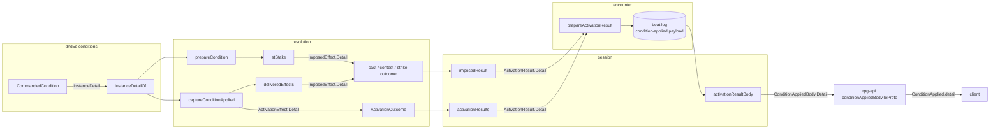

# Condition detail — walkthrough

For [rpg-toolkit#2018](https://github.com/KirkDiggler/rpg-toolkit/issues/2018)
item 1. The law is [design.md](design.md); the slices are
[slices.md](slices.md).

## What this is

A condition instance can say one thing about itself that its type cannot.
Command's instance knows which word it was given; the Commanded type only
knows that some word was. The instance says it through one optional method,
`InstanceDetail`, and that string rides every carrier from resolution to the
proto as `detail` on the condition-applied beat (D1). The design reuses the
condition-applied result and beat as they are and adds one field to each. It
adds no structured payload per condition, no table keyed by condition ref,
and nothing to the descriptor: the type is still described once, beside its
type, and the instance says only what the instance knows.

## Component shape

## Ownership and contracts

| Component | Owns | Input → output |
|---|---|---|
| a condition type's file | Whether its instances have anything to say, and what | instance → `InstanceDetail() string`, or no method |
| `conditions.InstanceDetailOf` | The one read of an instance's detail | `ConditionBehavior` → `string`, empty when the type does not implement `InstanceDetailProvider` |
| resolution `prepareCondition` | Building an imposed condition and reading its name and detail once | `ConditionApplication`, target, source → `preparedCondition{behavior, name, detail}` |
| resolution `preparedCondition.atStake` | The imposed-condition effect | `preparedCondition`, recipient → `ImposedEffect{Kind: ImposedCondition, Ref, Description: name, Detail, Address}` |
| resolution `captureConditionApplied` | The activation collector's condition fact | `ConditionAppliedEvent` → `ActivationEffect{Kind: EffectConditionApplied, Name, Detail, Address}` |
| resolution `deliveredEffects` | A gateless cast's applied effects | `[]ActivationEffect` → `[]ImposedEffect`, `Detail` copied |
| session `imposedResult` | A cast's result for the record | `ImposedEffect` → `encounter.ActivationResult{Kind: ResultConditionApplied, Address, Name, Detail}` |
| session `activationResults` | An activation's results for the record | `[]ActivationEffect` → `[]encounter.ActivationResult`, every field copied |
| encounter `prepareActivationResult` | Which fields each result kind may carry, and the payload it writes | `ActivationResult` → `conditionAppliedPayload{…, Detail}`, or a refusal |
| session `activationResultBody` | Reading a stored payload back onto the beat | payload bytes → `ConditionAppliedBody{…, Detail}`, or nil for a payload no build wrote |
| rpg-api `conditionAppliedBodyToProto` | The proto conversion | `*sdk.ConditionAppliedBody` → `*sessionpb.ConditionApplied{…, Detail}` |

The refusals:

- A condition type with nothing per-instance to say does not implement the
  method. No type returns its display detail, its name or a constant from it.
- No caller asserts `InstanceDetailProvider` itself. `InstanceDetailOf` is
  the read.
- Resolution does not write a detail from the cast's option, the parameter
  blob or the ref. It reads the instance it built or the instance the event
  carries.
- Session does not compose, translate or capitalise the detail. It copies it.
- Encounter does not accept a detail on a kind other than condition-applied,
  and does not write an empty one.
- No consumer branches on a detail's value. A rule that needs the word reads
  the instance.

## Walk one thing through

A bard casts Command at a goblin and chooses "grovel". The goblin fails its
Wisdom save.

1. The player's option is `grovel`. Resolution binds it into the Commanded
   application's parameters as `spells.CommandWordParameter`, as it does
   today.
2. The contest calls `prepareCondition`. `CreateFromRef` builds a
   `CommandedCondition` whose word is `grovel`. `prepareCondition` reads the
   registry name, `Commanded`, and the instance's detail through
   `InstanceDetailOf`, `grovel`, and keeps both on `preparedCondition`.
3. The save fails. The contest appends `atStake("goblin")` to its imposed
   effects: `ImposedEffect{Kind: ImposedCondition, Ref:
   dnd5e:conditions:commanded, Description: "Commanded", Detail: "grovel"}`.
4. Session's `imposedResult` turns it into an `ActivationResult` with
   `Name: "Commanded"` and `Detail: "grovel"`.
5. Encounter's `prepareActivationResult` accepts the detail on
   condition-applied and writes `{"kind":"condition-applied","target":"goblin",
   "ref":"dnd5e:conditions:commanded","name":"Commanded","source_id":"bard",
   "detail":"grovel"}` into the beat log.
6. Session's `activationResultBody` reads the payload back to
   `ConditionAppliedBody{Name: "Commanded", Detail: "grovel"}`.
7. rpg-api copies it onto `ConditionApplied{name: "Commanded", detail:
   "grovel"}`. The client shows "Commanded: grovel" or whatever its lane
   decides; the word is shown, not parsed.

A Bless on the same bard runs the same hops through the gateless path.
`captureConditionApplied` asks `InstanceDetailOf` of a `BlessedCondition`,
which does not implement the method, and every carrier holds the empty
string. The payload and the beat body have no `detail` key.

## Separations that look like one thing

| Query | Source of truth |
|---|---|
| What the Commanded type is and does | `descriptor.display`, read by `DisplayFor`: name `Commanded`, detail the compulsion rule text |
| Which word this Commanded instance was given | the instance, read by `InstanceDetailOf` |
| How a delivered condition is named on the beat | `ImposedEffect.Description`, the registry name |
| What a capacity-granted result says | `ActivationResult.Description` |
| What the compelled turn does with the word | session's Commanded driver, reading `Word` off the instance on the sheet |

`Display.Detail` and the beat's `detail` share a word and answer different
questions. **The display detail is the type's rule text and is the same for
every Commanded; the beat's detail is this instance's word.** A design that
filled the beat from the display would put the compulsion rule on every
Command beat and still lose the word. A design that reused `Description` for
the word would make one encounter field required on one kind and optional on
another, and the guard that forbids it would have to know which.

## Trade-offs

| Decision | Benefit | Cost / boundary | Not taken |
|---|---|---|---|
| An optional method on the instance | The knowledge stays with the instance; a silent type writes nothing | One method per type that speaks, paid by its author | A field on `ImposedEffect` written by the Command driver |
| `InstanceDetail`, not `Detail` | The type's text and the instance's word cannot be mistaken for each other in `conditions` | The beat key `detail` and the method name differ | One `Detail` name for both |
| One read, `InstanceDetailOf`, at two sites in resolution | Every path that imposes a condition carries it, built or captured | Two call sites to keep in step | Reading only in `prepareCondition`, which loses the gateless and activation paths |
| A new `Detail` field on every carrier | Each existing field keeps one meaning | One more field on four structs and one proto message | Reusing `Description` and relaxing its guards |
| Free text | Any condition can speak without a proto change | No consumer can branch on it | A structured per-condition payload |
| Omit when empty | A beat with nothing to say has no key, and an old stored beat reads the same | A present empty `detail` is refused on read | Always writing the key |

## Edges

- Today only Command speaks. Another type speaks when a use case asks for its
  instance's words on the beat.
- Detail rides the condition-applied beat only. The removed beat, the status
  view and the condition rows do not carry it.
- Detail has no per-observer filter. A condition whose instance detail is a
  secret brings that filter to the session projection with its use case.
- No web slice exists. The client renders `detail` when its lane takes it up.

## Where a change lands

- **Another condition with per-instance words.** Its type implements
  `InstanceDetail`. Nothing else changes; every carrier already copies the
  field.
- **The client shows the word.** The web reads `ConditionApplied.detail`. No
  toolkit or API change.
- **The removed beat wants the word too.** That is a new field on the removed
  result, payload, body and message, and a ruling: detail is scoped to the
  applied beat (D1).

## Source map

| Concern | Where (rpg-toolkit `rulebooks/dnd5e/`, unless named) |
|---|---|
| The capability and its read | `conditions/instance_detail.go` `InstanceDetailProvider`, `InstanceDetailOf` |
| Command's word | `conditions/commanded.go` `CommandedCondition.InstanceDetail` |
| Reading it at impose time | `resolution/contest.go` `prepareCondition`, `preparedCondition.atStake` |
| Reading it at capture | `resolution/activation.go` `captureConditionApplied` |
| Gateless delivery | `resolution/action.go` `deliveredEffects` |
| Cast results | `session/castoutcome.go` `imposedResult` |
| Activation results | `session/activate.go` `activationResults` |
| Result shape and payload | `encounter/activation.go` `ActivationResult`, `prepareActivationResult`, `conditionAppliedPayload` |
| Area membership | `encounter/sightarea_transition.go` `makeSightAreaTransition` |
| Beat body | `session/types.go` `ConditionAppliedBody`, `session/events.go` `activationResultBody` |
| Proto | rpg-api-protos `dnd5e/api/session/v1alpha1/events.proto` `ConditionApplied` |
| Conversion | rpg-api `internal/handlers/dnd5e/session/v1alpha1/convert.go` `conditionAppliedBodyToProto` |
