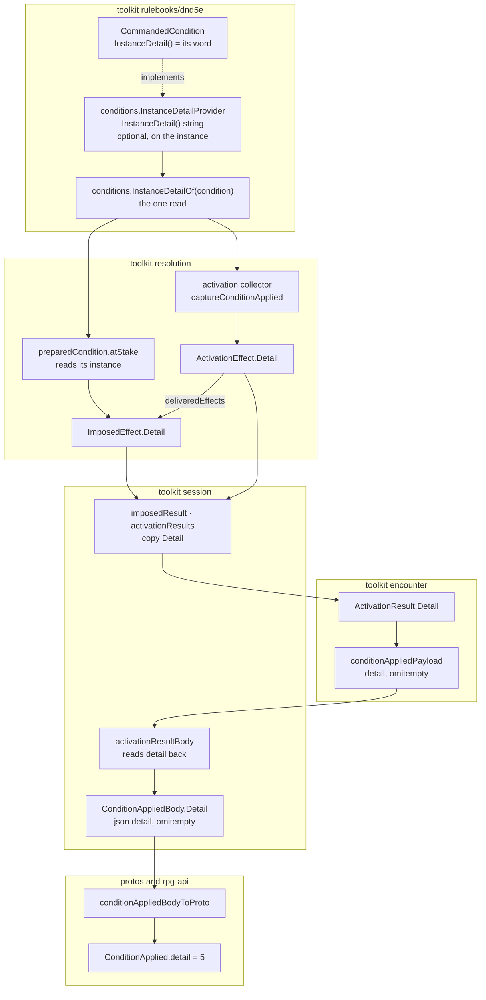

# Condition detail — the instance's word on the applied beat

Tracking: [rpg-toolkit#2018](https://github.com/KirkDiggler/rpg-toolkit/issues/2018)
item 1. Walkthrough: [README.md](README.md). Slices: [slices.md](slices.md).
Builds on the [condition descriptor](../condition-descriptor/design.md), whose
law is unchanged.

## Shape



A condition instance may say one thing about itself that its type cannot:
Command's instance says which word it was given. It says it through one
optional method. Resolution reads it where the instance is in hand and
carries it as `Detail` beside the condition's name. Encounter writes it into
the condition-applied payload, session reads it back onto the beat body, and
the API copies it onto the proto. A condition with nothing to say does not
implement the method, and every carrier holds the empty string, which no
payload writes.

### dnd5e conditions

```go
// InstanceDetailProvider is the optional capability of a condition instance
// that has something to say about itself which its type cannot: Command's
// word. A type with nothing per-instance to say does not implement it.
type InstanceDetailProvider interface {
	// InstanceDetail is free text the instance writes about itself. Empty
	// means the instance has nothing to say.
	InstanceDetail() string
}

// InstanceDetailOf is the one read of an instance's detail. A condition that
// does not implement InstanceDetailProvider has none.
func InstanceDetailOf(condition dnd5eEvents.ConditionBehavior) string

// InstanceDetail returns the word this instance was commanded.
func (c *CommandedCondition) InstanceDetail() string { return c.word }
```

### resolution

```go
type ImposedEffect struct {
	// ...
	// Detail is the instance's own detail for an ImposedCondition, read
	// through conditions.InstanceDetailOf. Empty for every other kind.
	Detail string
}

type ActivationEffect struct {
	// ...
	// Detail is the instance's own detail for EffectConditionApplied.
	Detail string
}

type preparedCondition struct {
	declaration combatActions.ConditionApplication
	behavior    dnd5eEvents.ConditionBehavior
	name        string
	// no detail field: atStake reads InstanceDetailOf(behavior), so the
	// effect's detail cannot come from anything but the instance
}
```

### encounter

```go
type ActivationResult struct {
	// ...
	// Detail is the condition instance's own detail. Optional on
	// ResultConditionApplied, forbidden on every other kind.
	Detail string
}

type conditionAppliedPayload struct {
	Kind     ActivationResultKind `json:"kind"`
	Target   MemberID             `json:"target"`
	Ref      string               `json:"ref"`
	Name     string               `json:"name"`
	SourceID string               `json:"source_id,omitempty"`
	Detail   string               `json:"detail,omitempty"`
}
```

### session

```go
type ConditionAppliedBody struct {
	Target   string `json:"target"`
	Ref      string `json:"ref"`
	Name     string `json:"name"`
	SourceID string `json:"source_id,omitempty"`
	Detail   string `json:"detail,omitempty"`
}
```

### The wire

```proto
// ConditionApplied identifies a condition attached to a target.
message ConditionApplied {
  string target = 1;
  string ref = 2;
  string name = 3;
  string source_id = 4;
  // What this condition instance says about itself, as free text the
  // toolkit wrote: the word a Command gave. Empty when the instance has
  // nothing to say. Shown, never parsed.
  string detail = 5;
}
```

## Law

### The instance speaks

- **A condition is described once, beside its type; everything else reads the
  description.** Detail adds nothing to the descriptor: it is what one
  instance knows, and the type's display stays the only place the type is
  described.
- An instance tells its detail through `conditions.InstanceDetailProvider`.
  A type with nothing per-instance to say does not implement it. A type that
  implements it may return the empty string for an instance with nothing to
  say.
- `conditions.InstanceDetailOf` is the one read. No caller asserts the
  interface itself, and no caller writes a detail from anything but the
  instance: not from cast input, not from a parameter blob, not from the ref.
- `CommandedCondition.InstanceDetail` returns its word, the same string
  `Word` returns, so a loaded instance and a built one say the same thing.
- The method is `InstanceDetail`, not `Detail`. `Display.Detail` is the
  type's text, and one name for both would let a type's rule text pass for an
  instance's word.
- Detail is free text. It is shown, and no consumer branches on its value. A
  rule that needs to know the word reads the instance, as session's Commanded
  driver does.

### Carried, never derived

- Resolution reads the detail where it holds the instance: in
  `preparedCondition.atStake`, from the prepared `behavior`, and in the
  activation collector's `captureConditionApplied`, from the event's
  condition. `preparedCondition` stores no copy. Every `ImposedEffect` of kind
  `ImposedCondition` built from a prepared condition carries it.
  `deliveredEffects` copies `ActivationEffect.Detail` onto the effect it
  builds.
- `ImposedEffect.Description` stays the condition's registry name and
  `ActivationEffect.Description` stays the capacity text. Detail is its own
  field on both, because a name and an instance's word are two facts.
- `encounter.ActivationResult` carries `Detail` as its own field.
  `Description` is the whole statement of a capacity-granted result, required
  and alone; detail is an optional addition to an identified condition. One
  field for both would make the encounter's description guard mean two
  things.
- Encounter accepts `Detail` on `ResultConditionApplied` only, in one guard
  before the kind switch, as it does damage type and stabilization. The
  payload omits the key when the detail is empty.
- Session's `imposedResult` and `activationResults` copy `Detail` unchanged.
  Session's `activationResultBody` refuses a payload carrying `detail` on any
  kind but condition-applied, and refuses a present `detail` that is null or
  empty, because no build writes either. An absent key reads as no detail.
- `ConditionAppliedBody.Detail` is `json:"detail,omitempty"`. The beat goes to
  the audience the condition-applied beat already has; detail adds no
  filter.
- rpg-api copies `ConditionAppliedBody.Detail` onto `ConditionApplied.detail`
  and nothing else. The field is additive, field number 5, not deprecated.

### Who writes a detail

- A condition-applied beat from a cast, a retaliation or an activation
  writes whatever its instance says. Today that is Command and nothing else.
- A strike's rider and the obey machine carry the detail on their
  `ImposedEffect` and write no beat with it: session records a strike as an
  attack beat and does not read its conditions, and the compelled turn does
  not record its conditions.
- Encounter's sight-area membership writes no detail. Membership is not a
  dnd5e condition instance, and encounter holds none.
- The compelled turn records no condition-applied result, so Grovel's Prone
  writes nothing on any beat.
- Condition-removed, damage, healing, stabilized, moved and capacity-granted
  results carry no detail.

### Reset

- Pre-release: no reset and no migration. A stored beat with no `detail` key
  reads as no detail.

## Rulings

| ID | status | scope | ruled by | date |
|---|---|---|---|---|
| D1 | settled | The instance's word rides a `detail` field on the condition-applied beat: free text the instance writes, one generic field, empty when the instance has nothing to say. No structured per-condition payload on the beat. The descriptor law is untouched. | KirkDiggler | 2026-10-11 |

## Open

None.
