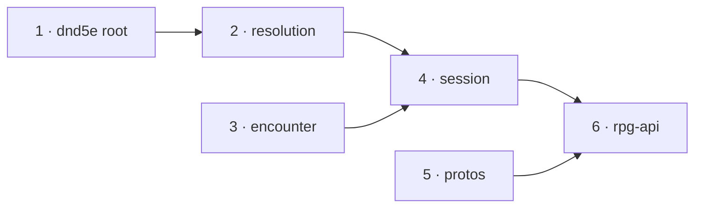

# Condition detail — slices

A working document beside [design.md](design.md): slice order, the task a
worker executes per module, what done means, and the walk. Every `file:line`
is at rpg-toolkit `origin/main` `19cd26c9` (dnd5e v0.210.0 · encounter
v0.124.1 · resolution v0.69.1 · session v0.129.1), rpg-api `dev` `cc082a1e`
and rpg-api-protos `main` `0b4f5d4`. Toolkit paths are relative to
`rulebooks/dnd5e/`. Line numbers drift; the symbol beside each line is the
anchor.

Develop outside-in, merge inside-out. One nearest-`go.mod` module per toolkit
PR. Each dependent builds on its provider's gate-approved branch head and
re-pins to the provider's tag at merge-out. Toolkit CI cannot resolve a branch
pseudo-version, so every dependent toolkit PR stays a draft until that re-pin.
`gen/go` has no branch pseudo-version, so the rpg-api slice is a draft until
the protos PR merges. The squash title's prefix picks the tag bump; every
slice is additive, so none carries `!`.

Every Go command runs with `GOTOOLCHAIN=go1.24.5` from the module directory.
Commit with every pre-commit check running; a "(cached)" pre-commit result ran
nothing. After any `go get`, run `go mod tidy`.

## Goal and scope

The Commanded instance's word reaches the wire as `detail` on the
condition-applied beat (D1). A condition with nothing per-instance to say
writes no key. Not in scope: the removed beat, the status view, a web render,
any other condition speaking.

## Order

| # | Module | PR title | Builds on |
|---|---|---|---|
| 1 | `rulebooks/dnd5e` | `feat(dnd5e): a condition instance tells its own detail; Commanded tells its word (toolkit#2018)` | `main` |
| 2 | `rulebooks/dnd5e/resolution` | `feat(resolution): carry the instance's detail on an imposed condition (toolkit#2018)` | slice 1 head |
| 3 | `rulebooks/dnd5e/encounter` | `feat(encounter): condition-applied carries an optional detail (toolkit#2018)` | `main` |
| 4 | `rulebooks/dnd5e/session` | `feat(session): the condition-applied beat carries the instance's detail (toolkit#2018)` | slices 2 and 3 heads |
| 5 | rpg-api-protos `main` | `feat(session): ConditionApplied.detail (toolkit#2018)` | `main` |
| 6 | rpg-api `dev` | `feat(session): carry condition detail onto ConditionApplied (toolkit#2018)` | slice 4 head, slice 5 merged |

Slices 1, 3 and 5 start in parallel. Merge order: 1, 2, 3, 4 with each
re-pin, then 5, then 6. Resolution needs no encounter change: it does not
build an `ActivationResult`. Session's re-pin moves its encounter pin from
v0.123.0 to slice 3's tag, which also brings encounter v0.124.x.

## 1. toolkit dnd5e root

**Delivers:** D1, "The instance speaks".
**Files:**
- new `conditions/instance_detail.go`: `InstanceDetailProvider`, `InstanceDetailOf`, as in [design.md](design.md). Precedents: `RollerBinder` at `conditions/roller_binding.go:30`, `ConditionAddressOf` at `conditions/baned.go:283`.
- `conditions/commanded.go`: add `InstanceDetail() string { return c.word }` beside `Word` (`commanded.go:132`), and a compile-time assertion `var _ InstanceDetailProvider = (*CommandedCondition)(nil)`.
- new `conditions/instance_detail_test.go`.

**Tests:**
- `TestCommandedTellsItsWordAsItsDetail`: for each of `spells.CommandWordApproach`, `CommandWordFlee`, `CommandWordGrovel`, build with `NewCommandedCondition("goblin", <command ref>, "bard", word, 1)`; `InstanceDetailOf(c)` equals `word`. Three distinct words, so a constant return fails.
- `TestALoadedCommandedTellsTheSameWord`: `ToJSON` then `LoadJSON` of a `grovel` instance; `InstanceDetailOf(loaded)` is `"grovel"`.
- `TestAConditionWithNothingToSayHasNoDetail`: `InstanceDetailOf` of a `BlessedCondition` is `""`.

**What would have to break:** `InstanceDetail` returning `""` or `CommandedName` turns the first test red; `InstanceDetailOf` returning `""` unconditionally turns the first two red; `InstanceDetailOf` returning `DisplayFor(ref).Detail` turns the third red.

**Acceptance:** `go test ./conditions/...` green; `go vet`, `golangci-lint run` clean.

## 2. toolkit resolution

**Delivers:** "Carried, never derived", resolution half.
**Prerequisites:** slice 1 head as a pseudo-version.
**Files:**
- `resolution/contest.go`: `ImposedEffect` (`:183`) gains `Detail string` with the doc in [design.md](design.md). `preparedCondition` (`:272`) gains `detail`. `prepareCondition` (`:361`) sets `detail: conditions.InstanceDetailOf(built.Condition)`. `preparedCondition.atStake` (`:383`) writes `Detail: p.detail`.
- `resolution/activation.go`: `ActivationEffect` (`:162`) gains `Detail string`. `captureConditionApplied` (`:315`) writes `Detail: conditions.InstanceDetailOf(event.Condition)`.
- `resolution/action.go`: `deliveredEffects` (`:752`) copies `effect.Detail` onto the `ImposedCondition` it builds (`:786`).
- No other site builds an `ImposedCondition`: the contest, strike rider (`strike.go:1010`), obey (`obey.go:263`) and pending delivery (`activation.go:137`) all go through `prepareCondition` and `atStake`.

**Tests:**
- `cast_action_test.go` `TestTheChosenWordIsWrittenOnAGatedCast` (`:805`): in each word's run, find the `ImposedCondition` in `outcome.Targets[0].Applied` whose ref is `refs.Conditions.Commanded()`; assert `Detail == word` and `Description == display.Name`.
- `cast_action_test.go` new `TestAGatelessConditionWithNothingToSayCarriesNoDetail`: a Bless cast; every `ImposedCondition` in `Applied` has `Detail == ""`.
- `activation_test.go` new `TestTheCollectorReadsTheInstanceDetail`: publish a `ConditionAppliedEvent` whose `Condition` is a `grovel` `CommandedCondition` on a collector's bus; the captured `ActivationEffect.Detail` is `"grovel"`. A second event with a `BlessedCondition` captures `""`.
- `action_test.go` or the nearest `deliveredEffects` test: an `ActivationEffect{Kind: EffectConditionApplied, Detail: "grovel", …}` becomes an `ImposedEffect` with `Detail == "grovel"`.

**What would have to break:** deleting the `detail` assignment in `prepareCondition`, or `Detail: p.detail` in `atStake`, turns the gated-cast test red; writing `Detail` from `ActionInput.Option` instead of the instance passes that test, so the collector test is the one that pins the instance as the source, and a constant `"grovel"` fails the approach and flee runs.

**Acceptance:** `go test ./...` green in `rulebooks/dnd5e/resolution`; lint clean; draft until slice 1's tag, then re-pin.

## 3. toolkit encounter

**Delivers:** "Carried, never derived", encounter half.
**Files:**
- `encounter/activation.go`: `ActivationResult` (`:136`) gains `Detail string`, documented as optional on `ResultConditionApplied`, forbidden elsewhere; the type's doc comment above it names the rule. `conditionAppliedPayload` (`:266`) gains `Detail string \`json:"detail,omitempty"\``. `prepareActivationResult` (`:435`) adds one guard before the kind switch, beside the damage-type and stabilization guards: `if result.Kind != ResultConditionApplied && result.Detail != "" { return nil, forbiddenActivationResultField(verb, index, result.Kind, "detail") }`. The `ResultConditionApplied` arm (`:550`) writes `Detail: result.Detail`.
- `encounter/sightarea_transition.go` `makeSightAreaTransition` (`:145`): unchanged; it writes no detail.

**Tests** (in `encounter/activation_test.go`):
- `TestConditionAppliedWritesItsDetail`: record a condition-applied result with `Detail: "grovel"`; unmarshal the beat's result payload into `map[string]json.RawMessage`; `detail` is `"grovel"`.
- `TestConditionAppliedWithoutDetailOmitsTheKey`: the same with `Detail: ""`; the map has no `detail` key.
- `TestDetailIsRefusedOnEveryOtherKind`: a table over condition-removed, healing, damage, stabilized, moved, capacity-granted, each otherwise valid with `Detail: "x"`; each refuses with `ErrInvalidData` naming `detail`.

**What would have to break:** dropping `Detail` from the payload literal reddens the first; removing `omitempty` reddens the second; deleting the guard reddens every row of the third.

**Acceptance:** `go test ./...` green in `rulebooks/dnd5e/encounter`; lint clean. Encounter imports no dnd5e module, so it builds on `main`.

## 4. toolkit session

**Delivers:** "Carried, never derived", session half, and "Who writes a detail".
**Prerequisites:** slice 2 and slice 3 heads as pseudo-versions.
**Files:**
- `session/castoutcome.go` `imposedResult` (`:185`): the `ImposedCondition` arm (`:203`) writes `Detail: imposed.Detail`. This covers casts (`:65`) and retaliations (`landings.go:368`).
- `session/activate.go` `activationResults` (`:316`): copies `Detail: effect.Detail`.
- `session/types.go` `ConditionAppliedBody` (`:2291`): `Detail string \`json:"detail,omitempty"\``.
- `session/events.go` `activationResultBody` (`:1059`): the decode struct gains `Detail *string \`json:"detail"\``; `_, detailPresent := fields["detail"]`; one guard beside the source-id guard (`:1148`): a kind other than condition-applied with `detailPresent` returns nil; on condition-applied, a present `detail` that is null or `""` returns nil. The condition-applied arm (`:1244`) sets `Detail` from the pointer when present.
- `session/compelled.go`: unchanged; the compelled turn records no condition-applied result.

**Tests:**
- new `TestACommandBeatCarriesTheWord` beside the Command tests (`command_turn_test.go` scene helpers): cast Command with `grovel` at a creature that fails; the activation-result beat's `ConditionApplied.Ref` is the Commanded ref and `Detail` is `"grovel"`; `json.Marshal` of the body has `"detail":"grovel"`. Repeat with `approach`.
- `bless_test.go`: in an existing Bless cast test, every activation-result beat's `ConditionApplied.Detail` is `""` and its marshalled body has no `detail` key.
- `activation_events_test.go`: payloads read by `activationResultBody`: condition-applied with `"detail":"grovel"` gives `Detail == "grovel"`; without the key gives `""`; `"detail":""` and `"detail":null` give nil; condition-removed with `"detail":"x"` gives nil.
- `activationResults` unit: an `ActivationEffect` with `Detail: "grovel"` gives a result with `Detail: "grovel"`.
- A golden that records a Command cast gains the `detail` key; regenerate it and read the diff. Any other golden change is a defect.

**What would have to break:** dropping `Detail` from `imposedResult` or from the body arm reddens the Command beat test; dropping `omitempty` reddens the Bless assertion; deleting either guard reddens its payload case.

**Acceptance:** `go test ./...` green in `rulebooks/dnd5e/session`; lint clean; draft until slices 2 and 3 tag, then re-pin both.

## 5. rpg-api-protos

**Delivers:** "The wire".
**Files:** `dnd5e/api/session/v1alpha1/events.proto` `ConditionApplied` (`:1070`): `string detail = 5;` with the comment in [design.md](design.md). Nothing else changes.

**Tests:** none hand-written. Evidence is `make test` (lint, format-check, proto-options, breaking) and `make generate` completing.

**What would have to break:** `buf breaking` refuses a reused or renumbered field; the api slice's converter test fails to compile without the generated `Detail`.

**Acceptance:** CI green; merged before slice 6 leaves draft. The tag is the CI generated-code commit, not the merge commit; pin by the tag's content.

## 6. rpg-api dev

**Delivers:** the conversion.
**Prerequisites:** slice 4 head (then tag); slice 5 merged.
**Files:**
- `go.mod`: pin `rulebooks/dnd5e`, `encounter`, `resolution` and `session` to the slices' tags, and `rpg-api-protos/gen/go` to slice 5's generated commit; `go mod tidy`.
- `internal/handlers/dnd5e/session/v1alpha1/convert.go` `conditionAppliedBodyToProto` (`:1745`): add `Detail: body.Detail`.

**Tests** (`convert_test.go`):
- the existing condition-applied conversion case (`:1378`) sets `Detail: "grovel"` and asserts `GetDetail() == "grovel"`.
- a case with no detail asserts `GetDetail() == ""`.

**What would have to break:** deleting `Detail: body.Detail` reddens the first.

**Acceptance:** `make pre-commit` green; draft until slice 5 merges and slice 4 tags.

## The walk

On a local stack with every slice pinned:

- [ ] A bard casts Command, word `grovel`, at a monster that fails its save. The stream's activation-result event for the Commanded condition reads `condition_applied` with `name: "Commanded"` and `detail: "grovel"`.
- [ ] A cleric casts Bless. Each `condition_applied` for Blessed has no `detail`.

One click per seam: the Command cast proves instance → resolution → encounter → session → api; the Bless cast proves the silent path.

## Requirement coverage

| Requirement | Slice | Proof |
|---|---|---|
| The instance tells its word | 1 | `TestCommandedTellsItsWordAsItsDetail`, `TestALoadedCommandedTellsTheSameWord` |
| A silent type has no detail | 1, 2, 4 | `TestAConditionWithNothingToSayHasNoDetail`; Bless assertions in 2 and 4 |
| Read off the instance, not cast input | 2 | `TestTheCollectorReadsTheInstanceDetail`; three distinct words in the gated-cast test |
| Every imposing path carries it | 2 | gated-cast, gateless, collector, `deliveredEffects` tests |
| Detail only on condition-applied | 3, 4 | `TestDetailIsRefusedOnEveryOtherKind`; decoder cases |
| Omitted when empty | 3, 4 | `TestConditionAppliedWithoutDetailOmitsTheKey`; Bless marshalled body |
| On the wire | 5, 6, walk | converter test; walk checklist |

## Seams

| Provider | Consumer | Contract | Proof |
|---|---|---|---|
| 1 `InstanceDetailOf` | 2 `prepareCondition`, `captureConditionApplied` | `func(ConditionBehavior) string`, `""` = none | slice 2 tests on slice 1's pseudo |
| 2 `ImposedEffect.Detail`, `ActivationEffect.Detail` | 4 `imposedResult`, `activationResults` | `string`, copied unchanged | slice 4 Command beat test |
| 3 `ActivationResult.Detail`, payload key `detail` omitempty | 4 `activationResultBody` | JSON key `detail`, absent = none, never empty | slice 4 decoder cases on slice 3's pseudo |
| 4 `ConditionAppliedBody.Detail` | 6 converter | `string` | slice 6 converter test |
| 5 `ConditionApplied.detail = 5` | 6 converter | proto3 string | slice 6 compiles and passes on the generated code |
