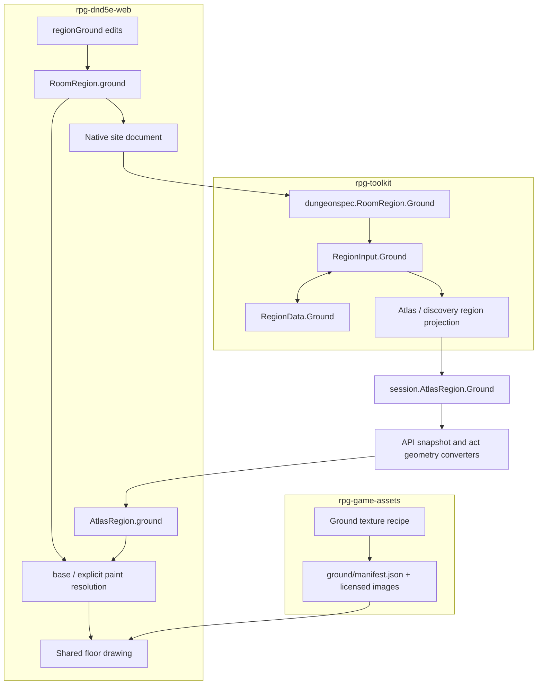

# Region ground: source to screen

[Story #867](https://github.com/KirkDiggler/rpg-project/issues/867),
[slice #874](https://github.com/KirkDiggler/rpg-project/issues/874) and
[design law](design.md). A region's base and explicit paint describe its look,
not its geometry or movement rules. The design reuses region membership,
ordinary document history and the encounter's recipient-specific atlas.

## Component shape

## Ownership and contracts

| Component | Owns | Input → output |
|---|---|---|
| Assets ground provider | Image identity, labels, repeat scale and source custody | Reviewed recipe → hash-bound `GroundCatalog` |
| Web `regionGround` | Base/paint/erase transformations | `RoomDraft` + region/cells/ref → immutable `RoomDraft` |
| `RoomRegion.ground` | Author intent | Optional `{baseRef?, paint?: [{ref, cells}]}`; cells use existing canonical row runs |
| Dungeonspec | Shape/membership validation and one coordinate conversion | Region ground → `encounter.RegionGround` in the field's declared frame |
| Encounter | Captured appearance and recipient delivery | Saved `RegionGroundData` ↔ construction facts → `AtlasRegion.Ground` restricted to delivered cells |
| Session/API/protos | Typed transport | `RegionGround` with opaque base ref and paint groups; wire cells are absolute positions |
| Shared Web drawing | Style resolution and level appearance | Permitted cells + region ground + catalog → one surface per cell |

The provider does not infer walkability from a model. The editor does not create
floor while painting an appearance. The encounter never downloads textures or
interprets grass as a movement cost. The API never resolves an appearance key.
The renderer never obtains undisclosed paint from the authored YAML.

## Walk one thing through

A courtyard has a grass `baseRef`, and dirt paint on cells `(0,0)` and `(1,0)`.
The editor writes one canonical row run for those two dirt cells. Changing the
base leaves that group intact (R1). Removing paint from `(1,0)` leaves its floor
membership unchanged and makes it resolve through the base.

Dungeonspec checks that each painted cell belongs to the courtyard, refuses
conflicting assignments and converts its coordinates with the region's ordinary
construction path. Encounter data captures the base and paint, not editor
history or texture bytes. An atlas disclosing only `(0,0)` carries only that
painted cell. Later discovery of `(1,0)` is merged by cell without losing the
paint already held. The Web resolves both cells using the same catalog and
world-space texture phase it uses in Studio.

## Separations that look like one thing

| Query | Source of truth |
|---|---|
| Is there floor here; which region owns it? | Existing region cells |
| Which appearance is explicitly painted? | Region ground paint |
| What does an unpainted cell look like? | Region base, or existing default when absent |
| Which ground facts may this viewer receive? | Encounter's existing region projection |
| What resource draws an appearance ref? | Assets ground catalog |
| How much does moving here cost? | Existing encounter/rulebook mechanics, never appearance |

Paint equal to the base is still explicit paint. Removing it as a redundant
value changes what happens when the base changes. Similarly, retaining paint
outside its owning region creates an appearance with no authority to draw.
Floor removal or reassignment prunes paint belonging to the departing region;
undo restores the whole earlier document.

## Trade-offs

| Decision | Benefit | Cost / boundary | Not taken |
|---|---|---|---|
| Region base + sparse paint | Cheap fill, intentional exceptions | Editor and transport retain explicit assignments | One site-wide texture |
| Existing row-run cell encoding | Compact authored patches | Compiler validates membership and duplicates | Separate polygon/path grammar |
| Flat surface with image-based facets | Shared grounding and inexpensive drawing | Provider art must carry the desired visual character | Terrain-following actors |
| Typed captured region ground | Reload and disclosure remain authoritative | Provider, SDK and wire must all carry the field | Full-source fetch in play |
| Existing default only when absent | Old maps retain their look | Missing explicit refs need visible diagnostics | Silent fallback for errors |

## Edges

No elevation, blended brush edge, sound configuration, live editing of an
already-started encounter, material-based movement cost or arbitrary terrain
mesh export is implied. Asset visual approval and the normal publication gates
remain separate from a successful preview.

## Where a change lands

A new ground appearance enters the Assets recipe/catalog without adding an
engine rule. A different brush shape belongs in Studio and still produces
explicit cell assignments. A raised-platform use case changes the level-plane
contract (R3), not a hidden offset in a character model.

## Source map

| Concern | Paths |
|---|---|
| New source/renderer ground helpers | Web `src/concepts/world-building/regionGround.ts`; `src/rendering/groundCatalog.ts` |
| Native site shape/history | Web `roomDraft.ts`, `singleRoomDungeon.ts`, `WorldBuildingConcept.tsx` under `src/concepts/world-building/` |
| Existing floor rendering | Web `WorkspaceFloorUnderlay.tsx`; `src/components/hex-grid/SyntyHexFloor.tsx` |
| Native content compilation | Toolkit encounter `dungeonspec/single_room.go`, `single_room_regions.go`, new `single_room_ground.go` |
| Region snapshot/projection | Toolkit encounter `field.go`, `compilefield.go`, `data.go`, `atlas.go`, `projection.go` and discovery producers |
| SDK | Toolkit session `types.go`, `convert.go`, `act_family.go` |
| Wire and API | Protos session v1alpha1 `types.proto`, v1alpha2 `act_geometry.proto`; API session converters for both versions |
| Client discovery merge | Web `src/components/session/applyReveal.ts`, `actGeometry.ts`, `atlasToScene3D.ts` |
| New floor provider | Assets `scripts/build_ground_catalog.py`, `scripts/configs/ground/courtyard-v1.json`, `harness/models/synty/ground/` |
