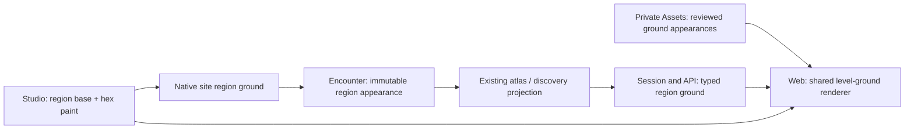

# Region ground

## Shape

## Law

1. A region owns its base floor appearance. Explicit paint assigns an appearance to existing cells of that region; it creates neither floor nor another region.
2. Filling changes the region's base. Painting replaces the selected cells' explicit paint. Erasing paint removes those assignments. Changing the base preserves all explicit paint, including paint equal to the previous base.
3. An absent base retains the existing stone appearance. An explicitly named but unavailable appearance is an error, never an instruction to substitute stone.
4. One appearance resolves per cell: explicit paint, then its region's base, then the existing default. These are precedence rules, not stacked physical surfaces.
5. Ground uses one level walking plane. Characters, NPCs, grounded dressing and movement/selection presentation agree with that plane. Ground appearance changes neither elevation nor gameplay.
6. Texture coordinates are anchored in the shared world frame, at the appearance's declared repeat scale. A cell boundary does not restart the texture or the faceted visual pattern.
7. The native site stores region appearance intent. Encounter construction captures immutable typed appearance facts; saving and loading preserve them without rereading edited source content. An appearance reference is opaque to the engine.
8. Ground paint in every atlas or incremental discovery is restricted to the cells delivered for its region by the existing projection. A consumer neither fetches full site source for ground nor re-derives disclosure from appearance.
9. Studio undo/redo, save/reopen and play preserve the same base and explicit-paint distinction. Region membership remains the authority for where the ground exists.
10. Assets owns licensed resources, source provenance, runtime identities and visual verification. Floor appearances are not generic volumetric props; prop grounding and positive-volume validators remain unchanged.
11. The first authoring cut uses hex-based painting and boundaries. Blended/sub-hex edges, elevated terrain, background audio, trading and performer-camp behavior are outside this cut.

## Rulings

| ID | status | scope | ruled by | date |
|---|---|---|---|---|
| R1 | settled | Region base plus explicit hex paint; fill/erase/base-change semantics | KirkDiggler | 2026-11-06 |
| R2 | settled | Existing stone default; unavailable explicit appearance errors | KirkDiggler | 2026-11-06 |
| R3 | settled | Level walking ground with faceted visual character; no terrain-following actor movement | KirkDiggler | 2026-11-06 |
| R4 | settled | Hex boundaries; appearance independent of membership and mechanics; undo/save/play agreement | KirkDiggler | 2026-11-06 |
| R5 | settled | Kingdom first; courtyard grass and dirt; other room dressing follows separately | KirkDiggler | 2026-11-06 |

## Open

- Final in-game grass/dirt appearance, repeat scale and readability require the operator's early view; local proofs do not establish Discord acceptance.
- Hardware-specific performance budgets remain unset. Comparable before/after measurements accompany delivery rather than an invented target.
