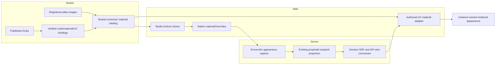

# Texture choices on wall and prop placements

[Courtyard S3](https://github.com/KirkDiggler/rpg-project/issues/895) implements the [texture-choice design](texture-design.md) using the existing [shared atlas contract](../assets/pack-material-profiles/atlas-provider-design.md). **An atlas choice changes a declared material scope, not the model or its UV layout.** Wall geometry, masonry mapping and texture-pack choice remain separate responsibilities.

## Component shape

## Ownership and contracts

| Component | Owns | Input → output |
|---|---|---|
| Assets catalog | Shared images, recommendations and exact editable scopes | Registered sources + GLBs → schema2 materials/collections/bindings |
| Consumer reader | Strict public schema/resource validation | Catalog and actual PNGs → masonry and authored-UV typed views under one digest |
| Studio history/document owner | Per-placement intent and reset | Selected surface/material → native `materialOverrides` |
| Encounter | Immutable appearance capture and existing audience | Native values → owner-bound `MaterialOverride` lists in data/projection |
| Session/API | Typed transcription, not resource interpretation | Captured owner records → snapshot/act `material_overrides` |
| Atlas adapter | Per-instance material/sampler lifetime | Exact model binding + selected color pixels → detached rendered appearance |

The provider does not give a visual material gameplay meaning. Studio does not bake a new GLB for each pack. The encounter does not load textures or invent missing selections. SDK/API do not recompute audience. The renderer does not fetch the source scene or guess a target from a filename (R3–R6).

## One value, source to screen

The author selects `04_C` for House Wall05. The catalog identifies the material as `dnd5e:material:fantasy-kingdom:atlas_04_c` and the model's declared scope as `atlas`. The saved wall appearance carries `{surfaceId: atlas, materialRef: dnd5e:material:fantasy-kingdom:atlas_04_c}`; neither private paths nor pixels enter the document.

The encounter captures that pair with the wall. Its recipient projection supplies the pair with that same permitted wall, and the SDK/API transcribe it as `MaterialOverride`. Web joins it to the pinned model hash and actual node/material binding. The adapter clones the placement's material and sampler, shares verified selected pixels and retains authored UV/sampler settings. A second placement can remain Original. Removing the selection restores the complete original material reference (R2–R6).

## Similar-looking questions, different owners

| Query | Source of truth |
|---|---|
| Which pixels belong on wood versus plaster? | The model's authored UVs and atlas layout |
| Which actual material may be changed? | Exact provider binding and model identity |
| Which looks are suggested? | The collection recommendation, not an exhaustive permission list |
| Which pack did this wall choose? | Its captured material override |
| Does the wall block or contain a door? | Authoritative wall/opening/door data, not its picture |
| Is this masonry physically tiled or an authored atlas? | The material mapping capability |

Conflating atlas mapping with masonry projection repaints the wrong parts. Conflating material choice with shape invents openings or changes barriers. Treating the current source file as the saved encounter repaints somebody else's ongoing run.

## Trade-offs and edges

| Decision | Benefit | Cost / boundary | Not taken |
|---|---|---|---|
| Shared images with instance-owned samplers/materials | Independent choices without GLB variants | Renderer owns clone disposal and atomic refusal | Mutating the cached GLTF material |
| Explicit surface/material refs | Stable saved intent and later target expansion | Consumers must validate unresolved refs | Encoding a palette into an asset filename |
| Authored UVs for atlas packs | Preserves designed material relationships | Does not turn arbitrary images into compatible atlases | Reprojecting the wall as flat masonry |
| Existing captured recipient path | No hidden-source fetch or mutable-source repaint | Every typed seam carries the same pair | Editor-only fallback in play |

The first wall UI addresses the existing whole atlas scope. Independent A/B is deferred under R7; it needs declared targets rather than guessed face names. Mixed feature/door sections and wall-to-hex positioning are separate under R8. Admin recommendation publication is outside this placement feature.

## Where changes land

A new atlas look belongs in the existing Assets resource/collection path. A new editable scope belongs in the provider's exact binding proof and consumer target validation. New selection controls belong to Studio history; a new captured appearance fact crosses the native/encounter/SDK/wire/client seam deliberately. New door state belongs to the existing door machinery, never to texture selection.

## Source map

| Concern | Owner/path |
|---|---|
| Provider contract and build | Assets `world_material_atlas_candidate.py`, `prepare_prop_atlas_candidate.py`, `build_world_material_catalog_v2.py` |
| Provider publication | Assets `publish_world_materials.py` |
| Strict reader / typed views | Web `scripts/world-material-catalog.mjs`, `world-atlas-catalog.mjs`, `src/rendering/worldMaterialTypes.ts` |
| Material scope and isolation | Web `src/rendering/worldAtlasMaterials.ts`, `worldSurfaceMaterials.ts` |
| Authoring owners | Web `src/concepts/world-building/types.ts`, `structuralWalls.ts`, `roomDraft.ts` and Studio arrange controls |
| Captured owner records | Toolkit encounter `data.go`, `structural_walls.go`, `prop_presentation.go`; session projection/types |
| Wire | Protos `session/v1alpha1/types.proto`, `session/v1alpha2/act_geometry.proto` |
