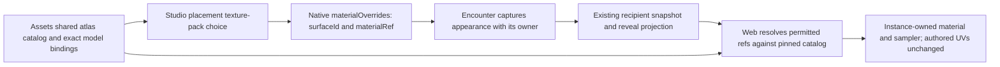

# Wall and prop texture-pack choices

## Shape

Masonry wall finishes and authored-UV atlas packs are distinct mapping capabilities in one material catalog. A texture choice names a material for a declared scope; it does not create a new GLB, geometry feature, wall opening or door.

## Law

- **R1 — Reuse.** Atlas resources, collections and bindings use the existing agreed schema2 provider contract. Collection membership recommends looks; technical model/target/resource validity remains mandatory.
- **R2 — Placement ownership.** A prop or wall appearance owns an optional ordered list `materialOverrides` of `{surfaceId, materialRef}`. Each surface ID appears at most once and both strings are nonempty. Absence/empty means original authored appearance. Reset removes the choice; it does not substitute another material ref.
- **R3 — Capture and disclosure.** Encounter/SDK `MaterialOverride{SurfaceID, MaterialRef}` and the wire `MaterialOverride{surface_id, material_ref}` carry the same opaque identities. `PropPresentation` and `AtlasStructuralWall` own `material_overrides` in snapshot and act geometry. Selections follow their owner's existing audience and observation lifetime; they never disclose an otherwise withheld target. Later source edits do not repaint an already captured encounter.
- **R4 — Runtime.** The client resolves a supplied material/target against exact pinned provider facts and applies it only to the selected instance. Missing/stale/unsupported explicit selections are reported rather than silently using Original. Play never fetches the full source scene to reconstruct missing selections.
- **R5 — Authored mapping.** The initial 01_A–04_C choice changes only color on the provider-declared authored-UV scope. Geometry, UVs, sampling, fixed companions and non-texture material properties remain authored. No normal or emissive map is manufactured; no masonry projection is inferred from an atlas choice.
- **R6 — Isolation.** Mutable materials/samplers belong to the placement. Cached GLB objects and source image pixels remain shared and immutable. Reset/disposal restores originals and disposes only owned clones; invalid selections cannot partially modify a placement.
- **R7 — Scope.** The first wall selector sets its existing atlas target as a whole. Independent A/B choices for all supported texture families remain required but deferred. The data contract uses declared target IDs so later side scopes do not require a global material override or a special encoded texture name.
- **R8 — Boundaries.** Material selections alter no collision, walkability, region membership, light rules, observer knowledge, hinges or door state. Mixed wall feature/doorway sections follow as a separate deliverable; selecting decorative art does not imply a passage.

## Rulings

| ID | status | scope | ruled by | date |
|---|---|---|---|---|
| R1 | settled | Reuse 01_A–04_C atlas packs and existing prop/house binding work | KirkDiggler | 2026-11-08 |
| R2–R6 | settled | Per-placement choices, original reset, instance isolation and Save & Play through existing capture/disclosure; concrete typed transcription is the builder's implementation choice | KirkDiggler; assets implementation | 2026-11-08 |
| R7 | deferred-until-independent-wall-sides | A/B choice remains required; one wall texture pack is sufficient for the first delivery | KirkDiggler | 2026-11-08 |
| R8 | settled | Textures first, then mixed feature/door sections; no implicit gameplay change | KirkDiggler | 2026-11-08 |

## Open

- Independent A/B targeting across atlas and masonry wall families requires separately declared target scopes and its own authoring integration; it is not implemented by naming two arbitrary material slots.
- Mixed wall sections need their own placement/fit contract before implementation. Wall/door alignment versus whole-hex ground remains a layout/design concern, not permission to relocate existing boundaries.
- Normal publication, generated bindings, actual consumer pins and operator-authorized merges remain delivery gates, not inferred from the design agreement.
