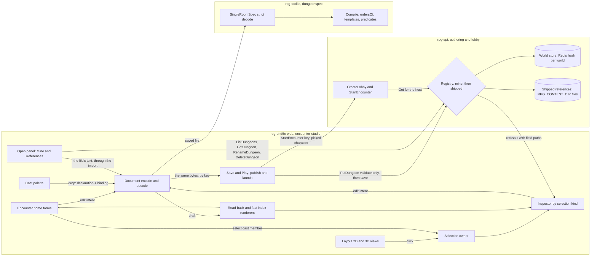

# Encounter studio — walkthrough

Law: [design.md](design.md). Epic: rpg-project#545. Use case it must carry:
rpg-project#569 (the mad king's castle).

## What this is

One inspector that answers for whatever is selected, one Encounter home for
what is placed nowhere, and a cast that is the document's own stat blocks.
It reuses the single-room dialect unchanged: every form below writes a key
that `SingleRoomSpec` already declares, and the only studio-owned data is
presentation the dialect carries opaquely (`room.scene`). It introduces **no
second creature list, no second fact store and no studio-side rules**: the
read-back renders the document, and the fact index is computed from it.

The server keeps two stores behind one registry: the shipped references,
which no author can write, and a world store per Discord server, which
holds what each author saves there under a key unique in that world, each
record carrying its owner. The Open panel reads either through the draft-file import, so
it adds **no second reading path**: a file from the server is refused
exactly where the same file from disk would be.

## Component shape

## Ownership and contracts

| Component | Owns | Input → output | Authored by (R6) |
|---|---|---|---|
| Encounter home forms | Editing the unplaced: `templates`, `tables`, `factions`, `dispositions`, `intel`, `endings`, `concealments` | form edit → one draft change per commit | either |
| Fact index | Nothing stored; a derived list | draft → `{fact, writers[], readers[]}` per mentioned fact id | derived |
| Inspector | Editing the one selected thing's fields | selection `{kind, id}` + draft → field edits on that thing's declaration and binding | per field, see the forms |
| Read-back renderer | Prose for a placed thing | draft + selection → sentences; names the kind's default, states engine laws | derived |
| Layout overview | Showing placed nouns and regions in 2D | draft → region fills, placement glyphs, room list with sizes; click → selection | human |
| Palette | Listing the cast; dropping one | cast member id + cell → `monsterDeclarations[]` entry + `monsterBindings.<id>` | human |
| Document encode and decode | The file round trip | draft ↔ YAML/JSON of `SingleRoomSpec` | none |
| Save and Play | Publishing the encoded file and launching it (R15) | `{draft, key, characterId}` → `PutDungeon{key, yaml}` then `CreateLobby` → `StartEncounter{lobby_id, dungeon_key}` → `onPlay(encounterId)`; a refusal → `{path, sentence}` to the inspector (R17) | human |
| Open panel | Listing the caller's encounters and the references, and the owner's verbs on them (R22, R24) | authoring `ListDungeons` → `DungeonSummary{key, name, source}` split into Mine and References; Open → `GetDungeon{key}` → `yaml` → `readDraftYaml` → `importDocument(draft, scope)` plus the seeded key and saved-key memory; `RenameDungeon{key, new_key}`, `DeleteDungeon{key}` | human |
| Registry | Resolving a key for a caller and routing each verb to a store (R20–R23) | `(caller{world, owner}, key)` → `Entry{key, name, source, owner, yaml, dungeon, atlas}`, world store then shipped; `List(caller)` → the caller's own records as Mine, then single-room References; `Put{caller, key, yaml}` compiles, then writes the world store; `Rename`, `Delete` on the world store; a shipped key in a write → the reference refusal; another owner's key → the another-member refusal | none |
| World store | Each world's encounters, verbatim, with their owners (R20, R21) | Redis hash `dungeon:world:<worldID>`, field = key, value = `{owner, yaml}`; `Get`, `List`, `Put`, `Delete`, `Rename` with the new bytes, each write checking the record's owner in the same transaction | none |
| Shipped references | The files the image ships, compiled once at boot | `RPG_CONTENT_DIR/*.yaml`, seeded from the image → entries with their dialect; read-only | none |
| Lobby picker | Choosing the key a lobby launches | lobby `ListDungeons` → the same Mine and References for the host, each option naming its source → `StartEncounter{dungeon_key}` | human |

The refusals, one per boundary:

- **The home forms do not place.** A form never writes a cell; cells come
  from the map.
- **The inspector does not edit another selection's fields.** A faction's
  table is edited on the Factions form, never from a member's inspector; the
  member's inspector links to it.
- **The read-back does not simulate.** It never rolls, never guesses what an
  undeclared default table contains, and never paraphrases a law the engine
  does not document. A value absent from the document is said to be absent.
- **The fact index does not declare facts.** It has no key in the document;
  a fact exists because something mentions it.
- **The overview does not derive membership.** A region fill is an
  annotation; a creature inside a coloured area is not "in" that region for
  any rule.
- **The palette does not copy a stat block.** A drop writes a ref to the
  template, never the template's fields.
- **Save and Play does not re-encode on the way out, and launches nothing it
  did not save.** It sends the bytes the draft-file export would write, under
  the same key (R16); a response for a retired capture, after an edit, a key
  change or a character change, saves and launches nothing; with authoring
  off or no character it says so and does nothing (R18).
- **The Open panel does not parse YAML itself.** It hands the file's text
  to `readDraftYaml`, the draft file's reader, and shows that reader's
  sentence when it refuses; it never decodes, repairs or converts a file.
- **The registry does not write shipped files.** Put, Rename and Delete
  reach only the world store; a shipped key in any of them is the reference
  refusal (R20, R22), and no flag turns it off.
- **The world store does not compile.** It holds bytes by world and key
  and never reads them; every compile, every key-grammar check and the
  key-line rewrite of a rename are the registry's. It does refuse a write to
  another owner's record, inside the write's own transaction, because only
  there can two authors racing for one key be told apart.
- **The lobby does not choose a world.** It resolves the key in the world
  of the host who presses Start (R21); the other party members play the
  host's compiled copy.
- **No handler reads a world from the request body.** The world is the one
  the auth boundary admitted the request to (R21).
- **Encode does not invent keys, and decode refuses what the toolkit
  refuses.** An unknown key refuses the whole file; `at` and `path` cells are
  refused in this dialect; a declaration ref must resolve to a template or a
  rulebook monster; a binding or faction naming an undeclared table, record
  or prop is refused by name at that field.

## The forms

Each form is a field list: field · document noun it writes · who authors it
under R6 · widget. "Either" means a human or an agent may write it, and the
read-back must let a human judge it.

### Encounter home

**Cast** (R3). One entry per `templates.<id>` plus its studio defaults.

| Field | Writes | Authored by | Widget |
|---|---|---|---|
| Id | `templates` key; every placement names it as `dnd5e:monsters:<id>` | either | text |
| Name | `templates.<id>.name` | either | text |
| Base | `templates.<id>.base` | either | pick-from-list: rulebook monsters |
| Scores | `templates.<id>.abilities` | either | number per score, blank is the base's |
| Hit dice, armor, proficiency | `.hitDice`, `.armor`, `.proficiency` | either | text, pick-from-list, number |
| Skills | `.skills` | either | pick-from-list |
| Weapons | `.actions` | either | pick-from-list: `dnd5e:weapons:*` by display name |
| Experience | `.experience` | either | number |
| Default faction | studio defaults in `room.scene` | either | pick-from-list: factions |
| Default look | studio defaults in `room.scene` | human | pick-from-list with thumbnails |
| Placements | read-only; selecting one selects it on the map (R11) | derived | list |

**Behavior tables.** One entry per `tables.<id>`.

| Field | Writes | Authored by | Widget |
|---|---|---|---|
| Id | `tables` key | either | text |
| Trigger | `tables.<id>.<trigger>` | either | pick-from-list: the dialect's triggers |
| Row conditions | `rows[].when`, a list; `not` wraps one | either | pick-from-list per condition; fact ids from the fact index or a new id |
| Word and selector | `attack`, `toward`, `away`, `hold`, `flee`, `fact` | either | pick-from-list |
| Weight | `rows[].weight` | either | number, blank is 1; rows sort heaviest first (R12) |
| Line | `rows[].say` | either | text |
| Used by | read-only: factions and placements that name it | derived | list, click selects |

Rows are listed and saved heaviest first, equal weights in authored order
(R12). Every eligible row is a candidate whatever its position, so the sort
changes no outcome. The beat's entry index points at the row's position in
the file as saved.

**Factions.**

| Field | Writes | Authored by | Widget |
|---|---|---|---|
| Id | `factions[].id` | either | text |
| Mind | `factions[].mind` | either | pick-from-list: placements in this faction, or click on the map |
| Table | `factions[].table` | either | pick-from-list: tables |
| Own rows | `factions[].on` | either | the Behavior tables row editor, inline |
| Temper | `factions[].temper`: one word or a mix | either | pick-from-list, plus a number per word for a mix |

**Dispositions.**

| Field | Writes | Authored by | Widget |
|---|---|---|---|
| Between | `dispositions[].between` | either | two pick-from-lists: factions, `party`, `monsters` |
| Stance | `.stance` | either | pick-from-list: hostile, neutral, allied |
| Until | `.until`, a predicate | either | predicate builder: fact, round, stance, down |

**Intel.**

| Field | Writes | Authored by | Widget |
|---|---|---|---|
| Id | `intel[].id` | either | text |
| Reveals | `intel[].reveals`: a fact or a concealment | either | pick-from-list: fact index or new id; concealments |
| Held by | read-only: bindings whose `holds` names it | derived | list, click selects |

**Endings and concealments** (R8).

| Field | Writes | Authored by | Widget |
|---|---|---|---|
| Ending id, when | `endings[].id`, `.when` | either | text, predicate builder |
| Concealment cells | `concealments.<id>.cells` | human | map paint |
| Concealment props | `concealments.<id>.props` | human | map click |
| Notice, checks, attempts | `.notice`, `.checks`, `.attempts` | either | ability pick-from-list plus DC number |

**Fact index** (R5). Read-only. One row per fact id the document mentions:
the id, its writers (option verdict rows, table rows with `fact`, intel
`reveals`), and its readers (option `requires`, disposition `until`, binding
`arrives`, ending `when`, table `when`). A row with no reader or no writer is
marked. Clicking a writer or reader selects the thing that holds it.

### Say options

Edited inside the inspector of a placed creature (`monsterBindings.<id>.options`)
or a prop (`propBindings.<id>.options`); the form is the same.

| Field | Writes | Authored by | Widget |
|---|---|---|---|
| Id | `options[].id` | either | text |
| Line | `options[].say` | either | text, wrapping by word |
| Check | `options[].check[]`: ability and DC | either | pick-from-list plus number, one row per approach |
| Requires | `options[].requires`: a fact, or a held prop | either | pick-from-list: fact index; holdable placed props, or click on the map |
| On success, on failure | `options[].success[]`, `.failure[]`: line, fact, weight | either | text, pick-from-list, number |

### The inspector, per selection (R1)

**Nothing selected: the room.**

| Field | Writes | Authored by | Widget |
|---|---|---|---|
| Size | `room.workspace` | human | number, or drag on the map; grows up and right by default, any side on request; no cell moves (R13) |
| Default finishes | `room.scene` finishes | human | pick-from-list with thumbnails |
| Void, lighting, standing | `play.void`, `play.lighting`, `play.standing` | human | pick-from-list |
| Notes | `room.scene` labels | human | text |
| Party start | `room.room.partyStart` | human | map |

**Wall.**

| Field | Writes | Authored by | Widget |
|---|---|---|---|
| Finish | `walls[].appearance.assetRef` | human | pick-from-list with thumbnails |
| Endpoints | `walls[].line.start`, `.end` | human | map drag |
| Height, thickness | `walls[].appearance` | human | number |
| Place a door | `walls[].openings[]` with `door` | human | map click on the wall |

**Door.**

| Field | Writes | Authored by | Widget |
|---|---|---|---|
| State | `doorBindings.<id>.closed`, `.locked` | either | pick-from-list: open, closed, locked; locked adds ability and DC |
| Hidden by | membership in `concealments.<id>.props` | either | pick-from-list: concealments |
| Model | opening `door.assetRef` | human | pick-from-list with thumbnails |

**Placed cast member.** The read-back heads the view (R5).

| Field | Writes | Authored by | Widget |
|---|---|---|---|
| Cast member | `monsterDeclarations[].ref` | human | read-only link to the Cast form |
| Look | `monsterDeclarations[].appearanceRef`, stamped (R4) | human | pick-from-list with thumbnails; style and skin palette |
| Cell, facing | `.startingCell.location`, `.facing` | human | map drag, pick-from-list |
| Faction | `monsterBindings.<id>.faction`, stamped (R3) | either | pick-from-list |
| Table | `monsterBindings.<id>.table` | either | pick-from-list: tables |
| Own rows | `monsterBindings.<id>.on` | either | the row editor, inline |
| Temper | `monsterBindings.<id>.temper` | either | pick-from-list |
| Weapons, in order | `monsterBindings.<id>.actions` | either | ordered pick-from-list |
| Says | `monsterBindings.<id>.options` | either | the Say options form |
| Holds | `monsterBindings.<id>.holds` | either | pick-from-list: intel |
| Arrives | `monsterBindings.<id>.arrives` | either | predicate builder |

**Prop.** The read-back heads the view (R5).

| Field | Writes | Authored by | Widget |
|---|---|---|---|
| Look | `room.scene` item `assetRef`: an exact catalog ref within the prop's family (R14) | human | pick-from-list with thumbnails |
| Footprint, blocking | `propDeclarations.<id>` | human | map handles, toggles |
| Light | `room.scene` | human | pick-from-list |
| Holdable, holds | `propBindings.<id>.holdable`, `.holds` | either | toggle, pick-from-list: intel |
| Options | `propBindings.<id>.options` | either | the Say options form |
| Arrives | `propBindings.<id>.arrives` | either | predicate builder |

**Floor hex.**

| Field | Writes | Authored by | Widget |
|---|---|---|---|
| Walkable | `room.room.walkableHexes` | human | map paint |
| Region | `room.scene` regions | human | map paint, pick-from-list |
| Lighting | `room.scene` region lighting | human | pick-from-list |
| Exit | `exits[]`: id and cell | human for the cell, either for the id | map, text |

## Walk one thing through

The gate guard's table, from the Tables form to its read-back line.

1. **Tables form.** The author, or an agent, adds `gate-patrol` with three
   `time` rows: hear a clang, raise the alarm, attack in reach. The draft
   gains `tables.gate-patrol`. The id is the map key, so there is one
   spelling of the name.
2. **Selection.** The author clicks the guard in 3D or Layout, or selects it
   under the Guard cast member on the home (R11). The selection is
   `{kind: creature, id: gate-1}` and the inspector opens on it.
3. **Inspector.** The Table field lists the keys of `tables`. Picking
   `gate-patrol` writes `monsterBindings.gate-1.table: gate-patrol`. **Only the
   id crosses**; the binding never copies rows, so an edit to the table
   reaches both gate guards.
4. **Read-back.** The renderer resolves the guard's orders in the layers the
   compiler uses: the kind's default, then the faction's, then the named
   table, then the guard's own rows, the nearest layer winning each trigger
   wholesale. It renders each surviving row as a sentence and names its
   source: "from gate-patrol, shared with gate-2".
5. **Fact index.** `alarm-raised` gains gate-patrol as a writer and a reader.
6. **Save and decode.** Encode writes the binding key unchanged. On load the
   toolkit refuses an undeclared id by name at
   `monsterBindings.gate-1.table`, and the studio shows that refusal as a
   jump that selects the guard and opens its inspector (R17).
7. **Save and Play.** The author presses Save and Play in the header. The
   bytes from step 6 go to `PutDungeon` under the draft's key; a first save to
   an existing key asks before overwriting. The server compiles the file and
   writes `<key>.yaml`; then a lobby is created for the character picked on
   Home and `StartEncounter` is called with the key. The studio hands the
   encounter id to the app, which opens the game view on it.
8. **Play.** The compiler's `ordersOf` builds the same layered table the
   read-back described, and the engine rolls it. The guard stands where it
   was placed, wearing the look its placement carries; the wall's base look
   and the props are there; the wall's face finish is not (R19).

### Open the cells, change a row, save, play

The author's own room, the cells under the keep, from the server back to
play.

1. **List.** The author opens the Open panel. Authoring `ListDungeons`
   answers `DungeonSummary{key: the-cells, name: The cells, source: MINE}`
   among the Mine rows and `castle-kitchen` among the References. The
   multi-room references are not in the answer at all (R23).
2. **Read.** The author presses Open on The cells. `GetDungeon{key:
   the-cells}` resolves in the author's world store first (R21) and returns the
   bytes the last save wrote, verbatim.
3. **Import.** The text goes to `readDraftYaml`, the draft file's reader. It
   decodes to a `RoomDraft` and a `SiteScope`, and `importDocument` replaces
   the draft in one undoable step. **The key that survives is the server's
   key**, `the-cells`; because the file is the author's own, it is seeded as
   already saved (R24, R16).
4. **Edit.** The author raises the watch row's weight in `cell-watch` on the
   Tables form. The row moves to the top, heaviest first (R12).
5. **Save and Play.** The draft is encoded to the export's bytes under
   `the-cells`. The existence check finds the key, but the remembered save
   names it, so nothing asks. `PutDungeon` compiles the file and writes it
   to `dungeon:world:<worldID>` under `the-cells`, owned by the author.
6. **Play.** The lobby launches `the-cells` as the host, the registry
   resolves it in the host's world store, and the session plays its
   compiled copy.

Opening `castle-kitchen` instead differs at step 3: the key seeded is a
fresh one, `the-castle-kitchen` from the room name, and no save is
remembered. Pressing Save and Play writes a copy into the world store, owned
by the author; the reference never changes (R20).

## Read-back, as rendered (R5)

The castle in this dialect carries no patrol row, because `path` is refused
until the sites layer.

> **gate-1, a Guard of the garrison.** Neutral to the party until the
> captain, the garrison's mind, knows *party-recognized*; then hostile.
> Neutral to the loyalists until the captain knows *guards-turned*; then
> hostile. A hostile act against it turns its side hostile to the actor,
> whatever the file says. Its temper is dealt at spawn from the garrison's
> mix: soldier 2, coward 1.
>
> **On its time** it follows *gate-patrol*, shared with gate-2, every row
> weighted alike. If it heard
> a clang within 2 rounds, it walks toward the sound. If it sees an enemy
> and does not know *alarm-raised*, it shouts "To arms! Intruders in the
> yard!" and raises *alarm-raised*. If an enemy is in reach, it attacks.
> *gate-patrol* names `time`, so the kind's default `time` rows do not
> apply. When no row holds, it holds its post.
>
> **Nothing can be said to it.** It has no options.
>
> **It knows** nothing at spawn; it carries no intel.

> **cook, a Commoner of the kitchen,** and the kitchen's mind. Neutral to
> the party, with nothing that turns it. A hostile act against it turns its
> side hostile to the actor.
>
> **On its time** it answers with the kind's default: no table and no rows
> are named by it or its faction.
>
> **It can be spoken to.**
> - "Busy night?" Persuasion DC 10. Success: "Feast for the whole court…",
>   and the speaker learns *feast-tonight*. Failure: "Out of my kitchen."
> - "What did he do to Ashford?" Offered to a speaker who knows
>   *feast-tonight*. Persuasion DC 12. Success: the speaker learns
>   *king-burned-village*. Failure: "I've said too much already."
> - "Ten gold says you never saw us." Offered to a speaker carrying the
>   purse. Persuasion DC 8. Success: "Saw who?", and the speaker learns
>   *feast-tonight*. Failure: "Keep your coin."
>
> **It knows** nothing at spawn; it carries no intel.

The same document gives the fact index these rows, among others:

| Fact | Written by | Read by |
|---|---|---|
| feast-tonight | cook: gossip, bribe | cook: ashford; captain: troupe |
| king-burned-village | cook: ashford; intel cooks-ledger | captain: turn |
| alarm-raised | gate-patrol, keep-patrol | gate-patrol, keep-patrol; reserve-1, reserve-2 arrive |
| king-is-cultist | altar: examine | nothing, marked |

## Separations that look like one thing

| Query | Source of truth |
|---|---|
| Which stat block a placement uses | its declaration ref, naming a template, followed by id |
| Which side a placement stands with | its binding's `faction`, stamped at placement |
| What a placement looks like | its declaration's `appearanceRef`, stamped at placement |
| What a cast member suggests for new placements | studio defaults in `room.scene` |
| What rows a named table holds | `tables.<id>` |
| What a creature does on its time | the layered orders: kind default, faction, named table, own rows |
| Where a region is drawn | `room.scene` regions, an annotation |

| What a key names for this caller | the registry: the caller's world store, then the shipped references |
| Who may change an encounter | the owner on its world-store record |
| Whether a key is a reference | the shipped store alone |
| Whether this draft was saved under its key | the studio's saved-key memory for the draft |

**The hazard is reading one layer as the answer.** A readout that reads only
a faction's inline rows reports "no shared table" for a faction that names
one, and a readout that reads a cast member's default faction reports the
wrong side for a placement whose faction was changed after placing.
A Save that asks the server "does this key exist?" learns that a file
answers to the key for this caller; it does not learn whether that file is
the author's own or a reference, nor whether this draft wrote it.

## Trade-offs

| Decision | Benefit | Cost / boundary | Not taken |
|---|---|---|---|
| Inspector keyed by the selection (R1) | the author edits the thing they look at; one place per field | the inspector renders every kind, and its width becomes a constraint the studio pays | tool tabs plus a summary tab; a separate read-only sheet screen |
| Cast is the template (R3) | one stat block, one home; edits follow every placement | a plain goblin needs a template entry, base only | a recipe list beside the templates |
| Stamped faction and look (R3, R4) | placements diverge freely | a changed default does not reach placed ones; the inspector labels stamped values | defaults followed live, which the compiler cannot see |
| Read-back from the document (R5) | it cannot describe what is not authored | the kind's default is named, not listed | a renderer that simulates the engine |
| Derived fact index (R5) | no second store to drift | recomputed on every edit | a declared fact list, which the dialect has no key for |
| Overview on Layout (R7) | a 3,504-hex keep is readable in 2D | Layout draws placed nouns | an overview in 3D only |
| Reuse the publishing and launch hooks unchanged (R15) | the owner-token lock, the overwrite ask and the launch sequence are already proven by World Builder's tests | the studio session gains a publish lock for edits, undo and view changes | a studio-owned publish flow; a server-side overwrite guard |
| One key per draft (R16) | the file on disk is the file the export writes | the studio's default key (slug of the name) differs from World Builder's `room-<id>` | a key field on the document, which the dialect has no key for |
| Refusals as jumps (R17) | the author lands on the thing to fix | a path-to-selection map the studio maintains per noun kind | a refusal list the author reads against the map |
| Finishes stay studio-only for now (R19) | no wire field for a shape the look catalog will replace | the played room has plain walls; the field says so | carrying today's finish ref over the wire ahead of the catalog |
| Two stores behind one registry (R20, R21) | a reference cannot be overwritten, and an author's encounters are theirs by owner | the registry resolves every key twice and compiles a world file on each read; a Redis outage hides Mine | one content directory written by every author |
| Keys unique per world (R21) | everyone at one table means one file by one key, so the lobby and every member's play view agree | authors in one world compete for names; a taken key is refused as another member's | a separate store for each author, where two authors in a world could each hold `my-castle` |
| Rename as a verb (R22) | a rename is atomic, and the server rewrites the file's own key line | the registry edits one line of a file it otherwise never touches | save under the new key, then delete the old |
| Remove the older dialect from lists (R23) | the studio and the lobby list only what the studio can open | the lobby picker loses the tomb and its siblings until they are retired; the default still plays the tomb | list them disabled with the reason |

The three approaches to the configuration surface:

| Approach | Benefit | Cost |
|---|---|---|
| Selection-keyed inspector, taken | one surface for reading and editing a thing | every kind needs its view |
| Keep tool tabs, add a summary tab | smallest change | configuration stays split across tabs, and the summary is a second place to look |
| Separate read-only sheet screen | read-back without touching the editor | the author leaves the map to understand what they placed |

## Edges

- **A placed creature whose template was deleted.** Its declaration ref no
  longer resolves. The inspector says the stat block is missing and offers
  the cast to choose from; Save names the placement and refuses.
- **A fact typed nowhere else.** The dialect declares facts by mention, so
  it is legal. The fact index marks a fact with no reader or no writer, and
  every fact field offers existing ids before a new one.
- **A faction naming a table that does not exist.** The pick-from-list
  cannot produce it. A file that arrives with one is refused by the toolkit
  at that faction's table field, and the Factions form shows it there.
- **Cells in table rows.** `at` and `path` are refused in this dialect
  (rpg-project#528); the row editor offers no cell selector.
- **Doors between separately authored rooms** are out of scope (R7).
- **Comments and key order** do not survive a save.
- **No prop shuffle.** The catalog resolves a prop key to its first
  variant, and choosing a variant per instance is rpg-dnd5e-web#523, so a
  shuffle over props is not trivial and stays out (R14).
- **The kind's default table** is not in the document, so the read-back
  names it and does not list its rows.
- **An exit under a blocking prop.** The studio offers exits on walkable
  hexes and adds no standability check; the toolkit refuses the file at
  compile with the exit's path, and Save and Play shows that refusal as a
  jump to the hex (R17).
- **A refusal path the studio cannot map.** The server's path grammar is the
  dialect's; a path to a noun with no studio selection kind, such as the
  party start or a wall, stays a sentence under the Save group. A path into
  a home noun without per-row focus, such as a concealment, opens its
  section.
- **The studio is reopened after a play.** The saved-key memory follows the
  draft in the studio's own storage, so pressing Save and Play again does not
  ask; a different draft, or an imported file, starts with no memory (R16).
- **The key changes after a save.** The next save asks again, because the
  overwrite memory is per key; the old file stays on the server.
- **The same key from two authors in one world.** The first save of
  `my-castle` owns it; the second author's save is refused with "that key belongs to another member of this world",
  before and at Save (R20, R21). Two authors in different
  worlds each hold their own `my-castle`.
- **A party in one world.** Every member resolves the launched key in the
  same world store, so the host's and each member's play view read the
  same bytes (R21).
- **Another author's encounter in the world.** It is not in the caller's
  lists, and the caller cannot rename, delete or overwrite it; a lobby
  launched by key plays it, because the key names one thing in the world.
- **A reference opened, then saved under its own key.** The author typed
  the reference's key back into the key field. The validate-only preview
  already shows the reference sentence at the key field; pressing Save is
  refused with it, and nothing is written (R20).
- **Delete while a lobby launched it.** The session keeps its compiled
  copy and plays on. A play view that reloads cannot read the file again,
  so it says it could not load the dungeon and draws without the studio's
  presentation.
- **A new reference with a key an author already holds.** The author's own
  file answers to the key for them, and the reference is left out of their
  list (R21).
- **A file saved before the two stores.** It is a file in the content
  directory, so it is listed as a reference. Opening it and saving under the
  author's key makes it theirs.
- **One's own file in the older dialect.** It is listed under Mine, and
  Open shows the import's dialect sentence; it plays from the lobby.
- **Play with authoring off.** The validate-only preview also answers
  Unimplemented, so the control is disabled and no refusal list is shown; the
  draft-file export still works.

## Where a change lands

- **Multi-room sites (rpg-project#528).** The home's unplaced nouns move up
  to the site; the inspector and palette are unchanged; the overview's room
  list gains rooms; the row editor gains a map cell selector.
- **Multi-select as an editing mode (R9).** The selection owner holds a set;
  the inspector shows fields the set shares. The Shift-pick that builds a
  group is unchanged, and the home forms are untouched.
- **Sharing between players.** The registry gains a resolution step
  between mine and shipped, and the Open panel a third list; the world
  store and the import are unchanged.
- **A new placed kind, such as a trap.** One inspector view, one overview
  glyph, one encode path. The home is untouched unless the kind brings an
  unplaced noun.

## Source map

| Concern | Path |
|---|---|
| Homes, views, sidebar slot | web `src/concepts/encounter-studio/{EncounterStudioWorkspace.tsx,StudioSidebar.tsx,studioSession.ts}` |
| Selected-thing fields, the inspector's seed | web `encounter-studio/{StudioArrangePanel.tsx,StudioArrangeFields.tsx}`, `world-building/studioArrange.ts` |
| Recipes and stat blocks, the cast's seed | web `encounter-studio/{StudioCreatures.tsx,StudioStatBlocks.tsx,StudioCreaturePalette.tsx}`, `world-building/{creaturePalette.ts,monsterTemplates.ts}` |
| Tables, factions, dispositions, orders, options | web `world-building/{TablesPanel.tsx,SitePolicies.tsx,answerTableShape.ts,optionEdits.ts}` |
| Intel, prop orders | web `world-building/{IntelPanel.tsx,PropOrders.tsx}` |
| Door state, concealments | web `world-building/{DoorStates.tsx,ConcealmentPanel.tsx}`, mounted by `WorldBuildingConcept.tsx` |
| Layout 2D | web `encounter-studio/{LayoutViewport.tsx,LayoutWallOverlay.tsx,RegionBoundaryOverlay.tsx,MapLabelOverlay.tsx,StudioRegions.tsx}` |
| 3D view and markers | web `world-building/{WorldBuildingConcept.tsx,WorldBuildingViewport.tsx,RoomActorMarkers.tsx}` |
| Workspace size | web `world-building/roomDraft.ts` `resizeRoomWorkspace`, `world-building/workspaceGeometry.ts` `centeredRoomWorkspace`: the workspace is centred on the origin, a resize grows or shrinks every side evenly, and cell coordinates are never rewritten |
| Prop variants | web `world-building/catalog.ts` with `components/hex-grid/propManifest.ts` `resolvePropVariant` (a key resolves to its first variant); scene props are `WorldProp` in `world-building/types.ts` |
| Castle fixture | web `encounter-studio/fixtures/castleWorkspace.ts` |
| Codec | web `world-building/roomDraft.ts` |
| Save and Play | web `world-building/{useRoomPublishing.ts,singleRoomDungeon.ts}` (`encodeSingleRoomDungeon`), `author/{usePlayAuthoredDungeon.ts,useAuthoringGate.ts,authoringRpc.ts}`, `encounter-studio/{StudioDraftFile.tsx,draftFile.ts}` (the shared key), `App.tsx` (character from Home, `onPlay` into the game view) |
| Registry and launch | api `internal/dungeons/registry.go` (the `Registry` interface, `^[a-z0-9-]+$`, writes only with `RPG_AUTHORING_ENABLED=1`), `internal/dungeons/seed.go` (`SeedShipped`), lobby `orchestrators/lobby/{start_encounter_session_stack.go,list_dungeons.go}` |
| World store | api `internal/repositories/worlddungeons`, after `internal/repositories/composition` |
| The caller's world | api `internal/worldcontext`, installed by `internal/auth/{world_interceptor.go,role_interceptor.go}` |
| Wire | protos `dnd5e/api/authoring/v1alpha1/service.proto` (`ListDungeons`, `RenameDungeon`, `DeleteDungeon`), `dnd5e/api/lobby/v1alpha1/service.proto` (`DungeonSummary.source`) |
| Open panel | web `encounter-studio/{StudioOpen.tsx,draftFile.ts,publicationMemory.ts,EncounterStudioWorkspace.tsx}` |
| Lobby picker | web `api/useListDungeons.ts`, `components/game/DungeonPicker.tsx` |
| Document shape, layering, refusals | toolkit `rulebooks/dnd5e/encounter/dungeonspec/{single_room.go,spec.go,predicate.go,single_room_compile.go,factions.go}` |
