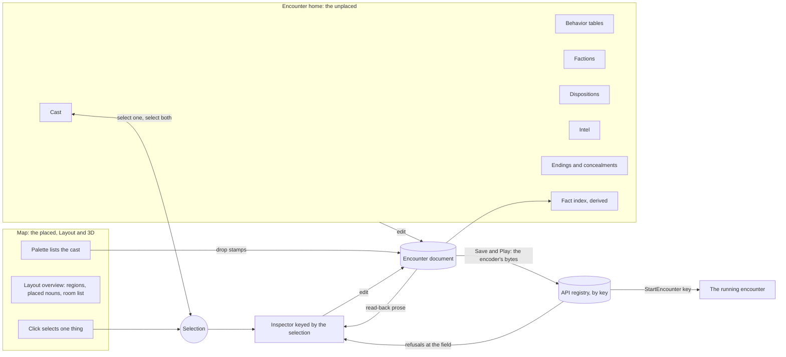
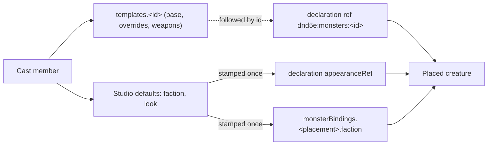

# Encounter studio — the selection inspector, the cast, and reading it back

Walkthrough: [README.md](README.md). Epic: rpg-project#545. The authored
document is the toolkit's single-room dialect
(`rpg-toolkit/rulebooks/dnd5e/encounter/dungeonspec`, `SingleRoomSpec`); the
castle use case it must carry is rpg-project#569. Per-placement looks reuse
[npc-appearance-ref](../npc-appearance-ref/design.md); tables are
[creature-table](../creature-table/design.md)'s.

## Shape

Two surfaces edit one document. The map holds what is placed; the Encounter
home holds what is placed nowhere. One inspector answers for whatever is
selected, and a selection made on either surface is the selection on both.

Save and Play sits in the header's Save group, beside the local draft and the
draft file, on every home and both views. The saved file is the file the
draft-file export writes, under the same key, and play launches that key with
the character picked on Home.

| Selection | Inspector shows |
|---|---|
| nothing | the room: size, default finishes, notes, party start |
| wall | finish, endpoints, place a door |
| door | open, closed or locked; the concealment that hides it |
| placed cast member | read-back prose; look, facing, faction, table, says, holds |
| prop | read-back prose; look, footprint, light, holds, options |
| floor hex | region, lighting, exit |
| group | members, ungroup, duplicate, delete |
| label | text, cell |
| party start | cell, move |

A cast member is one document template plus studio defaults. Placing it
stamps a declaration and a binding; only the template is followed by id.

## Law

- **The selection keys the inspector (R1).** Every editable field of a
  placed thing is reached by selecting it; there are no tool tabs that hold
  configuration. Why: the author is looking at the thing they mean to change.
- **The unplaced live on the Encounter home (R2).** Cast, tables, factions,
  dispositions, intel, endings and the fact index are edited there and named
  from placements. Why: the dialect itself places them at the root because no
  single placement owns them.
- **A cast member is a template (R3).** The cast list is the document's
  `templates` plus studio defaults; there is no second creature list. The
  palette lists the cast. Placing writes a declaration whose ref names the
  template and a binding carrying the stamped faction. A template edit
  reaches every placement; a cast member's default faction or look does not,
  and the inspector says which values are stamped. Why: one stat block has
  one home.
- **A look belongs to the placement (R4).** The cast member supplies the
  default look; each placement may override it; a shuffle varies the looks of
  one cast member's placements. Why: twelve guards are one stat block and
  twelve faces.
- **Read-back is rendered from the document (R5).** A placed thing's
  inspector opens with prose stating what it does on its time, what can be
  said to it, and what it knows. Values come from the document; a missing
  table is stated as the kind's default; engine laws are stated as laws, never
  invented. Why: an author who cannot read back the configuration cannot trust
  it.
- **The fact index is derived (R5).** For every fact id the document
  mentions, the home lists who writes it and who reads it. It stores nothing.
  Why: facts are declared by mention, so only an index can show one that is
  written and never read, or read and never written.
- **Humans place; configuration may be written by anyone (R6).** Layout,
  placement and looks are visual and human-authored. Tables, options, checks,
  factions and dispositions may be written by an agent. Every field an agent
  may write has a read-back a human can judge.
- **Layout shows the placed (R7).** The 2D view draws placed creatures, props,
  party start and doors over one colour per region, with a room list that
  frames a region on select and shows its size.
- **No saved noun is invisible (R8).** Exits, endings, concealments and door
  state each have a studio view in the inspector or on the home.
- **One thing at a time (R9).** The inspector shows one thing. The existing
  Shift-pick that feeds the group gesture keeps working as it does today, and
  a selected group is one thing with its own view. Multi-select as an editing
  mode waits for a use case.
- **The screen never says single room (R10).** The dialect's name stays in
  code; the word the screen uses is open (see Open).
- **The two surfaces point at each other (R11).** Selecting a cast member on
  the home selects its placements on the map, and selecting a placement
  highlights its cast member.
- **Rows read heaviest first (R12).** The Tables form and every read-back
  list a table's rows by weight, highest first, equal weights in authored
  order, and the studio saves them in that order. Why: a heavy row in the
  middle of a list is misread, and row order carries no meaning in the roll.
- **The workspace grows up and to the right (R13).** The workspace grows up
  and to the right by default; the author may choose another side. No cell
  moves on any side, because the workspace carries explicit bounds. Why: a
  resize must not move what was placed.
- **A prop's look belongs to the placement (R14).** The prop inspector offers
  the catalog's variants of the prop. Why: one barrel asset is many barrels.
  The shuffle stays with cast members (R4). Surface material waits for the
  look catalog (R14b).
- **The document's refusals are the studio's.** An unknown key refuses the
  whole file; a binding naming an undeclared table, record or template is
  refused by name; `at` and `path` cells are refused in this dialect. The
  studio shows each refusal at the field that caused it and does not save a
  file the decoder would refuse.

- **Play is the saved file (R15).** Save and Play writes the encoder's bytes
  to the registry under the draft's key and launches a lobby on that key with
  the character picked on Home. Nothing is launched that was not saved, and
  the control is one control on every home and both views. Why: what the
  author played is a file another author can read.
- **One key per draft (R16).** The draft-file export and the server save share
  one key, defaulting to the slug of the room name, editable, adopted from an
  import. The server's grammar is lowercase letters, digits and dashes, and the
  studio shows the server's sentence at the key field. The first save to a key
  that already exists asks before overwriting; later saves to it in the same
  editor session do not. The editor session is the draft's life in this
  browser: the memory follows the draft, not the studio's mount. Why: two
  keys for one draft is two files, and a play-tweak-play loop must not ask
  every time.
- **A refusal lands at the thing (R17).** A server refusal whose field path
  maps to a placed thing, a cast member, a table, a faction or a door becomes a
  jump that selects it and opens its inspector. One that maps to nothing stays
  a sentence under the Save group. Why: the author fixes the thing, not the
  path.
- **The studio says why it cannot (R18).** With authoring disabled on the
  server the control is present and disabled with that reason. Without a
  character picked on Home, Play is disabled with that reason. The studio does
  not pick a character, does not invent one and never launches a fallback
  encounter. Why: a disabled control with a sentence beats a missing one.
- **Edits wait for a publish (R15).** While a save or launch is in flight the
  studio refuses edits, undo and view changes that would change the captured
  bytes, and a response for a retired capture saves and launches nothing.
  Why: the file on the server must be the file the author pressed Save on.
- **What play does not render is said (R19).** Wall and region finishes and
  region lighting stay in the studio's presentation block and do not reach
  play; their fields say so in one line. Finishes reach play with the look
  catalog (R14b); region lighting is open. Why: an author must know a finish
  is a note to the studio, not to the game.

## Rulings

| ID | status | scope | ruled by | date |
|---|---|---|---|---|
| R1 | settled | one inspector keyed by the selection; Arrange, Walls, Doors and Notes tabs retire; N toggles the inspector, clicking a thing opens it | operator | 2026-10-14 |
| R2 | settled | the unplaced (cast, tables, factions, dispositions, intel, fact index) live on the Encounter home | operator | 2026-10-14 |
| R3 | settled | cast replaces Creatures and Stat blocks; cast member = template plus studio defaults; palette lists the cast; template followed by id, stamped faction and look not | operator | 2026-10-14 |
| R4 | settled | looks vary per placement; the cast member carries the default; a shuffle varies one cast member's placements | operator | 2026-10-14 |
| R5 | settled | read-back prose heads a placed thing's inspector; fact index on the home; kind default and engine laws stated, not invented | operator | 2026-10-14 |
| R6 | settled | humans own layout and placement; an agent may write configuration; the studio lets a human read it back | operator | 2026-10-14 |
| R7 | settled | Layout overview: placed nouns in 2D, one colour per region, room list that frames and sizes; shared-wall doors between separate rooms out of scope | operator | 2026-10-14 |
| R8 | settled | exits, endings, concealments and door state get studio views | operator | 2026-10-14 |
| R9 | settled | the inspector shows one thing; Shift-pick for the group gesture keeps working, and a group is one thing with its own view; multi-select as an editing mode waits for a use case (amended 2026-10-14: grouping already needs a multi-pick, epic #545 keeps grouping) | operator | 2026-10-14 |
| R10 | settled | the screen does not say single room; the dialect's name stays in code; the on-screen word is undecided | operator | 2026-10-14 |
| R11 | settled | selecting a cast member on the home selects it on the map, and the reverse | operator | 2026-10-14 |
| R12 | settled | table rows display and save heaviest first, ties in authored order | operator | 2026-10-14 |
| R13 | settled | default growth up and right; any side choosable; no cell moves, no warning (amended 2026-10-14: the plan found explicit bounds make the warning never true) | operator | 2026-10-14 |
| R14 | settled | props have a look per placement: the catalog variant; the shuffle stays with cast members | operator | 2026-10-14 |
| R14b | deferred-until-look-catalog | per-prop surface material and provider-published look choices; picker is rpg-dnd5e-web#1268 | operator | 2026-10-14 |
| R15 | settled | Save and Play in the studio header's Save group on every home and view; the existing publishing and launch hooks reused unchanged; edits refused while a publish is in flight | operator | 2026-10-14 |
| R16 | settled | one key per draft shared by the draft file and the server save; slug of the room name by default; overwrite asked once per key per editor session | operator | 2026-10-14 |
| R17 | settled | a server refusal with a field path that maps to a studio noun is a jump to that noun's inspector; otherwise a sentence under the Save group | operator | 2026-10-14 |
| R18 | settled | authoring off or no character picked disables the control with the reason; no in-studio character picker, no fallback encounter | operator | 2026-10-14 |
| R19 | deferred-until-look-catalog | wall and region finishes reach play with the look catalog, not before; region lighting does not reach play and is open; the fields say they are studio-only | operator | 2026-10-14 |

## Open

- **The document's on-screen word.** Encounter, site and room all appear
  today; the screen needs one.
- **Region lighting in play.** Play lights every derived region at full
  intensity with one archetype; whether an authored region's lighting should
  reach play is unsettled and separate from the look catalog (R19).
- **Opening a reference encounter.** How an author opens a shipped encounter,
  such as the castle, as a starting point rather than a blank room.
- **The sites layer (rpg-project#528).** Doors on shared walls between
  separately authored rooms, and authored cells for `at` and `path`, wait for
  it.
- **Multi-select as an editing mode.** R9 holds until a use case brings
  apply-to-all; the Shift-pick for grouping is not that mode.
- **What the shuffle randomises.** Appearance only, or also style and skin
  palette within one appearance family.
- **The look catalog (R14b).** Per-prop surface material and look choices
  wait on the provider publishing reviewed look choices per asset
  (rpg-game-assets#226); the Studio picker for them is
  rpg-dnd5e-web#1268. That published catalog is the contract the picker
  reads.
