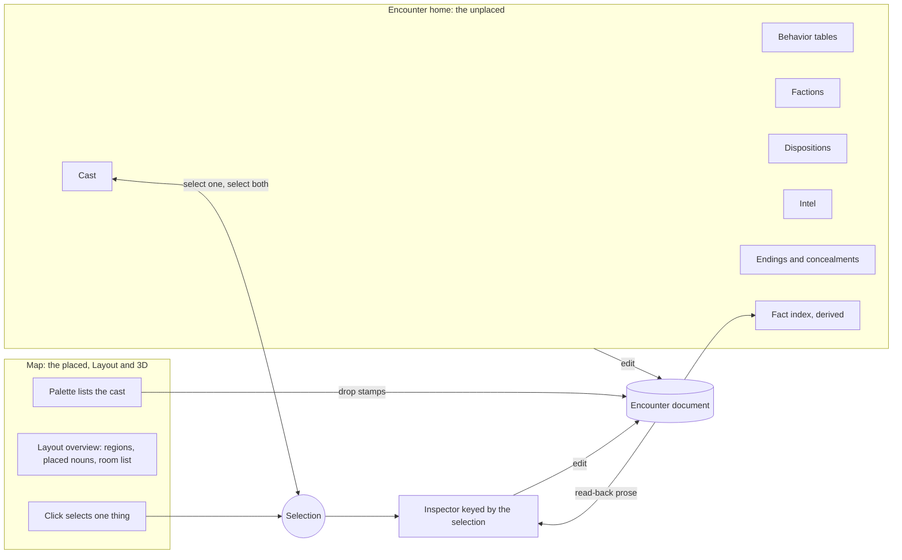
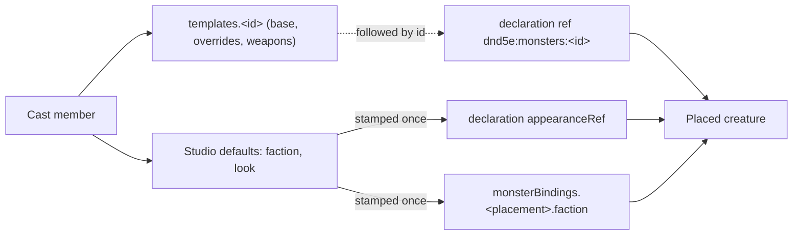

# Encounter studio — the selection inspector, the cast, and reading it back

Walkthrough: [README.md](README.md). Epic: rpg-project#545. The authored
document is the toolkit's single-room dialect
(`rpg-toolkit/rulebooks/dnd5e/encounter/dungeonspec`, `SingleRoomSpec`); the
castle use case it must carry is rpg-project#569. Per-placement looks reuse
[npc-appearance-ref](../npc-appearance-ref/design.md); tables are
[creature-table](../creature-table/design.md)'s.

## Shape

Two surfaces edit one document. The map holds what is placed; the Encounter
home holds what is placed nowhere. One inspector answers for whatever is
selected, and a selection made on either surface is the selection on both.

| Selection | Inspector shows |
|---|---|
| nothing | the room: size, default finishes, notes, party start |
| wall | finish, endpoints, place a door |
| door | open, closed or locked; the concealment that hides it |
| placed cast member | read-back prose; look, facing, faction, table, says, holds |
| prop | read-back prose; footprint, light, holds, options |
| floor hex | region, lighting, exit |

A cast member is one document template plus studio defaults. Placing it
stamps a declaration and a binding; only the template is followed by id.

## Law

- **The selection keys the inspector (R1).** Every editable field of a
  placed thing is reached by selecting it; there are no tool tabs that hold
  configuration. Why: the author is looking at the thing they mean to change.
- **The unplaced live on the Encounter home (R2).** Cast, tables, factions,
  dispositions, intel, endings and the fact index are edited there and named
  from placements. Why: the dialect itself places them at the root because no
  single placement owns them.
- **A cast member is a template (R3).** The cast list is the document's
  `templates` plus studio defaults; there is no second creature list. The
  palette lists the cast. Placing writes a declaration whose ref names the
  template and a binding carrying the stamped faction. A template edit
  reaches every placement; a cast member's default faction or look does not,
  and the inspector says which values are stamped. Why: one stat block has
  one home.
- **A look belongs to the placement (R4).** The cast member supplies the
  default look; each placement may override it; a shuffle varies the looks of
  one cast member's placements. Why: twelve guards are one stat block and
  twelve faces.
- **Read-back is rendered from the document (R5).** A placed thing's
  inspector opens with prose stating what it does on its time, what can be
  said to it, and what it knows. Values come from the document; a missing
  table is stated as the kind's default; engine laws are stated as laws, never
  invented. Why: an author who cannot read back the configuration cannot trust
  it.
- **The fact index is derived (R5).** For every fact id the document
  mentions, the home lists who writes it and who reads it. It stores nothing.
  Why: facts are declared by mention, so only an index can show one that is
  written and never read, or read and never written.
- **Humans place; configuration may be written by anyone (R6).** Layout,
  placement and looks are visual and human-authored. Tables, options, checks,
  factions and dispositions may be written by an agent. Every field an agent
  may write has a read-back a human can judge.
- **Layout shows the placed (R7).** The 2D view draws placed creatures, props,
  party start and doors over one colour per region, with a room list that
  frames a region on select and shows its size.
- **No saved noun is invisible (R8).** Exits, endings, concealments and door
  state each have a studio view in the inspector or on the home.
- **One selection at a time (R9).**
- **The screen never says single room (R10).** The dialect's name stays in
  code; the word the screen uses is open (see Open).
- **The two surfaces point at each other (R11).** Selecting a cast member on
  the home selects its placements on the map, and selecting a placement
  highlights its cast member.
- **The document's refusals are the studio's.** An unknown key refuses the
  whole file; a binding naming an undeclared table, record or template is
  refused by name; `at` and `path` cells are refused in this dialect. The
  studio shows each refusal at the field that caused it and does not save a
  file the decoder would refuse.

## Rulings

| ID | status | scope | ruled by | date |
|---|---|---|---|---|
| R1 | settled | one inspector keyed by the selection; Arrange, Walls, Doors and Notes tabs retire; N toggles the inspector, clicking a thing opens it | operator | 2026-10-14 |
| R2 | settled | the unplaced (cast, tables, factions, dispositions, intel, fact index) live on the Encounter home | operator | 2026-10-14 |
| R3 | settled | cast replaces Creatures and Stat blocks; cast member = template plus studio defaults; palette lists the cast; template followed by id, stamped faction and look not | operator | 2026-10-14 |
| R4 | settled | looks vary per placement; the cast member carries the default; a shuffle varies one cast member's placements | operator | 2026-10-14 |
| R5 | settled | read-back prose heads a placed thing's inspector; fact index on the home; kind default and engine laws stated, not invented | operator | 2026-10-14 |
| R6 | settled | humans own layout and placement; an agent may write configuration; the studio lets a human read it back | operator | 2026-10-14 |
| R7 | settled | Layout overview: placed nouns in 2D, one colour per region, room list that frames and sizes; shared-wall doors between separate rooms out of scope | operator | 2026-10-14 |
| R8 | settled | exits, endings, concealments and door state get studio views | operator | 2026-10-14 |
| R9 | settled | single selection only in the first cut; multi-select and apply-to-all wait for a use case | operator | 2026-10-14 |
| R10 | settled | the screen does not say single room; the dialect's name stays in code; the on-screen word is undecided | operator | 2026-10-14 |
| R11 | settled | selecting a cast member on the home selects it on the map, and the reverse | operator | 2026-10-14 |

## Open

- **The document's on-screen word.** Encounter, site and room all appear
  today; the screen needs one.
- **Save & Play ordering (rpg-dnd5e-web#1236).** Whether play-from-studio
  lands before or after the inspector slice.
- **Opening a reference encounter.** How an author opens a shipped encounter,
  such as the castle, as a starting point rather than a blank room.
- **The sites layer (rpg-project#528).** Doors on shared walls between
  separately authored rooms, and authored cells for `at` and `path`, wait for
  it.
- **Multi-select.** R9 holds until a use case brings apply-to-all.
- **What the shuffle randomises.** Appearance only, or also style and skin
  palette within one appearance family.
