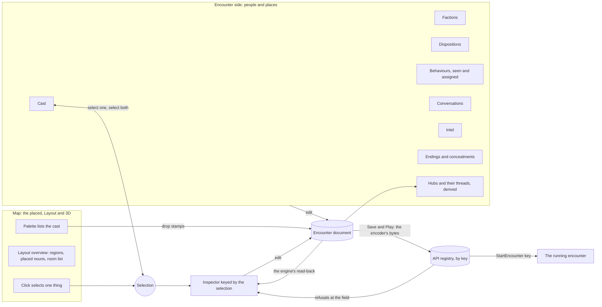
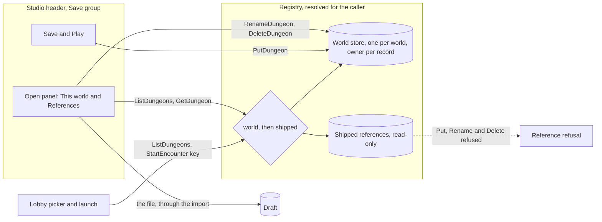
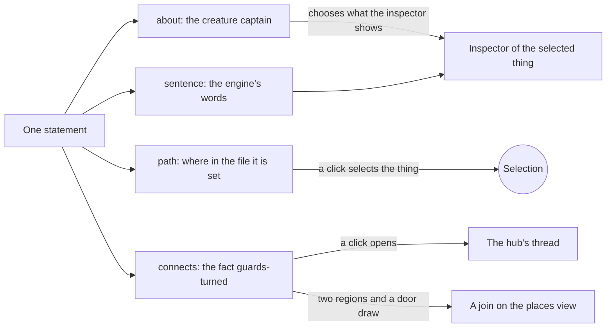
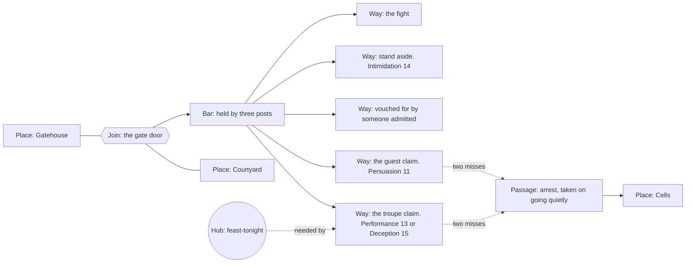
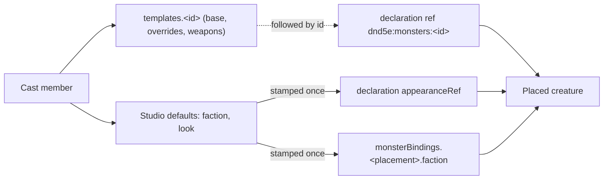

# Encounter studio — the selection inspector, the cast, and reading it back

Walkthrough: [README.md](README.md). Epic: rpg-project#545; places, ways and
the engine's read-back: rpg-project#966. The authored
document is the toolkit's single-room dialect
(`rpg-toolkit/rulebooks/dnd5e/encounter/dungeonspec`, `SingleRoomSpec`); the
castle use case it must carry is rpg-project#569. Per-placement looks reuse
[npc-appearance-ref](../npc-appearance-ref/design.md); tables are
[creature-table](../creature-table/design.md)'s.

## Shape

Two surfaces edit one document. The map holds what is placed; the Encounter
side holds the people and the places and what is placed nowhere (R28). One
inspector answers for whatever is selected, and a selection made on either
surface is the selection on both. What the studio says about the document, it
says in the engine's sentences (R25).

Save and Play sits in the header's Save group, beside the local draft and the
draft file, on every home and both views. The saved file is the file the
draft-file export writes, under the same key, and play launches that key with
the character picked on Home.

Behind the registry are two stores. The shipped references are files the
image seeds into the content directory, read-only over the wire. The world
store holds the encounters authors save, one store per world (the Discord
server), each record carrying its owner. A key names one encounter in a
world, and it is resolved for a caller in their world's store, then in the
references. The Open
panel sits beside Save and Play and reads both lists through the same import
the draft file uses.

| Selection | Inspector shows |
|---|---|
| nothing | the room: size, default finishes, notes, party start |
| wall | finish, endpoints, place a door |
| door | open, closed or locked; the concealment that hides it |
| placed cast member | the engine's read-back; look, facing, faction, behaviour, says, holds |
| prop | the engine's read-back; look, footprint, light, holds, options |
| floor hex | region, lighting, exit |
| group | members, ungroup, duplicate, delete |
| label | text, cell |
| party start | cell, move |
| join | its kind and state; the ways through it |
| hub | its thread: who teaches it, who asks it, what it wakes or opens |

The engine says the document back one statement at a time, on the check the
studio sends after each edit. A statement has four parts, and each part is
what one piece of the studio reads.

A join is one such statement. The front gate, as the castle runs:

The places view is the map at region scale with the encounter's web laid
over it.

| Word | What it is |
|---|---|
| place | a region |
| join | where two places meet: a door, an opening with no door, open floor where one region runs into the next, or a passage that is not physical (a relocation, an arrest) |
| bar | what stops a walker at a join: a lock, a hold by posted holders, or being hidden. A join has none, one or several |
| way | one means of lifting one bar: its method (a skill and its difficulty, something known, something carried, a fight), what it needs, and what failing does. A walker is through when every bar is lifted |
| partial way | something that lifts a bar for some holders and not all; it helps and is not counted as a way |
| sight seam | two places that see each other where no member can step across; not a join |
| hub | a fact, a topic, an intel record or a concealment |
| thread | what follows from a hub: who teaches it, who asks it, what it wakes or opens |

A cast member is one document template plus studio defaults. Placing it
stamps a declaration and a binding; only the template is followed by id.

## Law

- **The selection keys the inspector (R1).** Every editable field of a
  placed thing is reached by selecting it; there are no tool tabs that hold
  configuration. Why: the author is looking at the thing they mean to change.
- **The unplaced live on the Encounter side (R2, R28).** Cast, factions,
  dispositions, intel, endings, conversations and behaviours are edited or
  assigned there and named from placements. Why: the dialect itself places
  them at the root because no single placement owns them.
- **The Encounter side is people and places (R28).** It is organised by who
  is in the encounter and where, never by the file's sections. Why: an author
  thinks of the cook who knows something and the altar in the chapel, not of
  a root key.
- **A cast member is a template (R3).** The cast list is the document's
  `templates` plus studio defaults; there is no second creature list. The
  palette lists the cast. Placing writes a declaration whose ref names the
  template and a binding carrying the stamped faction. A template edit
  reaches every placement; a cast member's default faction or look does not,
  and the inspector says which values are stamped. Why: one stat block has
  one home.
- **A look belongs to the placement (R4).** The cast member supplies the
  default look; each placement may override it; a shuffle varies the looks of
  one cast member's placements. Why: twelve guards are one stat block and
  twelve faces.
- **Read-back heads the inspector (R5).** A placed thing's inspector opens
  with prose stating what it does on its time, what can be said to it, and
  what it knows. Why: an author who cannot read back the configuration cannot
  trust it.
- **The read-back is the engine's (R25).** The sentences are those of
  `dungeonspec/readback`, said from the compiled result and carried on the
  check the studio sends after each edit, and only on the check: a save
  carries none, because the studio holds the read-back of the check before
  it (R36). The studio holds no copy of the
  engine's rules and writes no sentence of its own about what will run. While
  a draft does not compile, the inspector shows the sentences of the last
  draft that did, marked as such, beside the refusal. Why: a second voice
  falls behind the engine and then disagrees with it.
- **One map from a path to a selection (R25).** A sentence, a refusal, a
  join and a thread each carry the file path where the thing is set, in the
  compiler's own form, and one map turns that path into a selection. Why:
  four ways to land on a thing would be four maps to keep true.
- **Hubs and threads are derived (R5, R32).** A hub is a fact, a topic, an
  intel record or a concealment. Its thread lists who teaches it, who asks
  it and what it wakes or opens, each a jump. A thread is never authored and
  the studio stores nothing for it. Why: facts are declared by mention, so
  only a derived view can show one that is taught and never asked, or asked
  and never taught.
- **A place is a region, and the engine says what joins it (R30).** Two
  places meet by a door, an opening with no door, open floor, or a passage
  that is not physical. All of it is derived by the engine from the running
  file; nothing is authored for the picture. Why: an author checks that an
  encounter offers several ways by different methods, and can only trust a
  count the engine made.
- **Feet decide a join (R38).** Two places join where a member can step from
  one to the other. Where sight crosses and feet do not, the engine says a
  sight seam, which is not a join; where feet cross and sight does not, it is
  a join whose sentence says sight is blocked. Why: a way is a way through.
- **A bar stops a walker; a way lifts one bar (R39).** A join is barred by a
  lock, by a hold of posted holders, or by being hidden, and may carry
  several. A way lifts exactly one bar, and a walker is through when every
  bar is lifted. A way past holders reaches every holder and meets each
  holder's whole pass, as the engine judges a pass. What lifts a bar for some
  holders only is a partial way and is never counted. A bar nothing lifts is
  said. Why: a locked and guarded door is one obstacle with two parts, and a
  list that reads either part as enough is false.
- **The engine says the ways (R39).** Each way is a read-back statement
  connected to its join, the bar it lifts, what carries it, what it needs and
  its method, with a check's difficulty as a number. The studio groups a
  join's ways by bar and lists them; it never decides that something is a
  way. Why: the rules that make a way are the engine's, and a second copy of
  them in the studio would drift.
- **A join is a sentence (R31).** The engine says each join, and each way, as
  a read-back statement with connections. The studio draws the places view
  from those connections and takes positions from the draft. No geometry
  message is added beside the atlas. Why: a second map of the site is a
  second thing to keep true.
- **The picture proves wiring (R30).** The places view shows that a way
  exists and what it needs. Whether it works in play is proved by a walk or a
  test, and the studio does not claim otherwise.
- **The studio shows the engine's fold (R37).** The read-back opens on the
  engine's fold for one thing at a time, and each folded entry opens to the
  full statements it stands for. The studio never folds, joins or rewords a
  sentence. Why: a fold made by the studio is the studio speaking for the
  engine.
- **Behaviour is a machine, built and then assigned (R26).** A creature's
  inspector names the behaviour it runs and lets the author assign one. Named
  tables and the `on`, `table` and `states` keys are not offered: the engine
  refuses them. Building a behaviour has its own home and its own story. Why:
  the engine runs machines, and a form that writes what the engine refuses is
  a trap.
- **Scenarios are not shown (R27).** The studio has no scenarios view. A file
  that carries the key still round-trips.
- **The file's `interactions` are Conversations (R29).** A conversation
  remembers for the whole run, so one creature can act on what was said to
  another. The screen never calls the wider set of things a player can do
  "interactions".
- **A built piece is named, used and filled in (R35).** Whatever an author
  builds once and uses many times (a cast member, a behaviour, a bundle, a
  conversation) is shown as a named piece with where it is used, and whatever
  it needs filled in is shown as a form. Why: a piece that reads the same on
  every shelf can later be kept on a world's shelf without a second design
  (rpg-project#977).
- **A primitive is shown once (R33).** A word that joins primitives to
  achieve something is shown as that joining: an arrest is a relocation with a
  message, reached from a conversation. Why: three forms for one act teach the
  author three things where there is one.
- **Humans place; configuration may be written by anyone (R6).** Layout,
  placement and looks are visual and human-authored. Tables, options, checks,
  factions and dispositions may be written by an agent. Every field an agent
  may write has a read-back a human can judge.
- **Layout shows the placed (R7).** The 2D view draws placed creatures, props,
  party start and doors over one colour per region, with a room list that
  frames a region on select and shows its size.
- **No saved noun is invisible (R8).** Exits, endings, concealments and door
  state each have a studio view in the inspector or on the home.
- **One thing at a time (R9).** The inspector shows one thing. The existing
  Shift-pick that feeds the group gesture keeps working as it does today, and
  a selected group is one thing with its own view. Multi-select as an editing
  mode waits for a use case.
- **The screen never says single room (R10).** The dialect's name stays in
  code; the word the screen uses is open (see Open).
- **The two surfaces point at each other (R11).** Selecting a cast member on
  the home selects its placements on the map, and selecting a placement
  highlights its cast member.
- **Rows read heaviest first (R12).** Every list of weighted rows the studio
  edits shows them by weight, highest first, equal weights in authored order,
  and saves them in that order. Why: a heavy row in the middle of a list is
  misread, and row order carries no meaning in the roll.
- **The workspace grows up and to the right (R13).** The workspace grows up
  and to the right by default; the author may choose another side. No cell
  moves on any side, because the workspace carries explicit bounds. Why: a
  resize must not move what was placed.
- **A prop's look belongs to the placement (R14).** The prop inspector offers
  the catalog's variants of the prop. Why: one barrel asset is many barrels.
  The shuffle stays with cast members (R4). Surface material waits for the
  look catalog (R14b).
- **The document's refusals are the studio's.** An unknown key refuses the
  whole file; a binding naming an undeclared table, record or template is
  refused by name; `at` and `path` cells are refused in this dialect. The
  studio shows each refusal at the field that caused it and does not save a
  file the decoder would refuse.

- **Play is the saved file (R15).** Save and Play writes the encoder's bytes
  to the registry under the draft's key and launches a lobby on that key with
  the character picked on Home. Nothing is launched that was not saved, and
  the control is one control on every home and both views. Why: what the
  author played is a file another author can read.
- **One key per draft (R16).** The draft-file export and the server save share
  one key, defaulting to the slug of the room name, editable, adopted from an
  import. The server's grammar is lowercase letters, digits and dashes, and the
  studio shows the server's sentence at the key field. The first save to a key
  that already exists asks before overwriting; later saves to it in the same
  editor session do not. The editor session is the draft's life in this
  browser: the memory follows the draft, not the studio's mount. Why: two
  keys for one draft is two files, and a play-tweak-play loop must not ask
  every time.
- **A refusal lands at the thing (R17).** A server refusal whose field path
  maps to a placed thing, a cast member, a table, a faction or a door becomes a
  jump that selects it and opens its inspector. One that maps to nothing stays
  a sentence under the Save group. Why: the author fixes the thing, not the
  path.
- **The inspector's width is the viewer's (R40).** The author sets the
  inspector's width; it is kept in the viewer's browser and never in the
  encounter file. Where there is room the map stops at the inspector; in a
  narrow window the inspector floats over the map. Why: a long read-back
  needs room, and a layout preference is not content.
- **A refusal is seen from anywhere (R34).** The header counts the current
  refusals on every home and view, and each is shown in the engine's words at
  the field that caused it. A refused file key is counted with them. A new
  empty draft shows its refusal at once. Why: a draft the engine refuses must
  not look healthy until Save is opened.
- **The studio says why it cannot (R18).** With authoring disabled on the
  server the control is present and disabled with that reason. Without a
  character picked on Home, Play is disabled with that reason. The studio does
  not pick a character, does not invent one and never launches a fallback
  encounter. Why: a disabled control with a sentence beats a missing one.
- **Edits wait for a publish (R15).** While a save or launch is in flight the
  studio refuses edits, undo and view changes that would change the captured
  bytes, and a response for a retired capture saves and launches nothing.
  Why: the file on the server must be the file the author pressed Save on.
- **What play does not render is said (R19).** Wall and region finishes and
  region lighting stay in the studio's presentation block and do not reach
  play; their fields say so in one line. Finishes reach play with the look
  catalog (R14b); region lighting is open. Why: an author must know a finish
  is a note to the studio, not to the game.
- **Saves land in the world's store, owned by the author (R20).**
  PutDungeon writes to the store of the caller's world, the Discord server
  the authenticated request is admitted to, and the record carries the
  caller's player id as its owner. A Put under a key the caller already owns
  replaces it, after the studio's ask (R16). A Put under a key another
  member of the world owns is refused with "that key belongs to another member of this world". A shipped reference
  is never written over the wire: a Put whose key names one is refused with
  "that key is a reference; save it under your own key". The validate-only
  grade refuses both the same way. Why: a reference is the same file for
  every author and an encounter belongs to the author who saved it, so no
  other save may change either.
- **A key names one thing in a world (R21).** A key is unique within a
  world: two authors in one world cannot both hold `my-castle`. The registry
  resolves a key in the caller's world store, then in the shipped
  references. The lists, GetDungeon, the play view's read of the file and
  the lobby's launch all resolve this way, and the lobby launches in its
  host's world. The world comes from the request's verified identity, never
  from a request field, and there is no qualified key on the wire. Why: one
  name for one file in a world keeps the studio, the lobby and play
  agreeing about what a key means for everyone at that table.
- **Rename and Delete are the owner's verbs (R22).** RenameDungeon moves one
  of the caller's encounters to a new key in one step, rewriting the file's
  own key line and nothing else. It is refused when the new key is already
  taken in the world, names a shipped reference or breaks the key grammar.
  DeleteDungeon removes one of the caller's encounters. Either verb by anyone
  but the owner is refused with "that key belongs to another member of this world", and neither
  touches a reference. Why: a rename built from a save and a delete leaves
  two files, or none, when it fails halfway.
- **The older dialect is listed nowhere (R23).** A shipped reference in the
  multi-room dialect is left out of every list a user reads: the studio's
  Open panel and the lobby's picker. Its file stays, the lobby's default
  still plays one, and a launch by key still resolves them until they are
  retired. Why: they are superseded stepping stones, and a list entry the
  studio cannot open is a trap.
- **Open is the import (R24).** The Open panel sits beside Save and Play and
  lists This world, every encounter in the caller's world with its owner
  and the caller's own marked Mine, and References. Every member of a world
  sees the world's encounters; only the owner edits one (R22). The lobby's
  picker lists the same, so a host can launch any member's. Opening reads
  the file with GetDungeon and passes it through the draft-file import, so a
  file from the server and a file from disk are refused alike. Opening
  one's own seeds its key as saved, so the next Save and Play does not ask
  (R16). Opening another member's or a reference opens a copy: a fresh key
  and no remembered save. Save and Play is unchanged. Why: one reading path
  means the studio cannot open what it could not import, and a table plays
  what its members made.

## Rulings

| ID | status | scope | ruled by | date |
|---|---|---|---|---|
| R1 | settled | one inspector keyed by the selection; Arrange, Walls, Doors and Notes tabs retire; N toggles the inspector, clicking a thing opens it | operator | 2026-10-14 |
| R2 | settled | the unplaced (cast, factions, dispositions, intel, endings, conversations, behaviours) live on the Encounter side (amended 2026-11-15: tables left with R26, the fact index became hubs and threads with R32, the grouping is R28) | operator | 2026-10-14 |
| R3 | settled | cast replaces Creatures and Stat blocks; cast member = template plus studio defaults; palette lists the cast; template followed by id, stamped faction and look not | operator | 2026-10-14 |
| R4 | settled | looks vary per placement; the cast member carries the default; a shuffle varies one cast member's placements | operator | 2026-10-14 |
| R5 | settled | read-back prose heads a placed thing's inspector (amended 2026-11-15: whose sentences they are is R25; the fact index is R32) | operator | 2026-10-14 |
| R6 | settled | humans own layout and placement; an agent may write configuration; the studio lets a human read it back | operator | 2026-10-14 |
| R7 | settled | Layout overview: placed nouns in 2D, one colour per region, room list that frames and sizes; shared-wall doors between separate rooms out of scope | operator | 2026-10-14 |
| R8 | settled | exits, endings, concealments and door state get studio views | operator | 2026-10-14 |
| R9 | settled | the inspector shows one thing; Shift-pick for the group gesture keeps working, and a group is one thing with its own view; multi-select as an editing mode waits for a use case (amended 2026-10-14: grouping already needs a multi-pick, epic #545 keeps grouping) | operator | 2026-10-14 |
| R10 | settled | the screen does not say single room; the dialect's name stays in code; the on-screen word is undecided | operator | 2026-10-14 |
| R11 | settled | selecting a cast member on the home selects it on the map, and the reverse | operator | 2026-10-14 |
| R12 | settled | weighted rows display and save heaviest first, ties in authored order (amended 2026-11-15: the Tables form left with R26; the rule holds for every row list that remains) | operator | 2026-10-14 |
| R13 | settled | default growth up and right; any side choosable; no cell moves, no warning (amended 2026-10-14: the plan found explicit bounds make the warning never true) | operator | 2026-10-14 |
| R14 | settled | props have a look per placement: the catalog variant; the shuffle stays with cast members | operator | 2026-10-14 |
| R14b | deferred-until-look-catalog | per-prop surface material and provider-published look choices; picker is rpg-dnd5e-web#1268 | operator | 2026-10-14 |
| R15 | settled | Save and Play in the studio header's Save group on every home and view; the existing publishing and launch hooks reused unchanged; edits refused while a publish is in flight | operator | 2026-10-14 |
| R16 | settled | one key per draft shared by the draft file and the server save; slug of the room name by default; overwrite asked once per key per editor session | operator | 2026-10-14 |
| R17 | settled | a server refusal with a field path that maps to a studio noun is a jump to that noun's inspector; otherwise a sentence under the Save group | operator | 2026-10-14 |
| R18 | settled | authoring off or no character picked disables the control with the reason; no in-studio character picker, no fallback encounter | operator | 2026-10-14 |
| R19 | deferred-until-look-catalog | wall and region finishes reach play with the look catalog, not before; region lighting does not reach play and is open; the fields say they are studio-only | operator | 2026-10-14 |
| R20 | settled | PutDungeon writes only to the caller's world store, each record owned by the auth player id; the same owner's Put under an existing key is the overwrite case; another owner's key is refused with the another-member sentence and a shipped key with the reference sentence, validate-only or not; opening a reference and saving writes a copy under the author's key | operator | 2026-10-15 |
| R21 | settled | a key is unique within a world, duplicates refused; it resolves world store, then shipped, in the lists, GetDungeon, the play view's file read and the lobby launch (the host's world); the world comes from the verified request identity; no qualified key on the wire | operator | 2026-10-15 |
| R22 | settled | `RenameDungeon{key, new_key}` on the world store, atomic, refused when `new_key` is taken in the world, shipped or outside the grammar; `DeleteDungeon{key}` on the world store; both refused with the another-member sentence for anyone but the owner; references are neither renamed nor deleted (owner checked on each record) | operator | 2026-10-15 |
| R23 | settled | multi-room-dialect references are removed from the studio Open panel and the lobby picker; their files, the lobby default and launch by key stay until rpg-api#1105 | operator | 2026-10-15 |
| R24 | settled | the Open panel beside Save and Play lists This world (every world encounter, owner shown, the caller's own marked Mine) and References and opens through the draft-file import; one's own seeds its key as saved; another member's or a reference opens as a copy, a fresh key and no remembered save; the lobby picker lists the world's encounters; Save and Play unchanged (amended 2026-10-15: the world's encounters are listed) | operator | 2026-10-15 |
| R25 | settled | the inspector's read-back is `dungeonspec/readback`'s, carried on the validate-only PutDungeon; the studio's own renderer retires; a draft that does not compile shows the last compiling draft's sentences beside the refusal; one path-to-selection map serves sentences, refusals, joins and threads | operator | 2026-11-15 |
| R26 | settled | named tables and the `on`/`table`/`states` forms retire; behaviour is a machine that is built, then assigned; this design shows and assigns one, building is a separate story | operator | 2026-11-15 |
| R27 | settled | the Scenarios view is removed; the key still round-trips | operator | 2026-11-15 |
| R28 | settled | the Encounter side is people and places, not the file's sections | operator | 2026-11-15 |
| R29 | settled | the file's `interactions` are called Conversations on screen | operator | 2026-11-15 |
| R30 | settled | a place is a region; a join is a door, an opening, open floor or a non-physical passage; all derived by the engine; the picture proves wiring, not play (amended 2026-11-16: the state of a join is its bars, R39; feet decide a join, R38) | operator | 2026-11-15 |
| R31 | settled | the engine says each join as a read-back statement connecting two regions and what holds, locks or hides it; one new field on the wire; no geometry message beside the atlas | operator | 2026-11-15 |
| R32 | settled | hubs (facts, topics, intel records, concealments) and their threads are derived, never authored, never stored | operator | 2026-11-15 |
| R33 | settled | a primitive is shown once; a word that joins primitives is shown as that joining; whether the engine folds `relocate`, `jail` and `arrest` is outside this design | operator | 2026-11-15 |
| R34 | settled | the current refusals are counted in the header on every home and view and shown in the engine's words at the field | operator | 2026-11-15 |
| R35 | settled | a built piece is shown as a named thing with where it is used; what it needs filled in is a form; this is what the design keeps open for a world's shelf of pieces (rpg-project#977), which it does not build | operator | 2026-11-15 |
| R36 | settled | the read-back is computed on the validate-only check only, never on a save | lead, from CI evidence, 2026-11-15; unvetoed | 2026-11-15 |
| R37 | settled | the inspector opens on the engine's one-thing fold with a Folded and Full switch; each entry opens to its full statements; the studio never folds | operator | 2026-11-16 |
| R38 | settled | a join is decided by movement; a sight seam is said and is not a join | lead, open to the operator's veto | 2026-11-15 |
| R39 | settled | bars (lock, hold, hidden); a way lifts one bar; partial ways; a bar nothing lifts is said; a pass is judged per holder as the engine judges it; ways and their method and difficulty are said by the engine | lead, open to the operator's veto | 2026-11-16 |
| R40 | settled | the inspector's width is set by the author, kept per viewer, never in the file; docks where the map keeps a floor, floats otherwise | operator | 2026-11-16 |
| R41 | settled | a new empty draft shows its refusal in the header at once | operator | 2026-11-16 |

## Open

- **The document's on-screen word.** Encounter, site and room all appear
  today; the screen needs one.
- **The on-screen words for place, join, way, hub and thread.** The design
  uses them; the screen's words are not chosen.
- **Open floor and a doorless gap.** The engine can tell them apart from
  what the compiled site holds; they are one kind until content needs them
  told apart.
- **Alternatives and the parts of one approach.** A way's method
  connections do not yet say which belong to one approach
  (rpg-toolkit#2444).
- **Folding the ways.** A join's ways are shown as full sentences, and a
  line carried by several creatures is said once per carrier.
- **Drawing sight seams.** The engine says them; the places view does not
  draw them.
- **Reusing the compile.** The read-back compiles the file a second time on
  each check; an engine entry point that says back an already compiled file
  is not built.
- **The behaviour builder.** Its own story; this design gives a behaviour a
  place to be seen and assigned (R26).
- **Region lighting in play.** Play lights every derived region at full
  intensity with one archetype; whether an authored region's lighting should
  reach play is unsettled and separate from the look catalog (R19).
- **The sites layer (rpg-project#528).** Doors on shared walls between
  separately authored rooms, and authored cells for `at` and `path`, wait for
  it.
- **Multi-select as an editing mode.** R9 holds until a use case brings
  apply-to-all; the Shift-pick for grouping is not that mode.
- **What the shuffle randomises.** Appearance only, or also style and skin
  palette within one appearance family.
- **Retiring the v2 references (rpg-api#1105).** The multi-room-dialect
  files leave the content directory once the lobby's default, the walk
  scenes and the atlas fixtures stop needing them (R23).
- **Draw what the party knows (rpg-project#586).** Unobserved doors drawn
  as wall, then rendering scoped to sight.
- **The look catalog (R14b).** Per-prop surface material and look choices
  wait on the provider publishing reviewed look choices per asset
  (rpg-game-assets#226); the Studio picker for them is
  rpg-dnd5e-web#1268. That published catalog is the contract the picker
  reads.
