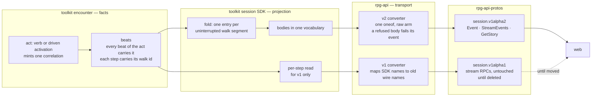
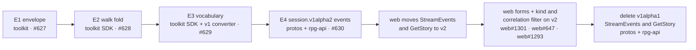

# Event stream — searchable, folded, one vocabulary, on session v1alpha2

The session event stream is what every client reads to learn what happened.
This pass makes it searchable by cause, folds a walk into one entry, speaks one
vocabulary, and says exactly what happened in every event. The cleaned stream
lives in a new proto package, `dnd5e.api.session.v1alpha2`, holding only the
event stream; the verbs stay in v1alpha1. The pass extends the
event-projection design (`ideas/event-projection/design.md`, rpg-project#541)
and does not reopen it. Explanation: [walkthrough.md](walkthrough.md).
Tracking: rpg-project#631.

## Shape

The pass is done when the v1alpha1 StreamEvents and GetStory are deleted (R6).

## Law

1. **An act names itself.** Every beat appended inside a verb or a driven
   activation carries that act's correlation, so one search returns a cause and
   all its effects. A beat outside any act carries none.
2. **A reaction belongs to its trigger.** An opportunity attack or a roll
   window carries the correlation of the act that provoked it.
3. **The envelope is `seq`, `at` and `correlation`.** `at` is the world-clock
   reading in rounds when the beat was recorded, shared by every beat in a
   round; order is `seq`, never `at`.
4. **Tags are the record's own query surface** and do not reach the session
   SDK event or the wire.
5. **A step carries its walk.** Encounter opens a walk id at a walk's first
   step and closes it at the last step or the refusal; the fold is by identity,
   never by adjacency.
6. **On v1alpha2 a walk is one entry per uninterrupted segment**, carrying its
   ordered cells, live and in story catch-up through the same SDK projection.
   Any other beat delivered to that recipient mid-walk closes the segment.
   v1alpha2 has no per-step kind.
7. **One vocabulary**, in the session SDK and on v1alpha2. The subject of a
   body is `member`; the other party is `target`; a prop or faction subject is
   `prop` or `faction`. A rolled body carries `roll`, `total`, `against` and
   `beaten`; a table roll carries `roll` and `of`. The verdict word is `beaten`.
8. **Closed in code, enum on the wire; authored in content, string ref.**
9. **Every event says exactly what happened.** The v1alpha2 Event has one
   oneof and no payload bytes; every mapped kind has a complete typed body.
   Nothing is filtered before release (event-projection R5).
10. **A fact crosses every layer or none.** A beat field is in its typed body
    or deleted from the beat.
11. **An unmapped beat is loud.** It arrives in the oneof's raw arm, named and
    whole, never as an empty UNKNOWN (R28).
12. **A refused body fails its event, not the read**, on v1alpha2. The event
    keeps its seq and arrives marked refused, so a catch-up never hides a hole.
13. **The stream moves by version.** v1alpha2 defines its own types and imports
    nothing from v1alpha1; v1alpha1's stream is left as is until it is deleted.
14. **Within a package, protos change additively:** a replaced field is
    `[deprecated = true]` and unwritten; it never changes type in place.

## Rulings

| ID | ruling | status | scope | ruled by | date |
|----|--------|--------|-------|----------|------|
| R1 | The pass extends event-projection R1–R5 and reopens none of them | settled | all | KirkDiggler | 2026-10-20 |
| R2 | Order: envelope, walk fold, vocabulary, the v1alpha2 events package, web on v2, then delete the v1alpha1 stream RPCs | settled | all | KirkDiggler | 2026-10-20 |
| R3 | Every beat carries the correlation of the verb or activation that caused it | settled | encounter, session | KirkDiggler | 2026-10-20 |
| R4 | `at`, `seq` and `correlation` all stay; `at` is documented as the world-clock reading in rounds. Tags reach the wire or leave the SDK | settled | session, protos | KirkDiggler | 2026-10-20 |
| R5 | The walk fold is event-projection R4, built in the toolkit session SDK; on the wire it exists only in v1alpha2. v1alpha1 keeps per-hex MOVED | settled | encounter, session, protos, api | KirkDiggler | 2026-10-20 |
| R6 | The cleaned stream is a new package `dnd5e.api.session.v1alpha2` holding only the Event envelope, the bodies, StreamEvents and GetStory; verbs stay in v1alpha1 and move as their use cases arrive. The pass is done when the v1alpha1 StreamEvents and GetStory are deleted. Additive-and-deprecate leaves fifteen subject names beside the new one and an in-place break moves every consumer in one train; a version gives one vocabulary and per-RPC migration (the proto-versioning rule, rpg-project#156, triggered by cleanliness rather than consumer count) | settled | protos, session, api, web | KirkDiggler | 2026-10-20 |
| R7 | `transferred`, `interacted`, `bought`, `sold` are early trading beats; they stay unmapped (UNKNOWN) and get typed kinds when trading brings its use case | settled | session, protos | KirkDiggler | 2026-10-20 |
| R8 | Delete the never-emitted deprecated kinds — replaced by R6: v1alpha2 never defines them, v1alpha1 stays as is until deleted | superseded | protos | KirkDiggler | 2026-10-20 |
| R9 | Web forms and the debug filter build on the cleaned stream and live in the existing web issues | settled | web | KirkDiggler | 2026-10-20 |
| R10 | Answered.fact stays out; a learned fact needs a per-viewer projection, not a broadcast field | settled | protos, api | KirkDiggler | 2026-09-17 |
| R11 | Encounter mints a correlation once per act as `<verb>:<first seq>`, the equip form | proposed | encounter | — | 2026-10-20 |
| R12 | A reaction carries its trigger's correlation (Law 2) | proposed | encounter | — | 2026-10-20 |
| R13 | `at` keeps its meaning — replaced by R4 | superseded | encounter, protos | KirkDiggler | 2026-10-20 |
| R14 | Tags leave the session SDK event; the record keeps them | proposed | session | — | 2026-10-20 |
| R15 | Encounter owns the walk id, not the session; the session already marks the last step | proposed | encounter, session | — | 2026-10-20 |
| R16 | Fold shape on v1alpha1, a path on Moved or a new kind — replaced by R6 and R27 | superseded | protos | KirkDiggler | 2026-10-20 |
| R17 | GetStory fails per event natively in v1alpha2 (Law 12); v1alpha1 keeps its whole-read failure untouched | proposed | api, protos | — | 2026-10-20 |
| R18 | Subject and roll vocabulary as Law 7; DeathSaveRolled keeps its calculation as the expansion; Saved `succeeded` becomes `beaten` | proposed | session, protos, web | — | 2026-10-20 |
| R19 | Toolkit beat strings use snake_case, matching the wire enum names | proposed | encounter, session | — | 2026-10-20 |
| R20 | Ability, skill and stance become v1alpha2 enums; causes and reasons become enums where the toolkit holds them as a closed const set | proposed | session, protos | — | 2026-10-20 |
| R21 | A walk's `cause` is in the walk body, once per segment | proposed | session, protos, api | — | 2026-10-20 |
| R22 | A walk's crossed doors are in the walk body, on the step that crossed them; a door a concealment holds never rides it (encounter already omits it) | proposed | session, protos, api | — | 2026-10-20 |
| R23 | Answered `prop` is in the body; exactly one of `member` and `prop` names who answered | proposed | session, protos, api | — | 2026-10-20 |
| R24 | v1alpha2 Answered has no `verb` or `beaten`; SPOKE carries the verdict. `temper` stays | proposed | protos, api, web | — | 2026-10-20 |
| R25 | Rested stops inlining concentration; the ended concentration is its own CONCENTRATION_ENDED under the rest's correlation | proposed | session, protos | — | 2026-10-20 |
| R26 | Every event carries enough detail in its typed body to say exactly what happened; the v1alpha2 Event has one oneof, a complete body for every mapped kind, and no raw `payload` bytes | settled | session, protos, api | KirkDiggler | 2026-10-20 |
| R27 | v1alpha2 has no per-step MOVED; a walk is one entry with its ordered cells | settled | protos, api, web | KirkDiggler | 2026-10-20 |
| R28 | An unmapped beat (the trading beats, anything future) arrives as a `Raw raw` arm of the same oneof: `string beat` plus the encounter fields as `google.protobuf.Struct`. Struct, because a form or the debug panel reads it as an object with no second decoder, and bytes would restore the passthrough payload R26 removes; the cost is that Struct numbers are doubles | proposed | protos, api, web | — | 2026-10-20 |
| R29 | Shared types (Position, the Verb, Temper, AnswerWord and AnswerKey enums, ids) are redefined in v1alpha2, only what the stream needs; duplication until v1alpha1's stream RPCs are deleted is the price of the clean slate. Not taken: importing the v1alpha1 types, which ties v2 to v1's names and keeps v1 alive after its stream is gone | proposed | protos | — | 2026-10-20 |
| R30 | The v1alpha2 walk is `EVENT_KIND_WALKED` with body `Walked { member, walk, repeated WalkStep path, cause }`, where `WalkStep { Position cell, repeated string doors }` | proposed | protos, api, web | — | 2026-10-20 |
| R31 | The session SDK keeps its per-step event read for the v1 converter until the v1alpha1 stream is deleted; the folded read is what v2 serves. Per-step v1 seqs stay as they are | proposed | session, api | — | 2026-10-20 |
| R32 | v1alpha2 declares `SessionService` with StreamEvents and GetStory only; verbs join it as they move | proposed | protos, api | — | 2026-10-20 |

## Open

- **Raw arm encoding.** R28 proposes Struct; the alternative is `bytes` with
  the encounter JSON, exact for integers and opaque to clients.
- **Seqs differ between versions.** A v2 seq counts folded entries and a v1 seq
  counts steps, so a client never mixes the two streams' seqs. Confirm one
  per-recipient seq per folded entry against story catch-up when building.
- **Segments per recipient.** Under event-projection R5 every viewer receives
  everything, so every viewer's segments match. When filtering arrives, a beat
  a viewer does not receive does not close their segment; confirm when it does.
- **Answered `selector`** (where the answer sends the creature: at a cell, along
  a path): in the body or deleted from the beat.
- **Downed `kind`**: in the body, or deleted if the roster still names a downed
  member's kind.
- **ExperienceGained `member`**, which repeats DOWNED's member: keep as the
  grant's source or delete now that correlation joins the two.
- **Concentration break**, which emits CONCENTRATION_ENDED, ACTIVATION_RESULT
  and, when a save caused it, SAVED: keep all three under one correlation, or
  drop the ACTIVATION_RESULT.
