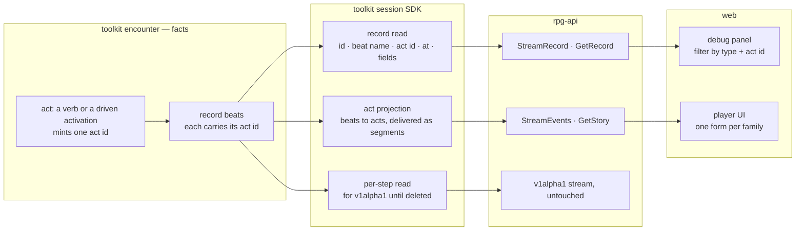
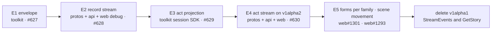

# Event stream — the record and the act, on session v1alpha2

Session v1alpha2 carries two streams cut from one record. The **record stream**
shows every beat encounter writes, as written. The **act stream** shows what
happened as acts: who did what, to whom, how it was decided, what changed. The
package holds only the streams; the verbs stay in v1alpha1. The pass extends
the event-projection design (`ideas/event-projection/design.md`,
rpg-project#541): encounter states facts, the session projection shapes
delivery, rpg-api transports. Explanation: [walkthrough.md](walkthrough.md).
Tracking: rpg-project#631.

## Shape

The act families, one body shape each:

| Family | Carries | Examples |
|---|---|---|
| act | a member's verb or a driven activation: who, what, to whom, the `Roll`, the outcome inside the body | walk, attack (hit, miss or warded), speak, cast, loot, rest |
| reaction | the same as act, nested under its trigger's act id | opportunity attack, a ward |
| table answer | word, say, option, candidates, the roll of N | a creature's answer, an idle pick |
| state | a standing change to one party | downed, stance, concentration ended, condition removed, experience |
| perception | what one observer came to know | sighted, heard, snuck, revealed, cells |
| clock and roster | the frame the acts happen in | turn, fight formed or dissolved, tick, joined, exited, arrived, scene, ended |

Two shared messages. `Roll` is the expression, the raw dice, the modifiers
with their sources, the total, what it was against, and whether it beat it.
`Party` is a kind and an id, for a member, a prop, a faction or the world.

The pass is done when the v1alpha1 StreamEvents and GetStory are deleted (R2).

## Law

1. **Two streams, one record.** The record stream and the act stream are both
   read from the record encounter writes; neither holds a fact the record
   lacks.
2. **An act names itself.** Encounter mints one act id per act, and every beat
   appended inside the act carries it as `correlation`. A reaction carries its
   trigger's act id.
3. **The envelope is an id, `at` and `correlation`.** The id is an ordering
   key, not a counter: it increases over time and is unique, and a gap between
   two ids means nothing. `at` is the world-clock reading in rounds, shared by
   every beat in a round; order is the id, never `at`.
4. **Loss is the transport's contract.** A subscriber that falls behind is
   told it lagged and catches up from the last id it saw; a client never
   infers a miss from the numbers.
5. **The record stream is the beat as written:** id, beat name, act id,
   `at`, and the encounter fields as `google.protobuf.Struct`. It has no
   typed bodies. Its whole contract is that a reader can narrow it by act id
   and by beat name.
6. **The unit of the act stream is the act.** An act is delivered as segments
   under one act id and folds back into one act on replay; a walk is the
   model. Any other beat delivered to that recipient mid-act closes the
   segment (R19).
7. **An act says what happened.** Its body names who, what, to whom, how it
   was decided and what changed. The outcome lives inside the body; an attack
   is one act that hit, missed or was warded, never three kinds.
8. **A beat with no act appears only in the record stream.**
9. **The player UI reads acts; the debug panel reads the record** (R14). A
   form that needs a record detail means the detail belongs in the act body.
10. **Filtering is outside both shapes.** Neither stream's bodies encode who
   may see them. The record stream is unfiltered; the act stream is filtered
   per viewer by perception as a delivery step in the session projection
   (R35).
11. **v1alpha2 imports nothing from v1alpha1.** v1alpha1's stream is left as
    is until it is deleted.
12. **Within a package, protos change additively:** a replaced field is
    `[deprecated = true]` and unwritten; it never changes type in place.
13. **Acts sharing an id are one delivery unit** (R32). The producer marks the
    unit's last act with `run_end`; a transport closes on lag and ends a page
    only after it.

## Rulings

| ID | ruling | status | scope | ruled by | date |
|----|--------|--------|-------|----------|------|
| R1 | The pass extends event-projection R1–R5 and reopens none of them | settled | all | KirkDiggler | 2026-10-20 |
| R2 | v1alpha2 holds only the streams; verbs stay in v1alpha1 and move as their use cases arrive. The pass is done when the v1alpha1 StreamEvents and GetStory are deleted | settled | protos, api, web | KirkDiggler | 2026-10-20 |
| R3 | Every beat carries the act id of the verb or activation that caused it | settled | encounter, session | KirkDiggler | 2026-10-20 |
| R4 | `at`, `seq` and `correlation` all stay; `at` is the world-clock reading in rounds | settled | session, protos | KirkDiggler | 2026-10-20 |
| R5 | v1alpha2 carries two streams: the record stream (every beat, untyped) and the act stream (the projection, folded per act) | settled | session, protos, api, web | KirkDiggler | 2026-10-20 |
| R6 | The act stream's unit is the act, delivered as segments under one act id and folded on replay; the walk is the model (event-projection R4 generalized) | settled | session, protos, web | KirkDiggler | 2026-10-20 |
| R7 | Filtering is a later layer outside both shapes; event-projection R5 stands before release | settled | session, api | KirkDiggler | 2026-10-20 |
| R8 | The record stream is made manageable in the UI by act id and beat name; that is its whole contract | settled | web, protos | KirkDiggler | 2026-10-20 |
| R9 | The trading beats (`transferred`, `interacted`, `bought`, `sold`) need no kind: they appear in the record stream and produce no act | settled | session, protos | KirkDiggler | 2026-10-20 |
| R10 | Answered `fact` stays out; a learned fact needs a per-viewer projection, not a broadcast field | settled | protos, api | KirkDiggler | 2026-09-17 |
| R11 | An unmapped beat rides a raw arm of the act stream — replaced by R5 | superseded | protos | KirkDiggler | 2026-10-20 |
| R12 | Two RPC pairs, not one stream with two arms: StreamRecord and GetRecord, StreamEvents and GetStory. The record stream carries the record's own id, not a per-recipient number. An act segment never names a range of record ids: the join runs the other way, because every record beat carries its act id | settled | protos, api | KirkDiggler | 2026-10-20 |
| R13 | Record access is an entitlement (operator and developer at release); before release every client receives both streams | settled | api, web | KirkDiggler | 2026-10-20 |
| R14 | The player UI reads acts only; the debug panel reads the record (Law 9) | settled | web | KirkDiggler | 2026-10-20 |
| R15 | A record catch-up read, GetRecord, sits beside GetStory so the panel keeps history on reconnect | settled | protos, api, web | KirkDiggler | 2026-10-20 |
| R16 | The act families of the Shape table, one body each: act, reaction, table answer, state, perception, clock and roster | settled | session, protos, web | KirkDiggler | 2026-10-20 |
| R17 | Shared `Roll` (expression, raw dice, modifiers with sources, total, against, beaten) and `Party` (kind and id: member, prop, faction, world) | settled | session, protos, web | KirkDiggler | 2026-10-20 |
| R18 | v1alpha2 defines every type it needs and imports nothing from v1alpha1; the duplication lasts until v1alpha1's stream is deleted. Not taken: importing the v1alpha1 types, which ties v2 to v1's names | settled | protos | KirkDiggler | 2026-10-20 |
| R19 | An open act (a walk paused for a window, a roll window) delivers as segments; any other beat delivered to that recipient mid-act closes the segment | settled | session | KirkDiggler | 2026-10-20 |
| R20 | Encounter mints the act id once per act as `<verb>:<first seq>`, the equip form; on v1alpha2 the form is `<verb>:<id>` (R27) | settled | encounter | KirkDiggler | 2026-10-20 |
| R21 | The session SDK keeps a per-step read for the v1alpha1 converter, so v1alpha1 keeps per-step MOVED until it is deleted | settled | session, api | KirkDiggler | 2026-10-20 |
| R22 | GetStory on v1alpha2 fails one act, not the read: the act keeps its id and arrives marked refused. v1alpha1 keeps its whole-read failure | settled | api, protos | KirkDiggler | 2026-10-20 |
| R23 | Tags stay the record's own query surface and leave the session SDK event | settled | session | KirkDiggler | 2026-10-20 |
| R24 | A driven activation that walks then attacks is several acts: an act is one verb, and a walk's act id is event-projection R4's walk id | settled | encounter, session | KirkDiggler | 2026-10-20 |
| R25 | The record stays trimmed to encounter's retention window as it is today; a durable home for the record waits for its use case, and this pass is the learning step for it | deferred-until-use-case | encounter, session, api | KirkDiggler | 2026-10-20 |
| R26 | The record stream shows every viewer every beat, per-observer beats included, before release under event-projection R5; R13 closes it at release | settled | session, api, web | KirkDiggler | 2026-10-20 |
| R27 | The wire id on both v1alpha2 streams is an ordering key, not a counter: an id that increases over time, ULID-style preferred (time-ordered, unique, monotonic within a millisecond). Gaps are normal and carry no meaning. The record keeps its global seq internally. On v1alpha2 the act id is `<verb>:<id>`; E1's `<verb>:<first seq>` stands on v1alpha1 until it is deleted. Refines R4 | settled | play/record, session, protos, api, web | KirkDiggler | 2026-10-20 |
| R28 | Loss is the transport's contract: a lagging subscriber is told it lagged and catches up from its last seen id; a client never infers a miss from numbers (rpg-api#1122) | settled | api, web | KirkDiggler | 2026-10-20 |
| R29 | The per-member StreamCursor and its persistence leave with the v1alpha1 stream | settled | session, api | KirkDiggler | 2026-10-20 |
| R30 | The gap oracle's mechanism, dense per-recipient numbering so a delivered beat leaves no hole (rpg-project#351), is superseded; its goal, that no number tells a viewer about a beat they were not sent, is met by sparsity instead of density | settled | session, api, web | KirkDiggler | 2026-10-20 |
| R31 | An act segment's wire id is the id of the last record beat it folds, so catching up after the last id seen resumes both streams the same way; it is also the lag point and the page boundary | settled | session, protos | KirkDiggler | 2026-10-21 |
| R32 | Acts sharing an id are one delivery unit: the producer marks the unit's last act with `run_end` on the Act envelope, and a transport closes on lag and ends a page only between ids | proposed | session, protos, api, web | — | 2026-10-21 |
| R33 | v1alpha2 redefines the atlas geometry the perception bodies carry, with a second converter in rpg-api; R18's cost accepted. Not taken: ids only with an atlas refetch, which breaks Law 7 | proposed | protos, api | — | 2026-10-21 |
| R34 | Two v1alpha2 services: StoryService (StreamEvents, GetStory) beside RecordService (StreamRecord, GetRecord), so access attaches per service | proposed | protos, api, web | — | 2026-10-21 |
| R35 | Events are needed, but not every event is story. The record stream stays unfiltered; only the act stream gets the perception filter, per viewer, in the session projection: a viewer receives their own acts, acts by creatures they see or hear, acts addressed to them, and the run's clock and roster acts. It is a slice after the forms (web#1301). Refines R7 and R26 and event-projection R5 for the act stream | settled | session, api, web | KirkDiggler | 2026-10-21 |
| R36 | An idle `time` pick (word `hold`) produces no act and stays record-only; a pick that does something appears as the act of its own verb | proposed | session | — | 2026-10-21 |
| R37 | `Roll` also carries what the beats hold (Law 10): its influences (advantage and disadvantage, each with its source and name, the keep rule reporting only the kept face) and its dice terms with their sources | proposed | session, protos, web | — | 2026-10-21 |
| R38 | A door act reaches whoever holds its beat: the encounter already audiences a door beat to the actor and the members who see both the door and the actor, or the door alone for an unattributed change, so the act-stream filter does not re-filter it by its actor. Proved by `TestFoldDoorNamesActor` (rpg-toolkit#2108) | proposed | session | — | 2026-10-21 |
| R39 | A prop arriving out of a viewer's sight is held like a step into view, and released by a sighting under the same act that carries `knowledge_changed`; a sighting names members only, and that flag is how the record tells an observer they now see different things. Proved by `TestFilterAPropArrivesWhenTheRecipientsViewOfThingsChanges` (rpg-toolkit#2108) | proposed | session | — | 2026-10-21 |
| R40 | A movement window reaches whoever sees its mover, and a roll window whoever sees its roller, besides the member it asks: the shared die is on the table for whoever watches it thrown. Proved by `TestFilterAWindowReachesWhoeverWatchesItsSubject` (rpg-toolkit#2108) | proposed | session | — | 2026-10-21 |
| R41 | An arrival out of the viewer's sight does not reach their act stream; it stays on the record. Refines encounter's arrived-beat note ("truth grain, reaches every member") for the act stream. Veto open for KirkDiggler: arrivals reach everyone regardless of sight. Proved by `TestFilterClockAndRoster` (rpg-toolkit#2108) and rpg-api's holdout reinforcement scenes reading the record (rpg-api#1134) | proposed | session, api | — | 2026-10-21 |

## Open

- **What the record must reach** (R25): how far back the debug panel and an
  act catch-up actually need to read, measured during this pass.
- **Family membership.** Where a beat folds when two families fit: a
  concentration break is a state change inside the act that caused it, or its
  own state act.
