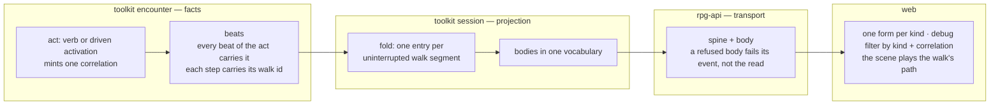
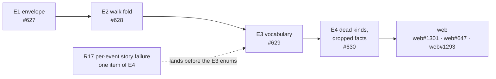

# Event stream — searchable, folded, one vocabulary

The session event stream is what every client reads to learn what happened.
This pass makes it searchable by cause, folds a walk into one entry, and speaks
one vocabulary across every body. It extends the event-projection design
(`ideas/event-projection/design.md`, rpg-project#541) and does not reopen it:
encounter states facts, the session projection shapes delivery, rpg-api
transports. Tracking: rpg-project#631.

## Shape

The pass lands in order; each step is a slice with its own issue.

The slices land in R2's order. R17 alone moves ahead: it lands before E3
adds any enum, because each new enum widens what a story read can refuse.

## Law

1. **An act names itself.** Every beat appended inside a verb or a driven
   activation carries that act's correlation, so one search returns a cause and
   all its effects. A beat outside any act carries none.
2. **A reaction belongs to its trigger.** An opportunity attack or a roll
   window carries the correlation of the act that provoked it.
3. **`at` is the world-clock reading in rounds** when the beat was recorded.
   It is shared by every beat in a round; order is `seq`, never `at`.
4. **Tags are the record's own query surface** and do not reach the session
   SDK event or the wire.
5. **A step carries its walk.** Encounter opens a walk id at a walk's first
   step and closes it at the last step or the refusal; the fold is by identity,
   never by adjacency.
6. **A walk reaches every reader as one entry per uninterrupted segment**,
   carrying its ordered cells, live and in story catch-up through the same
   projection code. Any other beat delivered to that recipient mid-walk closes
   the segment.
7. **One vocabulary.** The subject of a body is `member`; the other party is
   `target`; a prop or faction subject is `prop` or `faction`. A rolled body
   carries `roll`, `total`, `against` and `beaten`; a table roll carries `roll`
   and `of`. The verdict word is `beaten`.
8. **Closed in code, enum on the wire; authored in content, string ref.**
9. **A retired kind's number and name are reserved, never reused.** Whether
   the never-emitted kinds are deleted is R8.
10. **A fact crosses every layer or none.** A beat field that no layer
    above carries is either carried or deleted from the beat.
11. **A refused body fails its event, not the read.** The event keeps its
    seq and arrives marked refused, so a catch-up never hides a hole.
12. **Protos change additively:** a replaced field is `[deprecated = true]`
    and unwritten; it never changes type in place. Whether the vocabulary
    slice may break in place is R6, open.

## Rulings

| ID | ruling | status | scope | ruled by | date |
|----|--------|--------|-------|----------|------|
| R1 | The pass extends event-projection R1–R5 and reopens none of them | settled | all | KirkDiggler | 2026-10-20 |
| R2 | Order: envelope, walk fold, vocabulary, dead kinds and dropped facts, web | settled | all | KirkDiggler | 2026-10-20 |
| R3 | Every beat carries the correlation of the verb or activation that caused it | settled | encounter, session | KirkDiggler | 2026-10-20 |
| R4 | `at` gets a defined meaning or is replaced; tags reach the wire or leave the SDK | settled | session, protos | KirkDiggler | 2026-10-20 |
| R5 | The walk fold is event-projection R4, built in the session projection and carried on the wire; the proto change is additive with deprecation | settled | encounter, session, protos, api | KirkDiggler | 2026-10-20 |
| R6 | The vocabulary slice breaks the session v1alpha1 contract in place, under the proto-versioning trigger (rpg-project#156): consumers are few, all in the workspace, and move in one sitting. The package is alpha (protos team charter); the protos PR carries `breaking-change-approved` (`rpg-api-protos/docs/how-to/breaking-change-workflow.md`). Scoped to this slice | proposed | protos, session, api, web | — | 2026-10-20 |
| R7 | `transferred`, `interacted`, `bought`, `sold` are early trading beats; they stay UNKNOWN and get kinds when trading brings its use case | settled | session, protos | KirkDiggler | 2026-10-20 |
| R8 | The never-emitted deprecated kinds are deleted, number and name reserved: DOOR_REVEALED, REGION_REVEALED, INTIMIDATED, PERSUADED, ROOM_REVEALED | proposed | protos, session, api | — | 2026-10-20 |
| R9 | Web forms and the debug filter build on the cleaned stream and live in the existing web issues | settled | web | KirkDiggler | 2026-10-20 |
| R10 | Answered.fact stays deprecated and unfilled; a learned fact needs a per-viewer projection, not a broadcast field | settled | protos, api | KirkDiggler | 2026-09-17 |
| R11 | Encounter mints a correlation once per act as `<verb>:<first seq>`, the equip form | proposed | encounter | — | 2026-10-20 |
| R12 | A reaction carries its trigger's correlation (Law 2) | proposed | encounter | — | 2026-10-20 |
| R13 | `at` keeps its meaning and is documented; SCENE_OPENED carries the real reading instead of 0 | proposed | encounter, protos | — | 2026-10-20 |
| R14 | Tags leave the session SDK event; the record keeps them | proposed | session | — | 2026-10-20 |
| R15 | Encounter owns the walk id, not the session; the session already marks the last step | proposed | encounter, session | — | 2026-10-20 |
| R16 | Fold shape: Moved gains `walk` and `repeated Position path`, and `to` is deprecated. One kind for any walk length; a single step is a path of one | proposed | protos, session, api | — | 2026-10-20 |
| R17 | GetStory fails per event (Law 11), and lands before any new enum from the vocabulary slice | proposed | api, protos | — | 2026-10-20 |
| R18 | Subject and roll vocabulary as Law 7; DeathSaveRolled keeps its calculation as the expansion; Saved `succeeded` becomes `beaten` | proposed | session, protos, web | — | 2026-10-20 |
| R19 | Toolkit beat strings use snake_case, matching the wire enum names | proposed | encounter, session | — | 2026-10-20 |
| R20 | Ability, skill and stance become wire enums; causes and reasons become enums where the toolkit holds them as a closed const set | proposed | session, protos | — | 2026-10-20 |
| R21 | Moved `cause` is carried, once per walk entry | proposed | session, protos, api | — | 2026-10-20 |
| R22 | Moved `doors` is not carried; a client derives a crossing from the atlas's doorways, the reason TRAVERSED retired | proposed | session | — | 2026-10-20 |
| R23 | Answered `prop` is carried; exactly one of `member` and `prop` names who answered | proposed | protos, api | — | 2026-10-20 |
| R24 | Answered's deprecated `verb` and `beaten` are removed and reserved; SPOKE carries the verdict. Answered `temper` stays | proposed | protos, api, web | — | 2026-10-20 |
| R25 | Rested stops inlining concentration; the ended concentration is its own CONCENTRATION_ENDED under the rest's correlation | proposed | session, protos | — | 2026-10-20 |

## Open

- **R6, how the vocabulary reaches the wire.** In place: rename and reshape
  under the #156 trigger, every consumer moved in one train. Additive: add the
  new field beside the old (a `member` beside `actor`), deprecate the old, and
  remove it later.
- **R8, the never-emitted kinds.** Delete them with number and name reserved,
  or leave them deprecated.
- **Fold shape.** R16 extends Moved with a path. The alternative is a new
  kind (a `WALKED` with member, walk and path) beside a deprecated per-step
  MOVED; it reads cleaner in a switch but carries two kinds for one fact.
  Either takes a new tag; tag 2 stays reserved.
- **Segments per recipient.** Under event-projection R5 every viewer receives
  everything, so every viewer's segments match. When filtering arrives, a beat
  a viewer does not receive does not close their segment; confirm when it does.
- **Seq over folded entries**, carried from event-projection: one per-recipient
  seq per folded entry; confirm against story catch-up when building.
- **Answered `selector`** (where the answer sends the creature: at a cell, along
  a path): carry or delete.
- **Downed `kind`**: delete if the roster still names a downed member's kind,
  otherwise carry.
- **ExperienceGained `member`**, which repeats DOWNED's member: keep as the
  grant's source or delete now that correlation joins the two.
- **Concentration break**, which emits CONCENTRATION_ENDED, ACTIVATION_RESULT
  and, when a save caused it, SAVED: keep all three under one correlation, or
  drop the ACTIVATION_RESULT.
