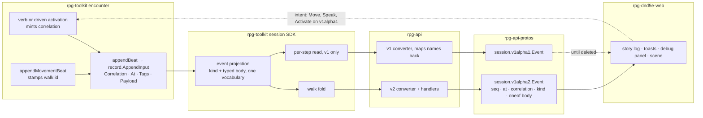

# Event stream — walkthrough

How the event-stream pass meets the code. Law: [design.md](design.md).
Tracking: rpg-project#631. Parent design: `ideas/event-projection/design.md`.

## What this is

The pass changes no owner. Encounter still writes beats, the session SDK still
shapes delivery, rpg-api still transports. It adds two identities to the beats
encounter already writes, the act's correlation and the walk id, and one
projection step in the SDK, the walk fold. The SDK speaks one vocabulary. The
cleaned stream reaches the wire in a new package, `dnd5e.api.session.v1alpha2`,
that holds only the event stream (R6); the verbs and the v1alpha1 stream stay
as they are until the stream RPCs are deleted. It introduces **no client-side
grouping, no per-viewer filter (event-projection R5) and no raw payload bytes
beside the typed bodies (R26)**.

## Component shape



## Ownership and contracts

| Component | Owns | Input → output |
|---|---|---|
| encounter act entry (Step, Speak, Activate, driven activation) | the act's correlation (R11), the walk id (R15) | verb input → `record.AppendInput.Correlation` on every beat of the act |
| `Encounter.appendMovementBeat` | one moved beat per step | `executedAction` → payload `{beat, member, position, walk, cause?, doors?}` |
| `play/record` | ordered, audienced log; tags as its query surface (R14) | `AppendInput` → entry with `seq` |
| session SDK projection | kind, typed body, vocabulary (Law 7), the fold (Law 6), the per-step read for v1 (R31) | record entries → `session.Event{Seq, At, Correlation, Kind, Body}` |
| rpg-api v2 converter and handlers | spine, one oneof body, raw arm (R28), per-event refusal (R17) | `session.Event` → `sessionv1alpha2.Event` |
| rpg-api v1 converter | the old wire names, mapped from the SDK's names, until deletion | `session.Event` → `sessionv1alpha1.Event` |
| protos `session/v1alpha2` | wire names, enums, the types the stream needs (R29), `SessionService` with StreamEvents and GetStory (R32) | — |
| web | rendering by kind; debug filter by kind and correlation | `sessionv1alpha2.Event` → forms, toasts, scene playback |

The refusals:

- **Encounter does not fold.** It keeps one beat per step (event-projection
  Law 4), because a reaction between steps is a fact in order.
- **The SDK projection does not mint identities.** It folds by the walk id
  encounter wrote and passes the correlation through. A fold by adjacency
  would merge two walks that happen to touch.
- **rpg-api does not regroup, rename on v2, or drop.** A body it cannot spell
  fails that event, visibly. A beat with no kind goes out whole in the raw arm.
- **v1alpha2 imports nothing from v1alpha1** (Law 13), so deleting v1's stream
  leaves v2 whole.
- **The web does not reconstruct a walk from steps** or group by anything but
  correlation. Both are already on the event it receives.

## Walk one thing through

The castle, round 3 of a fight in the gatehouse. Guard `gate-1` walks from
cell `a` through `b`, `c` (the gate door), `d` to `e`. Leaving `b` provokes
the ranger's opportunity attack. Later the ranger takes the captain's
`stand-aside` option (Intimidation, DC 14). Cell names, the ranger's id, rolls
and seqs are illustrative; the ids `gate-1`, `captain` and `stand-aside` are
the castle's.

**Today, on v1alpha1.** One event per step plus the strike. None carries a
correlation. Every one carries `at: 3`. The door crossing is in the beat and
dropped on the way up.

```
seq kind     correlation body
41  MOVED    ""          moved    {member: gate-1, to: b}
42  STRUCK   ""          struck   {attacker: ranger, target: gate-1, roll: 14, total: 19, against: 16, reaction: opportunity-attack}
43  MOVED    ""          moved    {member: gate-1, to: c}
44  MOVED    ""          moved    {member: gate-1, to: d}
45  MOVED    ""          moved    {member: gate-1, to: e}
57  SPOKE    ""          spoke    {actor: ranger, member_id: captain, option_id: stand-aside, line: "Stand aside or bleed.", skill: "intimidation", check: {dc: 14, total: 17, beaten: true}}
58  ANSWERED ""          answered {creature: captain, verb: SPEAK (deprecated), beaten: true (deprecated), roll: 2, of: 4, say: "…go on, then. I saw nothing.", option_id: stand-aside}
```

**After E1 (envelope).** Same events on v1alpha1, now grouped. The guard's
activation mints one correlation and every beat inside it carries it,
including the ranger's strike, because a reaction belongs to its trigger
(Law 2, R12). The speak mints its own. `at` still reads 3 for all of them;
order is `seq` (Law 3).

```
41  MOVED    activation:41  moved  {member: gate-1, to: b}
42  STRUCK   activation:41  struck {...}
43  MOVED    activation:41  ...
57  SPOKE    speak:57       spoke  {...}
58  ANSWERED speak:57       answered {...}
```

**After E2 and E3 (the SDK).** The SDK's folded read holds two walk entries
around the strike, in the one vocabulary. The v1alpha1 wire does not change:
its converter reads the per-step read and maps the SDK's names back (R31).

**After E4, on v1alpha2.** The strike closes the first segment, so the walk
arrives as two `WALKED` entries around it (Law 6, R27, R30). The door is on the
step that crossed it (R22). Fields use the one vocabulary (Law 7, Law 8). The
seq a folded entry takes is the open seq question.

```
kind      correlation    body
WALKED    activation:41  walked   {member: gate-1, walk: walk:41, path: [{cell: a}, {cell: b}]}
STRUCK    activation:41  struck   {member: ranger, target: gate-1, roll: 14, total: 19, against: 16, beaten: true, reaction: opportunity-attack}
WALKED    activation:41  walked   {member: gate-1, walk: walk:41, path: [{cell: b}, {cell: c, doors: [gate]}, {cell: d}, {cell: e}]}
SPOKE     speak:57       spoke    {member: ranger, target: captain, option_id: stand-aside, line: "Stand aside or bleed.", skill: SKILL_INTIMIDATION, roll: 12, total: 17, against: 14, beaten: true}
ANSWERED  speak:57       answered {member: captain, option_id: stand-aside, roll: 2, of: 4, say: "…go on, then. I saw nothing."}
```

The scene plays each path as one move (web#1293). ANSWERED carries no
`verb` or `beaten` (R24); the verdict lives on SPOKE, one hop away by
correlation.

**An unmapped beat, on v1alpha2.** A purchase has no typed kind yet (R7), so
it arrives whole in the raw arm (Law 11, R28) rather than as an empty UNKNOWN:

```
kind     correlation  body
UNKNOWN  trade:88     raw {beat: "bought", fields: {actor: ranger, targets: [smith], trade: {item_type: weapon, item_id: longsword, quantity: 1}}}
```

The debug panel shows it in full, and a form can be written for it the day
trading gives it a kind.

## Separations that look like one thing

| Query | Source of truth |
|---|---|
| What act caused this? | `correlation` |
| Which walk is this step part of? | the walk body's `walk` |
| In what order did it happen? | `seq`, within one package's stream |
| When in world time? | `at`, the world clock in rounds |
| What kind of thing happened? | `kind`; the raw arm's `beat` when unmapped |

A walk id is not a correlation. One guard activation can hold a walk, a
strike and a second walk segment; folding by correlation would swallow the
strike into the walk. Ordering by `at` puts every beat in a round in a tie. A
v1 seq counts steps and a v2 seq counts folded entries, so a seq from one
stream never resumes the other.

## Trade-offs

| Decision | Benefit | Cost / boundary | Not taken |
|---|---|---|---|
| A new events-only package (R6) | one vocabulary, migration per RPC | two stream packages until v1's is deleted | in-place break; additive-and-deprecate |
| Redefine shared types in v2 (R29) | v2 survives v1's deletion untouched | duplicated Position and enums for a while | import v1alpha1 types |
| Encounter mints correlation and walk id (R11, R15) | identity exists where the act and the walk happen | each act entry point mints one | session mints per write scope |
| Fold in the SDK projection (Law 6) | live and catch-up equal by construction | the SDK keeps a per-step read for v1 meanwhile (R31) | clients fold steps |
| Raw arm as Struct (R28) | readable without a second decoder | numbers are doubles | `bytes` of encounter JSON |
| Per-event refusal on v2 (R17) | one bad body costs one event | the client handles a refused event | fail the whole read |

## Edges

- No per-viewer filtering; everyone receives everything (event-projection R5).
  Segment closing under a filter is an open question.
- The trading beats stay unmapped and ride the raw arm (R7, R28).
- No turn or tick coordinate on the envelope; `at` is rounds (R4).
- A taught fact never rides a broadcast body (R10).
- The verbs stay on v1alpha1 (R6); their move is not part of this pass.

## Where a change lands

- **A new beat kind:** encounter writes it inside its act, so it inherits the
  correlation. The SDK gives it a body in the Law 7 vocabulary. Until v2 has a
  kind for it, it rides the raw arm with no change in rpg-api. Typing it adds
  one kind and body in v1alpha2 and one converter arm.
- **A new rolled check:** the body carries `roll`, `total`, `against` and
  `beaten`, and the web form reuses the formula line.
- **A client view grouped by cause:** web only, keyed on `correlation`.

## Source map

| Concern | Path |
|---|---|
| act entry, correlation mint (equip form) | `rpg-toolkit/rulebooks/dnd5e/encounter/equip.go` `RecordEquip` |
| moved beat | `rpg-toolkit/rulebooks/dnd5e/encounter/encounter.go` `appendMovementBeat` |
| walk entry points | `encounter/step.go` `Step`; `encounter/clocks.go`, `pause.go`, `held.go` |
| player walk loop | `rpg-toolkit/rulebooks/dnd5e/session/move.go` |
| record envelope | `rpg-toolkit/play/record/log.go` `AppendInput` |
| SDK event and bodies | `rpg-toolkit/rulebooks/dnd5e/session/events.go`, `types.go` |
| v1 wire conversion | `rpg-api/internal/handlers/dnd5e/session/v1alpha1/convert.go` `eventToProto`, `eventsToProto` |
| v1 wire contract | `rpg-api-protos/dnd5e/api/session/v1alpha1/events.proto` `Event`, `EventKind` |
| v2 wire contract | `rpg-api-protos/dnd5e/api/session/v1alpha2/` |
| web stream views | `rpg-dnd5e-web/src/components/session/combat-experience/StoryLog.tsx`, `DebugEventRow.tsx`, `story.ts` |
