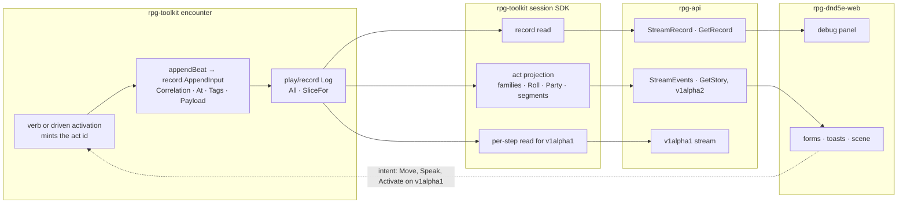

# Event stream — walkthrough

How the event-stream pass meets the code. Law: [design.md](design.md).
Tracking: rpg-project#631. Parent design: `ideas/event-projection/design.md`.

## What this is

The pass changes no owner. Encounter still writes beats into its record, the
session SDK still shapes delivery, rpg-api still transports. It adds one
identity to every beat, the act id, and reads the record two ways: as written,
for the debug panel, and folded into acts, for players (R5). Session v1alpha2
carries both streams and nothing else (R2). It introduces **no per-viewer
filter (R7), no typed bodies on the record stream (Law 4) and no player view
of raw beats (Law 8)**.

## Component shape



## Ownership and contracts

| Component | Owns | Input → output |
|---|---|---|
| encounter act entry (Step walk, Speak, Activate, driven activation) | the act id (R20), passed to every beat of the act and to its reactions | verb input → `record.AppendInput.Correlation` |
| `play/record` | the ordered log, each entry's audience, retention | `AppendInput` → entry with a record `seq`; `All` reads every retained entry |
| session SDK record read | the beat name and the payload decoded to fields | record entries → record events |
| session SDK act projection | the families (R16), `Roll` and `Party` (R17), segments (R19) | record entries → acts, delivered as segments under one act id |
| rpg-api | the two v1alpha2 RPC pairs (R12, R15), per-act refusal (R22) | SDK reads → `session.v1alpha2` messages |
| protos `session/v1alpha2` | the record event, the act event and family bodies, its own types (R18) | — |
| web debug panel | narrowing the record by act id and beat name (R8) | record events → rows |
| web player UI | one form per family | acts → forms, toasts, scene playback |

The refusals:

- **Encounter does not fold.** It keeps one beat per step (event-projection
  Law 4), because a reaction between steps is a fact in order.
- **The record read does not type.** It names the beat and hands its fields
  over whole; a typed reading of a beat is the act projection's job.
- **The act projection does not mint ids.** It groups by the act id encounter
  wrote. Grouping by adjacency would merge two acts that happen to touch.
- **rpg-api does not regroup or drop.** An act it cannot spell fails that act,
  visibly.
- **The player UI does not read the record.** A form that wants a record field
  is an act body missing that field (Law 8).

## Walk one thing through

The castle, round 3 of a fight in the gatehouse. Guard `gate-1` walks from
cell `a` through `b`, `c` (the gate door), `d` to `e`. Leaving `b` provokes
the ranger's opportunity attack. Later the ranger takes the captain's
`stand-aside` option (Intimidation, DC 14). Cell names, the ranger's id, the
act ids, rolls and seqs are illustrative; `gate-1`, `captain`, `stand-aside`
and the payload keys are the castle's and encounter's.

**The record stream.** Every beat, in record order, with its act id. The
fields are the encounter payload, untyped. The debug panel narrows this list by
act id (`move:41`) or by beat name (`struck`).

```
seq  beat      act id    at  fields
41   moved     move:41   3   {member: gate-1, position: b}
42   struck    move:41   3   {actor: ranger, targets: [gate-1], roll: 14, total: 19, against: 16, amount: 6, attack: {...}}
43   moved     move:41   3   {member: gate-1, position: c, doors: [gate]}
44   moved     move:41   3   {member: gate-1, position: d}
45   moved     move:41   3   {member: gate-1, position: e}
57   spoke     speak:57  3   {actor: ranger, target: captain, option: stand-aside, line: "Stand aside or bleed.", skill: intimidation, dc: 14, total: 17, beaten: true}
58   answered  speak:57  3   {creature: captain, option: stand-aside, roll: 2, of: 4, say: "…go on, then. I saw nothing.", ...}
```

**The act stream.** The same beats as acts. The guard's walk is one act,
delivered as two segments around the reaction, which nests under the walk's
act id (Law 5, R19). Each segment names the record seqs it folded (R12). On
replay the two segments fold back into one walk `a, b, c, d, e`.

```
act id    family    segment  folds   body
move:41   act       1        41      walk     {member: gate-1, path: [a, b]}
move:41   reaction  —        42      attack   {by: member ranger, to: member gate-1, outcome: hit, damage: 6, roll: {expression: 1d20+5, raw: [14], total: 19, against: 16, beaten: true}}
move:41   act       2        43–45   walk     {member: gate-1, path: [b, c, d, e], doors: [{at: c, door: gate}]}
speak:57  act       —        57–58   speak    {by: member ranger, to: member captain, option: stand-aside, line: "Stand aside or bleed.", roll: {expression: 1d20+5 intimidation, raw: [12], total: 17, against: 14, beaten: true}, answer: {say: "…go on, then. I saw nothing.", roll: 2, of: 4}}
```

The intimidate is one act. Its answer folds in; whether a table answer rides
inside the act that drew it or as its own table-answer act is a family
question for E3. The scene plays each walk segment as one move (web#1293).

**A trading beat.** A purchase appears in the record stream as `bought` under
its act id and produces no act (R9, Law 7).

## Separations that look like one thing

| Query | Source of truth |
|---|---|
| What act caused this? | the act id (`correlation`) |
| In what order were beats written? | the record seq |
| In what order did this viewer receive acts? | the act stream's seq |
| When in world time? | `at`, the world clock in rounds |
| What did encounter write? | the record stream |
| What happened, as a player reads it? | the act stream |

A record seq is the record's own and counts every beat; an act-stream seq
counts what one recipient received. A reader that uses one to resume the other
skips or repeats. Ordering by `at` puts every beat in a round in a tie.

## Trade-offs

| Decision | Benefit | Cost / boundary | Not taken |
|---|---|---|---|
| Two streams (R5) | the debug panel sees every beat whole; player bodies stay act-shaped | two RPC pairs to serve and catch up (R12, R15) | one stream with typed bodies plus a raw arm |
| Act as the unit (R6) | one form per act, the outcome inside it | the projection holds open acts per recipient | a beat with a join key |
| Struct fields on the record (Law 4) | readable without a decoder per beat | numbers are doubles | `bytes` of the encounter JSON |
| Redefine types in v1alpha2 (R18) | v2 survives v1's deletion untouched | duplicated Position and enums for a while | import v1alpha1 types |
| Per-step read kept for v1 (R21) | v1alpha1 is untouched until deleted | the SDK serves three reads meanwhile | unfold acts back into steps |

## Edges

- No per-viewer filtering in either stream (R7); access to the record at
  release is an entitlement (R13).
- The record reaches back only as far as encounter's retention window (R25).
- Trading beats have no act (R9).
- A taught fact never rides a broadcast body (R10).
- The verbs stay on v1alpha1 (R2).

## Where a change lands

- **A new beat:** encounter writes it inside its act. It shows in the record
  stream at once, with no other change. Giving it an act means placing it in a
  family in the SDK projection and adding its body to v1alpha2.
- **A new rolled check:** its act carries a `Roll`, and the web form reuses
  the formula line.
- **A debug view by cause:** web only, narrowing the record by act id.

## Source map

| Concern | Path |
|---|---|
| act id mint (equip form) | `rpg-toolkit/rulebooks/dnd5e/encounter/equip.go` `RecordEquip` |
| moved beat and walk entry points | `encounter/encounter.go` `appendMovementBeat`; `encounter/step.go`, `clocks.go`, `pause.go`, `held.go` |
| record and retention | `rpg-toolkit/play/record/log.go` `AppendInput`, `All`, `TrimBefore`; `encounter/encounter.go` retention trim |
| SDK story read | `rpg-toolkit/rulebooks/dnd5e/session/read.go` `Story`; `events.go`, `types.go` |
| player walk loop | `rpg-toolkit/rulebooks/dnd5e/session/move.go` |
| v1 wire conversion | `rpg-api/internal/handlers/dnd5e/session/v1alpha1/convert.go` |
| v1 wire contract | `rpg-api-protos/dnd5e/api/session/v1alpha1/events.proto`, `service.proto` |
| v2 wire contract | `rpg-api-protos/dnd5e/api/session/v1alpha2/` |
| web stream views | `rpg-dnd5e-web/src/components/session/combat-experience/StoryLog.tsx`, `DebugEventRow.tsx`, `story.ts` |
