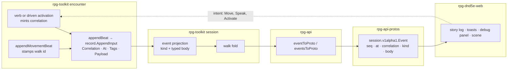

# Event stream — walkthrough

How the event-stream pass meets the code. Law: [design.md](design.md).
Tracking: rpg-project#631. Parent design: `ideas/event-projection/design.md`.

## What this is

The pass changes no owner. Encounter still writes beats, the session
projection still shapes delivery, rpg-api still transports. It adds two
identities to the beats encounter already writes, the act's correlation and
the walk id, and one projection step, the walk fold. It renames body fields
into one vocabulary. It introduces **no second delivery path, no client-side
grouping and no per-viewer filter** (event-projection R5).

## Component shape



## Ownership and contracts

| Component | Owns | Input → output |
|---|---|---|
| encounter act entry (Step, Speak, Activate, driven activation) | the act's correlation (R11), the walk id (R15) | verb input → `record.AppendInput.Correlation` on every beat of the act |
| `Encounter.appendMovementBeat` | one moved beat per step | `executedAction` → payload `{beat, member, position, walk, cause?, doors?}` |
| `play/record` | ordered, audienced log; tags as its query surface (R14) | `AppendInput` → entry with `seq` |
| session event projection | kind, typed body, vocabulary (Law 7), the fold (Law 6) | record entries → `session.Event{Seq, At, Correlation, Kind, Body}` |
| rpg-api `eventToProto` | spine and body copy; per-event refusal (R17) | `session.Event` → `sessionpb.Event` |
| protos `events.proto` | wire names, enums, reserved tags | — |
| web | rendering by kind; debug filter by kind and correlation | `sessionpb.Event` → forms, toasts, scene playback |

The refusals:

- **Encounter does not fold.** It keeps one beat per step (event-projection
  Law 4), because a reaction between steps is a fact in order.
- **The session projection does not mint identities.** It folds by the walk id
  encounter wrote and passes the correlation through. A fold by adjacency
  would merge two walks that happen to touch.
- **rpg-api does not regroup, rename or drop.** A body it cannot spell fails
  that event, visibly, never the read and never silently (R17).
- **The web does not reconstruct a walk from steps** or group by anything but
  correlation. Both are already on the event it receives.

## Walk one thing through

The castle, round 3 of a fight in the gatehouse. Guard `gate-1` walks from
cell `a` through `b`, `c` (the gate door), `d` to `e`. Leaving `b` provokes
the ranger's opportunity attack. Later the ranger takes the captain's
`stand-aside` option (Intimidation, DC 14). Cell names, the ranger's id, rolls
and seqs are illustrative; the ids `gate-1`, `captain` and `stand-aside` are
the castle's.

**Today.** Five events for the walk, one per step plus the strike. None
carries a correlation. Every one carries `at: 3`. The door crossing is in the
beat and dropped on the way up.

```
seq kind    correlation body
41  MOVED   ""          moved  {member: gate-1, to: b}
42  STRUCK  ""          struck {attacker: ranger, target: gate-1, roll: 14, total: 19, against: 16, reaction: opportunity-attack}
43  MOVED   ""          moved  {member: gate-1, to: c}
44  MOVED   ""          moved  {member: gate-1, to: d}
45  MOVED   ""          moved  {member: gate-1, to: e}

57  SPOKE    ""         spoke    {actor: ranger, member_id: captain, option_id: stand-aside, line: "Stand aside or bleed.", skill: "intimidation", check: {dc: 14, total: 17, beaten: true}}
58  ANSWERED ""         answered {creature: captain, verb: SPEAK (deprecated), beaten: true (deprecated), roll: 2, of: 4, say: "…go on, then. I saw nothing.", option_id: stand-aside}
```

**After E1 (envelope).** Same events, now grouped. The guard's activation
mints one correlation and every beat inside it carries it, including the
ranger's strike, because a reaction belongs to its trigger (Law 2, R12). The
speak mints its own. `at` still reads 3 for all of them; order is `seq`
(Law 3).

```
41  MOVED    activation:41  moved {member: gate-1, to: b}
42  STRUCK   activation:41  struck {...}
43  MOVED    activation:41  ...
57  SPOKE    speak:57       spoke {...}
58  ANSWERED speak:57       answered {...}
```

**After E2 (walk fold).** The strike closes the first segment, so the walk
arrives as two entries around it (Law 6). Shown in R16's shape; the shape is
open. The seq a folded entry takes is the open seq question.

```
kind    correlation    body
MOVED   activation:41  moved  {member: gate-1, walk: walk:41, path: [a, b]}
STRUCK  activation:41  struck {...}
MOVED   activation:41  moved  {member: gate-1, walk: walk:41, path: [b, c, d, e]}
```

The scene plays each path as one move (web#1293). The door at `c` is not on
the entry (R22). A client that draws a crossing reads the atlas doorways.

**After E3 (vocabulary).** One subject name, one roll shape, enums where the
set is closed (Law 7, Law 8, R18, R20). Shown as the in-place route; under
the additive route of open R6 the old names ride beside, deprecated.

```
STRUCK   struck   {member: ranger, target: gate-1, roll: 14, total: 19, against: 16, beaten: true, reaction: opportunity-attack}
SPOKE    spoke    {member: ranger, target: captain, option_id: stand-aside, line: "Stand aside or bleed.", skill: SKILL_INTIMIDATION, roll: 12, total: 17, against: 14, beaten: true}
ANSWERED answered {member: captain, option_id: stand-aside, roll: 2, of: 4, say: "…go on, then. I saw nothing."}
```

ANSWERED loses its deprecated `verb` and `beaten` under R24: the verdict lives
on SPOKE, one hop away by correlation.

## Separations that look like one thing

| Query | Source of truth |
|---|---|
| What act caused this? | `correlation` |
| Which walk is this step part of? | the moved body's `walk` |
| In what order did it happen? | `seq` |
| When in world time? | `at`, the world clock in rounds |
| What kind of thing happened? | `kind` |

A walk id is not a correlation. One guard activation can hold a walk, a
strike and a second walk segment; folding by correlation would swallow the
strike into the walk. Ordering by `at` puts every beat in a round in a tie.

## Trade-offs

| Decision | Benefit | Cost / boundary | Not taken |
|---|---|---|---|
| Encounter mints correlation and walk id (R11, R15) | identity exists where the act and the walk happen; every caller gets it free | encounter's act entry points each mint one | session mints per write scope |
| Fold in the session projection (Law 6) | live and catch-up equal by construction; every client gets the same entries | the projection holds an open segment per recipient | clients fold steps |
| Moved gains a path (R16) | one kind for any walk length | `to` deprecated; readers switch to `path` | a new WALKED kind |
| Per-event refusal (R17) | one bad body costs one event | the client handles a refused event | fail the whole read |
| Doors not carried (R22) | one source for doorways, the atlas | the client joins path to atlas | doors on each path cell |

## Edges

- No per-viewer filtering; everyone receives everything (event-projection R5).
  Segment closing under a filter is an open question.
- The trading beats stay UNKNOWN (R7).
- No turn or tick coordinate on the envelope; `at` is rounds (R13).
- A taught fact never rides a broadcast body (R10).

## Where a change lands

- **A new beat kind:** encounter writes it inside its act, so it inherits the
  correlation. The session projection gives it a body in the Law 7
  vocabulary. Protos add the kind and body, and rpg-api adds one arm.
- **A new rolled check:** the body carries `roll`, `total`, `against` and
  `beaten`, and the web form reuses the formula line.
- **A client view grouped by cause:** web only, keyed on `correlation`.

## Source map

| Concern | Path |
|---|---|
| act entry, correlation mint (equip form) | `rpg-toolkit/rulebooks/dnd5e/encounter/equip.go` `RecordEquip` |
| moved beat | `rpg-toolkit/rulebooks/dnd5e/encounter/encounter.go` `appendMovementBeat` |
| walk entry points | `encounter/step.go` `Step`; `encounter/clocks.go`, `pause.go`, `held.go` |
| player walk loop | `rpg-toolkit/rulebooks/dnd5e/session/move.go` |
| record envelope | `rpg-toolkit/play/record/log.go` `AppendInput` |
| session event and bodies | `rpg-toolkit/rulebooks/dnd5e/session/events.go`, `types.go` |
| wire conversion | `rpg-api/internal/handlers/dnd5e/session/v1alpha1/convert.go` `eventToProto`, `eventsToProto` |
| wire contract | `rpg-api-protos/dnd5e/api/session/v1alpha1/events.proto` `Event`, `Moved`, `EventKind` |
| web stream views | `rpg-dnd5e-web/src/components/session/combat-experience/StoryLog.tsx`, `DebugEventRow.tsx`, `story.ts` |
