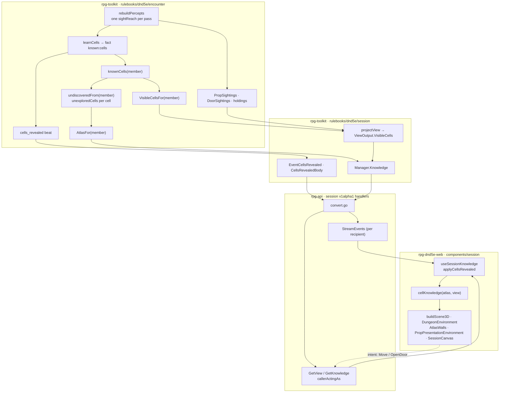

# Fog of war — walkthrough

Issue: [rpg-project#586](https://github.com/KirkDiggler/rpg-project/issues/586).
Law: [design.md](design.md). Plan: [plan.md](plan.md).

## What this is

Each seat sees its own map in three grains: the hexes its character sees now,
the hexes it remembers, and nothing for the rest. The design reuses the sight
test the engine already runs for creatures and doors (`sightReach.reachesCell`),
the per-member knowledge journal the engine already writes, and the
member-scoped atlas and view reads the session already delivers. It changes the
grain of discovery from a whole room to a single cell and adds one derived read,
the cells seen now. It deliberately introduces **no second visibility
authority**: no client line of sight, no cone geometry, no party-wide union and
no stored "currently visible" state.

## Component shape

## Ownership and contracts

| Component | Owns | Input → output |
|---|---|---|
| `sightReach` (encounter) | The one sight question for a cell | `reachesCell(observer MemberID, cell spatial.Position) bool`, built once per pass from positions, `Sight` ranges, canvas and sight areas |
| Cell learning (encounter, replaces `discoverRooms`/`learnRoom`) | Which cells a member knows | Sight pass, door opening, concealment reveal → fact `known:cells`, actor = subject = audience = member, payload the newly learned cells |
| `undiscoveredFrom` (encounter) | The unexplored delivery mask | Known cells → `hiddenView.unexploredCells` per cell; concealment's `hiddenView.cells` unchanged |
| `AtlasFor` (encounter) | The member's fixed map | `MemberID` → `Atlas` with unknown cells and everything touching only them withheld |
| `VisibleCellsFor` (encounter, new) | The member's seen-now set | `MemberID` → sorted `[]spatial.Position`, known cells whose `reachesCell` is true now |
| Cells-revealed beat (encounter, replaces `appendRoomRevealedBeat`) | Delivery of new fixed records | `AtlasFor` before/after one pass → one recipient-scoped beat `cells_revealed` |
| Observations (encounter) | Mutable props, door state, creatures | `PropSightings`, `DoorSightings`, perception holdings; `CurrentVia` empty means remembered |
| `projectView` / `Manager.Knowledge` (session) | One coherent seat snapshot | Encounter reads → `ViewOutput{…, VisibleCells}`, `KnowledgeOutput{Atlas, View, …}` |
| `EventCellsRevealed` (session) | The stream's body for new cells | Beat payload → `CellsRevealedBody` |
| Session handlers (rpg-api) | Seat binding and conversion | Authenticated caller → `GetViewResponse.visible_cells`, `GetAtlasResponse`, `Event.cells_revealed` |
| `useSessionKnowledge` (web) | The cached atlas and view | Snapshot plus `cellsRevealed` events → patched `GetKnowledgeResponse` |
| `cellKnowledge` (web, new) | Per-cell draw state | Atlas cells + `visible_cells` → `seen` / `remembered` per cell, plus edge weights |
| Scene components (web) | Drawing | Per-cell state → lit, grey or absent floor, walls, doors, props, creatures |

**Refusals.** `sightReach` refuses to answer for a cell the member does not
know: `VisibleCellsFor` intersects with known cells so seen-now is always a
subset of the atlas. Cell learning refuses to teach a region, a room or a
door's far side by inference; opening a door teaches that door's edge cells and
the sight pass teaches the rest. `undiscoveredFrom` refuses to turn unknown
floor into a wall; only concealment masquerades. `AtlasFor` refuses to consult
`DoorSightings` or creature holdings; fixed layout and mutable observation stay
two answers. `VisibleCellsFor` refuses to store anything; a stored visible set
outlives the pass whose readings made it. The session refuses to filter,
compute or union; it passes the encounter's per-member answers through. rpg-api
refuses to read any member but the caller's (`callerActingAs`) and refuses to
derive cells. The web refuses to run line of sight, to draw a cell absent from
its atlas, and to draw a cone, ray or polygon.

## Walk one thing through

The castle's cell block: a corridor of four hexes with an open archway on its
east side into a prison cell of six hexes.

1. **Authored.** The dungeon spec compiles the corridor and the cell into two
   regions of the field. Region identity is authored and survives to the atlas.
2. **Sight pass.** The rogue steps to the corridor's second hex. `rebuildPercepts`
   builds one `sightReach`. Cell learning asks `reachesCell(rogue, c)` for every
   field cell not yet known and not concealed. It answers true for the corridor
   and for the three cell hexes the archway frames, false for the three behind
   the archway's jamb.
3. **Fact.** One `known:cells` fact for the rogue lists the seven new cells.
   Nothing about the cell's other three hexes is written.
4. **Beat.** `AtlasFor(rogue)` is taken before and after. The difference is the
   seven cells, the walls and archway doorway on their edges, and the fixed
   cot standing on one of them. It becomes one `cells_revealed` beat whose
   audience is the rogue. The `regions` list carries the corridor region with
   four cells and the cell region with three: a partial region, merged by
   union.
5. **Session and wire.** The session decodes `CellsRevealedBody`; rpg-api
   converts it to `Event.cells_revealed` on the rogue's stream only. The rogue's
   next `GetView` carries `visible_cells` with all seven.
6. **Web.** `applyCellsRevealed` unions the cells into the cached atlas.
   `cellKnowledge` marks all seven `seen`. The floor, walls and cot draw lit;
   the remaining three hexes are not in the atlas and draw nothing.
7. **Leaving.** The rogue walks back west out of line of the archway. The next
   pass learns nothing new, so no beat. `GetView`'s `visible_cells` drops the
   three cell hexes. They stay in the atlas and draw grey with the cot; the
   jailer the rogue glimpsed there draws as a remembered creature at its last
   seen hex.
8. **The other seat.** The fighter has stood in the stairwell throughout. Their
   atlas has no cell-block hexes at all. Their screen shows nothing there.

## Separations that look like one thing

| Query | Source of truth |
|---|---|
| Is this cell on my map? | `AtlasFor(member).Cells` |
| Do I see this cell now? | `VisibleCellsFor(member)` |
| Is this cell a secret? | Concealment (`hiddenFrom`) |
| Is this cell inside a sight-obscuring area? | `SightAreasFor(member)` |
| Where is that creature? | Perception holdings via `GetView.sightings` |
| Is that door open? | `DoorSightings` via `GetView.doors` |
| Which room is this? | `AtlasRegion` membership |

Merging "on my map" with "seen now" draws remembered rooms as live, or forgets
them when the character turns away. Merging "unknown" with "secret" turns every
unexplored hex into a fake wall, which is the tell the concealment law forbids.
Merging the sight-obscuring area with seen-now draws a fog cloud as a hole in
the map; the area blocks `reachesCell`, so cells behind it drop out of seen-now
while staying remembered. Merging door state into the atlas lets a remembered
door show its current state. Merging region membership with knowledge brings
back the whole-room reveal R1 rejects.

## Trade-offs

| Decision | Benefit | Cost / boundary | Not taken |
|---|---|---|---|
| Cell as the unit of discovery (R1) | The seat sees exactly its own hexes | More journal facts; the encounter pays one fact per member per pass that learns cells | Region reveal; region plus visible slice |
| Seen-now derived on read | No dual state; restore and reconnect are free | Each `GetView` re-asks `reachesCell` over known cells; the engine pays the rays | Collect and store the set in the pass |
| One batched `known:cells` fact per pass | One append per pass, folds to a set | The loader validates every listed cell | One fact per cell |
| New `CELLS_REVEALED` kind | A partial region cannot be mistaken for a whole one | Two kinds exist while `ROOM_REVEALED` is deprecated; protos and web carry both decoders | Reuse `ROOM_REVEALED` with partial regions, which a client replacing regions by id silently truncates |
| `visible_cells` on `GetViewResponse` | Rides every existing view refresh; no new read | The client refreshes seen-now only on events that already refresh `view` | Seen-now pushed on every pass as its own event |
| Opening a door teaches only its edge cells | Blind or unlit opening learns no room | The far room arrives on the next sight pass, not with the open | Opening teaches the joined room |
| Remembered treatment from the existing crypt-memory materials (R3) | No new shader; one tint value | The tint is one constant until O2 rules | A new fog shader |
| Old `known:room` facts load and teach nothing | No whole-room knowledge survives in any run | A run saved before the change re-learns its map from its next sight pass | Translate old facts into their region's cells; reject them on load |

## Edges

- Pooling remembered across the party under discovery sharing is not built
  (R4, O1).
- Authored light levels and region lighting are not modelled here; sight range
  remains the `Sight` capability's answer.
- Stealth, hearing and passive Perception rules do not change.
- A remembered creature standing in a seen-now cell is perception's correction
  question, not this design's; the web draws what `GetView` sends.
- The author's view (`PutDungeon`'s full atlas) and the legacy v1alpha2
  encounter route are untouched.
- Memory does not fade within a run.

## Where a change lands

- **A light model that shortens sight in darkness.** It lands in the `Sight`
  capability's per-member range. `reachesCell`, seen-now and learning follow
  with no change here.
- **Pooling memory under discovery sharing.** It lands in cell learning, which
  widens the fact audience the way `discoveryAudience` does, and nowhere else.
- **A sepia remembered tint.** It lands in the web's remembered material
  constant; no wire or engine change.

## Source map

| Concern | Path |
|---|---|
| Sight test | `rpg-toolkit/rulebooks/dnd5e/encounter/sightreach.go` (`sightReach.reachesCell`) |
| Sight pass | `rpg-toolkit/rulebooks/dnd5e/encounter/encounter.go` (`rebuildPercepts`) |
| Discovery and unexplored mask | `rpg-toolkit/rulebooks/dnd5e/encounter/roomknowledge.go` |
| Reveal beat | `rpg-toolkit/rulebooks/dnd5e/encounter/roomreveal.go`, `structural_reveal.go` |
| Member atlas | `rpg-toolkit/rulebooks/dnd5e/encounter/projection.go` (`AtlasFor`) |
| Mutable observations | `rpg-toolkit/rulebooks/dnd5e/encounter/prop_observation.go` |
| Discovery sharing | `rpg-toolkit/rulebooks/dnd5e/encounter/discovery.go` |
| Seat snapshot | `rpg-toolkit/rulebooks/dnd5e/session/knowledge.go`, `read.go` (`projectView`) |
| Session reveal event | `rpg-toolkit/rulebooks/dnd5e/session/room_revealed.go`, `events.go` |
| Wire | `rpg-api-protos/dnd5e/api/session/v1alpha1/service.proto`, `events.proto` |
| Seat binding, conversion | `rpg-api/internal/handlers/dnd5e/session/v1alpha1/handler.go`, `get_view.go`, `convert.go` |
| Client cache | `rpg-dnd5e-web/src/api/useSessionKnowledge.ts`, `src/components/session/applyReveal.ts` |
| Client drawing | `rpg-dnd5e-web/src/components/session/` (`atlasToScene3D.ts`, `DungeonEnvironment.tsx`, `AtlasWalls.tsx`, `PropPresentationEnvironment.tsx`, `SessionCanvas.tsx`), `src/components/hex-grid/sceneKnowledge.ts` |
