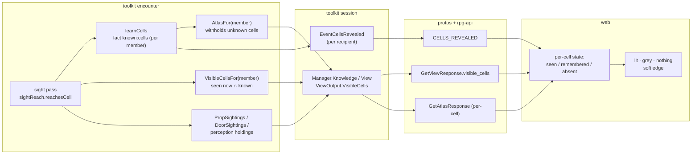

# Fog of war — draw what this seat knows

Tracking: [rpg-project#586](https://github.com/KirkDiggler/rpg-project/issues/586).
Walkthrough: [README.md](README.md). Plan: [plan.md](plan.md).

## Shape

Every seat holds three grains of the map. **Seen now** is the cells its own
character's sight reaches this moment. **Remembered** is every cell that
character has ever learned and does not see now. **Unseen** is everything else,
and it is absent from what the seat receives. The engine decides all three; the
session delivers them; the client draws the state it is sent.

## Law

- **The cell is the unit of knowledge.** A member learns a cell when the sight
  pass's `reachesCell` answers true for it, when it opens a door on that cell's
  edge, or when an explicit concealment reveal teaches it. Nothing teaches a
  whole region at once. (R1)
- **One sight test.** Seen-now and learning both ask `sightReach.reachesCell`
  in the same pass's geometry; no second visibility algorithm exists anywhere,
  client included. (R5)
- **Seen now is per seat and never stored.** `VisibleCellsFor(member)` is the
  known cells the member's sight reaches at the moment of the read. It is never
  a union across the party and never persisted; it is derived from current
  positions. (R1)
- **Remembered is per seat.** A learned cell is a per-member journal fact,
  audience that member alone. Memory is never forgotten within the run. (R4)
- **Unseen is absent.** `AtlasFor(member)` withholds every unknown cell, and
  every wall, door, doorway, fixed prop and placement that touches only unknown
  cells. A door on the edge of a known cell is presented; a door with no known
  cell on any edge is absent, exactly like the wall it stands in. (R2)
- **Unknown floor is not a wall.** Withholding unexplored space adds no
  synthesized boundary; only concealment masquerades as wall. The two masks stay
  separate.
- **Mutable things keep their observation lifecycle.** Holdable props and door
  state are `PropSightings` and `DoorSightings`; creatures are perception
  holdings. Current means `CurrentVia` non-empty; remembered means empty. The
  atlas never carries them. (R3)
- **The session projects, never computes.** `ViewOutput.VisibleCells` and
  `KnowledgeOutput` pass the encounter's answers through unchanged; the
  per-recipient stream delivers newly learned cells as one cells-revealed beat
  per member per pass. (R5)
- **The wire is additive.** `GetViewResponse.visible_cells` and the
  `CELLS_REVEALED` kind are new. `GetAtlasResponse`'s schema is unchanged and
  its contract becomes per-cell. `ROOM_REVEALED` is deprecated and no longer
  produced.
- **The client draws three states and nothing else.** A seen-now cell draws lit.
  A remembered cell draws in the remembered treatment: a lighter grey shadow
  with its shape readable, its fixed layout, and its props and creatures as
  last seen. An absent cell draws nothing. Walls and doors take the brightest
  state of the cells they border. (R3)
- **Sharing is a choice (R8).** Discovery sharing defaults off, so each
  player's map is what that player has seen until the party turns sharing on.
  Why: a default of off shows more in playtests than a default of on.
- **Soft edges, no wedges.** The boundary between seen-now and remembered is a
  short gradient over at most two cells, computed from the per-cell states the
  client was sent. It never extends into an absent cell and never draws a cone,
  ray or polygon. (R5)

## Rulings

| ID | status | scope | ruled by | date |
|---|---|---|---|---|
| R1 | settled | Live sight is per seat and per hex: a client draws the hexes its own character sees now, never a party union; carries the earlier per-viewer visibility ruling of rpg-project#130 | KirkDiggler | 2026-10-15 |
| R2 | settled | A never-seen cell draws nothing; an unobserved door is an unobserved wall; first sight reveals wall, door or floor as they are | KirkDiggler | 2026-10-15 |
| R3 | settled | Remembered draws as a lighter grey shadow with land shape readable, props and creatures as last seen; tint (grey or sepia) is a presentation choice still open | KirkDiggler | 2026-10-15 |
| R4 | settled | Memory is per seat; the existing discovery-sharing setting is the one switch that pools remembered across the party; live sight stays per seat regardless | KirkDiggler | 2026-10-15 |
| R5 | settled | No cone wedges: hex-based reveal with soft edges; the client computes no visibility, the session projection owns delivery (rpg-project#541) | KirkDiggler | 2026-10-15 |
| R6 | superseded by R1 | The region partition as the unit of reveal, including the engine's whole-room discovery | KirkDiggler | 2026-10-15 |
| R7 | superseded by R4 | Remembered map shared by the whole party by default | KirkDiggler | 2026-10-15 |
| R8 | settled | discovery sharing defaults off; a party pools memory by choosing to; playtests may move the default | KirkDiggler | 2026-10-15 |

## Open

- **O1 — the pooling fold under discovery sharing.** R4 names the switch and
  R8 sets its default; the fold itself is not built. When it is, a sharing
  member's learned cells join every placed player's remembered set, as
  `discoveryAudience` already does for concealment results.
- **O2 — remembered tint.** Grey or sepia (R3). The client's remembered
  material is one value; the choice does not touch the wire.
- **O3 — older working documents.** `production-design.md`, `handoff.md` and
  `progress.json` predate this design and describe the web concept route. They
  are not law; where they disagree, this document wins.
