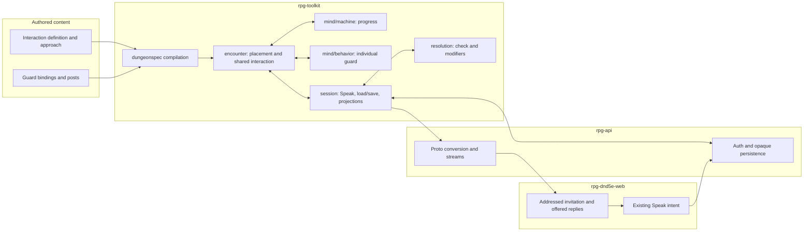

# One entrance, one remembered interaction

This is the proposed ownership and lifecycle for
[guarded admission #769](https://github.com/KirkDiggler/rpg-project/issues/769).
The [design](design.md) distinguishes agreed scope from proposed contracts;
open rulings are not implementation authority. The use case is the
[keep's admission journey](../keep-dungeon/design.md#front-gate-encounter),
not a replacement of the standing QA castle.

## What this is

An authored interaction has shared progress that outlives its current speaker.
The guard still has its own mind. The player still makes an ordinary Speak
choice. The encounter connects those two to one remembered entrance outcome.
**The invitation, the attempt and permission to pass are not the same thing.**

The proposal reuses `mind/machine` for progression, the existing NPC composer
for guard behavior, ordinary Speak/resolution for a check, physical posts for
passage and existing movement for relocation. It adds no second decision
engine and no server script that knows what a guard or admission check means
(R3, R6, R8).

## Component shape

## Ownership and contracts

Names prefixed **proposed** identify new design shapes. They are not claims
that those types or protobuf fields already exist. Existing names identify
actual seams the design extends.

| Component | Owns | Input → output |
|---|---|---|
| `encounter/dungeonspec` | Validation and lowering of authored interaction definitions, the approach distance, guard references and choice references | Source document → **proposed `InteractionDefinition`**, bound `machine.Recipe` and original configuration |
| `mind/machine` | One state transition and its actual evaluation trace | `Program`, `Blob`, supplied event/environment → `Stepped` or `TraceStepOutput` |
| `encounter` shared interaction | The interaction identity, shared progress, addressed invitation and pending attempt | Definition + `Step`/`Speak` outcomes → **proposed `InteractionData`**, **`InteractionView`**, ordinary outcomes and private trace records |
| Each guard's behavior | Its own perception, role precedence, selected answer and actual work | Encounter's proposed bounded dialogue opportunity → existing composer selection with a **proposed invitation answer**, carrying the interaction reference and actual approached character; ordinary movement remains separate |
| `encounter` passage and placement | Who physically occupies or holds an opening, and actual destination positions | Existing `Post`, `StepInput`, movement/directive inputs + explicit authored release → legal movement or an actual stop |
| `resolution` | The check, character modifiers and any genuine paused resolution | Existing staged check plus authored context → settled verdict/calculation or posed check |
| `session` | Actor lookup, host verbs, saved state and player projection | `SpeakInput` carrying the option id and the offered pool's revision (R3) → ordinary check result plus projected interaction state; `EncounterData` → existing persistence seam |
| `rpg-api` | Caller binding, opaque storage, continuation ownership and wire conversion | IDs/selection → session call; saved projection → protobuf/stream |
| Web | Presentation of an addressed interaction and submission of an offered choice | Server `InteractionView`/ordinary acts → reply panel; chosen selection → Speak |

The compiler never supplies a default missing guard, initial state or landing
cell. It refuses a challenge binding that can select paid movement or an attack
in a dialogue-only opportunity. The machine knows no guard, check DC or door. A guard's private blob
never becomes the party's attempt budget. The encounter never calculates the
roll from character attributes. Session never decides that proximity means
participation. API never counts failures. Web never treats a closed panel or
a narration string as admission (R3–R9).

## Walk one thing through

Consider a bound interaction named `front-gate`, addressed to Alice by an
ordinary gate guard. Its progression distinguishes a fresh entrance, one
failed claim, granted entry and an arrest consequence. Those are authored
states, not host-side `if gate` branches (R2, R3).

1. The compiler captures the interaction and guard bindings. `front-gate`
   retains its identity across all guards; each guard retains its own member
   identity and private progress.
2. Alice reaches the authored outside approach. Encounter placement and
   perception determine whether an eligible guard can address her. The
   encounter supplies a bounded dialogue opportunity, not an ordinary turn
   disguised as a notification. The guard's composer selects the authored
   invitation once. The remaining requested path stops before crossing; the
   response and record include only the movement that actually happened.
3. The encounter records an addressed invitation. The session saves it with
   the world before ordinary delivery. Web opens Alice's replies from the
   current projection. Bob elsewhere is not silently put into a conversation.
4. Alice selects a checked claim. Her reply names the option and the
   revision of the evaluated pool it was offered from (R3). The existing member
   and target identities still travel through Speak. The toolkit validates
   them before reserving the choice and invoking the real check.
5. If the check poses a held benefit, its original attempt remains pending.
   React resumes that check; changing the UI or reconnecting cannot create a
   second roll. This uses existing resolution behavior, not the invitation
   mechanism.
6. On a first failure, the shared machine advances to the warned state and
   closes the failed claim. Bob cannot start over by speaking to another
   guard. Hearing the warning and being subject to the shared attempt budget
   are separate questions.
7. On success, the encounter commits the authored entry outcome and releases
   the named gate hold. Actual guards begin their relocation through normal
   movement opportunities; the gate does not wait for their arrival. A short
   or interrupted guard walk remains unfinished work.
8. On reload, captured definitions, shared progress and any pending selection
   are loaded. The normal player view recovers the invitation where still
   applicable. The private inspector explains the actual shared transition
   and related NPC decisions without recreating them from current YAML.

On a second failure, the arrest candidates come from the entrance area OR the
arresting guards' own intel (R11). A distant explorer absent from both is not
included just because they belong to the party. An out-of-sight character may
qualify through guard intel. The exact treatment of lost/unknown locations
remains the design's Open question, not a live-position lookup disguised as
knowledge. The committed consequence retains its selected IDs across reload
rather than recomputing the set after the world changes (R7).

## Separations that look like one thing

| Query | Source of truth |
|---|---|
| Which rules and lines belong to this run? | Original bound interaction definition |
| What did this guard observe and decide? | Its existing observations and behavior instances |
| How many claims remain at this entrance? | Shared interaction progress for the run |
| Who is currently being invited to reply? | The addressed invitation |
| Has a check already started but not settled? | The reserved attempt and genuine resolution continuation |
| Who is eligible for front-gate arrest? | Authored entrance-area membership OR the arresting guards' own intel (R11) |
| Does a guard know a character's current location? | That guard's actual testimony, not the arrest selection or global placement |
| Does this character know what was said? | Observer-local knowledge and ordinary audience |
| May the party pass the entrance? | Committed shared outcome, applied by the encounter to passage policy |
| Can a body actually stand or move here? | Existing placement, doors, posts and movement |
| Is the reply panel open? | Client presentation state only |

Copying an attempt flag into every character's knowledge permits omissions and
resets. Storing it on one guard loses it when that guard changes. Deriving an
invitation from any `barred` line confuses physical obstruction with an authored
request. Treating a conversation as a resolution pause freezes unrelated
players. Those shortcuts merge owners that the design keeps separate.

## Trade-offs

| Decision | Benefit | Cost / boundary | Not taken |
|---|---|---|---|
| One acting character in the first delivery (R1) | Reuses the actual Speak/check path | Participating players do not yet vote or select among group results | Full #737 delivery as a prerequisite |
| Encounter-owned shared interaction (R3) | Attempts survive speaker/guard changes | Compiler and encounter must own a validated new binding and persistence shape | NPC-local counters or an API admission service |
| Reuse `mind/machine` for shared progression (R3) | One evaluation model and trace semantics | Encounter supplies a distinct interaction vocabulary; guard composition stays separate | A second conversation-state evaluator |
| Invitation separate from resolution pause (R4) | Opening replies does not halt distant play | Session/web need an authoritative invitation projection and invalidation path | Pose every invitation as a globally freezing check window |
| Validate and reserve before dice (R5) | Concurrent speakers cannot consume the same offered phase | Encounter/session must carry selection identity through posed checks | A second check followed by a late rejection |
| Original definitions plus saved progress (R9) | Reload and inspection explain the run that actually happened | State size and schema validation are paid at save/load | Fetching latest authoring YAML on reconnect |

## Edges

The current game has one cooperative player party per run. The proposed shared
binding belongs to that run, not to the set of nearby witnesses. This is not a
multi-party faction permission service (R2, R3).

A bare invitation is not a combat reaction or a pending die roll. Once a real
check is posed, the existing resolution window's restrictions still apply;
this proposal does not change that policy (R4).

Ordinary body/post rules remain physical. The design must reconcile a vacated
post with the mission's entrance restriction rather than smuggling in an
invisible blocker (R6, Open). Arrest's area-or-intel boundary is R11; its
precise intel predicate and the class/background check context must be
explicit before their implementation (R8, R11, Open).

An invitation lost from a live stream is recoverable state. Diagnostic history
is evidence, not the authority for whether somebody may choose a line or cross
a door. New interaction diagnostics identify their owner separately from an
NPC instance; the existing reader must not mislabel one as the other (R9).

## Where a change lands

- A different warning or branch is interaction content, compiled through
  `dungeonspec`; it is not a handler conditional.
- A new check modifier belongs to the rulebook/resolution path, with its
  authored input carried across the existing seams.
- A different reply-panel layout is web presentation. It cannot change the
  active interaction revision, remaining attempts or physical passage.
- A new initiation condition belongs to encounter placement/perception and the
  interaction's authored contract, not a distance comparison in the browser.

## Source map

| Concern | Existing source |
|---|---|
| Generic progress and trace | `rpg-toolkit/mind/machine/{compile,step,trace,blob}.go` |
| Individual NPC composition | `rpg-toolkit/mind/behavior/composer.go`; `encounter/{behavior,behavior_work,wakebeats}.go` |
| Physical stop and addressed guard response | `encounter/{post,barred,step}.go`; `session/move.go` |
| Observer-held identities and location states | `mind/perception/perception.go`; `encounter/{observation_subject,testimony,turndriver}.go` |
| Authored choices and knowledge requirements | `encounter/option.go`; `encounter/world.go` |
| Host social/check path | `session/{speak,social,conceal}.go` |
| Genuine paused decisions | `play/interrupt`; `session/afford.go` |
| Saved world | `encounter/data.go`; `session/{write,checkpoint}.go` |
| Source compiler | `encounter/dungeonspec` |
| Host transport | `rpg-api/internal/handlers/dnd5e/session`; `internal/orchestrators/session` |
| Player interaction and narration | `rpg-dnd5e-web/src/components/session/combat-experience/{useSessionCombatExperience,bumpStory.test}.ts` |

Paths abbreviated `encounter/` and `session/` are beneath
`rpg-toolkit/rulebooks/dnd5e/`. Proposed interaction-specific types do not yet
have source paths; their owner is the table above, not a newly introduced
module or host service.
