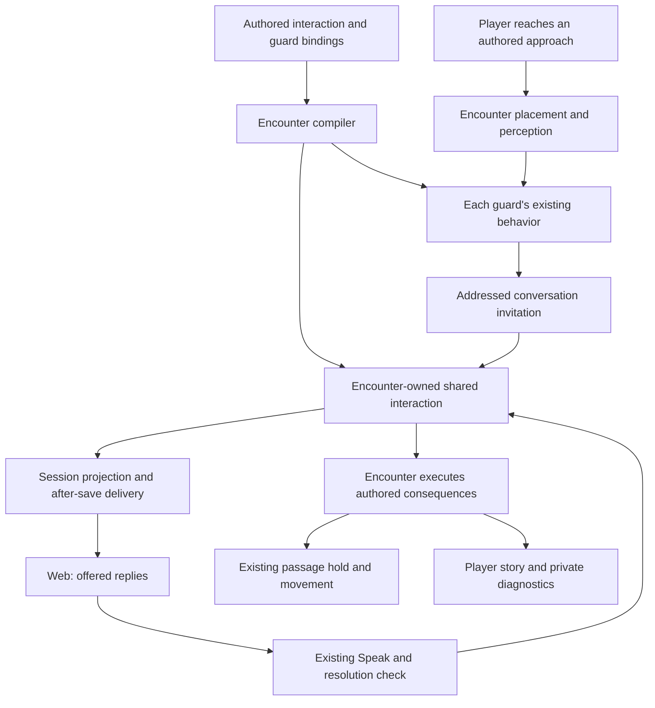

# Guarded admission

## Shape

[Story #769](https://github.com/KirkDiggler/rpg-project/issues/769) carries
scope, decisions and delivery evidence. [The walkthrough](README.md) explains
the proposed seams. Only rows marked **settled** below are agreed law; open
rows describe the proposed contract for review. An open row is not permission
to implement it.

## Law

### R1 — One acting character, shared consequences

The first playable admission interaction uses one acting character's existing
Speak/check path. Group voting and shared result selection remain separate
from this delivery. Other characters receive only outcomes their ordinary
observer-local stream permits; they need not stop exploring merely because
an invitation is open.

### R2 — The entrance remembers for the run

Attempts and admission belong to the party at the named entrance for the run.
Changing speaker or guard, backing away, dismissing a panel, disconnecting or
rejoining does not create a fresh attempt budget. A successful admission or
established alternate entry releases the gate for the run. The keep allows
two attempts: the first failed claim is unavailable for the retry; the second
complete failure causes arrest, not an automatic fight.

### R3 — Shared progress has one owner — proposed

The encounter owns an authored interaction instance independently of any
speaker or guard. Its identity is the interaction binding within the run;
its original bound definition and persisted `machine.Blob` remain distinct.
The existing machine evaluates the shared progression; the encounter supplies
its vocabulary and executes its consequences. No new generic machine,
workflow service or host-side admission counter is introduced.

A guard retains its own behavior instances, observations and work. A guard's
death, replacement as speaker or interruption cannot reset the shared
interaction. The interaction does not become the NPC composer or choose
movement on its behalf.

### R4 — An invitation is not a frozen resolution — proposed

The authored approach names where a living, eligible guard can initiate the
interaction through the encounter's placement and perception answers. The
encounter authorizes a bounded dialogue opportunity on the world clock; an
observation does not become an ordinary paid turn. That opportunity permits
only the authored challenge/invitation, not a free move or attack. The guard's
composer selects once, and an explicit invitation names the actual approached
character rather than a client-inferred listener. A long walk stops on the
outside approach before any restricted crossing. It reports
only steps actually taken and discards its unentered remainder; answering or
dismissing the invitation never resumes that old path automatically.

The invitation addresses one character and identifies the real guard and the
shared interaction. It is recoverable from authoritative state, not only from
a one-time stream notification. Its presence neither spends a check attempt
nor freezes unrelated players. An actual Speak check that poses an existing
resolution window retains that window's established freeze/resume behavior.

Backing away ends the current address without clearing shared progress.
Repeated reads or repeated steps within the same approach do not spam new
invitations. Leaving and returning can address the remaining interaction
again. An unavailable guard, combat, changed interaction state or an actor no
longer eligible invalidates the old invitation rather than fabricating a
replacement conversation.

### R5 — A choice is validated and reserved before dice — proposed

The offered choice carries the shared interaction identity and its revision.
The toolkit revalidates recipient, target, phase, option, reach and current
eligibility before charging, rolling or reserving an attempt. A stale or
inapplicable selection is refused; the API does not reinterpret it as a new
choice.

Only one checked choice can be pending for an interaction at a time. A posed
check retains that reservation and its original attempt through save/reload
and ordinary React. An unresolved check is neither a failure nor a new try.
Its settled verdict advances shared progress once. Another speaker cannot
start a competing check against the same phase. Duplicate/stale requests
cannot spend a second attempt or reroll a delivered result. This is not a
promise of exactly-once host execution across a failed, uncommitted save.

### R6 — Permission is not knowledge — proposed

Private knowledge, current speaker, shared interaction progress, passage
permission and physical placement have different owners. Granting passage
does not teach a distant member the dialogue, and hearing a claim is not
permission to enter. Admission never grants faction-wide alliance as a
shortcut.

The encounter applies the authored release to the named posts independently
of the guards completing their relocation. Existing body occupancy,
post-at-place rules, door crossings and movement remain authoritative; there
is no invisible replacement wall. A new permission effect is not an excuse
to read private progress from the API or infer it in the client.

### R7 — Consequences act on existing people — proposed

Arrest uses the covered transition specified by the keep, retains equipment
and character state, and places affected members at distinct valid positions
in the authored shared cell. It creates no replacement prisoner or run.
Surviving guards retain identity, health, resources and memories and walk to
their authored destinations through existing movement and work completion.
Gate release does not wait for that walk. Membership and outcome identifiers
survive reload so neither relocation nor arrest starts again from a duplicate
request or presentation event. R11 supplies the arrest-membership boundary.
The encounter captures the selected member IDs and their qualifying basis
when committing the arrest consequence; reload and presentation reuse that
set rather than querying changed positions or intel again.

### R8 — Checks remain rulebook-owned — proposed

The requested admission routes are Performance and Persuasion, initially
DC11. Claim mapping and context-specific advantage are explicit authored
inputs to the rulebook check path, not comparisons in the API or encounter
composition. Existing per-character modifiers still come from the acting
character. No extra Deception check is silently inserted. The second attempt
does not increase the DC; the exact boundary of its advantage removal must
be resolved before authoring that check policy.

### R9 — Stored truth, observable consequences — proposed

Original interaction definitions, shared progress, addressed invitations and
pending attempts save with the encounter's authoritative state. The host
uses the existing fenced persistence and after-save delivery. Presentation
cannot grant passage or clear pending gameplay work.

Load validates the captured definition and progress together; it never
substitutes current YAML or resets malformed progress to a fresh interaction.
A run with no authored interactions has none; adding interaction content does
not retrofit an existing saved run.

Ordinary story carries the permitted invitation and outcomes. Private
inspection records identify the shared interaction separately from NPC
instances and report actual evaluation and commitment without replaying
choices or rolling again. Missing evidence remains unavailable.

### R10 — A bounded first delivery

The first interaction has one acting character, not a voting service. Automatic
initiation belongs to the free-roam entrance journey and does not override a
combat turn or an already posed resolution. It introduces no dedicated Studio
behavior editor, analytics database, general
quest platform, universal scheduler or effects-machine migration. The standing
QA castle remains a regression fixture; the canonical admission mission and
its focused authored fixture have their own required outcomes.

### R11 — Area or the arresting guards' intel

Front-gate arrest includes party characters in the authored entrance area or
in the arresting guards' own intel. The two sources form a union, not an
intersection. Membership in the party roster alone is insufficient; a distant
character is not excluded merely for being out of sight if guard intel
qualifies them.

The intel branch reads the relevant guards' actual observer-held information,
not a global party view or an unrelated NPC's knowledge. It must identify the
character; an anonymous sound does not establish its maker. Combining the
arresting guards' answers does not teach each guard everybody else's knowledge
or replace remembered information with a live hidden position.

The exact location-state predicate for intel eligibility is an open contract
below; the area-or-intel boundary does not settle it by implication.

## Rulings

| ID | status | scope | ruled by | date |
|---|---|---|---|---|
| R1 | settled | One acting character uses Speak/check; shared consequences, not group voting in first delivery | KirkDiggler | 2026-11-10 |
| R2 | settled | Entrance/run attempt history and canonical admission consequences | KirkDiggler, canonical keep and #769 | 2026-10-31 |
| R3 | open | Encounter-owned shared interaction using the existing machine | — | — |
| R4 | open | Authored approach, addressed invitation and non-frozen lifecycle | — | — |
| R5 | open | Versioned choice, pending-check reservation and stale refusal | — | — |
| R6 | open | Permission distinct from knowledge; integration with physical posts | — | — |
| R7 | open | Existing-actor consequence lifecycle and captured arrest-set persistence | — | — |
| R8 | open | Claim mapping and authored check-benefit boundaries | — | — |
| R9 | open | Persistence, projections and inspection of shared progress | — | — |
| R10 | open | Proposed first-delivery boundaries beyond the settled R1 participation scope | — | — |
| R11 | settled | Front-gate arrest membership: entrance area OR the arresting guards' own intel, not the whole party by default | KirkDiggler | 2026-11-10 |

## Open

- **Intel eligibility and area binding (R11):** distinguish identified
  characters with current or remembered known-location testimony from those
  whose location is marked lost or unknown. Decide which qualify for arrest
  outside the area without consulting their hidden live positions. Bind the
  area explicitly; no implementation may choose an implicit distance.
- **Approach and physical bypass (R4/R6):** fix the authored approach and its
  perception/re-arm conditions, and reconcile full entrance enforcement with
  the existing rule that an actually vacated post holds nothing. Preserve
  legitimate physical play; do not silently add an invisible barrier.
- **Claim and advantage policy (R8):** settle guest/entertainment mapping to
  Persuasion/Performance and whether the second attempt removes only the
  admission-granted advantage or also independent sources. Preserve the
  existing class/background requirements in the canonical keep.
- **Contract review (R3–R9):** validate the proposed ownership, selection,
  reservation, reload and delivery contracts before deriving implementation
  tasks. New public shapes in the walkthrough are proposal names, not existing
  toolkit or protobuf APIs.
