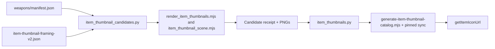

# Item artwork: source to screen

[Story #741](https://github.com/KirkDiggler/rpg-project/issues/741) follows the
[design](design.md). This is a static image production path, not a rules preview,
character portrait service or item-skin authoring system.

## Component shape

## Ownership and contracts

| Component | Owns | Input → output |
|---|---|---|
| Weapon manifest | Exact item/model binding | Full item ref → runtime GLB path/hash |
| Item recipe | Camera, orientation, light, resolution | Exact ref → explicit view profile; shared image settings |
| Candidate builder/renderer | Reproducible inert capture | Verified model + recipe → 512px PNG + bound receipt |
| Private publisher | Runtime image/catalog custody | Reviewed candidate → atomic image/catalog/inventory update |
| Web generator/sync | Public-safe metadata and exact bytes | Pinned provider catalog → exact-ref URL/hash/dimensions + synchronized images |
| UI lookup | Image selection and presentation | Supplied item ref/override → image URL or named fallback |

Capture does not rewrite model geometry, materials or game facts (R2).
The publisher does not substitute stale or unreviewed captures (R5).
The web does not derive a skin from a name or render the weapon on inventory open.

## A longsword through the path

`dnd5e:item:longsword` identifies its registered model in the weapon manifest.
The builder verifies those exact GLB bytes and pairs them with the longsword's
view profile. The renderer fits all projected geometry, preserving the full
silhouette while using the square diagonally. The receipt binds ref, model,
recipe and image; the private publisher carries that same ref into the runtime
catalog. Web generation retains it as the lookup key and appends the image digest
to the URL, so a new capture cannot hide behind the old image's cache identity.

## Separations and trade-offs

| Question | Owner |
|---|---|
| Which object/appearance is this? | Supplied content/ref and asset mapping |
| How does its image look? | Item capture recipe |
| How large is the image on screen? | Consuming UI |
| What does the weapon do to a target? | Existing rules/action-information path |

| Decision | Benefit | Cost / boundary | Not taken |
|---|---|---|---|
| Explicit per-ref view profiles | Unusual shapes are inspectable and deliberate | Asset author reviews new or changed entries | Universal inferred camera |
| Static higher-resolution images | Detail without per-client weapon capture | Asset build/storage cost | Runtime inventory GLB rendering |
| Separate item recipe | World receipts and visual contract remain stable | Small independent capture path | Repurposing the world recipe |
| Whole-object default | Shape and identity remain visible | Long thin objects remain slender | Cropped default detail image |

A new skin needs an authoritative image binding, not a tooltip calculation.
Armor, pack contents and other item families are outside this weapon batch.
A new camera profile belongs with the item recipe; a display-size change belongs
with the UI; a new rule remains outside this path.
