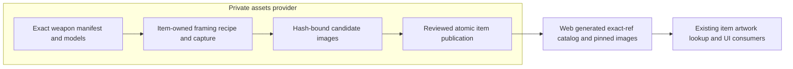

# Readable item artwork

## Shape

## Law

- **R1 — Recognizable appearance.** Default weapon artwork shows the whole weapon, corner to corner, with lighting and framing that reveal the handle, blade/head and surface detail. The reviewed axe presents its cutting edge downward; other shapes have explicitly reviewed framing.
- **R2 — Presentation is not a new skin.** Capture uses the supplied source model and its materials/textures unchanged. A ref selects its registered default image; a distinctive appearance requires its own authoritative image mapping, not a name-derived substitute.
- **R3 — Item-owned static capture.** Item artwork has its own versioned recipe and source/image identity checks. A change to it does not change world-asset thumbnail behavior. The reviewed candidate resolution is 512×512; display size is a consumer presentation choice.
- **R4 — One review surface.** Operator-facing item-art review uses the existing 5195 preview server. Candidate bytes remain private or in an ignored dev-only stage outside production asset copying.
- **R5 — Honest delivery.** Candidate images are not published runtime images. Publication preserves exact-ref lookup, source/image digest verification, atomic replacement and explicit fallbacks. Rendering artwork neither grants gameplay actions nor evaluates combat effects.

## Rulings

| ID | status | scope | ruled by | date |
|---|---|---|---|---|
| R1 | settled | B whole-weapon framing; reviewed three weapons and corrected axe; remaining batch still requires visual verification | KirkDiggler | 2026-10-30 |
| R2 | settled | Existing models/appearances, not newly authored skins | KirkDiggler | 2026-10-30 |
| R3 | settled | Accepted static 512px item-art study; separate from world captures and browser character portraits | KirkDiggler | 2026-10-30 |
| R4 | settled | Reuse 5195 rather than another persistent preview server | KirkDiggler | 2026-10-30 |
| R5 | settled | Existing provider/web publication and ownership boundaries remain in force | Existing workspace contract | 2026-10-30 |

## Open

- Remaining weapon shapes need visual verification against R1 before publication.
- Joined equipment display size/layout is judged with the new imagery; no final UI dimensions or inventory redesign are settled by the source-image choice.
- Catalog version migration and exact release adoption are implementation contracts owned by the provider and consumer, not new gameplay or RPC surfaces.
