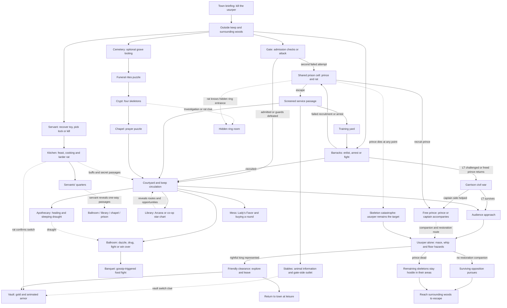

# The Keep dungeon design

**Living paper design · Updated 2026-11-03 · Owner: Kirk**

Working episode title: **The Gang Commits Regicide**. The title is provisional.

The party enters a keep during a celebration to assassinate a usurper. It can
rush the throne, find ways to neutralize the guards, intervene in a divided
garrison, or discover the imprisoned rightful king. Exploration changes the
resources, information, allies and consequences available; it is optional.

This is the complete intended dungeon experience. It describes player choices,
room purposes, encounters and their relationships. It does not describe current
implementation coverage or prescribe an implementation. **TBD** means an authored
detail remains undecided; it does not remove the surrounding agreed behavior.

## Contents

- [Premise and mission](#premise-and-mission)
- [Mission web and physical layout](#mission-web-and-physical-layout)
- [Shared interaction rules](#shared-interaction-rules)
- [Approaches and entry](#approaches-and-entry)
- [Prison and the rightful king](#prison-and-the-rightful-king)
- [Barracks and training yard](#barracks-and-training-yard)
- [Servant route and kitchen](#servant-route-and-kitchen)
- [Cemetery route and chapel](#cemetery-route-and-chapel)
- [Courtyard and patrol](#courtyard-and-patrol)
- [Ballroom](#ballroom)
- [Library and apothecary](#library-and-apothecary)
- [Mess hall and Lady's Favor](#mess-hall-and-ladys-favor)
- [Banquet hall food fight](#banquet-hall-food-fight)
- [Audience approach and throne room](#audience-approach-and-throne-room)
- [Vault and other exploration rooms](#vault-and-other-exploration-rooms)
- [Characters and equipment](#characters-and-equipment)
- [Victory, catastrophe and escape](#victory-catastrophe-and-escape)
- [Facts that carry beyond the keep](#facts-that-carry-beyond-the-keep)
- [Remaining authored choices](#remaining-authored-choices)
- [Maintaining this design](#maintaining-this-design)

## Premise and mission

### The assignment

Someone in town opposes the usurper and sends the party to kill him. The
questgiver may be an ally of the prince. Their identity and exact knowledge
remain TBD.

The briefing establishes the open mission:

> You can go straight to him. He should be in the throne room. But kill him and
> the guards will come for you, so be ready to get out fast. There's unrest among
> the guards, and a party going on. You might find another way in—or a way to
> neutralize some of the guards before you get the job done.

This is sufficient motivation to explore without requiring every room. A direct
assassination and difficult escape is a valid completion.

The usurper killed the previous king and implicated his son through political
maneuvering and blackmailed officials. The imprisoned prince is now the rightful
king. He is referred to as **the prince** throughout this design to distinguish
him from the assassination target.

### Tone and scope

The keep is an episode in a larger world. Recurring side characters, rat
families, local customs and remembered party behavior connect episodes. Players
play their own characters; they are not assigned the roles of an existing
comedy ensemble.

The tone supports an earnest restoration story alongside absurd excuses, rude
guests, gambling and a food fight. Conversations should communicate their point
quickly. Important choices should not require long explanatory cutscenes.

The initial balance baseline is **four level-one player characters**. A hex is
five feet. Level-one characters can receive special equipment without implying
that a complete progression system has been settled.

## Mission web and physical layout

### One web of opportunities

Solid lines below show principal routes or destinations. Dotted lines show
information, assistance or an alternate consequence. This is a mission
relationship diagram, not a floor plan; the physical inventory follows it.

The vault remains available before or after the boss and without a friendly
prince. The diagram's reward connection does not make it an exclusive route.

### Footprint and room purposes

Retain the large keep silhouette and current near-limit layout: **28,934 hexes
across 28 named areas**. Size provides space for propping, circulation and combat;
it is not a requirement to fill every hex with an encounter.

| Area | Purpose and physical connections |
| --- | --- |
| West grounds | Exterior approaches to the kitchen/servant entrance and barracks. |
| South grounds | Exterior access to the forecourt and cemetery; surrounding escape woods. |
| Forecourt | Main gate approach and gate-side outlet from the stable/service circulation. |
| Gatehouse | Admission encounter; joins forecourt to courtyard. |
| Courtyard | Central circulation, nobles and patrol; connects gate, training yard, armory, apothecary, ballroom and audience approach. |
| Barracks/tower | Recruitment and garrison faction confrontation; exterior door, mess, armory and training yard. |
| Training yard | Open maneuvering space and two LT-aligned guards; joins barracks, courtyard, stables and service passage. |
| Prison | One shared cell, prince, rat and multiple escape methods; exits into the service passage. |
| Prison service passage | Screened circulation joining prison, training yard and stables, with a route toward the gate area. |
| Stables | Animal conversations and vault information; joins training yard and service passage, with gate-side access toward the forecourt. |
| Armory | Optional equipment exploration between barracks and courtyard. |
| Mess hall | Gambling and off-duty guards; connects kitchen, barracks and audience approach. |
| Kitchen/larder | Servant entry, food buffs, cooking activity and rat information; joins west grounds, servants' quarters and mess. |
| Servants' quarters | Revealed one-way secret-passage hub; ordinary access from kitchen. |
| Apothecary | Potion and draught exploration off the courtyard. |
| Library | Map discovery through Arcana or a co-op puzzle; connects audience approach and chapel. |
| Ballroom | Social encounter and guard neutralization; connects courtyard and banquet hall. |
| Banquet hall | Food fight and social title; reached from ballroom. |
| Audience approach | Last guard interaction and surviving barracks LT; connects courtyard, mess, library and throne. |
| Throne room | Solo usurper boss; connects audience approach, bedrooms and treasury. |
| Treasury/vault | Gold, locked chest and animated armor; reached from throne room. |
| Bedrooms | Optional common equipment exploration off the throne room. |
| Chapel/rectory | Priests, cleanup-job misunderstanding and prayer puzzle; connects library and crypt. |
| Crypt | Four-skeleton fight and lesser rings; connects chapel, enclosed passage and hidden stash. |
| Hidden stash | Secret crypt room containing the more valuable ring. |
| Enclosed passage | Transit between mausoleum and crypt. |
| Mausoleum | Funeral rites puzzle and secret keep entry; connects cemetery and enclosed passage. |
| Cemetery | Three optional lootable graves; connects south grounds and mausoleum. |

The prison does **not** open directly into the training yard. An enclosed,
screened service passage makes emerging from that direction inconspicuous.
The spatial amendment uses a passage roughly six hexes deep along the prison's
north side. Preserve the direct training-yard–stables connection as well.
Final door and wall placement must preserve the passage's gate-side outlet.

The servants' secret passages are an additional one-way travel network, not
ordinary doors that replace these physical connections.

### Propping and encounter space

Use obstacle envelopes, walkable lanes, NPC positions and activity zones to
plan populated rooms. Placement markers express intent; they do not silently
add named actors or encounters to the roster.

- **Library:** exploration with occasional fighting, four players and roughly
  two or three occupants. Two desks along a wall, two tables, four chairs
  (two per table), and shelves along the long walls are impassable objects.
  Leave reachable furniture, clear approaches to exits, a gathering area and
  enough space to reposition.
- **Mess hall:** preserve passing lanes between table rows and cross-access
  so actors can reach seats, leave the room and pass a group.
- **Ballroom:** preserve lanes between guest clusters or pillars, approaches
  to the stage and punch, and room to fight without every civilian becoming
  a permanent choke point.
- **Training yard:** keep the working area comparatively open.
- **Throne room:** make the scale feel epic through the throne, pillars,
  sightlines, maneuvering space and clearly readable hazards.

Room intent, reachable interactions and usable routes determine propping.
No universal furniture percentage or untested minimum room dimension is adopted.

## Shared interaction rules

### Checks, participation and attempts

The default authored check target is **DC 11**. Attack rolls, ordinary opposed
shoves and other normal combat resolutions retain their own rules.

A check gathers the characters actually participating in that interaction,
rather than automatically using the whole party. Three characters at the gate
can participate there while a fourth searches outside for a toy. The two
interactions have separate participant sets.

Two group modes are intended:

| Mode | What players do | Difficulty goal |
| --- | --- | --- |
| Shared Fortune | Each participant rolls with their own modifiers and applicable advantage. The group votes on the result to use. | Account for choosing among several results; do not pretend this has the odds of one ordinary DC 11 roll. |
| Combined Effort | Each participant rolls and the modified results contribute to one combined total. | Calibrate the target to the number of actual participants and the intended success probability, rather than multiplying the DC by headcount. |

Shared Fortune is the default described by the encounter decisions. Combined
Effort is an alternate mode to explore. Exact mode selection, probability
reference, threshold rounding and treatment of mixed bonuses remain TBD.
Character investment must still matter, and players should understand what
target they are attempting.

Showing every participant's recognizable colored/textured dice is part of the
experience. A check should not feel like one player plays the interaction while
everyone else watches.

An **attempt belongs to the party at that encounter**, even when someone else
speaks next. Changing speaker or participant set cannot reset exhausted attempts.
A room's specific retry rule takes precedence over a general assumption that
someone else might try.

### Voting and dialogue

The party votes on dialogue choices. When votes tie, automatically show d20
rolls for the tied voters; the highest roller's existing vote wins. Reroll
highest ties among the tied voters. Do the same for a tied vote selecting a
check result. Avoid extra clicks just to resolve a tie.

Class/background presentation can alter a line and the response without
removing the base approach from other characters. A non-bard can claim to be
entertainment; a bard might instead say, "Perhaps you've heard of me!" and get
a more familiar reply. Tagged lines identify the character who delivers them;
everyone can vote for that line. Choosing a speaker and choosing a check result
are distinct decisions.

Conversations can branch into new options after a choice and continue several
steps. Aim for fewer than four exchanges where practical without making four a
hard limit. An explicit attack choice starts combat with the intended guards.
Knowledge-dependent options, such as reporting an insult actually heard, appear
only after learning that information.

A failed roll must produce its authored consequence. Closing a conversation or
walking around an open-looking doorway must not bypass an unresolved admission
encounter.

## Approaches and entry

The five entry families are the **front gate, barracks, servant entrance,
cemetery/mausoleum, and prison through arrest**.

### Front gate encounter

Four guards check arrivals at an already-open gate: **three ordinary guards
and a lieutenant**. The gate lieutenant is not the barracks lieutenant and is
not a captain. A standard guard is the initial speaking target.

The open doorway remains impassable to the party until admitted, the guards
are defeated, or the party establishes entry elsewhere. Reaching the entrance
causes the guards to halt the party and initiate the admission interaction.
Backing away is possible; slipping through the unresolved encounter is not.

The latest admission requirement names **Performance and Persuasion** routes.
Both begin at DC 11. The original detailed conversation also includes guest and
entertainment claims:

| Approach | Agreed narrative and consequence |
| --- | --- |
| Claim to be an invited guest | A social admission attempt. Noble and Sage are the only backgrounds selected for first-attempt advantage on the guest claim. |
| Claim to be entertainment | A non-bard can attempt it. Bard-specific delivery/reactions are available; Bard grants first-attempt advantage on the Performance proof. |
| Claim to be hired extra hands | No roll and no attempt consumed. Guards direct the party to the servant entrance and reveal its location for the run; they do not admit it at this gate. |
| Attack | Fight all four gate guards. |
| Back away | Leave admission unresolved; the passage restriction remains. |

**Gate mapping TBD:** the original guest route uses Deception, and the original
entertainment route tries Deception followed by Performance if the bluff fails,
with that entire exchange counting as one attempt. The later admission wording
uses Performance/Persuasion. Preserve the claims and distinct responses, but
settle their final skill mapping before final dialogue authoring; do not silently
require an extra Deception roll on top of the latest two-check requirement.

The party has two admission attempts for the run:

1. A success admits the party without fighting.
2. First complete failure produces disbelief and a warning to leave.
   The lieutenant approaches: "What's going on here?" The guard reports the
   failed claim. That claim disappears, leaving a different claim for the retry.
3. On the second attempt the party gets **no advantage**. A second complete
   failure leads directly to arrest, rather than automatic gate combat.

The exchange can be comic rather than a solemn lie detector:

> "No, we're the entertainment FOR the invited guests is what I was saying.
> Clean your ears, friend!"

Talking to another guard, choosing extra hands, leaving or changing speakers
does not reset attempts. The second attempt remains DC 11.

Choosing combat is independent of failed admission. Defeating the whole gate
group opens access; killing one guard does not clear the encounter. This
exterior fight does **not** put the entire keep on alert for now.

### Gate release and guard rotation

Successful admission or established entry through another route removes the
front-entry restriction for the rest of the run. Arrest into the prison counts
as entry. For the cemetery route, solving the mausoleum secret door is the
specific entry trigger.

After entry, living gate guards reposition along their route to the ballroom.
Do this once, preserving their identities, health, deaths, resources and memory.
There is no replacement group at the gate. The lieutenant mingles with guests;
the other guards take ballroom posts.

These are newer recruits who defend the throne. Their later response to the
prince or captain is a persuasion opportunity, not automatic allegiance.
Guards who arrested the party remember that fact; strangers elsewhere do not
automatically know it.

### Arrest transition

Use a brief covered transition or fade to black rather than marching across
the enormous map. Show an arrest message with concise flavor, place the party
in the large shared prison cell with the existing prince, then reveal the cell
and return control.

The party keeps its equipment. Preserve existing characters, health and story
state; place affected party members at distinct valid positions. Do not create
a second prince. The same arrest destination applies to the barracks captain's
arrest outcome. At the front gate, affected party members are those in the
entrance area **or** in the arresting guards' own intel, not the whole roster
by default ([guarded admission R11](../guarded-admission/design.md#law)).
Being outside the area is not an exemption when guard intel qualifies the
character. The precise intel predicate, area boundary and transition wording
remain to be specified; this ruling does not select barracks arrest membership.

## Prison and the rightful king

### Shared cell and introduction

One large communal cell holds the party and prince. A rat is nearby. There is
no dedicated jailer encounter: the keep already has a barracks, a patrol and a
celebration occupying its guards.

Keep the identity reveal simple:

> "What are you in for?"
>
> "We're here to kill the king."
>
> "He's no king. He killed my father. I'm the rightful king now."

Recruitment is a player choice with **no check**. The prince can promise riches
from the vault if the party helps restore him. He becomes an autonomous
companion who follows and fights; players do not directly control him. The
party may instead leave him or choose to attack him.

### Escape options

| Method | Resolution |
| --- | --- |
| Recruit the prince | He knows the cell door's weakness and pushes it over. |
| Talk, then leave him | The parting conversation reveals the weakness anyway. A party member can then interact to push the door over. |
| Notice the weakness | One party-wide DC 11 Investigation attempt when passing the relevant part of the cell reveals the interaction. |
| Pick the lock | One party-wide DC 11 attempt. |
| Befriend the rat | With animal speech, the rat retrieves the key. |

Knowing the weakness enables the push interaction; there is no additional
Strength roll. Failure on Investigation or lockpicking leaves other methods
available. Opening the cell lets everyone pass and does not itself trigger
a noise/alarm encounter.

The exit leads into the screened service passage. It can lead toward the
training yard or the stable/gate side, so emerging does not immediately announce
that the party escaped prison.

### Prison rat and its cousins

Animal speech offers a nice response and a "shoo the rat away" response.

Being nice prompts talk about "shinies." The rat offers to fetch a little shiny
to show the party, runs to a simple key location such as a hook on the wall,
and brings back the cell key. No payment, barter or extra quest is required.

Shooing the rat makes it leave. A cousin encountered later has heard about the
party: warmer if it was kind, colder if it was mean, but still willing to talk.

Rat information includes the hidden crypt ring and how to find its entrance,
plus the giant cheese in the vault. Larder and cellar rats are related recurring
families; individual names, exact family placement and the cheese interaction
remain TBD.

### Recognition after escape

Escaping does not create universal prisoner knowledge. Unalerted guards normally
assume the party belongs in the keep. The arresting guards, now in the ballroom,
can recognize escaped prisoners and initiate the confrontation there.

A visible prince or captain allows the ballroom allegiance conversation instead
of treating arrest history as an unanswerable accusation. Usurper-aligned guards
can react to the prince as an enemy; captain-aligned guards can support him.
A missing prince does not automatically prove the party harmed him.

## Barracks and training yard

### Recruitment route

Two guards stand at the exterior barracks door. Dialogue offers:

- Sign up: go inside and speak to the captain.
- Say the party is here to kill the king: branch into "just kidding, sign up"
  or a serious declaration leading to attack.
- Attack directly.

Peaceful entry triggers the shared keep-entry behavior. The captain is trying
to keep the garrison together during the celebration and growing argument about
the rightful king.

The captain tests recruits with **DC 11 Strength arm wrestling**. Passing earns
a first assignment:

> Go down to the cells and guard the prisoner. Don't let anyone talk to him or
> do anything to him. I'll give you further instructions myself after our
> guests leave.

This provides a cover story, not a restriction on player exploration. Failure
leads to arrest with equipment retained. The party can choose to fight instead.
An unfamiliar party arriving from another keep entrance can receive the same
help-or-arrest ultimatum: the captain does not have time to sort it out tonight.
Exact retry allowances for recruitment remain TBD.

### Final garrison roster

There are **eight** actors in this local encounter. Their placement and allegiance
are:

| Side | Actor | Initial location |
| --- | --- | --- |
| Prince/captain | Ranger captain | Inside barracks |
| Prince/captain | One ranged guard | Inside with captain |
| Prince/captain | Two ranged guards | Outside barracks door |
| Usurper/LT | Fighter-style lieutenant | Inside barracks |
| Usurper/LT | One melee guard | Inside with LT |
| Usurper/LT | Two melee guards | Training yard |

The training-yard pair discuss their side's views. The captain's heart is with
the prince, while he feels duty-bound to the throne. The lieutenant is firmly
pro-usurper and wants the prisoner killed.

If the party simply attacks the garrison, **both sides fight the party**.
An outside attack brings the inside and training-yard guards into the encounter;
an inside attack brings the exterior guards in. The faction split does not make
half of an unprovoked attack automatically friendly.

### Two civil-war triggers

**Return with the prince:** after freeing and recruiting him, the party returns.
The lieutenant objects and starts the confrontation. The captain's side is
friendly to the party because the prince is present.

**Challenge the lieutenant's order:** after recruitment, speak to the lieutenant.
He orders the party to kill the prisoner, contradicting the captain. A public
challenge/appeal to the captain sparks the faction fight. Keep the exchange
snappy. In this version the party begins neutral to both sides and may help or
attack either.

Both triggers use the same garrison faction encounter. Do not add a separate
new civil-war system solely for the usurper's death.

### Resolution and succession

When a side loses all its units, pause combat for a conversation with the
eligible surviving leader. The party can cooperate with the survivors or
continue fighting. Surviving guards have a named succession order; names and
the exact order remain TBD.

| Surviving side | Cooperation outcome |
| --- | --- |
| Captain alive | He goes to free the prince. The prince stays behind; the captain accompanies the party with the restoration outcome active. |
| Captain dead, prince-side guard alive | The surviving guard still frees the prince. The prince, rather than that guard, becomes the available companion. |
| Barracks LT alive | He orders the party to kill the prince; obeying is optional. He falls back toward the audience approach to protect the usurper. |
| Barracks LT dead, his guards alive | They shout that they must warn the king and retreat. They do not inherit the lieutenant's authority to issue his orders. |
| Both sides dead | This garrison is neutralized. |

In the captain route, speaking to/recruiting the prince yields the captain as
the companion instead: the prince remains safe in prison and can lend his
sword. If the prince is already accompanying the party when it meets the
captain, keep the prince as companion; the captain stands down and can lend
his bow.

A living prince left behind is not magically immune to being killed. Losing
the captain does not itself trigger the skeleton catastrophe; actually killing
the prince does. Whether a captain who dies before the boss still secures the
restoration ending remains TBD.

Leaderless usurper guards' exact fallback positions remain TBD. Their retreat
must be reconciled with the agreed solo usurper encounter rather than silently
adding boss reinforcements. The surviving lieutenant's audience-approach
interaction is described below.

## Servant route and kitchen

### The toy and the locked entrance

A weeping servant waits outside the locked kitchen entrance. The usurper threw
away a toy the servant was saving for his child. Talking reveals the outside
trash location.

The trash is reasonably obvious to search. A **DC 11 Investigation** interaction
uses the shared roll/vote rules. Complete failure exhausts the toy-recovery
opportunity for this run; hearing the servant's story later does not reset it.

The party can find the toy before meeting the servant. It keeps an unidentified
toy until the conversation provides context, then can show it immediately.

| Entry choice | Result |
| --- | --- |
| Return the toy | Servant unlocks the entrance and comes inside with the party. Positive servant disposition. |
| Pick the lock | Entry succeeds without the favor. Neutral disposition. DC 11; tools/retries TBD. |
| Kill the servant | He drops the key. Another servant opens the door, sees the party, flees screaming; servants evacuate and the keep goes on alert. Negative disposition. |

There are no stationed kitchen guards. A failed toy search does not remove the
lockpicking or murder alternatives. It also does not justify inventing a second
toy search.

### Feast and helping the cook

The kitchen is exploration and a noncombat activity space.

Eating the feast grants **+2 maximum HP and heals 2 HP for the run**. Repeated
sampling must not stack the bonus or become unlimited healing.

Helping a stressed servant finish cooking uses a short series of varied,
playful checks such as Athletics, Acrobatics and Perception. Use the shared
group check process, not four independent personal pass/fail tracks. Success
grants **+1 initiative for the run**, which can coexist with the feast benefit.

Failing to help is not immediately damaging, alarming or punishing. It leaves
a remembered cooking failure that can produce a ballroom heckler. The exact
tasks, number of successes and benefit recipients remain TBD.

The larder rat can give or corroborate vault-switch information and react to
the prison rat's account of the party.

### Servants' quarters and secret passages

The special floor hex looks ordinary until servants reveal it. Once known,
it is distinctly marked and usable by the party.

Unlock it by either:

- Helping the exterior servant recover the toy.
- Talking to a kitchen servant while the **prince accompanies the party**.

Lockpicking or killing the exterior servant does not unlock it. A captain
companion does not automatically substitute for the explicitly selected
prince condition.

The hex offers one-way travel to **ballroom, library, chapel or prison**.
Players may walk back to the quarters and choose another destination later;
no charge count or cooldown is specified.

Use a party travel prompt with an individual **Travel / Stay** choice so
players can split up. This does not create a return pad at the destination.
Companion travel, prompt timing and distant-player eligibility remain TBD.

## Cemetery route and chapel

### Cemetery and graves

The cemetery gate is freely accessible. Use spooky crypt-themed props and
three lootable graves. Grave valuables are basic jewelry for selling, without
special gameplay bonuses.

Each grave's first looting has a **50%** chance to trigger the undead encounter
until it has triggered once. On the first trigger, spawn **all three simple
undead together** in one fight. Do not create three separate initiative
interruptions or another wave for each later grave. Their skeleton/zombie mix
is TBD; they should be manageable individually.

### Mausoleum funeral rites

A simple interaction puzzle opens the secret door:

1. Ring the **bell**.
2. Light the **candle**.
3. Lay the **flower**.

The inscription gives the order:

> Sound their passing. Light their journey. Lay them to rest.

Provide visible/audible feedback. A wrong sequence resets the puzzle without
damage, enemies or other setbacks; retry freely. It is an interaction puzzle,
not an additional ability check.

**Opening this secret door** triggers keep entry, releasing front access and
rotating surviving gate guards to the ballroom. Merely entering the cemetery
does not.

The enclosed passage leads from mausoleum to crypt without an extra authored
encounter.

### Crypt and hidden ring room

Four ordinary skeletons guard the crypt: **two melee and two ranged**, with no
special abilities. Sarcophagi establish the setting.

After the fight, a **DC 11 Investigation** check reveals the hidden room's
entrance/control. Relevant information from the prison rat already tells the
party where to find it; do not make it rediscover that clue. The clue does not
remove the skeleton fight.

The secret room contains a chest with the more significant ring from a TBD
random stats/spells table. Use **L2** as the current working tier. Chests in the
main crypt contain lesser **common/L1** rings. These are design tier labels,
not a claim about official item rarities.

### Chapel

Coming from the crypt, the party meets priests who assume it is the overdue
cleanup crew. They scold it for being late and direct it to the garrison for
payment: someone was hired days ago to clear those monsters. Payment details
are deferred.

At the altar, the party can recite a prayer to a priest in the correct order.
Plaques or other visible chapel clues provide that order. Present selectable
responses; no exact typed phrase or class restriction is required. Wrong
responses permit retries with no setback.

Completing the prayer grants **advantage on ability checks for the rest of
the run**. It does not grant advantage on attacks or saving throws. The deity,
prayer parts, benefit recipients and precedence against the gate's explicit
second-attempt no-advantage rule remain TBD.

## Courtyard and patrol

### Ambient nobles

Nobles scattered around the courtyard supply optional context about the prince,
the usurper, the celebration, the keep and events outside it. Their rumors need
not all be reliable.

Give them varied voices and responses to the party's presentation/backgrounds:
dismissive, ordering, charming, kind or politically performative. Nobles back
whoever holds power rather than belonging to the garrison's combat factions.

### Pickpocketing consequences

Courtyard and ballroom each support pickpocketing.

A failed attempt causes a scolding and makes **that room's nobles** refuse
further ordinary conversation and further pickpocket attempts for the run.
Attempts to talk get dismissive replies. It does not automatically close the
other room or start guard combat.

Skill details, stolen contents and retries after success remain TBD. The
failure rule belongs to the room, not just the player who rolled.

### Patrol

The patrol is aligned with the **barracks lieutenant/usurper**. It slowly
circulates through the courtyard and checks the training yard, mess hall,
ballroom, prison area and gate. Count, exact sequence and timing remain TBD.

Unalerted patrol members normally assume the party belongs. They do not stop
every unfamiliar character for a new entry check. Local recognition, visible
companions, attacks and an actual keep alert can change that response.

A guard passing through the mess during pursuit can wake sleeping guards.
A distant alarm alone does not perform that interaction.

## Ballroom

### Scene and approaches

Nobles gather in clusters around an open stage and punch bowl. The surviving
gate guards have taken posts; their lieutenant mingles. The room supports
**dazzle, drug or fight**, plus winning the guards over through an allied leader.

These guards defend the throne but are persuadable recruits. They are distinct
from the captain's committed rangers in the barracks.

### Arriving with the prince or captain

The prince's presence creates a dialogue moment and a **DC 11 check** to win
the group over. The captain gets the **same check**, with his own dialogue.
Success makes the guards allies who **stay in the ballroom**, rather than
joining the party as followers. Failure leads to combat.

This replaces automatic clearance simply for arriving with the prince.
The check's precise skill and lines remain TBD.

### Performance and the heckler

The stage permits acting, singing, playing, speaking, roasting or another
performance. Performance is a **minigame**, with a preliminary Performance
check setting its difficulty:

| Preparation result | Minigame difficulty |
| --- | --- |
| Critical success | Easy |
| Critical failure | Very difficult, still possible |
| Other result | Normal |

The selected group result and the definition of critical ability-check results
must be settled together. The performance game itself remains TBD.

If the party failed the kitchen activity, a heckler brings it up. Resolve a
group saving throw using the shared roll/vote process. On failure, make the
Performance preparation check with disadvantage. Save ability and exact wording
remain TBD.

A successful overall performance dazzles the audience and guards: everyone is
having a good time and distracted, so the guards are neutralized for pursuit.
It can redeem the cooking embarrassment. A failed overall performance leaves
the room unresolved, rather than automatically starting combat. Coupled with
the kitchen failure, it can become a future story that the party collapses
under pressure. There is no agreed permanent numerical penalty.

### Spiking the punch

The apothecary's sleeping draught can be used here. Sneak to the bowl, then put
a dose in it. The option does not require the prince or captain.

Being caught means being noticed **approaching** the bowl. Someone starts
watching it, and this spiking opportunity closes for the run. The dose has not
been used. Performance remains an alternative.

A successful spiking leaves the guests and guards drugged, enjoying themselves
and distracted: neutralized for pursuit. It need not force every attendee into
the combat Sleep condition. The draught is a finite resource also usable in
combat; do not grant an independent free bowl dose.

### Fighting and explaining the dead guards

Fighting the guards sends nobles fleeing from **both ballroom and courtyard**.
Defeating the guards neutralizes the ballroom.

If the prince or captain later finds these recruits dead, the party can explain
itself, including self-defense. Persuasion, Deception and a no-check answer are
intended possible forms; their exact mapping remains TBD.

The prince/captain remembers the explanation and judgment. Failure need not
cause an immediate confrontation; it may affect whether the party is celebrated
as heroes or how later missions are offered. Do not automatically break the
restoration alliance or invent a reputation score.

Dazzled, drugged or won-over guards do not pursue after the usurper dies.

## Library and apothecary

### Library map and star chart

An **Arcana DC 11 success bypasses the minigame** and grants the map.
Failure leaves the co-op puzzle available.

Restore an ancient star chart through a short cooperative match game inspired
by match-three games. Reuse colored/textured dice as the pieces. Show a brief
visual instruction card and a Start button, then a visible timer.

The group earns a combined score:

- **One star:** passing result; receive the full map reward.
- **Two stars:** better performance, without a separate mandatory map benefit.
- **Three stars:** prestige only; may contribute to a future party fact.

Candidate durations are a 15-second score challenge or a 30-second match
challenge. Duration, scoring and thresholds remain TBD.

Scale scoring targets to actual participants and shared-board opportunity,
rather than multiplying everything by party size. One star should reward
steady basic play; three should reward speed, planning and combinations.
Use fair playable boards and reshuffle a dead board. Retry/hint support may
help struggling players, but the players must still make the matches; do not
secretly lower the target mid-round or infer ability before anyone plays.

The map reveals:

- The full keep layout.
- Patrol routes, potentially displayed as shimmering footsteps.
- Undiscovered treasure/opportunity locations: vault, hidden crypt ring room
  and kitchen food buffs.

Knowing a location does not unlock its door, complete its fight, grant its loot
or reveal live unseen occupants. Whether bypassing the puzzle earns any star
prestige is TBD.

### Apothecary

Explore and loot supplies, including approximately **two healing potions**
and a sleeping draught with multiple usable doses. Exact quantities, packaging
and an optional locked container remain TBD. There is no required extra combat.

In combat, the draught applies the normal **Sleep** effect rather than a new
bespoke debuff. It can affect the usurper; there is no special boss immunity
just to prevent a free opportunity. Throwing/targeting and dose-to-spell mapping
remain TBD.

## Mess hall and Lady's Favor

### Gambling scene

Off-duty, drinking guards play **Lady's Favor**, a local fortune-themed dice
game associated with Tymora. The name expresses town culture, not a newly
invented canonical religious ritual.

Play uses the simple Threes Away structure:

1. Roll five d6.
2. Keep at least one die from the roll; optionally keep more.
3. Reroll the remaining dice, again keeping at least one.
4. Continue until all five are kept.
5. Threes score zero; other faces score their value. Lowest total wins.

The five named slots are **Wish, Wager, Leap, Favor, Fortune**. They give the
guards something to call out excitedly; they do not impose a mandatory order
for keeping dice.

Each player rolls their **own hand against the same NPC hand**, winning or
losing individually. This activity does not use group selection of a single
winning check result.

The party may play repeatedly with ordinary coins and finite player/guard
bankrolls. Do not introduce a separate chip currency. Stakes, starting funds,
ties and exact guard count remain TBD.

### Buying a round

When the party leaves the game, the guards ask it to buy a round. Running them
broke is not required:

> "King makes us pay for our drinks now! Buy us a round before you go?"

Buying the round makes the gambling guards pass out at the tables. Refusing
leaves them active and able to respond normally to the assassination.
Simply gambling does not neutralize them.

Sleeping guards remain asleep during pursuit **unless another guard actually
passes through the room**, wakes them and tells them about the assassins.
Then they can join pursuit. This creates a reason to consider the patrol route.
The price and purchase interaction remain TBD.

## Banquet hall food fight

The banquet hall has its own activity rather than remaining an empty locked
room.

Three or four guests can instigate trouble. Initially, each talks badly about
one or two other guests. After hearing an insult, the party can report it to
the affected guest. This dialogue option requires the learned information.
A **DC 11 Persuasion** success produces the "He said WHAT?" moment and starts
the food fight.

Failure exhausts that guest's instigation opportunity for the run. Other guests
still offer their chances; there are roughly four opportunities overall.

Players and NPCs sling finite food from reachable tables/counters. Taking
a food item or loaded plate and throwing it should fit **one action's flow**,
rather than requiring a separate turn just to pick it up.

The fight runs until the available food is thrown, rather than for an arbitrary
number of rounds. Keep the supply small enough for a brief, lively encounter.
It ends with the guests laughing.

The player who hits the most targets earns a title that NPCs use afterward.
The title is the reward; no other reward is assigned. Exact food count, throw
resolution, target selection, repeat versus unique hits, ties and title remain
TBD. This playful activity does not implicitly cause the keep's lethal
guard-alert consequences.

## Audience approach and throne room

### Audience approach

The approach has guards unless already neutralized; their number is TBD.
A surviving barracks lieutenant falls back here. The party can finish the fight
or **Persuasion DC 11** its way into seeing the king; failure starts combat.

Leaderless usurper survivors also retreat to warn/protect the king. Their final
posts remain TBD, with the constraint that the usurper fight itself is solo.

### The usurper

The usurper is a cleric-style boss fought **by himself**. He knows why the party
was sent and does not trust it. Dialogue can be authored later, but no peaceful
resolution is required. He remains the same boss during the skeleton outcome.

He uses a **mace and shield** and begins with **Shield of Faith already active**
for its AC benefit. Do not spend the opening turn arranging that buff.
Its normal concentration behavior still matters.

His special mace grants **Radiant Whip**:

- Bonus-action attack dealing **1d4 radiant damage**.
- Pull the target **one hex** toward him if a legal space is available.
- An intended sequence is whip, move toward the target, then swing the mace.

Exact range, attack modifier and item usage limits remain TBD. The selected
whip is not automatically a delayed telegraphed attack; earlier telegraphed
spell and expanding radiant-bomb ideas are not extra abilities in this kit.

The throne room should feel epic: a raised throne, pillars that make sightlines
matter, and enough space to position. Use **always-active, visibly dangerous
floor hexes**. Being pushed or pulled across them hurts, and players can use
them against the boss. Hazard theme and damage remain TBD. Do not make the
hazards silently harmless to him.

Give him enough health for roughly **four to six rounds against four players**,
subject to play balance; no fixed HP total is selected. No fixed
highest-current-HP targeting rule has been adopted.

## Vault and other exploration rooms

### Treasury and vault

The locked chest holds gold, with **four animated armor guardians** nearby.
They activate **when the chest opens**:

| Defense state | Guardians that fight |
| --- | --- |
| Switch not used | Four |
| Switch used, including by prince | Two; the old safety fails to disable the other two |

The party can learn the switch from horses in the stables or larder rats,
with the other source corroborating it. Otherwise an area-triggered inspection
or Survival check at DC 11 can discover it. The final skill label for
"inspection" remains TBD. Knowing where the control is should not require
another rediscovery check.

The prince can operate the control and has the chest key. Without him,
the party can lockpick the chest at DC 11. Retry/tool requirements are TBD.

The vault remains available without the prince and before or after killing
the usurper. A friendly prince offers its contents as the promised restoration
reward. If the party already looted it, he acknowledges that he was going to
use it to pay for his rightful return anyway. Do not refill it, duplicate the
gold or reset the guardians.

The prison rat's giant-cheese breadcrumb points here, but the cheese's
interaction remains TBD.

### Stables

Horses provide optional animal-speech information about the defense switch.
They may have connections to the gambling guards; extra horse gossip is
optional and not a required new encounter.

The stable/service/forecourt circulation supports leaving prison without
walking straight into a guarded training area.

### Armory and bedrooms

The armory can hold a lockbox with one or two random pieces of equipment.
No additional guards are assigned: the barracks already supplies the area's
combat.

Bedrooms contain commonish/L1 armor, boots or jewelry. Exact tables and
container quantities remain TBD. The hidden crypt ring is intended to be
a stronger find than these common rewards.

## Characters and equipment

### Captain

The level-one ranger captain fights tactically, primarily at range, using
a **+1 longbow**, studded leather and backup daggers. He considers target,
distance and space when choosing actions.

His bonus-action choices are:

| Ability | Rules |
| --- | --- |
| Kick/push | No damage, no usage limit beyond the bonus action. Normal opposed shove resolution; push one hex if there is room. Do not attempt a push he knows cannot move the target. |
| Arrow puncture | Melee attack against AC; 1d4 initial damage and bleed. No separate per-rest limit is selected. The special bow's puncture also pushes one hex when space permits. |

Normal shove uses Athletics contested by the target's Athletics or Acrobatics
and the normal reach/size constraints. No movement through occupied cells or
walls.

**Bleed:** deal 1 damage at the start of the affected target's turn for two
turns. Another puncture adds two turns to the remaining duration, not another
damage stack. Receiving healing ends the bleed. Exact zero-effective-healing
behavior and attack modifiers remain TBD.

He has one bonus action per turn; he cannot kick and puncture in that same
bonus action. A longbow shot uses his action.

### Barracks lieutenant and ordinary guards

The usurper-aligned lieutenant has a fighter-style identity with **two
one-handed weapons**, Rage and Reckless Attack. Weapon types and final chest
armor are TBD; chain armor is the starting visual idea.

He may Rage immediately on his first legal opportunity, using its normal
bonus action/resources. Make his Reckless choice randomly on approximately
half his eligible turns. His special gloves provide an **action that includes
a reckless weapon attack**, not an action spent only to turn on a later attack.
Strength-based melee attacks receive the reckless benefit, and attacks against
the wearer gain advantage until the next turn.

The six ordinary garrison guards wear leather and have bucklers:

- Captain's ranged guards: one longbow, one shortbow, one crossbow.
  All have backup shortswords. They use bucklers when switched to the
  shortsword, not while firing a two-handed ranged weapon.
- LT's melee guards: one sword, one axe, one mace.

Exact weapon subtypes, buckler profile and actor-to-weapon assignment are TBD.
A custom LT kit does not automatically grant every barbarian class feature.

### Gate and ballroom lieutenant

Aggressive gate leader, later mingling in the ballroom. His selected special
ability is **Second Wind**, not all three of Second Wind, Action Surge and
Reckless Attack.

At level one, he has **one use**, as a bonus action healing **1d10 + 1**,
with normal short/long-rest recovery. Use it on his turn at **30% maximum HP
or lower** if he is alive and the bonus action/use is available.

His cloak grants Second Wind to its recipient. The cloak's use is available
even if the lieutenant already used his personal Second Wind that day.

### Prince and radiant longsword

The prince fights as an autonomous martial companion. His complete stat line
and remaining kit are TBD.

His longsword deals its ordinary weapon damage plus **1d6 radiant**. Against
an initial target **vulnerable to radiant**, that radiant component chains
twice:

1. Full radiant component to the original target.
2. Half component to another nearby enemy.
3. Quarter component to another nearby enemy.

Measure each jump's range from the preceding target. Prefer a new enemy when
available; a later jump may return to an earlier target. Exact jump range,
eligibility of later targets and rounding remain TBD.

Keep skeletons are specifically **vulnerable to radiant**, so double the
radiant damage they receive. This is not triple dice, does not double the
weapon's non-radiant damage, and does not give all undead, demons or aberrations
a universal vulnerability. Other creatures need their own defined traits.
Do not compound vulnerability repeatedly into growing chain damage.

The sword also provides **Thunderous Smite once per long rest**, without
requiring the bearer to spend a spell slot. The prince saves it for the usurper
unless very close to death; that emergency threshold is TBD.

### Special equipment acquisition

| Item | Offered or acquired |
| --- | --- |
| Prince's radiant longsword | Loan when the prince stays behind and the captain accompanies the party. No offer merely for leaving him alone. Loot if the prince dies. |
| Captain's +1 longbow with puncture/push | Loan when an accompanying prince dismisses the captain; loot if the captain dies. |
| Ballroom LT's Second Wind cloak | Offered when he is won over; otherwise loot if killed. |
| Barracks LT's Reckless Attack gloves | Loot only by killing him. |
| Barracks LT's Rage chest armor | Loot only by killing him. |
| Usurper's Radiant Whip mace | Boss drop. |
| Patrol | No additional special equipment assigned. |

An accompanying prince keeps his own sword. A loaned prince sword is an
additional usable weapon for its recipient without inventory/equipment-slot
worry. Do not assume that special exception applies to every item.

**Loans are explicit:** the offer makes clear that the item returns at mission
end if its owner lives. The game automatically removes returned loans and
shows them on the mission recap's gained/lost accounting. If the owner dies,
the party keeps the item. The captain's loan follows the same return rule.
Do not label every gift or drop a loan.

Reanimated enemies never generate a second copy of previously acquired gear.

## Victory, catastrophe and escape

### Outcome precedence

The usurper must be killed in every mission route. Killing the prince does not
replace that objective. Killing the usurper does not instantly end the session:
the party may explore or need to escape.

| State at usurper's death | Immediate result |
| --- | --- |
| Prince accompanying and alive | Friendly restoration clearance. Remaining guards acknowledge the rightful king; no pursuit. |
| Captain accompanying, prince alive in prison | Same clearance. Prince comes to the throne room to conclude restoration. |
| Prince alive, neither prince nor captain accompanying | No allied clearance. Surviving opposition responds according to the garrison history and room resolutions. |
| Prince dead | Skeleton catastrophe remains active. Remaining undead stay hostile in their areas; escape through the keep. |

Prince death takes precedence even after a friendly boss victory if it happens
while the party is still exploring.

### Friendly restoration

The keep is cleared as a political/combat opposition map, leaving exploration.
Unresolved independent graveyard/crypt undead and vault guardians can still
fight. Clearance does not empty their treasure chests or solve their puzzles.

The prince can lead to the vault reward. After exploration, the party is
directed back to town and can walk to the exit without a guard pursuit.

Won-over ballroom guards assume the party acts with the prince/captain and
do not pursue on victory.

### Living prince left behind

If the party kills the usurper without a restoration companion:

- If the barracks rift never opened, guards favor the throne over unknown
  assassins and pursue.
- If the rift opened, surviving prince-side guards remain around the prison
  protecting the prince, with the captain if alive. They do not pursue.
- Surviving usurper-side guards pursue.
- If both garrison sides are dead, that section contributes no pursuers.
- Dazzled, drugged or won-over ballroom guards remain neutralized.
- Sleeping mess guards remain neutralized until a passing guard wakes them.
- The usurper-aligned patrol responds if alive and not otherwise neutralized.
- Servants and nobles flee the assassination rather than becoming a new
  combat faction.

Returning to the prince after killing the usurper does **not** permit late
recruitment or retroactive allied clearance. He can thank the party for the
favor, permit it to take the vault contents, and tell it to get out of his
sight. That permission does not automatically transfer his key or solve the
vault defenses.

If attacked there, the prince joins his defenders. Killing him triggers the
same catastrophe as any other prince death.

After the party leaves, a living prince can take control without its help.
That is a different future relationship from restoring him as an ally.

### Skeleton catastrophe

**The prince dying at any point triggers the catastrophe once**, whether
recruited, ignored, attacked deliberately or left in prison.

Guards, guests and servants die and return as skeletons, including people the
party already killed:

- Guards become proper combat skeletons.
- Guests and servants become weak, slow, low-health skeletons dealing
  **1d4 damage**.
- Previously looted special gear is not duplicated.

The usurper remains the same living boss and still must be killed. His reaction
can reference the failed transfer ritual, but the wider enchantment explanation
remains background to author later.

This does not automatically resurrect the prince, horses or constructs.
Where previously dead bodies and off-map evacuees reappear remains TBD.

After the usurper dies, the remaining skeletons stay in their positions
**active and aggressive**. They do not all converge on the party at once.
The party fights or avoids them to reach the woods.

### Escape and mission end

Woods surround the keep. Reaching the appropriate outside woods completes
escape for the hostile and skeleton outcomes; the party need not return through
its original entrance.

Friendly restoration makes the trip back safe. Optional exploration and vault
access remain possible before leaving. At mission end, settle loans and show
the party's gains/losses and relevant outcome facts.

## Facts that carry beyond the keep

Keep concrete facts available for later authored reactions without requiring
a numerical reputation system:

- Whether the party restored the prince as an ally, left him to take power
  alone, or caused his death.
- Which named guards and leaders survived; which allies were won over.
- The prince/captain's judgment of an explanation for dead ballroom recruits.
- Kindness or hostility toward the rat family.
- Cooking failure, the heckler and whether the party redeemed itself onstage.
- Performance embarrassment, star-chart prestige and food-fight title.
- Loan returns, permanent gear gained and the state of the vault.

These can affect later missions, town comments and how the new king receives
the party. A useful story thread does not need an immediate mechanical reward.

## Remaining authored choices

These are unfinished content decisions, not an implementation backlog.

| Topic | Detail to determine |
| --- | --- |
| Identity and dialogue | Names, succession order, questgiver identity, final lines except the agreed beats. |
| Gate | Map the original guest/entertainment branches to the latest Performance/Persuasion wording; preserve first-attempt identity benefits and two-attempt consequences. |
| Shared rolls | Mode selection, participant prompts/timeouts, calibration reference, mixed modifiers, critical-result definition and interrupted participation. |
| Companion edge cases | Restoration eligibility if the captain dies before the boss; travel behavior for companions and split groups. |
| Faction staging | Leaderless LT-side fallback positions consistent with a solo boss; exact ordinary guard posts and routine rotations after recruitment. |
| Buffs | Kitchen task sequence and success requirement, benefit recipients, repetition; chapel-versus-second-gate-attempt advantage precedence. |
| Prayer | Deity, response sequence and plaque text. |
| Minigames | Performance game; library duration, score thresholds, assistance timing and bypass prestige. |
| Food fight | Food supply, throw/hit resolution, target selection, repeat hits, ties and title. |
| Consumables | Draught dose count, combat targeting and mapping to normal Sleep; potion quantities. |
| Equipment | Missing ranges, modifiers, charges, armor/buckler profiles, chain rounding and later-target eligibility. |
| Encounter balance | HP, AC, damage, hazards, pursuit timing, weak skeleton speed/health, grave undead mix, remaining actor counts. |
| Vault and loot | Final discovery skill label, chest attempts/tools, random tables, gold, ordinary rewards and giant cheese. |
| Catastrophe staging | Positions of old corpses and handling of people already outside the keep. |

## Maintaining this design

This file is the canonical keep paper design. Update the date when a substantive
decision changes. Edit the affected room, shared rule, equipment entry and
outcome together so they continue to agree. Use stable section links when
discussing a change.

Record new agreements here; keep implementation status and task tracking in
their own issues. Do not infer a paper-design change from a temporary prototype.
Use the PR/commit history for superseded decisions rather than leaving two
contradictory current rules.

For each future audit, follow representative paths through the web: each
entrance, each prince/captain outcome, both garrison sides, each ballroom
resolution, direct assassination, optional vault and prince death before/after
the boss. Check that knowledge, remaining actors, loans and escape still agree.

### Related records

- [Keep mission requirements #702](https://github.com/KirkDiggler/rpg-project/issues/702)
- [Dialogue requirements #737](https://github.com/KirkDiggler/rpg-project/issues/737)
- [Gate admission and arrest use case #769](https://github.com/KirkDiggler/rpg-project/issues/769)
- [Published reference layout and conversation #789](https://github.com/KirkDiggler/rpg-project/issues/789)
- [Reference keep authoring guide](https://github.com/KirkDiggler/rpg-api/blob/dev/docs/how-to/reference-keep.md)

The reference layout and conversation are an editable starting point. This
paper design remains the authority for the intended dungeon experience.
