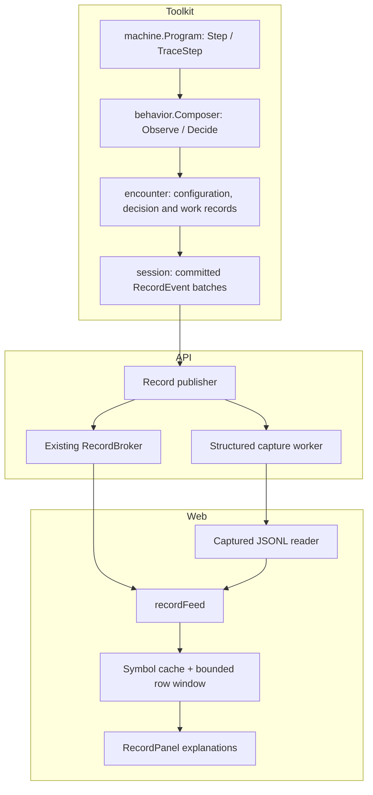

# Reading a machine's choices

[Machine inspection #898](https://github.com/KirkDiggler/rpg-project/issues/898) adds explanations to the existing record, governed by [R1–R8](design.md). It extends table symbols and row verdicts, not the rules interpreter or the scheduling model.

## Component shape

## Ownership and contracts

| Component | Owns | Input → output |
|---|---|---|
| `machine.Program` | Ordered transition/guard evaluation | `TraceStepInput` → `TraceStepOutput`: ordinary `Stepped` plus actual `StepTrace` |
| `behavior.Composer` | Ordered role selection and commit dispositions | `ObserveInput` / `DecideInput` with tracing → `InstanceOutcome` values beside existing steps/pick |
| `encounter` | Actor/act/clock identity, bound configuration and real work outcomes | Values → record-only configuration, behavior and work beats |
| `session` | Save-before-delivery and one record mapping | Existing `RecordEvent` batches, unchanged IDs and payloads |
| API publisher/capture worker | Server access, delivery and structured export | Committed events → browser broker and versioned JSONL records |
| `recordFeed` / captured reader | Ordered delivery, parsing and symbol retention | Record rows → immutable symbol lookup and bounded visible rows |
| `RecordPanel` | Inspection | Captured symbols/verdicts → human-readable alternatives and outcome |

The machine does not publish or log. The composer does not turn its losing preview into a committed transition. Encounter does not invent a completion from a selected movement intent. API does not parse guards or derive an NPC reason. The reader never evaluates a condition to fill a missing trace.

## Walk one choice through

An actor has ordered `investigate` and `patrol` attachments. A paid `time` opportunity reaches the composer. Each awake instance previews its own machine once. The trace records the actual guard reads in recipe order. `investigate` requests a table and wins precedence; `patrol` also requests a table but keeps its original blob. Only the winner's table is rolled, and its existing row verdicts explain weighted alternatives.

The encounter emits a configuration symbol record before the first outcome referencing its configuration ID. That record describes the exact materialized attachments, not a re-expansion of current YAML. The decision identifies the actor, beat, clock, configuration and role dispositions. The execution path separately records actual work progress/completion. Session saves before delivering the resulting record batch.

API captures that batch without relying on a browser subscriber. The Debug reader resolves the configuration ID and combines the recorded evaluation with its recipe symbols. A later unvisited transition can be displayed in context, but is labeled **not evaluated**. A losing machine's proposed state is labeled **not committed**. The reader's symbol cache survives eviction of old visible rows; a captured file carries the symbol records themselves (R6).

## Separations that look like one thing

| Query | Source of truth |
|---|---|
| What could this configured machine contain? | Immutable configuration symbols |
| What did this invocation actually inspect? | `GuardTrace`, not the whole authoritative world |
| Which role may choose? | Composer precedence/disposition |
| Which row won the weighted selection? | Existing picker verdicts and actual roll |
| Did selected work finish? | Encounter execution/completion path |
| Is a captured run complete? | Capture status, restart/gap markers and available symbols |

A false guard, an unknown fact, a sleeping instance, a short-circuited branch and a deferred request are different explanations. Conflating them creates false analytics as well as a misleading debugger.

## Trade-offs

| Decision | Benefit | Cost / boundary | Not taken |
|---|---|---|---|
| Shared evaluator, optional trace values | No diagnostic rerun; untraced callers keep their cheap path | Trace-enabled callers pay for detached explanation values | Separate debug interpreter |
| Symbols once, references in outcome records | Exact historical meaning without per-decision configuration copies | Reader retains a symbol dictionary for the run | Looking up today's source |
| Existing record transport | Same IDs and after-save boundary for UI/capture | New kinds must be explicitly record-only in session | Second event bus / debug RPC |
| Host worker writes structured records | No file/collector I/O in the verb's delivery call | Bounded queue, shutdown drain and explicit gaps | Blocking gameplay on analytics |
| Preserve record evidence before choosing analytics | Future queries can use the actual alternatives | Capture volume must be measured | Only selected aggregate counters |

## Edges

A record viewer is not simulation replay. Existing session runs retain their server record unbounded; this design does not change that storage policy or the orchestrator's resident-instance work. The browser's row limit is a different lifetime from symbols. If an input capture starts after its symbols or contains a gap, the reader says it is incomplete rather than fabricating history. A durable exactly-once audit store and TSDB choice remain outside R8.

## Where a change lands

A new guard form changes machine evaluation and its trace. A new behavior precedence policy belongs in the composer, not the log renderer. A new execution-completion kind belongs in encounter. A different log collector changes the host writer, not the machine. A new inspection layout consumes the same captured values in web.

## Source map

| Concern | Path |
|---|---|
| Machine result and evaluator | toolkit `mind/machine/{step.go,guard.go,trace.go}` |
| Composer previews and commit | toolkit `mind/behavior/{composer.go,trace.go}` |
| Bound configurations and work | toolkit `rulebooks/dnd5e/encounter/{behavior.go,behavior_work.go,behavior_trace.go}` |
| Record-only classification / delivery | toolkit `rulebooks/dnd5e/session/{act_family.go,record.go}` |
| Host capture / gate | API `internal/orchestrators/session/`, `internal/handlers/dnd5e/session/v1alpha2/`, `cmd/server/server.go` |
| Existing symbol presentation | web `src/components/session/combat-experience/recordSymbols.ts` |
| Stream and symbol lifetimes | web `src/components/session/{recordFeed.ts,useSessionRecordStream.ts}` |
