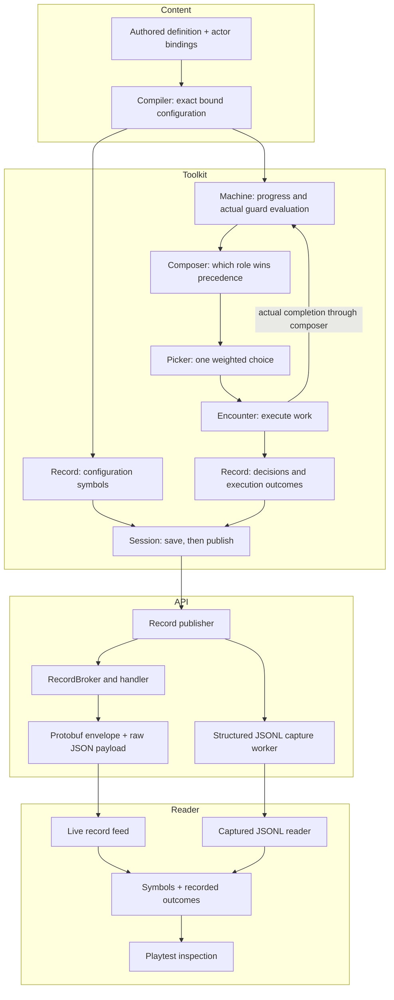

# Reading a machine's choices

[Machine inspection #898](https://github.com/KirkDiggler/rpg-project/issues/898) makes the game's decisions inspectable: load the exact configuration like debug symbols, then read what was considered, chosen and actually completed. It extends the existing table-symbol and record mechanisms, not the rules interpreter or scheduler. [The design](design.md) states R1–R9; **the story issue holds current delivery status**, while this page explains how the pieces fit.

There are three different products here: authored behavior makes the NPC act; inspection explains that act; Studio authoring lets a designer edit the configuration visually. Inspection does not require a new Studio editor, and a debugger never becomes another place where the game decides what to do.

## Component shape



## Ownership and contracts

| Component | Owns | Input → output |
|---|---|---|
| `machine.Program` | Ordered transition/guard evaluation | `TraceStepInput` → `TraceStepOutput`: ordinary `Stepped` plus actual `StepTrace` |
| Dungeon compiler | Resolve definitions and supplied bindings once | YAML definitions/attachments → original bound `BehaviorInput` |
| `behavior.Composer` | Ordered role selection and commit dispositions | `ObserveInput` / `DecideInput` with tracing → `InstanceOutcome` values beside existing steps/pick |
| `behavior.Pick` | Weighted choice inside the selected table | Eligible rows, weights and supplied die → actual pick and row verdicts |
| `encounter` | Actor/act/clock identity, bound configuration and real work outcomes | Values → record-only configuration, behavior and work beats |
| `session` | Save-before-delivery and one record mapping | Existing `RecordEvent` batches, unchanged IDs and payloads |
| API publisher/capture worker | Server access, delivery and structured export | Committed events → browser broker and versioned JSONL records |
| Record handler / protobuf contract | Transport envelope and exact payload bytes | SDK `RecordEvent.Fields` → proto `RecordEvent.fields_json`; ID, act, clock and beat remain typed fields |
| `recordFeed` / captured reader | Ordered delivery, parsing and symbol retention | Record rows → immutable symbol lookup and bounded visible rows |
| `RecordPanel` | Inspection | Captured symbols/verdicts → human-readable alternatives and outcome |

The machine does not publish or log. The composer does not turn its losing preview into a committed transition. Encounter does not invent a completion from a selected movement intent. API does not parse guards or derive an NPC reason. The reader never evaluates a condition to fill a missing trace.

## Walk one choice through

An actor has ordered `investigate` and `patrol` attachments. A paid `time` opportunity reaches the composer. Each awake instance previews its own machine once. The trace records the actual guard reads in recipe order. `investigate` requests a table and wins precedence; `patrol` also requests a table but keeps its original blob. Only the winner's table is rolled, and its existing row verdicts explain weighted alternatives.

The encounter emits a configuration symbol record before the first outcome referencing its configuration ID. That record describes the exact materialized attachments, not a re-expansion of current YAML. The decision identifies the actor, beat, clock, configuration and role dispositions. The execution path separately records actual work progress/completion. Session saves before delivering the resulting record batch.

API captures that batch without relying on a browser subscriber. The Debug reader resolves the configuration ID and combines the recorded evaluation with its recipe symbols. A later unvisited transition can be displayed in context, but is labeled **not evaluated**. A losing machine's proposed state is labeled **not committed**. The reader's symbol cache survives eviction of old visible rows; a captured file carries the symbol records themselves (R6).

### What changes when the fields travel as JSON

**The record payload is already JSON before it reaches the API.** The new field removes a lossy conversion; it does not move game rules into JSON or replace protobuf/Connect RPCs.

The two representations are:

```text
Approximate projection:
Toolkit JSON → API decodes numbers → protobuf Struct → browser numbers

Exact diagnostic path (R9):
Toolkit JSON bytes → protobuf fields_json bytes → lossless reader
                  ↘ API JSONL capture → the same lossless reader
```

Session identity comes from the RPC or capture context. The protobuf envelope still carries **record ID, act ID, beat name and game-clock position**. The payload describes that beat's details. The API carries those details; it does not understand or recalculate an NPC guard.

`google.protobuf.Struct` stores numbers as doubles. That is unsuitable for exact inspection of all valid integer values. `fields_json` preserves the original UTF-8 JSON bytes. The browser must also decode losslessly—ordinary `JSON.parse` followed by ordinary JavaScript numbers can lose precision again. The captured reader's integer-aware parsing serves that same responsibility.

The legacy `fields` projection remains on the additive protocol contract but is deprecated for exact inspection. Missing or malformed raw data is unavailable evidence, not permission to substitute an approximation. The format still has a schema version and validation; an untyped payload is not an invitation to guess its meaning.

This concerns **diagnostic records**, not the normal player's story. The ordinary story remains a separate, perception-filtered act projection. The playtest record view is server-gated; server-side capture is independent of whether a browser is subscribed.

## Separations that look like one thing

| Query | Source of truth |
|---|---|
| What could this configured machine contain? | Immutable configuration symbols |
| What private progress does this instance retain? | Its machine blob, not the configuration or the viewer |
| What is the transport envelope versus the payload? | Typed record identity/clock fields versus original JSON detail bytes |
| What did this invocation actually inspect? | `GuardTrace`, not the whole authoritative world |
| Which role may choose? | Composer precedence/disposition |
| Which row won the weighted selection? | Existing picker verdicts and actual roll |
| Did selected work finish? | Encounter execution/completion path |
| Is a captured run complete? | Capture status, restart/gap markers and available symbols |
| What may the player know? | Perception-filtered story, not private diagnostic records |

A false guard, an unknown fact, a sleeping instance, a short-circuited branch and a deferred request are different explanations. Conflating them creates false analytics as well as a misleading debugger.

## Trade-offs

| Decision | Benefit | Cost / boundary | Not taken |
|---|---|---|---|
| Shared evaluator, optional trace values | No diagnostic rerun; untraced callers keep their cheap path | Trace-enabled callers pay for detached explanation values | Separate debug interpreter |
| Symbols once, references in outcome records | Exact historical meaning without per-decision configuration copies | Reader retains a symbol dictionary for the run | Looking up today's source |
| Existing record transport | Same IDs and after-save boundary for UI/capture | New kinds must be explicitly record-only in session | Second event bus / debug RPC |
| Exact JSON bytes inside protobuf | Preserve the owner's values without a lossy number projection | Readers own payload validation and lossless decoding | Treating dynamic Struct doubles as exact data |
| Host worker writes structured records | No file/collector I/O in the verb's delivery call | Bounded queue, shutdown drain and explicit gaps | Blocking gameplay on analytics |
| Preserve record evidence before choosing analytics | Future queries can use the actual alternatives | Capture volume must be measured | Only selected aggregate counters |

## Edges

A record viewer is not simulation replay. It reads what happened; it does not run the machine again to discover what might have happened.

Existing session runs retain their server record unbounded. **Moving export I/O off the gameplay call does not make tracing free:** constructing diagnostics, copying batches and retaining more history still cost CPU and memory/storage. A resident instance avoids repeated hydration; it does not remove diagnostic record volume. That is the boundary with the separate optimization work, not a second cache built here. Measurements and their qualifications are linked from the story issue.

The browser's row limit is a different lifetime from symbols. If an input capture starts after its symbols or contains a gap, the reader says it is incomplete rather than fabricating history. A bounded exporter can fail; a clean drain means accepted batches were written, not that all earlier run history exists. A durable exactly-once audit store and TSDB choice remain outside R8.

Studio remains a source-preserving editor for these authored YAML definitions/bindings until a dedicated authoring surface is provided. Its future controls can edit the same inputs and use this inspector for verification; neither the editor nor the inspector becomes the rules engine.

## Where a change lands

A new guard form changes machine evaluation and its trace. A new behavior precedence policy belongs in the composer, not the log renderer. A new execution-completion kind belongs in encounter. A different log collector changes the host writer, not the machine. A new inspection layout consumes the same captured values in web.

## Source map

| Concern | Path |
|---|---|
| Machine result and evaluator | toolkit `mind/machine/{step.go,guard.go,trace.go}` |
| Composer previews and commit | toolkit `mind/behavior/{composer.go,trace.go}` |
| Bound configurations and work | toolkit `rulebooks/dnd5e/encounter/{behavior.go,behavior_work.go,behavior_trace.go}` |
| Record-only classification / delivery | toolkit `rulebooks/dnd5e/session/{act_family.go,record.go}` |
| Host capture / gate | API `internal/orchestrators/session/`, `internal/handlers/dnd5e/session/v1alpha2/`, `cmd/server/server.go` |
| Exact record wire | protos `dnd5e/api/session/v1alpha2/record.proto`, `RecordEvent.fields_json` |
| Existing symbol presentation | web `src/components/session/combat-experience/recordSymbols.ts` |
| Stream and symbol lifetimes | web `src/components/session/{recordFeed.ts,useSessionRecordStream.ts}` |
