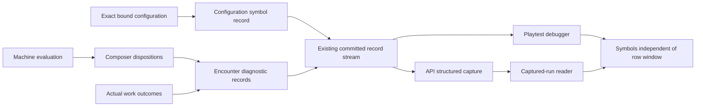

# Machine inspection

## Shape

## Law

- **R1 — Symbols identify the configuration that actually ran.** A configuration identity names immutable bound recipes, tables, completions and precedence, separate from private runtime progress. A reader never substitutes current source for captured symbols.
- **R2 — Trace evaluation, do not reconstruct it.** Machine diagnostics are returned values from the same evaluation that decides the result. Guard results include unknown separately from false; branches not evaluated remain explicitly not evaluated. Instrumentation performs no additional vocabulary reads, rolls, steps or state mutations.
- **R3 — Keep decisions separate.** Machine transition order, composer precedence and weighted table selection have their own explanations. A proposed transition in a deferred behavior is not a committed state change. No-candidate holds, sleeping instances and addressed observations remain distinct.
- **R4 — Selection is not execution.** Encounter diagnostics distinguish selected work from partial, paused and completed work. Only the existing execution/completion path determines those outcomes.
- **R5 — One evidence path.** Toolkit owns the meaning and configuration symbols; the existing record carries them. API transports and captures opaque records; readers render them without executing guards or game rules. Normal perception-filtered player acts do not acquire private diagnostic data.
- **R6 — Retain evidence honestly.** Symbol records travel with captured runs and are cached independently of the debugger's bounded row list. Missing symbols, retention restart and capture gaps are visible. Record identity and ordering remain unchanged; configuration records do not invent gameplay acts.
- **R7 — Host capture is independent of the browser.** Structured API capture can run without a debug subscriber; diagnostic client access is server-gated off outside the development/playtest mode. Slow or failing export is reported, not silently represented as a complete run or permitted to roll back committed gameplay.
- **R9 — Exact live payloads are raw JSON.** RecordEvent carries the owner's original JSON bytes; the Struct projection is approximate and deprecated for diagnostic readers. Exact readers preserve integer precision and refuse missing/malformed raw payloads rather than substituting the approximate projection.
- **R8 — Capture details, defer analytics.** Events carry stable identities and structured values rather than only prose. No time-series database, dashboard, simulation replay or new NPC policy is part of this capability. Export work does not add a database round trip to the gameplay critical section.

## Rulings

| ID | status | scope | ruled by | date |
|---|---|---|---|---|
| R1 | settled | Exact configuration as debug symbols | KirkDiggler | 2026-11-08 |
| R2 | settled | Actual evaluated alternatives, no diagnostic rerun | KirkDiggler | 2026-11-08 |
| R3 | settled | Machine/composer/picker distinctions | KirkDiggler | 2026-11-08 |
| R4 | settled | Selection versus execution | KirkDiggler | 2026-11-08 |
| R5 | settled | Debugger and API use the same evidence | KirkDiggler | 2026-11-08 |
| R6 | settled | Symbols survive live-window trimming and captured-run reading | KirkDiggler | 2026-11-08 |
| R7 | settled | Server-side capture and development-only diagnostic access | KirkDiggler | 2026-11-08 |
| R8 | settled | Details now; analytics later | KirkDiggler | 2026-11-08 |
| R9 | settled | Raw JSON bytes for exact live payloads; no Struct fallback | KirkDiggler | 2026-11-09 |

## Open

- No remaining design choice. Proto publication authority and generated-binding availability are delivery gates tracked on the design PR, not permission to merge the implementation wave.
- Transport and storage mechanics retain the existing after-save, best-effort record-delivery contract; implementation must make incomplete capture explicit.
- A durable exactly-once audit store and reconstruction of a simulated world are outside this design, not guarantees of a captured diagnostic record.
