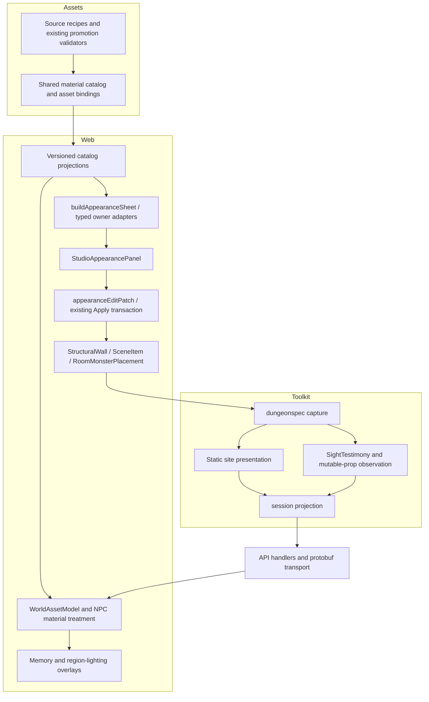

# Authored material-channel controls

This is the contract walkthrough for [Web #1402](https://github.com/KirkDiggler/rpg-dnd5e-web/issues/1402)
and its [design law](design.md). It adds a reusable adjustment value for the
normal and emissive maps an asset already supplies. It reuses the shared
Appearance panel, existing placement transactions and captured presentation;
it is neither a texture browser nor a lighting system (R1/R2).

## Component shape



There is one forward capability path and one authored-intent path. The editor
uses capabilities to validate new edits; the server carries typed intent without
learning how a texture is sampled. The renderer joins only the appearance it is
permitted to receive to its pinned provider (R2/R7).

## Ownership and contracts

The following type names describe the channel contract; the source map names its
owning implementation surfaces.

`MaterialChannelCapability` identifies an asset-bound target and its verified
selectors. For each channel it reports absent, fixed or adjustable. Adjustable
channels declare their effective-source facts and finite admissible multiplier
interval. Original embedded maps and selected masonry-pack maps are distinct
inputs to the same capability resolution, not interchangeable image layouts.
The shared catalog owns these facts; NPC appearance manifests continue to own
which body/standing/downed assets constitute a complete look. Capability bindings
name the exact representation and GLB hash, rather than pretending one body ref
always resolves to one file. An enrolled logical target has corresponding checked
selectors in every consumed representation; changing to a downed model does not
rename the target, lose its adjustment, or borrow the standing model's selectors.

The authored leaf value is deliberately small:

```ts
type ChannelAdjustment =
  | { mode: 'off' }
  | { mode: 'scale'; multiplier: number };

interface MaterialChannelAdjustment {
  targetId: string;
  normal?: ChannelAdjustment;
  emissive?: ChannelAdjustment;
}
```

Absence of a channel is default. There is no image URL, replacement resource ref,
shader name, parent-wall ID or provider-specific material object in this value.
Rows have unique nonblank target IDs and at least one adjustment. Off carries no
multiplier; scale carries a finite positive multiplier. Structural decoding
refuses invalid modes, duplicate targets and invalid numeric values. The editor
and renderer additionally check the effective capability's range (R3/R4/R9).

| Component | Owns | Input → output |
| --- | --- | --- |
| Assets import/promotion | Actual target identity, maps, defaults, mapping/basis and editable range | Source recipe plus exact GLB/material facts → verified `MaterialChannelCapability` in the existing catalog authority |
| Web versioned readers | Strict consumer-safe projections and resource identity | Pinned catalog → typed capabilities; no capability inferred from filenames |
| `buildAppearanceSheet` | Supported controls for the current selection and effective look | Existing owner, draft and capabilities → `AppearanceSheet` channel fields |
| `appearanceEditPatch` and owner adapters | Typed staged intent and compatibility checks | `AppearanceEdit` → `ArrangeDraft` patch → existing Apply/history transaction |
| Native owner codecs | Saved author intent | `StructuralWall.appearance`, `SceneItem` or `RoomMonsterPlacement` plus adjustment rows → native document and detached copies |
| Wall/section/frame projection | Applying a wall-body setting only where the existing finish relationship is declared | Wall adjustment plus binding facts → applicable visual targets; independent captured frame adjustments |
| `dungeonspec` | Native validation and canonical capture | Native rows → typed encounter presentation and member input; no texture interpretation |
| `encounter` | Static permitted presentation and observed mutable appearance | Captured rows → site data, `PropPresentation`, structural projection, `SightTestimony` and their persisted forms |
| `session` | Detached host-facing values and supported host boundaries | Canonical captured appearance → session presentation types |
| API / Protos | Presence-preserving wire mapping | Session values → snapshot and live-delivery protobufs; off/default/scale remain distinguishable |
| Shared material treatment | Applying adjustments to a detached effective material | Binding, complete look and adjustment → owned material clones before existing overlays |

Assets does not choose gameplay visibility. The panel does not save a parallel
appearance document. Owner adapters do not infer capabilities from model names.
Encounter does not load an asset catalog or convert a visual strength into a rule.
Session/API do not synthesize defaults for missing fields. The renderer does not
fetch native source documents or a hidden parent's settings (R2/R7).

### Which existing owner carries the value

A world placement carries its own adjustment rows beside its existing material
choices. A wall carries wall-body adjustments in its appearance, not in blocker
facts. A Studio NPC carries them beside its appearance choice, not in its rules
identity. These remain different containing records even though their leaf value
and controls are shared.

A wall-body adjustment is not permission to traverse every descendant material.
The existing masonry projection resolves applicable base-wall, compatible static
section and fixed-frame targets. Unsupported inserted bodies and moving leaves
remain unchanged. Independent section/leaf editors and a new per-side channel
mode are outside this cut (R5).

An opening-attached door receives the resolved fixed-frame adjustment in its
`DoorFramePresentation`. It cannot read the parent wall during Play. This is the
normal/emissive continuation of an existing fixed-frame material relationship,
not inner-door atlas-palette inheritance. Door identity, state and pose retain
their existing owners (R5/R7).

For an NPC, the authored rows enter `MemberInput`/`JoinInput`, persist with member
or reserve data, and are copied into `SightTestimony` when observed. Session's
member projection uses that observation, not a join against the live member.
The same rule applies to mutable props' captured presentations. Unknown testimony
has no adjustment payload (R7).

## Walk one thing through

Take a Castle Wall 01 using a published masonry finish with its paired normal
map. Its editable masonry target comes from provider declarations, not the wall's
display name. The author chooses normal strength `0.5` and leaves emission at
default.

1. `buildAppearanceSheet` resolves the current finish and checks that this target
   has an adjustable normal map and that `0.5` is within its declared interval.
   A color-only timber target does not gain the same control from sharing the panel.
2. The edit produces one `MaterialChannelAdjustment` for that target:
   `normal = {mode: 'scale', multiplier: 0.5}`. Emissive remains absent. Apply
   records one owner transaction; Cancel and Undo use the existing transaction path.
3. Native save preserves the target ID and explicit multiplier. `dungeonspec`
   captures that typed value without interpreting the image, changing wall height,
   or introducing a movement/sight fact.
4. The wall's permitted structural presentation carries a detached copy through
   session and the API. A compatible doorway frame carries its resolved copy
   independently, so permitting the door does not disclose the wall.
5. After the existing fitter and finish selection prepare the material, the shared
   adjustment stage multiplies both components of its effective `normalScale` by
   `0.5`. The fitted basis signs and the image/UV relationship remain intact.
6. Reload reconstructs the same captured value. Setting Off suppresses that
   normal contribution without discarding the color map. Reset removes only the
   normal adjustment and restores the effective finish's authored normal setting.

Emission follows the same leaf contract on an eligible nonzero-emission target:
`scale = 2` doubles its effective authored contribution while retaining its tint
and mask. It creates no point light or bloom halo. A material with an emission
image but an authored zero contribution is not made white or switched on by this
multiplier model (R4/R8).

## Separations that look like one thing

| Query | Source of truth |
| --- | --- |
| Does a GLB reference an image? | Actual source material data |
| Is this target safely editable? | Verified provider capability and current complete look |
| Is emission currently authored off? | Effective material's source default, not image presence |
| What did this placement's author change? | Owner's `MaterialChannelAdjustment` rows |
| What appearance did this observer see? | Captured testimony or permitted immutable presentation |
| What does the surface contribute to shading? | Resolved material treatment |
| Does it illuminate a room or make an entity visible? | Existing lighting/perception authority, never this adjustment |

**Default and Off are different even when they currently draw the same picture.**
Default follows the complete look; Off remains an explicit instruction. Likewise,
a multiplier of one remains an explicit multiplier rather than being silently
rewritten to default (R4).

A complete-look change can replace the effective map and its normal scale. The
adjustment scales that new baseline only if the target and channel still have a
valid declared meaning. Otherwise the author must explicitly reset or repair the
adjustment. Loading unavailable data preserves intent and diagnoses it; it does
not silently approve a default substitute (R5/R9).

## Trade-offs

| Decision | Benefit | Cost / boundary | Not taken |
| --- | --- | --- | --- |
| Existing authored maps with relative multipliers | Small reusable intent; retains source tint and normal basis | Author cannot substitute a different image or activate a zero baseline | Independent channel-map browser |
| Provider-declared editable targets | One technical authority across materials and owners | Provider must verify bindings/ranges and enroll each supported target | Runtime guesses from material names or image presence |
| Typed leaf value on existing owners | Shared controls without blurring custody | Codecs and recipient paths need explicit fields in each owning record | One global appearance store |
| Captured frame/member/prop values | Stable replay and independent disclosure | Compiler/projection must copy values at the existing capture boundaries | Live source/parent lookup during rendering |
| Adjustment after complete-look selection | Correct effective map and scaling basis | Renderer must preserve treatment order and clone lifecycle | Mutating cached GLTF materials |

The first-cut alternatives and the operator's selection remain in the linked
issue's case file. The table describes the continuing engineering costs, not a
second approval history.

## Edges

- Normal maps change shading, not geometric height, silhouette or physical relief.
- No new emission color picker, texture replacement, roughness/metalness controls,
  per-side channel mode, bloom or gameplay lighting is implied by this value (R1/R2).
- A channel that exists but has a zero reference contribution is fixed/default-only
  here. Making it editable requires a deliberate source/capability decision, not
  a consumer fallback (R3/R4).
- Existing remembered/visual-lighting overlays still run after appearance.
  Their presentation treatment is not an authored emission edit (R8).
- Studio NPC body appearances are the actor adapter; this does not enroll modular
  player customization, fitted equipment or an arbitrary skinned roster (R10).
- Exact target enrollment needs mapped-channel evidence. Counts of textures or
  models are not proof that a camera sees useful detail or emission (R10).
- Existing color-only atlas grouping remains color-equivalence metadata. It
  cannot be promoted into a claim that two complete shaded looks are identical.

## Where a change lands

Adding a supported asset or target changes its provider recipe and capability
verification. It does not add a new editor widget or material-name branch.

Adding another Studio owner requires an adapter, native field and that owner's
capture/disclosure path. It reuses the leaf adjustment; it does not attach a
world-placement record to a creature.

Independent map selection changes the resource/compatibility and intent contract,
not just the control label. Activating source-default zero emission likewise
requires explicit source semantics. Neither is hidden inside the multiplier (R1/R4).

## Source map

| Concern | Owning paths / symbols |
| --- | --- |
| Provider material contract | Assets `docs/pipelines/world-materials.md`; `scripts/world_material_catalog.py`; `scripts/build_world_material_catalog_v2.py` |
| World geometry/surface declarations | Assets `scripts/world_asset_surfaces.py`; `harness/catalogs/synty-world-assets.json` |
| Shared resources and bindings | Assets `harness/catalogs/synty-world-materials.json`; existing material publication/custody tools |
| Typed client projection | Web `src/rendering/worldMaterialTypes.ts`; `worldMaterialCatalog.ts`; `worldAtlasCatalogSchema.mjs`; generated catalogs |
| Shared editor | Web `src/concepts/encounter-studio/appearance/{appearanceTypes,appearanceSheet,appearanceEdits,StudioAppearancePanel}` |
| Native owner/transaction | Web `src/concepts/world-building/{types,structuralWalls,roomDraft,studioArrange,wallFinishProjection,doorFrameCapture}` |
| Material composition | Web `src/rendering/{worldSurfaceMaterials,worldAtlasMaterials,assetHeightInstance}`; `src/components/hex-grid/useRememberedModelTint.ts`; NPC model consumer |
| Static canonical capture | Toolkit `rulebooks/dnd5e/encounter/{dungeonspec,material_override.go,prop_presentation.go,structural_walls.go,door_frame_presentation.go}` |
| Observed appearance | Toolkit encounter `field.go`, `data.go`, `testimony.go`, `projection.go`; session `types.go`, `convert.go`, `structural.go` |
| Wire mapping | Protos `dnd5e/api/session/v1alpha1/types.proto`, `v1alpha2/act_geometry.proto`; API session handler converters |
