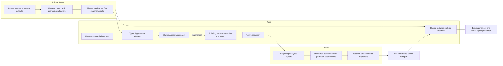

# Authored normal and emissive controls

## Shape

The [walkthrough](README.md) explains the contracts. Scope and decisions live on
[Web #1402](https://github.com/KirkDiggler/rpg-dnd5e-web/issues/1402), under
[Project #867](https://github.com/KirkDiggler/rpg-project/issues/867).

## Law

- **Authored maps first (R1).** Controls adjust verified existing normal and
  emissive maps; they do not select replacement images. Different per-side looks,
  arbitrary texture selection and additional shading channels are outside this cut.
- **Existing owners (R2).** Assets owns technical capability; typed Studio adapters
  edit existing placement owners; encounter owns permitted captured appearance.
  A shared panel introduces neither a second catalog nor a generic saved property bag.
- **Declared eligibility (R3).** Each editable target has a stable provider ID,
  exact asset/binding identity, verified material selectors, channel sampling and
  basis facts, authored defaults, and a finite positive multiplier interval
  containing one. Missing,
  fixed and editable channels are distinct. Every consumed representation of an
  enrolled look has verified selectors, including standing/downed NPC bodies;
  a logical target keeps its meaning across those representations. An image
  reference alone grants no control.
- **One adjustment value (R4).** A channel is default by absence, explicitly off,
  or explicitly scaled by a finite positive dimensionless multiplier. Default
  follows the effective complete look; Reset removes only the selected adjustment.
  Off is not absence, and an explicit multiplier of one is not rewritten to default.
- **Default fidelity (R4).** Scaling multiplies the effective look's existing
  normal-scale vector or emissive contribution, preserving its signs and tint.
  It does not supply a missing map, invent a white emission factor, or activate a
  source-default zero contribution. A zero-reference channel is not enrolled as
  adjustable in this cut.
- **Exact scope (R5).** Adjustments belong to named targets of the selected owner,
  not to all materials sharing an image. Wall-body controls follow the existing
  declared masonry projection into compatible sections and fixed frames; they
  do not affect trim, moving leaves or unsupported inserted assets. No new
  per-side channel-control mode or independent section/leaf editor is introduced.
- **Explicit change validation (R5).** Asset or complete-look changes retain
  adjustments only when the new effective target supports their exact meaning and
  range. Otherwise the edit refuses until the author explicitly resets or repairs
  the affected values; loading never silently drops them.
- **One transaction (R6).** Channel edits share Appearance's staged Apply/Cancel
  and existing history transaction. Invalid, stale or unsupported edits create no
  partial owner change or history entry. Cloning and duplication detach adjustment values.
- **Captured custody (R7).** Static wall/prop adjustments travel with their existing
  captured owner. Fixed-frame adjustments are captured with the independent door
  presentation, without a parent-wall identity or runtime lookup. Member and mutable
  prop observations capture adjustments with the observed appearance; memories and
  reloads never acquire newer live values. Unknown testimony carries no appearance facts.
- **Typed transport (R7).** Native, canonical, persisted and wire representations
  preserve target identity, mode and multiplier presence. Backend validation checks
  shape and numeric validity without resolving vendor resources. Session and API
  transport detached values; they do not choose visual defaults or import asset catalogs.
- **One material writer (R8).** Adjustment resolution uses the effective material
  after fitting and complete-look selection, before memory and visual-lighting
  treatment. It uses placement-owned material clones, never mutates cached maps or
  source materials, and restores/disposes only its owned resources. It validates
  the whole requested treatment before mutation; failure leaves no partial adjustment.
- **Normal and emissive roles (R8).** Normals retain their linear sampling, UV
  alignment and fitted tangent/derivative basis. Emissive images retain their
  declared color sampling, tint and intensity relationship. Adjustment does not
  change geometry, height, texture coordinates or unselected channels.
- **No lighting authority (R2).** Emission changes surface appearance, not scene
  lights, bloom, sight, concealment, collision, door state or rules identity.
  Memory/visibility treatments retain their independent presentation authority.
- **Unsupported intent is visible (R9).** Structurally valid saved values survive
  unavailable resources. The editor explains the unavailable target and permits
  explicit reset; the renderer diagnoses and refuses an unsupported treatment
  rather than certifying a substituted default as the requested appearance.
- **Versioned extension (R9).** Provider capability extensions and typed capture
  fields use explicit compatible versions and normal release pins. Existing
  documents with no adjustments retain their prior appearance. Old consumers are
  not advertised as supporting adjustments they cannot preserve.
- **Bounded enrollment (R10).** The delivery names verified wall and asset targets
  and demonstrates their edits in Studio and native/captured Play. It does not
  certify every imported model. Studio world placements and NPC body appearances
  share the primitive; player customization/equipment editors and source-default
  zero emission are not silently added to the enrollment.

## Rulings

| ID | status | scope | ruled by | date |
| --- | --- | --- | --- | --- |
| R1 | settled | Authored-map controls with default/off/strength before replacement maps and different looks | KirkDiggler | 2026-11-26 |
| R2 | settled | Existing manifest/owner boundaries, native capture, no mechanics or illumination authority | KirkDiggler; Studio appearance R1/R2/R6–R8 retained | 2026-11-10 |
| R3 | open | Exact provider targets, channel capability and multiplier ranges | — | — |
| R4 | open | Default/off/positive multiplier semantics; zero-reference exclusion | — | — |
| R5 | open | Wall projection, target identity and incompatible-look refusal | — | — |
| R6 | open | Channel edits through existing atomic appearance transactions | — | — |
| R7 | open | Typed per-owner persistence, independent frames and observer snapshots | — | — |
| R8 | open | Effective-look scaling and material lifecycle/basis behavior | — | — |
| R9 | open | Unsupported intent and versioned consumer rollout | — | — |
| R10 | open | Named proof set and Studio world/NPC enrollment boundaries | — | — |

## Open

- **Design agreement.** R3–R10 are the proposed contracts elaborating the selected
  scope, not additional operator rulings. The linked design PR carries their
  agreement checklist and any specific unresolved decision.
- **Enrollment proof.** Candidate targets need source/binding verification and
  visible mapped-channel evidence before publication. Source-proven multiplier
  intervals and the exact enrolled set belong to provider declarations and the
  delivery case file, not guessed universal limits.
