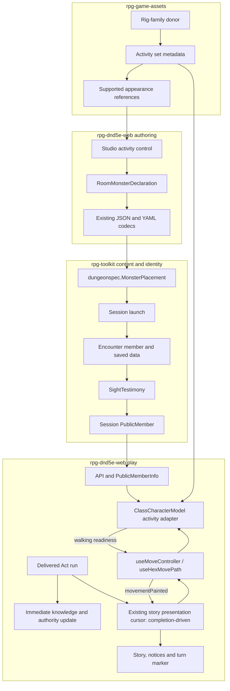

# NPC activities: from authored choice to visible movement

This is the walkthrough for [story #711](https://github.com/KirkDiggler/rpg-project/issues/711)
and its [design](design.md). It connects reusable animation sets to the existing
studio, observer-facing identity and presentation machinery. It does not add a
second rules engine, a server-side animation scheduler, or a new NPC definition
store. **The existing presentation cursor owns completion order** (R9): body
playback reports readiness/completion rather than advancing the visible story
on a competing clock.

## Component shape

## Ownership and contracts

| Component | Owns | Input → output |
|---|---|---|
| Private asset provider | Editable donors, clip names, pose compatibility, supported looks | Authored clips → versioned activity metadata and game assets |
| Studio placement | The author's chosen default, independent of stat block/body | Selected activity ref → optional placement field; JSON/YAML/undo preserve it |
| `dungeonspec` | Structural source validation and compiled content | Placement ref → `MonsterPlacement` opaque presentation value |
| Encounter persistence/sight | Authored identity and what an observer captured | Join/load → member data; sight refresh → `SightTestimony` |
| Session roster | Observer-safe public identity | Captured testimony → `PublicMember` |
| API/proto | Transport transcription | `PublicMember` → additive `PublicMemberInfo` field |
| Activity sequencer | Current activity, Enter/Sustain/Exit, latest requested destination | Default + requested activity + clip completion → playback commands/readiness |
| Move controller/hook | The visible route and its progress | Accepted route + walking readiness → rendered positions + `movementPainted` |
| Presentation cursor (R9) | Coordination of visible act order | Delivered acts + presentation completion → releases to movement/story/turn marker |

The provider does not assign monster behavior, statistics or faction. Studio
does not write clip filenames into gameplay content. Toolkit carries the
presentation reference unread; it does not load GLBs or consult the private
catalog. API does not interpret “thoughtful”. These are the same separations as
[authored appearance](../npc-appearance-ref/design.md), especially R3–R5 there.

The renderer does not fetch live authored content to fill an observer's missing
identity. The movement hook remains the sole writer of its group's position;
activity readiness gates that writer rather than creating a competing position
animation. The presentation cursor does not delay authoritative reducers or
make rules outcomes depend on animation completion (R5, R7, R8).

## Walk the thoughtful prisoner through

1. The author selects a supported prisoner appearance and chooses **Thoughtful**.
   The placement keeps its actor ID and monster/template ref. The new value is
   an opaque default-activity reference, not an animation filename (R1–R2).
2. The existing document codecs preserve that choice through local reload and
   exported encounter source. Compilation validates reference syntax; launch and
   encounter persistence retain it. Save/load must not drop it.
3. Sight captures it beside appearance identity. `PublicMember` and the API's
   `PublicMemberInfo` transport that captured choice. A remembered observation
   is not rewritten from a newer live member or source document (R7).
4. The presentation adapter resolves Thoughtful through the selected appearance's
   supported activity metadata. An NPC first displayed while standing may start
   directly in Sustain; it need not perform an entrance every time it is loaded.
5. A visible walk is requested. The activity sequencer reaches its allowed
   boundary and plays Exit. The route remains pending and the body stays put.
   Walking readiness releases the existing route interpolation (R3–R4).
6. Route completion requests the configured default again. The model plays its
   entrance and sustains Thoughtful. Route completion releases the presentation
   cursor to the next visible story/turn item (R9). The model adapter does not
   advance that cursor by guessing a duration.

## Separations that look like one thing

| Question | Source of truth |
|---|---|
| What is the NPC's authored default activity? | Placement content, captured through observer identity |
| What phase is being shown on this client now? | Local activity sequencer |
| Where is the creature according to authoritative knowledge? | Existing session/knowledge reducers |
| Where is the animated body along a visible walk? | Existing movement presentation |
| When does the next visible story/turn item advance? | Completion-driven presentation cursor (R9) |
| Which animations work with this body? | Provider metadata and verified rig compatibility |

Conflating these makes animation timing into game timing, or makes a current
server location force a body to slide while it is still exiting a stance.
**A configured default is not a server animation state machine.**

## Trade-offs

| Choice | Benefit | Cost / boundary | Alternative |
|---|---|---|---|
| Activity sets with shared entry/exit poses | Another stance adds content rather than pairwise transitions | Provider verifies endpoint/contact compatibility | Dedicated transition for every pair |
| Finish ordinary exits before travel | Readable stance changes | Presentation pays visible waiting time; speed controls tune it | Snap or interrupt ordinary transitions |
| Reuse the observer-safe identity path | Preserves the visibility contract | Content/persistence/projection/wire additions must travel together | Read the live studio document in play |
| Completion-driven presentation coordination (R9) | Body, story and turn marker agree on visible order | Web presentation seam and lifecycle changes | Keep timer-paced story independent of delayed bodies |

The caller waits for a visible completion, not a guessed clip duration. The
renderer pays the lifecycle cost: it must also report cancellation/unavailability
when there is no longer a live body to present.

## Edges

Unsupported explicit activity references require a named diagnostic; they are
not permission to choose the first clip containing “idle”. Absence and
unsupported are different answers (R2).

Catch-up, remembered and non-visible actors must not replay stale motion. A
missing/unmounted presentation cannot hold the visible cursor forever. The
completion policy for those lifecycle cases belongs to the integration contract
for R9, not to game rules or a magic timeout in a model component.

Existing downed/static behavior stays intact; new combat and conversation
animation policy is outside the first slice (R8). Walk-start/stop blending is an
explicit provider limitation until authored transitions are added. New source
sets still need loop/contact inspection even when the rig map is reusable.

## Where a change lands

- A new casual stance: provider authoring/metadata and visual evidence; no new
  game rule or per-model sequencer branch.
- A new compatible body: provider compatibility check and asset publication;
  the activity selector reads supported choices.
- A different Enter/Exit pace: presentation configuration, not persisted NPC
  behavior or server turn speed.
- A new interruption policy or whole-act visual sequencing rule: revisit the
  presentation boundary, rather than overriding it inside a GLB component.

## Source map

| Concern | Existing owning source |
|---|---|
| Activity authoring and reusable donor | `rpg-game-assets/library/animation-donors/npc-activities-v1/` |
| Playable proof / pure phase controller | `rpg-game-assets/tools/npc-motion-lab/` |
| Placement data and mutation | `rpg-dnd5e-web/src/concepts/world-building/roomDraft.ts`, `studioArrange.ts` |
| Studio placement controls | `rpg-dnd5e-web/src/concepts/encounter-studio/StudioArrangeFields.tsx` |
| Source compilation | `rpg-toolkit/rulebooks/dnd5e/encounter/dungeonspec/` |
| Identity persistence and capture | `rpg-toolkit/rulebooks/dnd5e/encounter/{field,data,testimony,encounter}.go` |
| Launch and observed public member | `rpg-toolkit/rulebooks/dnd5e/session/{launch,read,types}.go` |
| Identity wire | `rpg-api-protos/dnd5e/api/session/v1alpha1/types.proto` |
| Identity adapter | `rpg-api/internal/handlers/dnd5e/session/v1alpha1/get_roster.go` |
| Delivered-act/movement wiring | `rpg-dnd5e-web/src/components/session/SessionEncounterView.tsx` |
| Story cursor | `rpg-dnd5e-web/src/components/session/combat-experience/useCombatStoryPacing.ts` |
| Visible movement | `rpg-dnd5e-web/src/components/session/{moveController,useMoveController}.ts`, `src/components/hex-grid/useHexMovePath.ts` |
| Body playback | `rpg-dnd5e-web/src/components/hex-grid/ClassCharacterModel.tsx` |
