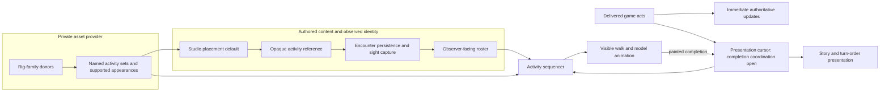

# NPC activity presentation

## Shape

## Law

- **R1 — Content owns presentation vocabulary.** An activity set names Enter,
  Sustain and Exit clips and their entry/exit pose compatibility. The asset
  provider declares which appearances support it; gameplay rules do not select
  animation filenames.
- **R2 — An NPC placement chooses its default activity independently of its
  body and rules identity.** No authored choice means the provider's declared
  default; unsupported explicit choices are reported rather than silently
  substituted.
- **R3 — Ordinary transitions preserve their sequence.** Enter finishes,
  Sustain leaves at its configured boundary, Exit finishes, then the requested
  destination begins. A newer destination replaces a pending one rather than
  appending another gameplay command.
- **R4 — Visible travel waits for walking readiness.** A character does not
  translate across the board while leaving a stationary activity. Passing
  through the relaxed reference pose does not require an extra relaxed loop.
- **R5 — Pacing changes speed, not order.** Overall presentation speed scales
  animation and travel together; Enter/Exit tuning is separate. Animation
  completion does not delay rules execution or reinterpret game outcomes.
- **R6 — Reference authoring and body reuse are separate.** Retargeting occurs
  per rig family; compatible bodies reuse baked Actions and slots after names,
  parents and rest-transform checks. Contact and loop quality remain visual
  release requirements.
- **R7 — Observer identity remains observer-owned.** A default activity travels
  as opaque presentation content through the same persistence and observation
  boundary as appearance. The renderer does not enrich remembered or unseen
  subjects from live source content. Remembered bodies do not resume animation.
- **R8 — Presentation is not a second rules engine.** The first game slice adds
  default casual activities and walk transitions for supported NPC appearances.
  Sword combat, conversation gestures and new hit/death interruption policy are
  outside that slice; existing downed/unseen/catch-up behavior remains intact.

## Rulings

| ID | status | scope | ruled by | date |
|---|---|---|---|---|
| R1 | settled | Activity-set vocabulary and provider ownership | KirkDiggler | 2026-10-28 |
| R2 | settled | Authored NPC default, independent of body/rules | KirkDiggler | 2026-10-29 |
| R3 | settled | Complete exits and retain the latest destination | KirkDiggler | 2026-10-28 |
| R4 | settled | Exit before visible walking | KirkDiggler | 2026-10-28 |
| R5 | settled | Clean sequence with adjustable presentation pace | KirkDiggler | 2026-10-28 |
| R6 | settled | Family donor and compatible-body reuse | KirkDiggler | 2026-10-28 |
| R7 | settled | Preserve [appearance R4–R5](../npc-appearance-ref/design.md): observer-safe identity delivery | Existing appearance contract | 2026-10-11 |
| R8 | settled | First integrated slice; deferred combat/conversation policy | KirkDiggler | 2026-10-29 |
| O1 | open | Completion-driven coordination of body, story and turn-order presentation | — | — |

## Open

- **O1 — Who advances the visible act sequence?** Coordinate the existing
  presentation cursor with actual movement completion, or keep activity
  transitions local to the body while story/turn-order timing remains
  independent. This changes ownership beyond clip selection; decide it before
  integrating movement delays. The alternatives and recommendation are on
  [the story issue](https://github.com/KirkDiggler/rpg-project/issues/711).
